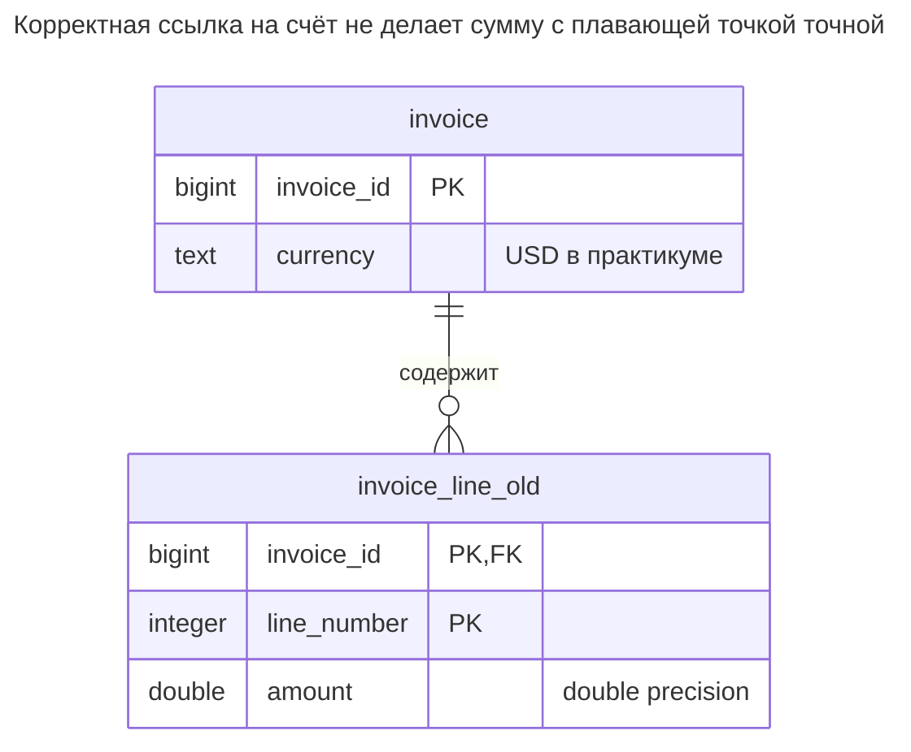
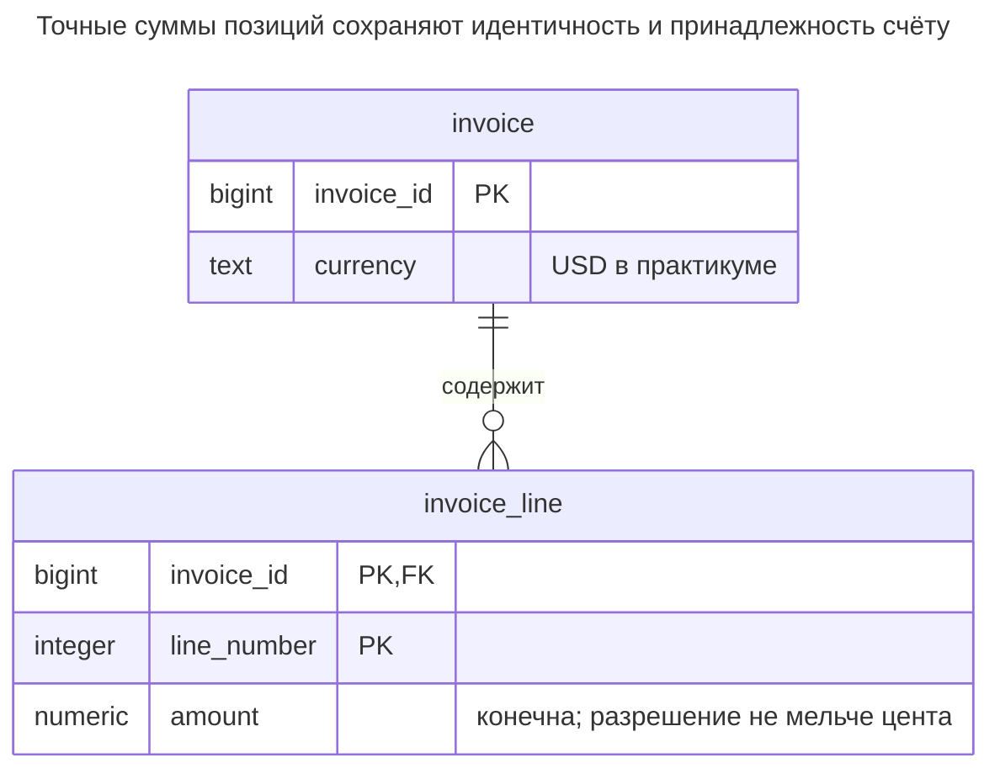
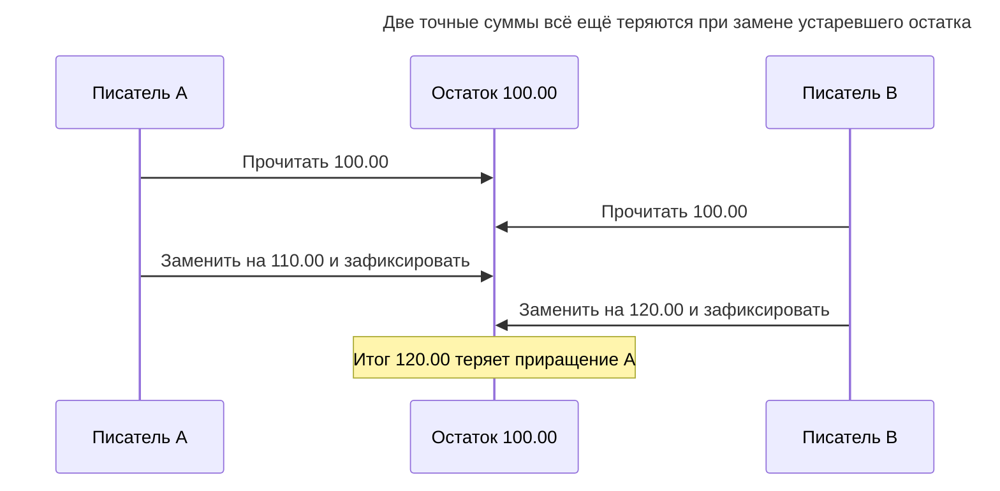
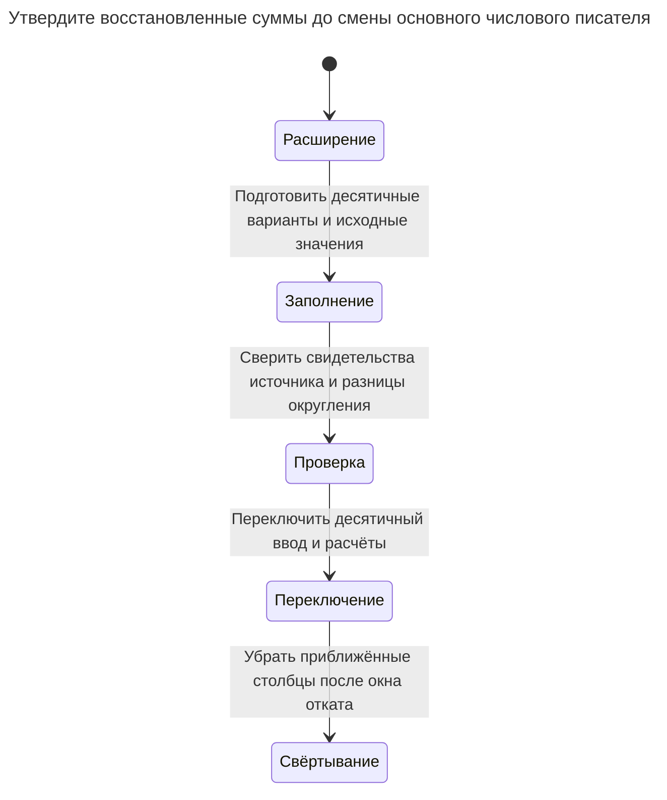

# Неточная арифметика

Неточная арифметика хранит деньги и другие точные величины в столбцах с плавающей точкой, чьё двоичное представление не вмещает большинство десятичных дробей точно. Суммы расходятся на доли цента, проверки равенства не проходят, отчёты не сходятся с банком. Глава показывает ошибки, исправление типами `numeric`/`decimal` и целыми младшими единицами, а также места явного определения округления. Билл Карвин называет это Rounding Errors.

## Также известен как

Rounding Errors в [оглавлении SQL Antipatterns Билла Карвина](https://pragprog.com/titles/bksap1/sql-antipatterns-volume-1/). Точное хранение и политика округления — разные решения; исправление типа само не определяет момент округления и получателя остаточного цента.

## Контекст

Вы храните суммы позиций счёта, складываете их, сравниваете результат с суммой к оплате и сверяете с внешней выпиской. Контракт требует точности в согласованной десятичной единице. Вы выбираете плавающую точку, поскольку она принимает дробный ввод, а обычные примеры печатают знакомые десятичные значения.

## Проблема

Вы используете приближённое представление там, где приложению нужно точное десятичное равенство. PostgreSQL описывает [`real` и `double precision` как неточные типы](https://www.postgresql.org/docs/18/datatype-numeric.html#DATATYPE-FLOAT). Короткое печатное представление выглядит верно, пока арифметика не обнаружит приближение. Практикум показывает сбой на двух положительных суммах и одном сложении.

Плавающая точка оправдана для измерений и численных моделей с явно допустимой погрешностью. Для договорного числа центов это плохой исходный выбор. И наоборот, точные десятичные числа не делают любое деление конечным и не выбирают учётную политику: один цент, разделённый между тремя получателями, всё ещё требует правила остатка.

## Почему так делают

Тип знаком по языкам программирования, арифметика удобна, а интерфейс округляет всё до двух знаков. Округлённое отображение скрывает расхождение, не меняя сохранённое значение проверки равенства. «Использовать допуск» подходит измерениям, но допуск не должен молча отменять правило денежной сверки.

## Последствия

- ➖ Одинаково выглядящие суммы не проходят точное сравнение.
- ➖ Агрегация и повторные преобразования обнаруживают различия представления на границе сверки.
- ➖ Приведение старых приближённых значений не восстанавливает несохранённый десятичный замысел.
- ➖ Округление каждой позиции и округление итоговой суммы дают разные правдоподобные результаты.
- ➖ Целые младшие единицы без единицы измерения и разрешения неоднозначны.

## Признаки

- Денежный отчёт полагается на равенство float после форматирования до двух знаков.
- Сверка считает каждое небольшое расхождение шумом без бизнес-правила.
- Приложение разбирает точный ввод через двоичный float до записи в `numeric`.
- Миграция типа обещает восстановить исходные суммы приведением существующих float.

## Как лучше

Используйте `numeric`/`decimal` для точных десятичных сумм либо целые младшие единицы при фиксированном разрешении и достаточном диапазоне. Храните валюту или единицу вместе с суммой. [Money Фаулера](https://martinfowler.com/eaaCatalog/money.html) обсуждает различия валют и округление; [Величина](quantity.md) даёт более общую модель суммы и единицы.

Пример намеренно поддерживает лишь USD с границей хранения в два десятичных знака. Это локальный контракт, а не утверждение, что все валюты и промежуточные расчёты имеют два знака. Ставкам и промежуточным распределениям до явного финального округления нужна большая точность.

### Альтернативы и выбор

| Выбор | Связь | Когда выбирать |
| --- | --- | --- |
| Точный десятичный столбец | Замена | Десятичный ввод и расчёты сохраняют согласованную точность с явным округлением |
| Целые младшие единицы | Вариант реализации | Разрешение фиксировано, единицы явны, пределы диапазона и переполнения приемлемы |
| [Величина](quantity.md) | Дополнение | Интерпретация суммы и совместимость единиц должны передаваться со значением |
| [Двойная запись](double-entry-ledger.md) | Дополнение | Переводы должны сохранять точные суммы между проводками |
| Плавающая точка | Вариант приближённых величин | Пределы измерительной или численной погрешности входят в контракт |

См. [Атлас решений](decision-atlas.md). Регистр может сбалансировать приближённые представления, расходясь с задуманными десятичными суммами; сохранение и представление решают разные задачи.

## Пример

### Структура

**Было:** суммы позиций приближённые, хотя валютный контракт точен.



Ограничения идентичности и ссылок корректны. Меняется лишь представление суммы.

```sql
CREATE TABLE invoice (
    invoice_id bigint PRIMARY KEY,
    currency text NOT NULL CHECK (currency = 'USD')
);
CREATE TABLE invoice_line_old (
    invoice_id bigint NOT NULL REFERENCES invoice (invoice_id),
    line_number integer NOT NULL,
    amount double precision NOT NULL,
    PRIMARY KEY (invoice_id, line_number)
);
INSERT INTO invoice VALUES (1, 'USD');
INSERT INTO invoice_line_old VALUES (1, 1, 0.1), (1, 2, 0.2);
SELECT sum(amount) AS total, sum(amount) = 0.3::double precision AS equals_expected
FROM invoice_line_old WHERE invoice_id = 1;
```

В PostgreSQL 18.6 сумма равна `0.30000000000000004`, а сравнение — `false`. Этот результат демонстрирует проблему без предположения, что любая сумма с плавающей точкой расходится или любое расхождение достигает цента.

**Стало:** проверяем согласованное разрешение без скрытого округления ввода.



Столбец numeric без ограничения масштаба позволяет проверке увидеть исходную десятичную дробь. Проверка конечности также исключает специальные значения.

```sql
CREATE TABLE invoice_line (
    invoice_id bigint NOT NULL REFERENCES invoice (invoice_id),
    line_number integer NOT NULL,
    amount numeric NOT NULL,
    PRIMARY KEY (invoice_id, line_number),
    CONSTRAINT invoice_line_finite CHECK (
        amount > '-Infinity'::numeric AND amount < 'Infinity'::numeric
    ),
    CONSTRAINT invoice_line_scale CHECK (amount = round(amount, 2))
);
CREATE TABLE line_conversion (
    invoice_id bigint NOT NULL,
    line_number integer NOT NULL,
    old_amount double precision NOT NULL,
    proposed_amount numeric NOT NULL,
    approved boolean NOT NULL DEFAULT false,
    PRIMARY KEY (invoice_id, line_number)
);
BEGIN;
LOCK TABLE invoice_line_old IN SHARE ROW EXCLUSIVE MODE;
INSERT INTO line_conversion (invoice_id, line_number, old_amount, proposed_amount)
SELECT invoice_id, line_number, amount, round(amount::numeric, 2) FROM invoice_line_old;
-- These two approvals stand for a review against the original decimal amounts in this lab.
UPDATE line_conversion SET approved = true
WHERE invoice_id = 1 AND ((line_number = 1 AND proposed_amount = 0.10)
    OR (line_number = 2 AND proposed_amount = 0.20));
INSERT INTO invoice_line
SELECT invoice_id, line_number, proposed_amount FROM line_conversion WHERE approved;
COMMIT;
SELECT sum(amount) AS total, sum(amount) = 0.30 AS equals_expected
FROM invoice_line WHERE invoice_id = 1;
```

Сумма равна `0.30`, равенство — `true`. Таблица преобразования сохраняет старые приближения и предлагаемые десятичные значения; публикуются лишь проверенные строки. Производственная проверка должна использовать сохранённые исходные суммы, выписки или иной достоверный документ. Предложенное округлённое приведение — возможная интерпретация, не восстановленное свидетельство.

```sql
INSERT INTO invoice_line VALUES (1, 3, 1.005);
```

PostgreSQL 18.6 возвращает SQLSTATE `23514`: `ERROR: new row for relation "invoice_line" violates check constraint "invoice_line_scale"`. Пример отклоняет излишнюю точность вместо скрытого округления.

```sql
INSERT INTO invoice_line VALUES (1, 3, 'NaN');
```

Это даёт SQLSTATE `23514`: `ERROR: new row for relation "invoice_line" violates check constraint "invoice_line_finite"`. [Полный скрипт](../assets/inexact-arithmetic/inexact-arithmetic.sql) проверяет обе ошибки и следующие результаты округления.

```sql
SELECT 1.005::numeric(10, 2) AS amount;
SELECT round(0.005::numeric, 2) + round(0.005::numeric, 2) AS round_each,
       round(0.005::numeric + 0.005::numeric, 2) AS round_total;
SELECT 10 / 3 AS whole_cents, 10 % 3 AS remaining_cents;
```

Преобразование с фиксированным масштабом даёт `1.01`. `round_each` равен `0.02`, а `round_total` — `0.01`. [Правила масштаба и округления numeric PostgreSQL](https://www.postgresql.org/docs/18/datatype-numeric.html#DATATYPE-NUMERIC-DECIMAL) округляют ввод до объявленного масштаба до сохранения, а точные середины numeric — от нуля. Если контракт требует другого правила середины, задайте другой явный расчёт. Проверка `numeric(10,2)` не может отклонить исходную дробь после того, как приведение уже её убрало.

Целочисленный расчёт даёт `3` целых цента и `1` оставшийся. Определите детерминированного получателя остатка, сохраните распределение и проверьте, что части складываются в исходные `10`. Точное хранение не выбирает эту политику.

### Поддержка в движках

- **PostgreSQL 18:** `decimal` и `numeric` [эквивалентны](https://www.postgresql.org/docs/18/datatype-numeric.html). Неограниченный numeric с проверкой масштаба отклоняет ввод; объявленный масштаб автоматически приводит его.
- **MySQL 8.4:** [точная арифметика](https://dev.mysql.com/doc/refman/8.4/en/precision-math.html) различает точные десятичные расчёты и приближённые расчёты с плавающей точкой. Переносите типы выражений, не только целевые столбцы.
- **SQL Server:** [максимальная точность `decimal`/`numeric` — 38](https://learn.microsoft.com/en-us/sql/t-sql/data-types/decimal-and-numeric-transact-sql?view=sql-server-ver17). Укажите поддерживаемые точность и масштаб, затем проверьте округление и переполнение промежуточных выражений.
- **Oracle:** [`NUMBER` и `BINARY_FLOAT`/`BINARY_DOUBLE`](https://docs.oracle.com/en/database/oracle/oracle-database/26/sqlrf/Data-Types.html) имеют разные десятичное и двоичное представления. Не считайте похожее название плавающего типа точным аналогом типа PostgreSQL.
- **SQLite:** [плавающие значения приближённы](https://www.sqlite.org/floatingpoint.html), а [сродство NUMERIC](https://www.sqlite.org/datatype3.html#type_affinity) не даёт точного десятичного хранения PostgreSQL. Используйте целые младшие единицы или намеренно интегрированную десятичную реализацию.

### Сбои и конкурентность

Точная арифметика не предотвращает потерянные обновления. Замена остатка вычисленным на клиенте числом затирает чужую правку даже с точными операндами. Для простых счётчиков используйте атомарное обновление, для переводов — явный протокол проводок и блокировок; см. [Двойная запись](double-entry-ledger.md).



Диаграмма показывает безусловную замену, а не скрипт хранения позиций. PostgreSQL [сериализует обновления строки](https://www.postgresql.org/docs/18/explicit-locking.html#LOCKING-ROWS), но устаревшая константа остаётся устаревшей после ожидания. Защищайте бизнес-операцию и идентичность повтора вместе с числовым типом.

### Миграция

Сначала определите единицы, допустимую точность, этап округления и правило середины. До преобразования проверьте неконечные и выходящие за диапазон суммы. Сохраните исходные представления, предлагаемые замены и решения одобрения. Сверяйте итоги по счёту и валюте, включая разницы; совпадение общей суммы скрывает взаимно погашающиеся ошибки.



Практикум использует короткую паузу записи источника. При заполнении работающей системы синхронизируйте старые и новые записи под одной блокировкой владельца до смены первичности; см. [Расширение и свёртывание](expand-contract.md). Не пропускайте десятичный ввод через двоичные float клиента и драйвера; связывайте точное десятичное представление. Не оставляйте float незаметно основным источником после смены столбца: это вернёт приближение на границе записи.

## Связанные паттерны и антипаттерны

- [Величина](quantity.md) делает совместимость единиц явной.
- [Двойная запись](double-entry-ledger.md) сохраняет суммы атомарными сбалансированными проводками.
- [Нетипизированные свойства](untyped-properties.md) теряют ещё одну часть числового контракта, сохраняя суммы неограниченным текстом.
- [Расширение и свёртывание](expand-contract.md) разбивает смену представления и клиентов на этапы.
