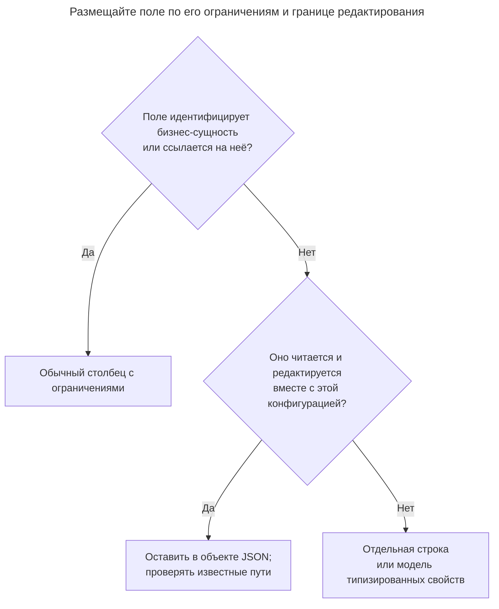
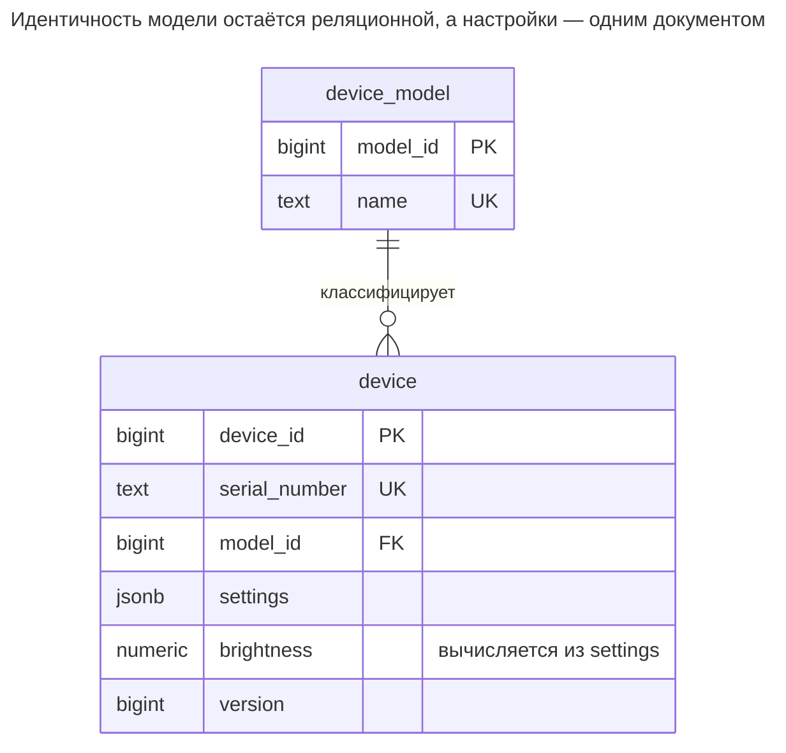
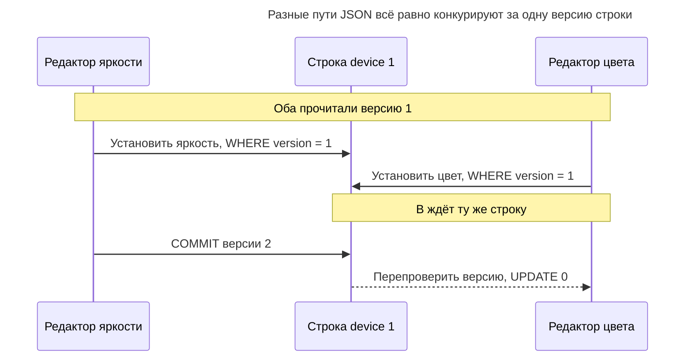
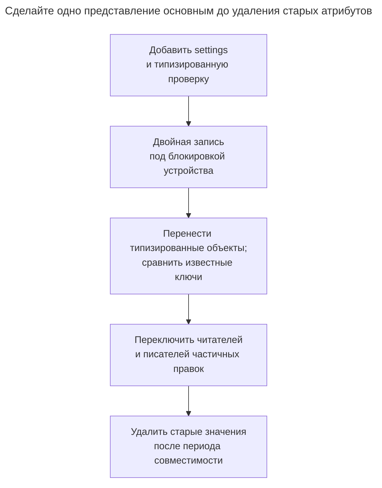

# Столбец JSON

## Назначение

Столбец JSON хранит полуструктурированные атрибуты — настройки устройств, отличающиеся по категории характеристики товаров, данные внешних систем — одним значением JSONB рядом с обычными столбцами. Вы получаете гибкую форму без миграций и сохраняете запросы через операторы, индексы GIN и вычисляемые столбцы, извлекающие часто используемые поля в обычные типизированные столбцы. Глава показывает границу между JSON и столбцами, возврат части гарантий через `CHECK` и проверку схемы, а также потери во внешних ключах, статистике и безопасности типов.

## Также известен как

Документный столбец; гибридная реляционная/документная модель. [Serialized LOB Фаулера](https://martinfowler.com/eaaCatalog/serializedLOB.html) — более общее отображение графа объектов в один столбец; допускающий запросы JSON — один вариант реализации, а не весь смысл паттерна.

## Проблема

Вы управляете устройствами с фиксированными серийными номерами и моделями, но разными настройками. У лампы есть яркость и цвет; у другой модели — другой набор настроек. Обычно настройки читаются одной конфигурацией, а добавление необязательного ключа не должно требовать столбца в каждой строке устройства.

Текстовый блок не даёт тех же структурированных запросов и проверок, что тип JSON. На другом полюсе универсальная таблица строковых свойств превращает простое чтение конфигурации в задачу восстановления. Вы хотите сохранить настройки одним документом, не вынося идентичность устройства и связи модели из обычных столбцов.

## Решение

Оставьте идентичность, ссылки на модель и стабильные бизнес-ключи реляционными. Храните переменную конфигурацию объектом `jsonb`. Проверяйте пути, от которых зависит приложение, извлеките важный скаляр в вычисляемый типизированный столбец и выбирайте индексы для фактически используемых операторов. [Документация JSON PostgreSQL](https://www.postgresql.org/docs/18/datatype-json.html) различает индексируемый `jsonb` и сохраняющий исходный текст `json`.

Различайте добавление неизвестного необязательного ключа и смену смысла или типа известного. Последняя всё ещё является миграцией контракта данных. Пример допускает лишние ключи, но требует, чтобы присутствующий `brightness` был числом JSON от 0 до 100. Отсутствие яркости допустимо; явный JSON null отклоняется. Это узкое правило схемы, а не проверка всех возможных настроек.

## Альтернативы и выбор

| Соседний паттерн | Связь | Определяющее требование |
| --- | --- | --- |
| Обычные типизированные столбцы | Замена стабильных атрибутов; дополнение реляционного ядра | Вы постоянно фильтруете, соединяете или ограничиваете одни скалярные поля |
| [Единая таблица](single-table-inheritance.md) | Замена | Небольшое известное семейство имеет фиксированные формы подтипов, которые нужно выразить DDL |
| [Таблицы классов](class-table-inheritance.md) | Замена хранения подтипов | Подтипам нужны отдельно адресуемые строки с обязательными полями |
| [Типизированные свойства](typed-properties.md) | Замена | Администраторы определяют доступные поиску атрибуты, обязательность и диапазоны как управляемые метаданные |
| [Разделение таблицы](table-split.md) | Дополнение | Настройки — независимо редактируемая группа, которой нужны отдельная строка и блокировка |
| [Столбец версии](version-column.md) | Дополнение | Редактирование целого документа должно обнаруживать устаревшее сохранение |

Полная таблица — в [Атласе решений](decision-atlas.md). Числа JSON с явной проверкой лучше подходят документу, чем [Нетипизированные свойства](untyped-properties.md), но один синтаксис JSON не даёт вашей бизнес-схемы.



Вычисляемый скаляр — вариант реализации, когда путь документа становится важным для фильтрации. Если многим путям нужны независимые ссылки или жизненные циклы записи, пересмотрите границу документа вместо бесконечного добавления извлечений.

## Структура



У каждого устройства настоящая ссылка на одну модель. `brightness` — проекция документа, а не второй редактируемый источник. Диаграмма содержит один столбец настроек независимо от числа необязательных ключей.

## Таблицы и инварианты

- **`device_model`** владеет ключом модели и уникальным именем. `device.model_id` — обязательный внешний ключ.
- **`device`** имеет уникальный серийный номер, документ настроек без `NULL` и версию для условных сохранений.
- **`device_settings_object`** отклоняет скалярные документы и массивы. Одна синтаксическая корректность JSON не требует объекта.
- **`device_brightness`** принимает отсутствие, отклоняет JSON null и строки и ограничивает числа. Вычисляемое выражение проверяет тип до приведения.
- **Проекция и индексы** дают два пути доступа: включение по `settings` и числовое сравнение диапазона по `brightness`. PostgreSQL [`jsonb_path_ops`](https://www.postgresql.org/docs/18/datatype-json.html#JSON-INDEXING) поддерживает включение, но не оператор существования ключа `?`; если ему нужен индекс, выбирайте стандартный `jsonb_ops`.

## Когда применять

- Атрибуты различаются между экземплярами и обычно потребляются ограниченным документом.
- Реляционное ядро стабильно, а вы можете назвать несколько путей, требующих проверки базой.
- Новый необязательный атрибут не должен требовать DDL, но смена установленного поля всё ещё следует версионируемому контракту.

## Последствия и компромиссы

- ➕ Конфигурация получает новые необязательные ключи без строк определений свойств и значений.
- ➕ Чтение документа сочетается с обычными ключами, соединениями и ограниченными скалярными проекциями.
- ➖ Каждая бизнес-гарантия пути требует явной проверки; неизвестный ключ с опечаткой разрешён этим примером.
- ➖ Большой документ — общая граница обновления. PostgreSQL [блокирует всю строку при обновлении JSON](https://www.postgresql.org/docs/18/datatype-json.html#JSON-DOC-DESIGN), даже при редактировании разных путей.
- ➖ [Статистика планировщика](https://www.postgresql.org/docs/18/planner-stats.html), собираемая `ANALYZE`, описывает столбцы и явно выбранные объекты статистики. Для доступного проверке скалярного распределения используйте вычисляемый `brightness`; не считайте, что документ предоставляет отдельную гистограмму каждого пути.
- ➖ Внешние ключи примера ограничивают обычные столбцы, а не произвольные ID внутри настроек. Поля со ссылками оставляйте в реляционном ядре.
- ➖ `jsonb` [не сохраняет пробелы, порядок ключей объекта и повторные ключи](https://www.postgresql.org/docs/18/datatype-json.html). Если точное воспроизведение или проверка подписи требуют исходных байтов, сохраняйте текст отдельно.

## Реализация

[Полный скрипт](../assets/json-column/json-column.sql) проверяет запросы, условное редактирование, неверные типы, явный null и выход за диапазон:

```sql
CREATE TABLE device_model (model_id bigint PRIMARY KEY, name text NOT NULL UNIQUE);
CREATE TABLE device (
    device_id bigint PRIMARY KEY,
    serial_number text NOT NULL UNIQUE,
    model_id bigint NOT NULL REFERENCES device_model (model_id),
    settings jsonb NOT NULL DEFAULT '{}',
    version bigint NOT NULL DEFAULT 1,
    brightness numeric GENERATED ALWAYS AS (
        CASE WHEN jsonb_typeof(settings -> 'brightness') = 'number'
            THEN (settings ->> 'brightness')::numeric END
    ) STORED,
    CONSTRAINT device_settings_object CHECK (jsonb_typeof(settings) = 'object'),
    CONSTRAINT device_brightness CHECK (
        CASE WHEN settings ? 'brightness' THEN
            jsonb_typeof(settings -> 'brightness') = 'number'
            AND brightness BETWEEN 0 AND 100
        ELSE true END
    )
);
CREATE INDEX device_model_idx ON device (model_id);
CREATE INDEX device_settings_idx ON device USING gin (settings jsonb_path_ops);
CREATE INDEX device_brightness_idx ON device (brightness);
```

PostgreSQL 18 поддерживает хранимые и виртуальные [вычисляемые столбцы](https://www.postgresql.org/docs/18/ddl-generated-columns.html); пример явно выбирает `STORED`. Вычисляемый скаляр полезен для обычного типизированного диапазонного индекса. Он не проверяет остальные пути JSON и не запрещает лишние ключи.

```sql
INSERT INTO device_model VALUES (10, 'Lamp');
INSERT INTO device (device_id, serial_number, model_id, settings)
VALUES (1, 'D-1', 10, '{"brightness":40,"color":"warm"}'), (2, 'D-2', 10, '{}');
SELECT device_id FROM device WHERE settings @> '{"color":"warm"}';
SELECT device_id, brightness FROM device WHERE brightness BETWEEN 30 AND 50;
```

Запросы возвращают `1` и `(1, 40)`. Условия совместимы с индексами, но не обещают выбор индекса планировщиком для лабораторной таблицы из двух строк. Строка JSON в числовом пути недопустима:

```sql
INSERT INTO device (device_id, serial_number, model_id, settings)
VALUES (3, 'D-3', 10, '{"brightness":"60"}');
```

PostgreSQL 18.6 возвращает SQLSTATE `23514`: `ERROR: new row for relation "device" violates check constraint "device_brightness"`. `{"brightness":null}` и `{"brightness":101}` нарушают то же ограничение; `{}` допустим. Защищённое вычисляемое выражение возвращает `NULL` для нечисла, а проверка отклоняет присутствующее неверное значение.

При редактировании конфигурации вычисляйте изменение пути из сохранённого документа и проверяйте прочитанную клиентом версию. PostgreSQL документирует операцию пути как [`jsonb_set`](https://www.postgresql.org/docs/18/functions-json.html):

```sql
UPDATE device
SET settings = jsonb_set(settings, '{brightness}', '60'::jsonb), version = version + 1
WHERE device_id = 1 AND version = 1;
SELECT brightness, version FROM device WHERE device_id = 1;
UPDATE device SET settings = '{"color":"cool"}', version = version + 1
WHERE device_id = 1 AND version = 1;
```

После первого обновления следующий `SELECT` возвращает `(60, 2)`. Устаревшая замена затрагивает `0` строк. Сообщите о конфликте и перечитайте вместо принятия сохранения. [Операторы извлечения PostgreSQL возвращают SQL null для отсутствующих путей](https://www.postgresql.org/docs/18/functions-json.html); при проектировании обязательных путей различайте его и явный JSON null.

## Поддержка в движках

- **PostgreSQL 18:** для этих индексируемых запросов выбирайте `jsonb`. Ни тип столбца, ни GIN не утверждают полную схему приложения; проверки обеспечивают лишь названные правила.
- **MySQL 8.4:** встроенные [столбцы `JSON` напрямую не индексируются](https://dev.mysql.com/doc/refman/8.4/en/json.html). Индексируемые вычисляемые столбцы дают скалярный доступ; определение GIN PostgreSQL непереносимо. Проверяйте типы JSON до преобразования скаляров, сохраняя правило различения числа и строки.
- **SQL Server 2025 (17.x):** Microsoft документирует встроенный [тип `json` и индексы JSON как общедоступные](https://learn.microsoft.com/en-us/sql/t-sql/data-types/json-data-type?view=sql-server-ver17). Старые примеры текстовых столбцов — не единственная реализация; используйте синтаксис и возможности индексов целевой версии.
- **Oracle AI Database 26ai:** встроенный [`JSON`](https://docs.oracle.com/en/database/oracle/oracle-database/26/adjsn/json-data-type.html) использует двоичное представление Oracle. Адаптируйте извлечение, проверку и индексацию; классы операторов PostgreSQL специфичны для движка.
- **SQLite 3:** поддерживает [функции JSON и собственное представление JSONB](https://www.sqlite.org/json1.html). Его двоичный формат несовместим с JSONB PostgreSQL. [Вычисляемые столбцы](https://www.sqlite.org/gencol.html) индексируются, но для этого GIN нужна другая схема запросов и индексов.

## Сбои и конкурентность

Обновление пути всё равно конкурирует за строку устройства. При [изоляции read committed PostgreSQL](https://www.postgresql.org/docs/18/transaction-iso.html#XACT-READ-COMMITTED) ожидающее обновление перепроверяет условие на обновлённой строке. Поэтому условие версии заставляет второе сохранение сообщить конфликт, даже если пользователи правили разные пути.



Если независимые изменения путей намеренно сливаются, серверная частичная правка по текущей строке может использовать другую политику конфликтов. Не читайте старый документ в клиенте для безусловной перезаписи целиком: она стирает ключи другого писателя. Выделяйте настройки в отдельно блокируемые строки, если у них действительно независимое владение или частота обновления.

## Миграция

Из строковых атрибутов сначала определите предполагаемый тип каждого ключа и представление отсутствия. Преобразование всех значений в строки JSON лишь переносит старую проблему типов. Фиксированные ключи и ссылки оставьте столбцами, создавайте документы только для выбранных настроек и разрешите повторяющиеся имена атрибутов до построения объекта.



Во время переноса держите обе формы в одной транзакции и сохраняйте старую для отката. Если часто запрашиваемый путь позднее становится настоящим столбцом, выберите вычисляемую проекцию или поэтапный перенос источника истины; две независимо записываемые копии расходятся. Используйте [поэтапную проверку ограничений PostgreSQL](https://www.postgresql.org/docs/18/sql-altertable.html) и планируйте окна блокировок DDL. См. [Расширение и свёртывание](expand-contract.md).

## Антипаттерны и частые ошибки

- Называть схему отсутствующей, когда читатели зависят от точных имён и типов путей.
- Считать корректный JSON гарантией объекта или нужного типа каждого известного поля.
- Считать отсутствующий ключ, JSON null и SQL null взаимозаменяемыми.
- Добавлять один огромный документ ради отказа от моделирования независимо редактируемых сущностей.
- Ожидать, что GIN включения обслужит любые числовые диапазоны, сортировки и проверки существования ключа.
- Оставлять ручной скалярный столбец и путь JSON одновременно редактируемыми без правила основного источника.

## Известные применения

- [Примеры индексации JSON PostgreSQL](https://www.postgresql.org/docs/18/datatype-json.html#JSON-INDEXING) хранят документы API с поисковыми атрибутами и показывают GIN всего документа и целевые индексы выражений.
- [Serialized LOB Фаулера](https://martinfowler.com/eaaCatalog/serializedLOB.html) даёт более общее отображение объекта в один столбец. Проверяемый JSON с запросами в этой главе — более узкий выбор.

## Связанные паттерны

- [Типизированные свойства](typed-properties.md) делают пользовательские поля и правила явными метаданными.
- [Единая таблица](single-table-inheritance.md) даёт известным полям подтипов фиксированную форму.
- [Разделение таблицы](table-split.md) переносит независимо редактируемую группу в собственную строку.
- [Столбец версии](version-column.md) защищает сохранение клиента от устаревшей замены документа.
- [Нетипизированные свойства](untyped-properties.md) объясняют ошибки типов, которые JSON не исправляет автоматически.
