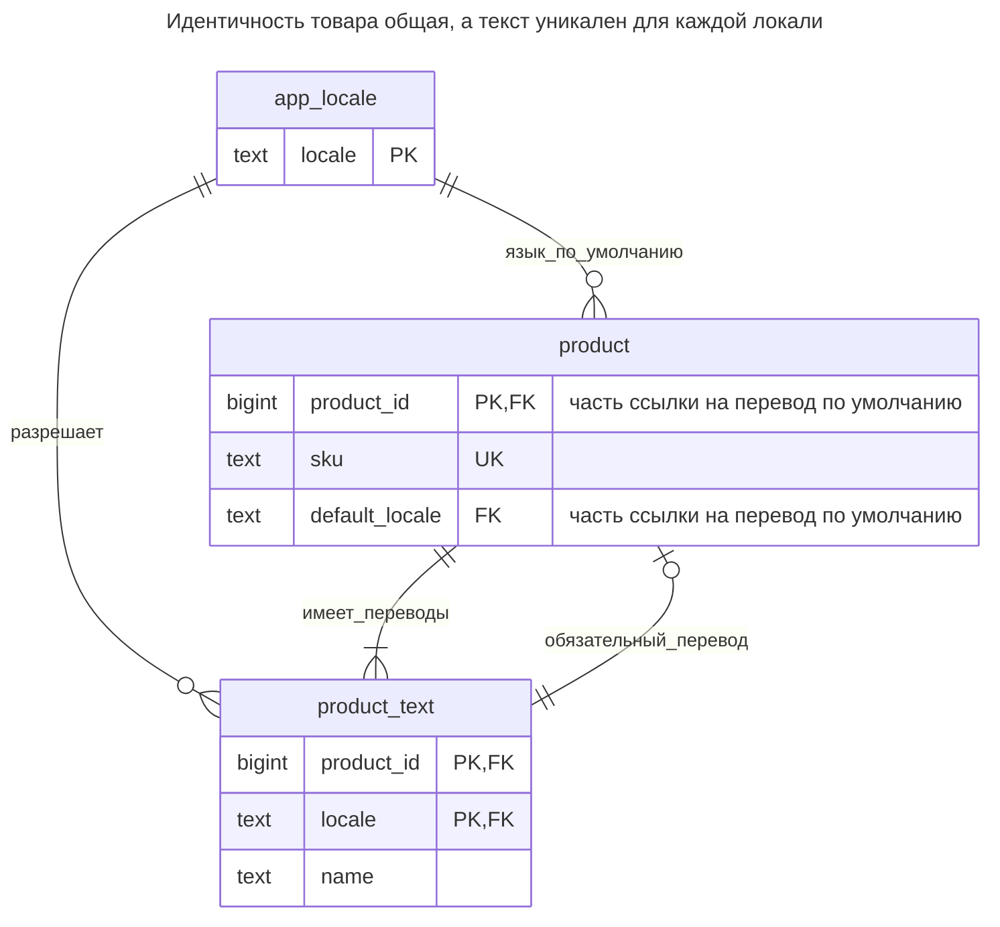
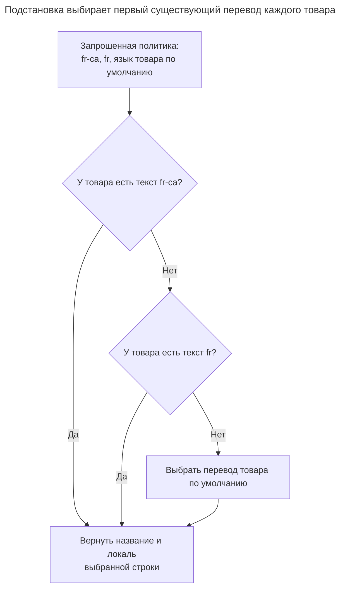
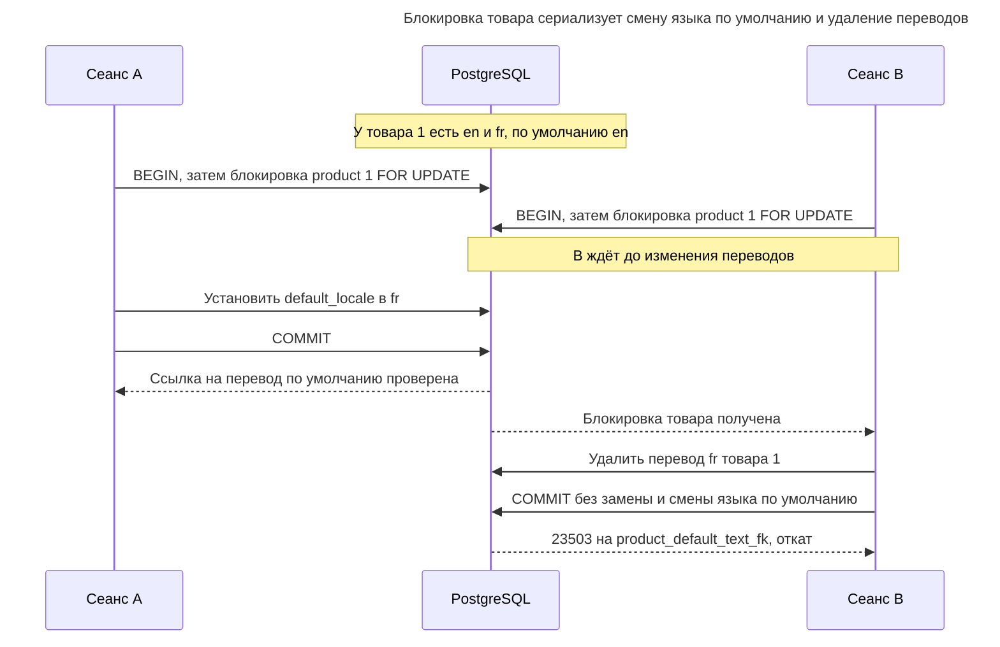

# Локализованные значения

## Назначение

Локализованные значения — атрибуты, которым нужно отдельное значение для каждого языка, например название товара или описание категории. Глава сравнивает таблицу переводов с ключом из сущности и локали, столбцы для отдельных языков и JSON-карту переводов, а также показывает, как гарантировать одно значение на локаль, требовать язык по умолчанию и читать с цепочкой подстановок при отсутствии перевода. Она рассматривает и сортировку с поиском переведённого текста, где правила сравнения и конфигурация полнотекстового поиска зависят от языка.

## Также известен как

Таблица переводов; таблица локализованных атрибутов. Глава посвящена хранимым атрибутам сущностей, а не сообщениям интерфейса приложения или форматированию дат и чисел.

## Проблема

У каталога есть идентичность товара и SKU, не зависящие от языка отображения. Название зависит: англоязычные читатели видят «Chair», франкоязычные — «Chaise». Копирование всего товара для каждого языка создало бы несколько кажущихся идентичностей одного товара для остатков и заказов. Добавление `name_en`, `name_fr` и нового столбца для каждого языка связывает внедрение языка с изменением схемы.

Отсутствие текста требует отдельного решения. Должен ли запрос на канадском французском получить французский, английский текст или ничего? Считается ли пустая строка отсутствием? Может ли название подставляться независимо от описания? Определите эти правила до написания запроса; ключ таблицы не выберет их за вас.

## Решение

Храните общие атрибуты в `product`, а переведённые — в `product_text` с ключом `(product_id, locale)`. Используйте справочник `app_locale`, чтобы допускать только поддерживаемые приложением языки. До записи нормализуйте принимаемые языковые теги к одному написанию: [RFC 5646](https://www.rfc-editor.org/rfc/rfc5646.html#section-2.1.1) определяет регистронезависимое сравнение тегов. Пример использует теги ASCII в нижнем регистре и побайтовое равенство, поэтому разные написания не становятся разными строками перевода.

Назначьте каждому товару обязательный `default_locale` и отложенный составной внешний ключ на его собственный перевод по умолчанию. Товар можно вставить раньше текста в одной транзакции, но зафиксировать без текста нельзя. Обратный внешний ключ перевода гарантирует принадлежность всего текста существующему товару. Здесь язык по умолчанию выбирается для каждого товара и не обязательно является английским.

Разрешайте заранее подготовленный список подстановок в порядке приоритета и возвращайте выбранную локаль вместе с текстом. Список примера — `fr-ca`, `fr`, затем язык товара по умолчанию. Это политика приложения, а не реализация всех правил согласования языка. [Поиск по RFC 4647](https://www.rfc-editor.org/rfc/rfc4647.html#section-3.4) определяет постепенное сопоставление и требует явного поведения по умолчанию; если протокол обещает этот алгоритм, реализуйте его отдельно.

## Альтернативы и выбор

| Соседний паттерн или представление | Связь | Определяющее требование |
| --- | --- | --- |
| Столбцы для каждого языка | Замена | Набор языков мал и фиксирован, а ограничения отдельных столбцов оправдывают изменение схемы при расширении |
| [Столбец JSON](json-column.md) с картой «локаль — текст» | Замена | Обычно нужна вся карта, и вы принимаете политику валидации документа вместо обычных ссылок на строки переводов |
| [Разделение таблицы](table-split.md) | Дополнение | У непереводимых необязательных подробностей отдельный жизненный цикл; переводам всё равно нужны несколько строк на товар |
| [Таблица значений](lookup-table.md) | Дополнение | Поддерживаемым локалям нужны контролируемый состав и метаданные приложения |
| Обязательное имя по умолчанию в `product` и только переопределения в `product_text` | Вариант реализации | Нужен простой обязательный текст по умолчанию без циклического внешнего ключа, и приемлемы два пути хранения одного атрибута |

Полное сравнение — в [Атласе решений](decision-atlas.md). Столбцы языков оправданны для фиксированного контракта; [Повторяющиеся столбцы](repeated-columns.md) становятся уместным предупреждением, когда набор открыт. Для карты JSON [оператор PostgreSQL `->>`](https://www.postgresql.org/docs/18/functions-json.html) извлекает текст локали, но допустимые ключи, обязательные значения по умолчанию и типы значений придётся определять отдельно.

## Структура



У товара может быть много переводов. Составная ссылка на перевод по умолчанию включает `product_id`, поэтому английская строка другого товара не может её удовлетворить. Справочник локалей допускает язык, но не требует соответствующего перевода у каждого товара.

## Таблицы и инварианты

- **`app_locale`** содержит нормализованные поддерживаемые теги. Проверка нижнего регистра — локальное правило хранения, а не полный валидатор BCP 47; добавляйте проверенные теги, а не произвольный пользовательский ввод.
- **`product`** хранит один уникальный SKU, одну идентичность и обязательную поддерживаемую локаль по умолчанию. Отложенный внешний ключ требует собственного текста по умолчанию.
- **`product_text`** допускает одно непустое название на товар и локаль. Отсутствие перевода означает отсутствие строки; пустое название и название только из пробелов отклоняются проверкой примера. Нормализация других пробельных символов остаётся политикой ввода.
- **Подстановка** выбирает целую строку перевода. Если добавить описания и разрешить для них `NULL`, определите, подставляется ли строка или каждое поле отдельно. Подстановка на уровне полей может намеренно смешивать языки; этот пример так не делает.

## Когда применять

- У сущностей одна общая идентичность и развивающийся набор переведённых атрибутов.
- Вы редактируете, проверяете, ищете или публикуете переводы независимо по языкам.
- Полнота языка по умолчанию должна гарантироваться базой, а не предполагаться при чтении.

## Последствия и компромиссы

- ➕ Новый поддерживаемый язык добавляет строки справочника и переводов, а не столбцы.
- ➕ Уникальность перевода и полнота значений по умолчанию имеют явные ограничения.
- ➖ Чтение для отображения требует выбора языка и соединений.
- ➖ Нельзя считать, что один индекс или одна поисковая конфигурация обеспечивают нужные сортировку и стемминг для всех языков.
- ➖ Текст с правильным ключом всё ещё может быть устаревшим или неточным переводом. Если публикация зависит от актуальности, добавьте метаданные рецензирования или версии источника.

## Реализация

[Полный скрипт](../assets/localized-values/localized-values.sql) проверяет подстановку, редактирование переводов, отклонение дубликата, полноту значений по умолчанию и английский полнотекстовый поиск:

```sql
CREATE TABLE app_locale (
    locale text COLLATE "C" PRIMARY KEY,
    CHECK (locale = lower(locale))
);
CREATE TABLE product (
    product_id bigint PRIMARY KEY,
    sku text NOT NULL UNIQUE,
    default_locale text COLLATE "C" NOT NULL REFERENCES app_locale (locale)
);
CREATE TABLE product_text (
    product_id bigint NOT NULL REFERENCES product (product_id)
        ON DELETE CASCADE,
    locale text COLLATE "C" NOT NULL REFERENCES app_locale (locale),
    name text NOT NULL CHECK (btrim(name) <> ''),
    CONSTRAINT product_text_pkey PRIMARY KEY (product_id, locale)
);
ALTER TABLE product ADD CONSTRAINT product_default_text_fk
    FOREIGN KEY (product_id, default_locale)
    REFERENCES product_text (product_id, locale)
    DEFERRABLE INITIALLY DEFERRED;
INSERT INTO app_locale VALUES ('en'), ('fr'), ('fr-ca');
BEGIN;
INSERT INTO product VALUES (1, 'CHAIR', 'en'), (2, 'DESK', 'en');
INSERT INTO product_text VALUES
    (1, 'en', 'Chair'), (1, 'fr', 'Chaise'), (2, 'en', 'Desk');
COMMIT;
```

Цикл между товаром и переводом по умолчанию опирается на [отложенные внешние ключи PostgreSQL](https://www.postgresql.org/docs/18/sql-createtable.html). Первичный ключ начинается с товара для отдельных поисков. Рассмотрите дополнительный индекс с локалью впереди, если это оправданно очередями переводов или чтением всех записей локали.

```sql
SELECT p.sku, chosen.locale, chosen.name
FROM product AS p
CROSS JOIN LATERAL (
    SELECT t.locale, t.name
    FROM (VALUES ('fr-ca', 1), ('fr', 2), (p.default_locale, 3))
        AS preference(locale, priority)
    JOIN product_text AS t
      ON t.product_id = p.product_id AND t.locale = preference.locale
    ORDER BY preference.priority
    LIMIT 1
) AS chosen
ORDER BY p.product_id;
UPDATE product_text SET name = 'Chaise en bois'
WHERE product_id = 1 AND locale = 'fr';
```

Первый результат — `(CHAIR, fr, Chaise)` и `(DESK, en, Desk)`. [Латеральный подзапрос](https://www.postgresql.org/docs/18/queries-table-expressions.html#QUERIES-LATERAL) выбирает текст для каждого товара; ссылка на перевод по умолчанию гарантирует кандидата для зафиксированных товаров. Возвращайте `chosen.locale`, чтобы вызывающая сторона могла пометить или индексировать фактический язык. Не кешируйте результат только по ID товара, если запросы могут иметь разные списки подстановок.



На исходных данных CHAIR выбирает французскую ветвь, а DESK доходит до английского значения по умолчанию. Отложенная ссылка гарантирует кандидата по умолчанию для зафиксированных товаров, а запрос задаёт порядок предпочтений.

```sql
INSERT INTO product_text VALUES (1, 'fr', 'Autre chaise');
```

PostgreSQL 18.6 возвращает SQLSTATE `23505`: `ERROR: duplicate key value violates unique constraint "product_text_pkey"`, с уточнением `DETAIL: Key (product_id, locale)=(1, fr) already exists.` Полнота значений по умолчанию — отдельный отказ: вставка товара `(3, 'LAMP', 'en')` без перевода завершается при фиксации с SQLSTATE `23503`, ограничением `product_default_text_fk` и `DETAIL: Key (product_id, default_locale)=(3, en) is not present in table "product_text".` Скрипт выполняет и эту проверку.

Для простого английского поиска сохраняйте фильтр языка и явную конфигурацию и в индексе, и в запросе:

```sql
CREATE INDEX product_text_en_search_idx ON product_text
    USING gin (to_tsvector('english'::regconfig, name)) WHERE locale = 'en';
SELECT product_id FROM product_text
WHERE locale = 'en'
  AND to_tsvector('english'::regconfig, name)
      @@ plainto_tsquery('english'::regconfig, 'chairs')
ORDER BY product_id;
SELECT product_id, name FROM product_text
WHERE locale = 'en' ORDER BY name COLLATE "C", product_id;
```

Поиск возвращает товар `1`; сортировка располагает Chair перед Desk. PostgreSQL документирует [полнотекстовые индексы с конкретной конфигурацией](https://www.postgresql.org/docs/18/textsearch-tables.html), включая выбор конфигурации по столбцу строки для многоязычных индексов. Используйте проверенное соответствие локалей и конфигураций; языковой тег сам по себе не является именем поисковой конфигурации. Если результаты поиска должны соответствовать видимому тексту, ищите в тексте после разрешения подстановок; поиск по всем переводам может найти слова, отсутствующие в отображаемой строке.

[Правило сортировки `C`](https://www.postgresql.org/docs/18/collation.html) примера сравнивает байты, делая лабораторную работу независимой от установленных лингвистических правил. Для читательской сортировки выбирайте в запросе поддерживаемое правило нужного языка и проектируйте соответствующий индекс для этого выражения. Значение `locale` в строке не меняет правило сортировки столбца автоматически. Перед созданием многоязычного списка решите, сортируется ли подставленное французское или английское название по запрошенному или фактическому языку.

## Поддержка в движках

- **PostgreSQL 18:** отложенные ссылки обеспечивают обязательный перевод по умолчанию. Правило сортировки и конфигурация полнотекстового поиска выбираются явно, независимо от ключа перевода.
- **MySQL 8.4 / InnoDB:** [немедленные проверки внешних ключей](https://dev.mysql.com/doc/refman/8.4/en/ansi-diff-foreign-keys.html) не позволяют показанную циклическую последовательность создания. Хранение обязательного значения по умолчанию в основной строке — более простой переносимый вариант. Осознанно выбирайте [наборы символов и правила сортировки столбцов](https://dev.mysql.com/doc/refman/8.4/en/charset-column.html) для равенства локалей и сравнения текста.
- **SQL Server 2025 (17.x):** [синтаксис `CREATE TABLE`](https://learn.microsoft.com/en-us/sql/t-sql/statements/create-table-transact-sql?view=sql-server-ver17) не содержит предложения отложенных ограничений; используйте другое хранение значения по умолчанию. [Правило сортировки столбца](https://learn.microsoft.com/en-us/sql/relational-databases/collations/set-or-change-the-column-collation?view=sql-server-ver17) настраивается, а не выводится из локали строки.
- **Oracle AI Database 26ai:** поддерживает [отложенные ограничения](https://docs.oracle.com/en/database/oracle/oracle-database/26/sqlrf/constraint.html). [Правила лингвистического сравнения](https://docs.oracle.com/en/database/oracle/oracle-database/26/nlspg/linguistic-sorting-and-matching.html) требуют выбора, специфичного для Oracle; поисковые конфигурации PostgreSQL не являются переносимым SQL.
- **SQLite 3:** включите [проверку внешних ключей](https://www.sqlite.org/foreignkeys.html) и объявите циклическую отложенную связь при создании таблиц. Встроенный [`NOCASE` игнорирует регистр только букв ASCII](https://www.sqlite.org/datatype3.html#collation), поэтому это не общее решение для многоязычной сортировки. При необходимости используйте подходящее пользовательское правило сравнения.

## Сбои и конкурентность

Записывайте товар и текст по умолчанию в одной транзакции и считайте фиксацию границей успеха. Для смены языка по умолчанию атомарно создайте новый перевод и обновите `default_locale`; отложенная ссылка проверит итоговую пару. Удаление одного текущего перевода по умолчанию завершается ошибкой, если та же транзакция не заменяет его или не меняет язык по умолчанию. Удаление товара каскадно удаляет его переводы.

Конкурирующие вставки для одного товара и локали встречают ограничение первичного ключа. Конкурирующим изменениям существующего перевода нужен [Столбец версии](version-column.md), если недопустимо молчаливое затирание. В процессе, совместно меняющем язык по умолчанию и удаляющем переводы, каждый участвующий писатель должен сначала брать [блокировку строки товара](https://www.postgresql.org/docs/18/explicit-locking.html#LOCKING-ROWS). Сбрасывайте кеши подстановок при изменении переводов или языка по умолчанию: добавление более предпочтительного перевода меняет результат, хотя старый текст остаётся.



B должен заново оценить текущий язык по умолчанию после захвата блокировки. Отложенное ограничение запрещает удалить этот перевод без замены, даже если сам оператор удаления прошёл.

```mermaid
---
title: Смена языка по умолчанию допустима лишь при наличии соответствующего текста
---
stateDiagram-v2
  direction TB
  state "Зафиксированный товар с текстом по умолчанию" as Valid
  state "Транзакция удерживает блокировку товара" as Locked
  state "Перевод нового языка существует" as Text
  state "Язык по умолчанию указывает на новый перевод" as Pointed
  state "Фиксация отклонена; старое состояние восстановлено" as Failed
  [*] --> Valid
  Valid --> Locked: BEGIN; заблокировать товар
  Locked --> Text: Создать или сохранить целевой перевод
  Text --> Pointed: Обновить default_locale
  Pointed --> Valid: COMMIT проверяет пару товара и локали
  Locked --> Failed: Удалить только перевод по умолчанию; COMMIT
  Failed --> Valid: Откат
  class Valid,Text,Pointed accent
  class Locked muted
  class Failed warn
```



Обязательная пара включает ID товара, поэтому перевод другого товара не удовлетворяет изменению. Неудачная фиксация атомарно восстанавливает прежние язык по умолчанию и текст.

## Миграция

При переходе с одного столбца названия определите его настоящий язык до назначения тега. Создайте таблицы локалей и переводов, затем разверните писателей, атомарно поддерживающих оба представления. Переносите данные под общей с действующими писателями блокировкой товара, чтобы устаревшие копии не затёрли новые переводы. При переходе с языковых столбцов или JSON нормализуйте теги и разрешите коллизии до вставки; различайте отсутствующие значения, `NULL` и пустые строки по новой политике.

Заполните обязательный перевод по умолчанию каждого товара до добавления и [проверки внешнего ключа](https://www.postgresql.org/docs/18/sql-altertable.html). Переключите читателей на явную политику подстановок, сравните результаты и сохраняйте старое хранилище в период [Расширения и свёртывания](expand-contract.md). Возврат к одноязычному столбцу не может представить новые переводы; сохраняйте их в таблице переводов даже при возврате читателей. Планируйте окна блокировок DDL, не предполагая, что установка ограничений обходится без блокировок.

## Антипаттерны и частые ошибки

- Считать `fr` и `FR` разными языками, потому что побайтовый ключ допускает оба; нормализуйте на границе и ограничивайте поддерживаемые теги.
- Копировать SKU, остатки и идентичность в каждую языковую строку.
- Хранить пустой текст как «отсутствующий», когда подстановка проверяет лишь существование строки.
- Называть произвольный список подстановок полным согласованием BCP 47.
- Считать, что база автоматически выбирает правила сравнения или стемминг по `locale`.
- Создавать общий контейнер переводов `(entity_type, entity_id, locale, value)` и терять обычные внешние ключи сущностей; предпочтите таблицу переводов для каждой формы сущности.

## Известные применения

- [Документация django-parler об устройстве](https://django-parler.readthedocs.io/en/stable/background.html) описывает общую модель, передающую доступ к атрибутам модели перевода, которую создают вручную или через `TranslatedFields`. Это пример разделения общего и переводимого, а не обязательного перевода по умолчанию из этой главы.
- [Документация полнотекстовой индексации PostgreSQL](https://www.postgresql.org/docs/18/textsearch-tables.html) прямо описывает столбец имени конфигурации для коллекций документов на разных языках. Это вариант реализации поиска по строкам переводов, а не политика подстановок.

## Связанные паттерны

- [Таблица значений](lookup-table.md) контролирует набор поддерживаемых локалей.
- [Столбец JSON](json-column.md) — альтернативная форма хранения карт переводов.
- [Разделение таблицы](table-split.md) отделяет непереводимые необязательные атрибуты.
- [Столбец версии](version-column.md) защищает конкурирующие изменения переводов.
- [Повторяющиеся столбцы](repeated-columns.md) объясняют цену кодирования расширяющегося набора языков столбцами.
- [Расширение и свёртывание](expand-contract.md) задаёт этапы миграции хранения и пути чтения.
