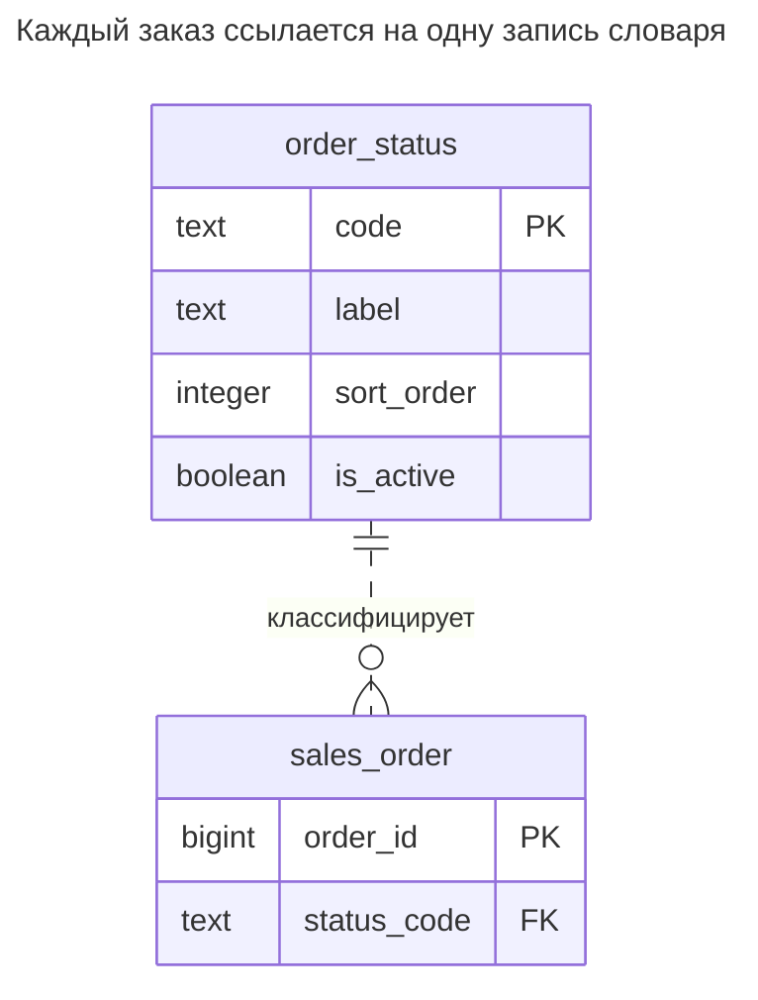
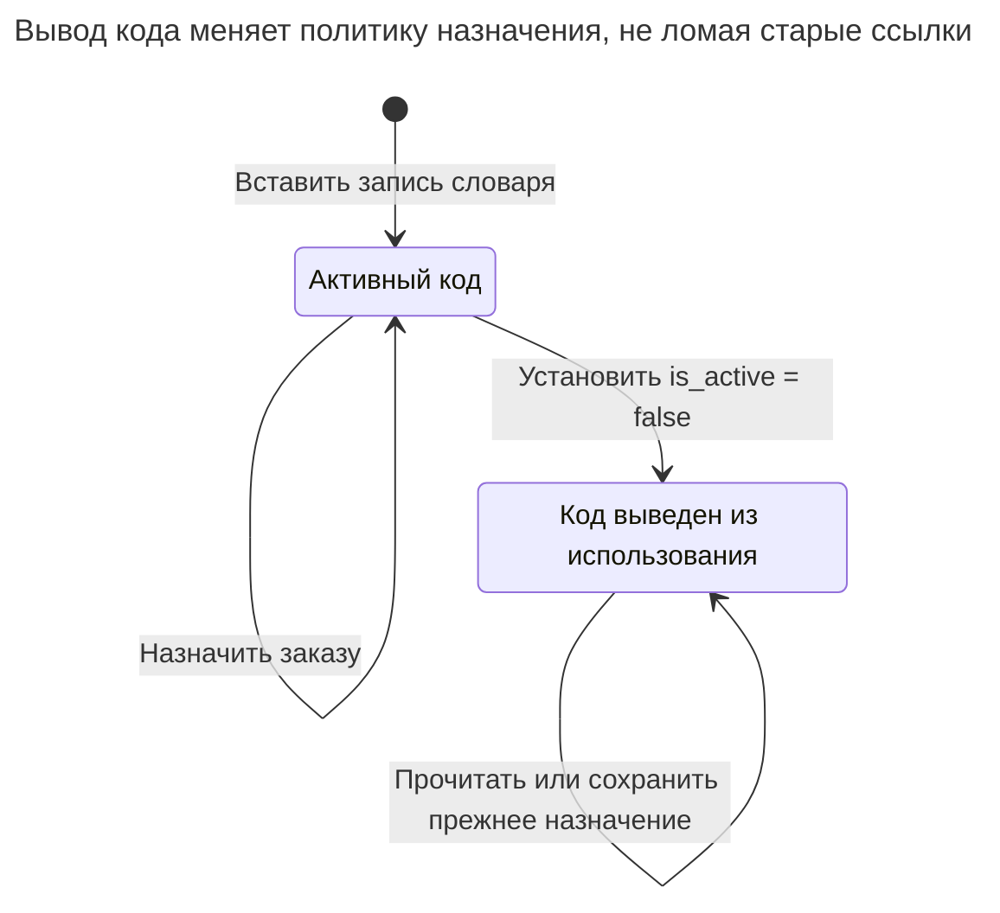
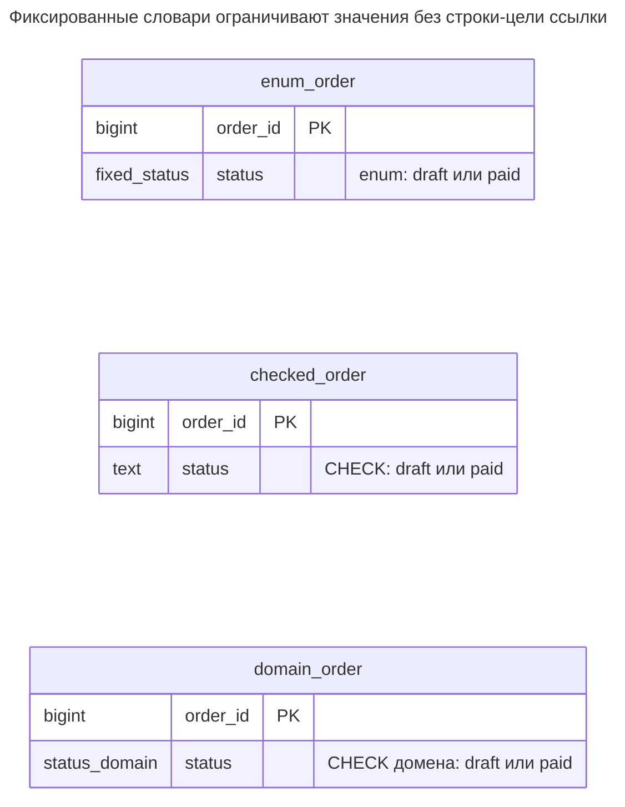
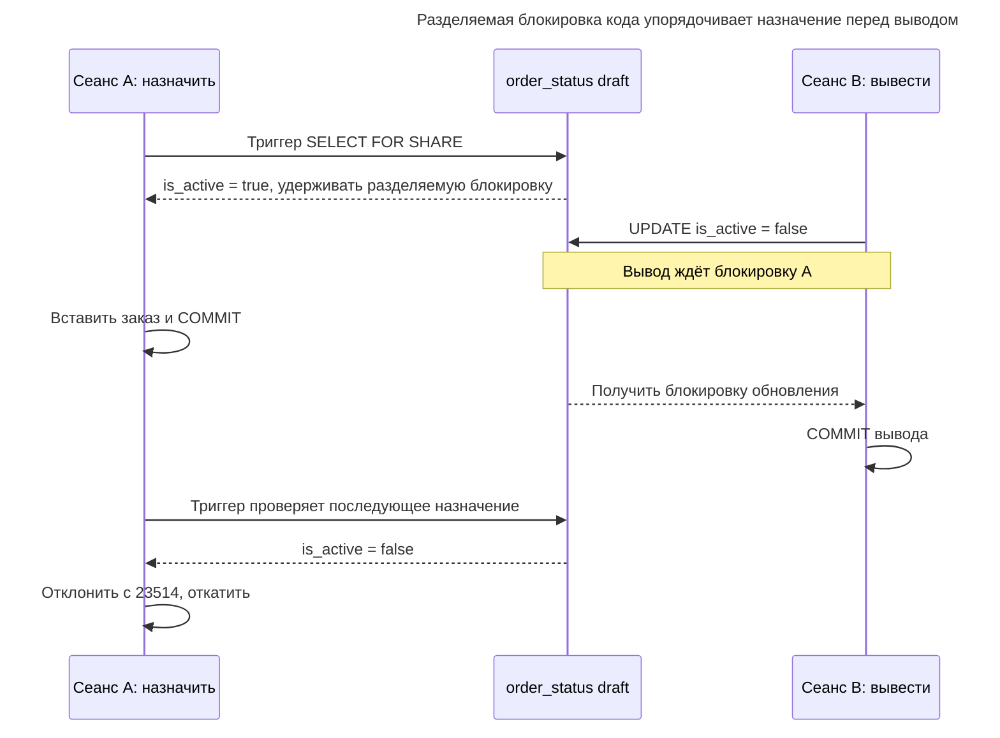
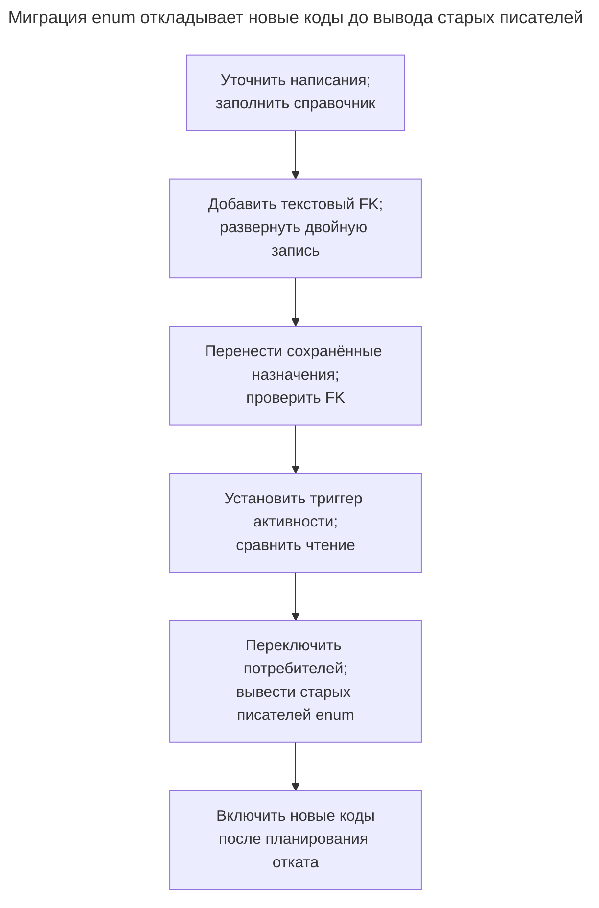

# Таблица значений

## Назначение

Таблица значений ограничивает столбец фиксированным словарём — статусами заказов, странами, способами оплаты, — храня допустимые значения отдельно и ссылаясь на них внешним ключом. Она конкурирует со встроенным типом enum, ограничением `CHECK` и доменом. Глава рассматривает выбор как единое решение: насколько часто меняется список, есть ли у значений собственные атрибуты вроде подписей и порядка сортировки и сколько стоит изменение при миграции. Она также показывает неудачное объединение всех словарей в одну универсальную таблицу, известное как One True Lookup Table.

## Также известен как

Таблица кодов; таблица справочных данных. Джо Селко в [Look-up Tables in SQL](https://www.red-gate.com/simple-talk/databases/sql-server/t-sql-programming-sql-server/look-up-tables-in-sql/) обсуждает преобразование хранимых кодов в описания и проблемы объединения несвязанных словарей.

## Проблема

Вы храните статус заказа текстом. Один писатель передаёт `paid`, другой — `Paid`, третий придумывает `awaiting_payment`. Отчётный запрос должен решить, три ли это состояния или две ошибки написания. Выпадающий список приложения помогает одному писателю, но импорту и административному SQL нужно то же правило принадлежности.

У словаря также есть жизненный цикл. Можно изменить подпись, добавить ручную проверку, переупорядочить варианты или перестать предлагать код, сохранив старые заказы. Размещение всех написаний в коде приложения делает базу зависимой от одновременного обновления всех писателей. Список в схеме разумен, когда изменения относятся к релизам; он неудобен, когда сопровождение списка — обычная бизнес-операция.

## Решение

Создайте отдельную таблицу для каждого словаря и ссылайтесь на её ключ из использующего столбца. Храните стабильный код отдельно от подписи, порядка отображения и доступности. В примере `order_status.code` — цель ссылок, а `sales_order.status_code` обязателен. [Правила внешних ключей PostgreSQL](https://www.postgresql.org/docs/18/ddl-constraints.html#DDL-CONSTRAINTS-FK) обеспечивают принадлежность; триггер примера отдельно проверяет доступность значения для нового назначения.

Выводите код из использования, сбрасывая `is_active` и сохраняя строку для существующих ссылок. Не используйте выведенный код повторно с другим смыслом. Изменение подписи меняет отображение каждого соединённого заказа; если нужно воспроизвести формулировку исторического документа, сохраните её с документом или версионируйте отдельно. Справочник — текущий словарь, а не запись прошлых подписей.

Выбирайте короткий естественный код, если можете сохранять его смысл и написание стабильными. Если внешние коды регулярно заменяются, используйте [Суррогатный ключ](surrogate-key.md) и сохраняйте уникальный атрибут кода. В обоих случаях нужна отдельная строка для каждого допустимого понятия; генератор ключей не определяет политику словаря.

## Альтернативы и выбор

| Представление или соседний паттерн | Связь | Когда выбирать |
| --- | --- | --- |
| Таблица значений с FK | Вариант реализации ограниченных значений | Значениям нужны подписи, вывод из использования, переводы или сопровождение обычными записями данных |
| Встроенный enum | Замена | Разработчики владеют небольшим стабильным упорядоченным словарём и принимают миграции типов |
| `CHECK` столбца | Замена | Короткий список локален для одного столбца и меняется с релизами |
| Домен с `CHECK` | Замена | Нескольким столбцам нужно одно стабильное правило значений без метаданных отдельных значений |
| [История статусов](status-history.md) | Дополнение | Помимо принадлежности списку состояний нужны допустимые переходы и последовательность изменений |
| [Локализованные значения](localized-values.md) | Дополнение | Каждой записи словаря нужны подписи на нескольких языках |

[Enum PostgreSQL](https://www.postgresql.org/docs/18/datatype-enum.html) имеет порядок объявления и отдельную идентичность типа; значения можно добавлять и переименовывать, но существующих участников нельзя удалить или переупорядочить без пересоздания типа. Выполненный внутри транзакции [`ALTER TYPE ... ADD VALUE`](https://www.postgresql.org/docs/18/sql-altertype.html) делает новое значение доступным лишь после фиксации. Вставка в справочник позволяет добавить запись и назначить её в одной транзакции. Ни одно представление не учит старое приложение понимать новое бизнес-состояние.

[Домен PostgreSQL](https://www.postgresql.org/docs/18/sql-createdomain.html) централизует ограничения базового типа, но не предоставляет строку для подписи каждого значения. Правила обязательности задавайте на использующих столбцах. Полное сравнение — в [Атласе решений](decision-atlas.md), а ошибка представления сопровождаемых бизнесом данных фиксированным списком схемы разобрана в [Изменчивых перечислениях](volatile-enums.md).

## Структура



У заказа один статус; статус может использоваться многими заказами или ни одним. Чтение существующих заказов соединяет все указанные коды, включая выведенные из использования. Только запрос вариантов фильтрует доступность. Позиция отображения — атрибут, поэтому её изменение не меняет ссылки.



Выведенная запись остаётся допустимой целью FK для существующих заказов, а триггер отклоняет новые назначения. Вывод меняет доступность, а не смысл кода.

## Таблицы и инварианты

- **`order_status`** имеет одну строку на код. Первичный ключ предотвращает повтор кодов; обязательные атрибуты и проверка непустой подписи делают пример пригодным для отображения. Позиции могут совпадать; запрос разрешает совпадения по `code`.
- **`sales_order`** требует существующего кода через `sales_order_status_fk`. `ON DELETE RESTRICT` запрещает удаление кода со ссылками. Явный индекс потомка поддерживает запросы заказов по статусу; PostgreSQL [не индексирует ссылающиеся столбцы автоматически](https://www.postgresql.org/docs/18/ddl-constraints.html#DDL-CONSTRAINTS-FK).
- **Доступность** проверяется при вставке и фактической смене статуса. Триггер отклоняет выведенную цель, но позволяет сохранять неизменённый выведенный статус. Сам активный флаг такой гарантии не даёт.
- **Стабильность смысла и кода** остаётся правилом сопровождения. Разрешайте изменения словаря доверенным администраторам; схема не может определить, переопределил ли оператор код незаметно.

## Когда применять

- Добавление значения относится к эксплуатации приложения, а не к развёртыванию нового типа базы данных.
- Кодам нужны подписи, порядок сортировки, доступность или другие предметные атрибуты.
- Нескольким писателям нужен единый принудительно соблюдаемый словарь, а существующие записи должны сохранять ссылки на выведенные коды.

## Последствия и компромиссы

- ➕ Записи и атрибуты представления можно добавлять и менять операциями с данными.
- ➕ Внешний ключ защищает импорт и прямые записи так же, как формы приложения.
- ➕ Вывод записи сохраняет смысл существующих ссылок.
- ➖ Чтение для отображения требует соединения или поддерживаемого кеша; фильтрация по известному коду — нет.
- ➖ Каждое добавление кода всё ещё требует планирования совместимости, если логика приложения ветвится по нему.
- ➖ Строгий вывод из использования требует дополнительной проверки записи и координации с обновлением справочных данных.

## Реализация

[Полный скрипт PostgreSQL 18.6](../assets/lookup-table/lookup-table.sql) включает ошибки принадлежности, вывода и удаления, а также отдельные варианты enum, `CHECK` и домена. Выделенная схема держит лабораторные объекты вместе:

```sql
CREATE SCHEMA lookup_example;
REVOKE ALL ON SCHEMA lookup_example FROM PUBLIC;

CREATE TABLE lookup_example.order_status (
    code text PRIMARY KEY,
    label text NOT NULL CHECK (btrim(label) <> ''),
    sort_order integer NOT NULL,
    is_active boolean NOT NULL DEFAULT true
);
CREATE TABLE lookup_example.sales_order (
    order_id bigint PRIMARY KEY,
    status_code text NOT NULL,
    CONSTRAINT sales_order_status_fk FOREIGN KEY (status_code)
        REFERENCES lookup_example.order_status (code) ON DELETE RESTRICT
);
CREATE INDEX sales_order_status_idx
    ON lookup_example.sales_order (status_code);
```

Принадлежность и вывод отвечают на разные вопросы. Следующий [строчный триггер](https://www.postgresql.org/docs/18/sql-createtrigger.html) проверяет доступность и удерживает разделяемую блокировку кода до конца транзакции. Отсутствующий код оставляется для отклонения внешним ключом:

```sql
CREATE FUNCTION lookup_example.require_active_status()
RETURNS trigger LANGUAGE plpgsql SECURITY DEFINER
SET search_path = pg_catalog, pg_temp AS $$
DECLARE
    active boolean;
BEGIN
    IF TG_OP = 'UPDATE' THEN
        IF NEW.status_code IS NOT DISTINCT FROM OLD.status_code THEN
            RETURN NEW;
        END IF;
    END IF;
    SELECT s.is_active INTO active
    FROM lookup_example.order_status AS s
    WHERE s.code = NEW.status_code FOR SHARE;
    IF FOUND AND NOT active THEN
        RAISE EXCEPTION 'order status is retired: %', NEW.status_code
            USING ERRCODE = '23514',
                  CONSTRAINT = 'sales_order_status_active';
    END IF;
    RETURN NEW;
END;
$$;
REVOKE ALL ON FUNCTION lookup_example.require_active_status() FROM PUBLIC;
CREATE TRIGGER sales_order_active_status
BEFORE INSERT OR UPDATE OF status_code ON lookup_example.sales_order
FOR EACH ROW EXECUTE FUNCTION lookup_example.require_active_status();
```

Триггер использует [функцию `SECURITY DEFINER` с фиксированным путём поиска](https://www.postgresql.org/docs/18/sql-createfunction.html#SQL-CREATEFUNCTION-SECURITY), чтобы писателям заказов не требовались прямые разрешения на блокировку или редактирование словаря. Владельцем схемы и функции должна быть доверенная роль сопровождения; ролям приложения выдавайте только необходимые доступ к схеме и операции с заказами. Разделяемая блокировка намеренная: PostgreSQL [`FOR KEY SHARE` разрешает обновления неключевых полей](https://www.postgresql.org/docs/18/explicit-locking.html#LOCKING-ROWS), включая вывод; `FOR SHARE` их блокирует.

```sql
INSERT INTO lookup_example.order_status (code, label, sort_order)
VALUES ('draft', 'Draft', 10), ('paid', 'Paid', 20);
INSERT INTO lookup_example.sales_order VALUES (1001, 'draft'), (1002, 'draft');
UPDATE lookup_example.order_status SET label = 'Awaiting payment'
WHERE code = 'draft';
INSERT INTO lookup_example.order_status (code, label, sort_order)
VALUES ('review', 'Manual review', 15);
UPDATE lookup_example.sales_order SET status_code = 'review' WHERE order_id = 1001;
UPDATE lookup_example.order_status SET is_active = false WHERE code = 'draft';

SELECT code, label FROM lookup_example.order_status
WHERE is_active ORDER BY sort_order, code;
SELECT o.order_id, o.status_code, s.label, s.is_active
FROM lookup_example.sales_order AS o
JOIN lookup_example.order_status AS s ON s.code = o.status_code
ORDER BY o.order_id;
```

Запрос вариантов возвращает `(review, Manual review)` и `(paid, Paid)`. Запрос заказов возвращает `(1001, review, Manual review, true)` и `(1002, draft, Awaiting payment, false)`: прежнее назначение переживает вывод и видит исправленную подпись. Несуществующий код отклоняется независимо от проверки активности:

```sql
UPDATE lookup_example.sales_order SET status_code = 'unknown' WHERE order_id = 1001;
```

PostgreSQL 18.6 возвращает SQLSTATE `23503`: `ERROR: insert or update on table "sales_order" violates foreign key constraint "sales_order_status_fk"`, с уточнением `DETAIL: Key (status_code)=(unknown) is not present in table "order_status".` Назначение выведенного `draft` новому заказу вместо этого вызывает SQLSTATE триггера `23514`: `ERROR: order status is retired: draft`. Полный скрипт проверяет оба отказа и запрет удаления `draft`, на который есть ссылки.

Для сравнения ниже отдельные реализации стабильного словаря из двух значений, а не дополнительные ограничения для схемы со справочником:

```sql
CREATE TYPE lookup_example.fixed_status AS ENUM ('draft', 'paid');
CREATE TABLE lookup_example.enum_order (
    order_id bigint PRIMARY KEY,
    status lookup_example.fixed_status NOT NULL
);
CREATE TABLE lookup_example.checked_order (
    order_id bigint PRIMARY KEY,
    status text NOT NULL CHECK (status IN ('draft', 'paid'))
);
CREATE DOMAIN lookup_example.status_domain AS text
    CHECK (VALUE IN ('draft', 'paid'));
CREATE TABLE lookup_example.domain_order (
    order_id bigint PRIMARY KEY,
    status lookup_example.status_domain NOT NULL
);
```



Это три независимые альтернативы: ни у одной нет внешнего ключа статуса или строки для метаданных значения. Правило принадлежности задаёт enum, проверка столбца или домен.

Оставляйте выражение `CHECK` локальным проверяемому значению. PostgreSQL [не поддерживает `CHECK` как межтабличное правило целостности](https://www.postgresql.org/docs/18/ddl-constraints.html#DDL-CONSTRAINTS-CHECK-CONSTRAINTS); скрытый в функции запрос справочника не превращается в поддерживаемый внешний ключ.

## Поддержка в движках

- **PostgreSQL 18:** скрипт использует встроенные enum, домены и обычные таблицы с FK. Триггер специфичен для PostgreSQL; переносите не только синтаксис, но и политику доступности и блокировки.
- **MySQL 8.4 / InnoDB:** [`ENUM` принадлежит определению столбца и сортируется по позиции значения](https://dev.mysql.com/doc/refman/8.4/en/enum.html). Недопустимые значения отклоняются в строгом режиме, но могут превратиться в специальное ошибочное значение при отключённой строгости или подавлении ошибок. Перед заменой справочника определите, соответствует ли это требуемому отказу.
- **SQL Server 2025 (17.x):** [тип-псевдоним, созданный `CREATE TYPE`](https://learn.microsoft.com/en-us/sql/t-sql/statements/create-type-transact-sql?view=sql-server-ver17), оборачивает системный тип; он не принимает встроенное определение `CHECK` домена PostgreSQL. Используйте табличные `CHECK` для фиксированных списков или таблицу с FK для сопровождаемых значений.
- **Oracle AI Database 26ai:** [`CREATE DOMAIN`](https://docs.oracle.com/en/database/oracle/oracle-database/26/sqlrf/create-domain.html) поддерживает повторно используемые ограничения значений, включая документированный пример списка дней недели. Синтаксис отличается от показанного выражения PostgreSQL `VALUE`; домен всё равно не заменяет таблицу редактируемых записей.
- **SQLite 3:** включайте [`PRAGMA foreign_keys = ON` для каждого соединения](https://www.sqlite.org/foreignkeys.html#fk_enable) до транзакций. Объявления FK недостаточно, когда проверка отключена. Если нужен принудительный вывод, перенесите триггер на язык триггеров SQLite.

## Сбои и конкурентность

Внешний ключ определяет принадлежность; триггер и обновление справочника — вывод из использования. При PostgreSQL [Read Committed](https://www.postgresql.org/docs/18/transaction-iso.html#XACT-READ-COMMITTED), если назначение первым блокирует активный код, вывод ждёт завершения назначения. Если вывод зафиксирован первым, триггер читает выведенную строку и отклоняет новое назначение. Несколько назначений могут одновременно держать разделяемые блокировки. Делайте транзакции короткими: исправление подписи тоже ждёт эти блокировки.



Первое назначение сохраняется, потому что предшествует выводу под разделяемой блокировкой. Позднее назначение видит флаг вывода и завершается ошибкой, даже если форма всё ещё предлагает этот код.

Если приложение кеширует варианты, сбрасывайте кеш после изменения словаря, но сохраняйте проверку базы: пользователь может отправить форму, открытую до вывода. Обрабатывайте отказ как устаревший выбор. Не исключайте выведенные значения при чтении существующих заказов, иначе отчёт потеряет допустимые заказы. Таблица значений также позволяет перейти из `paid` в `draft`, если оба активны; используйте [Историю статусов](status-history.md), когда важны допустимые переходы.

## Миграция

Соберите различные хранимые значения и исправьте опечатки и неоднозначные смыслы до заполнения словаря. Сохраните соответствие каждого старого написания выбранному коду. Для текстового столбца можно оставить его и добавить FK как [`NOT VALID`, затем проверить](https://www.postgresql.org/docs/18/sql-altertable.html) после очистки. Ограничение проверяет новые записи, а валидация обрабатывает старые. Планируйте короткие окна блокировок DDL.

При переходе с enum добавьте текстовый столбец ссылки, разверните писателей, поддерживающих обе формы, и перенесите данные по согласованному соответствию. Проверьте принадлежность, сравните чтение, затем переключите потребителей до удаления старого столбца. Устанавливайте триггер активности после переноса сохранённых назначений; не считайте исторические выведенные назначения новыми выборами. Держите коды, существующие только в новой схеме, неактивными, пока старым писателям нужен enum. В период [Расширения и свёртывания](expand-contract.md) чтение можно вернуть, но старый enum не представит код, добавленный лишь в новую таблицу. Отложите такие добавления или явно определите поведение отката.



Перенос предшествует контролю доступности, чтобы можно было установить сохранённые назначения выведенных кодов. Включение кода вне старого enum — момент, после которого одного возврата читателей может оказаться недостаточно.

## Антипаттерны и частые ошибки

- **One True Lookup Table:** объединение всех списков в `(kind, code, label)` делает ссылку зависимой и от вида, и от кода. FK на глобально уникальный общий ID доказывает существование, но не то, что заказ получил запись статуса заказа. Составной FK вместе с проверкой фиксированного вида может сохранить различие ценой повторения различителя. Предпочитайте отдельную таблицу каждому словарю; именно эту структурную проблему разбирает [Селко в обсуждении OTLT](https://www.red-gate.com/simple-talk/databases/sql-server/t-sql-programming-sql-server/look-up-tables-in-sql/), а не принципиальную невозможность ограничений у любой общей таблицы.
- Удалять запись со ссылками или каскадно удалять её заказы, когда нужно лишь скрыть вариант.
- Считать, что активный флаг участвует во внешнем ключе, или фильтровать его при каждом историческом чтении.
- Использовать подпись отображения как ключ ссылки, превращая исправление текста в миграцию ссылок.
- Использовать изменяемый список схемы для значений, которыми управляет бизнес; см. [Изменчивые перечисления](volatile-enums.md). И наоборот, справочник для навсегда фиксированного правила из двух значений может не дать полезных возможностей сопровождения.
- Полагаться только на выпадающий список; [Отсутствующие внешние ключи](missing-foreign-keys.md) оставляют остальных писателей за пределами правила принадлежности.

## Известные применения

- [Примеры таблиц значений Селко](https://www.red-gate.com/simple-talk/databases/sql-server/t-sql-programming-sql-server/look-up-tables-in-sql/) сопоставляют коды с читаемыми описаниями и показывают нагрузку различителя в объединённой таблице.
- [Справочные таблицы Citus](https://docs.citusdata.com/en/stable/get_started/concepts.html#type-2-reference-tables) реплицируют небольшую таблицу на каждого рабочего узла и прямо называют статусы заказов и категории товаров примерами. Репликация — выбор распределения таких данных, а не требование локального паттерна.

## Связанные паттерны

- [История статусов](status-history.md) добавляет контролируемому словарю состояний правила переходов и запись изменений.
- [Локализованные значения](localized-values.md) хранят подпись на запись и локаль.
- [Естественный ключ](natural-key.md) оценивает использование самого кода как цели ссылок.
- [Суррогатный ключ](surrogate-key.md) отделяет идентичность от изменяемого внешнего кода.
- [Изменчивые перечисления](volatile-enums.md) объясняют, когда изменения словаря должны перестать быть DDL.
- [Расширение и свёртывание](expand-contract.md) задаёт этапы изменения представления словаря.
