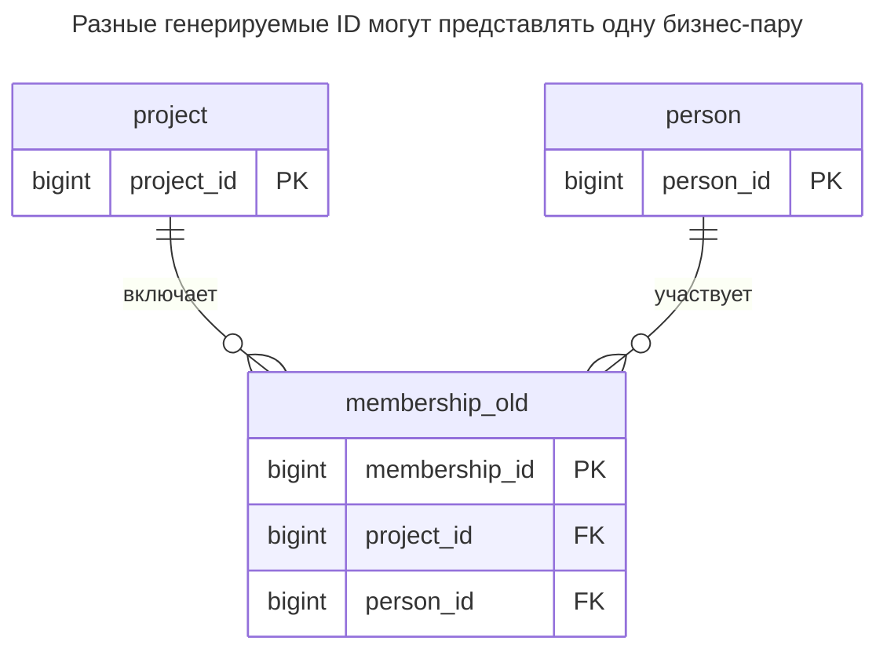
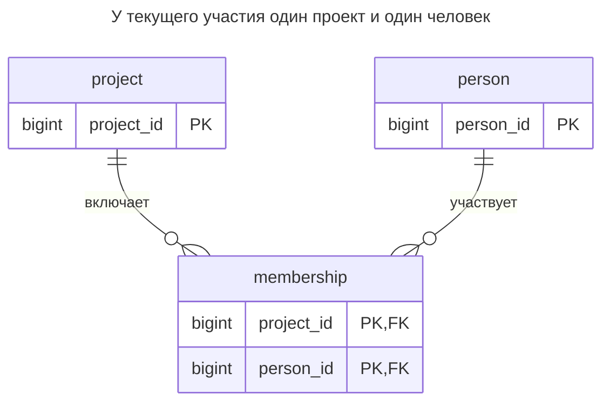
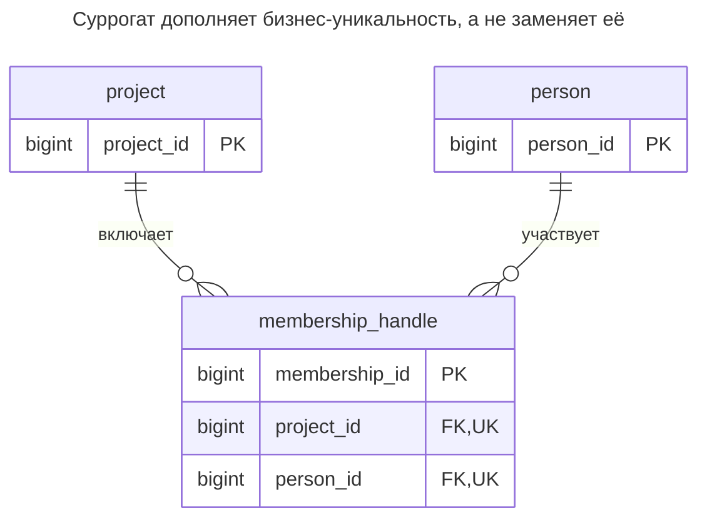
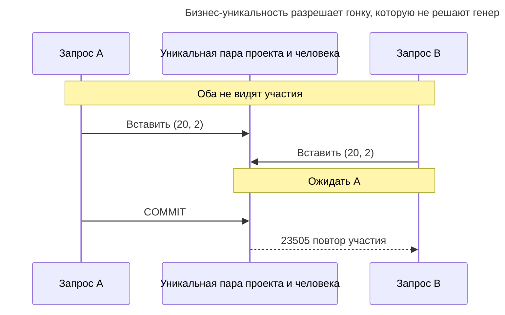
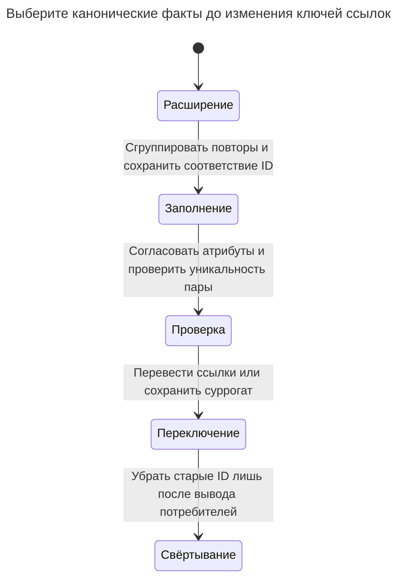

# Обязательные суррогаты

Обязательный суррогатный ключ — привычка добавлять столбец `id` в каждую таблицу, даже когда настоящая идентичность задаётся естественным или составным ключом. В таблице связей это позволяет дважды связать одну пару без отдельного ограничения уникальности, а в других случаях скрывает бизнес-ключ, который должен быть уникален. Глава показывает возникающие дубликаты и случаи, когда суррогат всё же уместен. Билл Карвин называет это ID Required.

## Также известен как

ID Required в [оглавлении SQL Antipatterns Билла Карвина](https://pragprog.com/titles/bksap1/sql-antipatterns-volume-1/). Глава ставит под сомнение обязательную суррогатную идентичность, а не осознанно выбранные генерируемые ключи.

## Контекст

Вы моделируете текущее участие людей в проектах. Требование говорит: человек либо участвует в проекте, либо нет; нескольких независимых периодов участия оно не описывает. Пара уже идентифицирует факт. Но универсальный слой хранения или внутреннее соглашение требует `id` от каждой таблицы.

## Проблема

Вы объявляете уникальным лишь генерируемый ключ, разрешая повтор настоящей бизнес-идентичности. Каждая строка отдельно адресуется, но две строки могут описывать одно участие. Подсчёт строк считает повторные представления, а не людей, и удаление по генерируемому ID оставляет вторую копию.

Вредное состояние — отсутствие бизнес-ограничения вместе с необоснованной политикой идентичности. Сохранить суррогат и объявить пару уникальной — корректная альтернатива. [Документация identity PostgreSQL](https://www.postgresql.org/docs/18/ddl-identity-columns.html) различает выдачу генерируемых значений и уникальность; ни одна операция не выясняет, какой бизнес-факт должен встречаться один раз.

## Почему так делают

Одностолбцовый идентификатор удобно передавать через API и дочерние таблицы. Он также сохраняет ссылку при изменении концов связи. Эти преимущества оправдывают суррогат для связи с независимым жизненным циклом, но не превращают два текущих участия одной пары в разные факты.

Вы также можете ожидать проблем от всех составных ключей. Это требование инструментов, которое следует оценить, а не основание отбросить инвариант схемы. Суррогат и отдельная уникальная пара удовлетворяют обоим требованиям, не вынуждая всех потребителей использовать пару.

## Последствия

- ➖ При допустимых дубликатах число строк завышает число участников.
- ➖ Правка по паре затрагивает несколько строк, а по суррогату — только одну копию.
- ➖ Устранение дубликатов становится миграцией ссылок, если другие строки уже ссылаются на разные копии.
- ➖ Ненужный генерируемый ключ добавляет ещё одну идентичность для документирования, индексирования и сверки импортов.

## Признаки

- Единственный ответ на вопрос «что идентифицирует этот ID?» — «он есть у каждой таблицы».
- Обычное чтение связей использует `DISTINCT`, скрывая повторные пары.
- Есть суррогатный первичный ключ без объявленной уникальности бизнес-факта.
- Повтор создаёт ещё одно участие, потому что всегда получает новый ID.

## Как лучше

Сначала идентифицируйте факт. Для одного текущего участия на пару «проект и человек» используйте эту пару первичным ключом. Если другим записям нужен независимый идентификатор участия, сохраните суррогат и объявите `UNIQUE (project_id, person_id)`. Если повторное вступление создаёт отдельный период участия, моделируйте его время или собственную идентичность и определите допустимость пересечений.

### Альтернативы и выбор

| Соседний паттерн | Связь | Определяющее требование |
| --- | --- | --- |
| [Естественный ключ](natural-key.md) | Замена ненужного суррогата | Обязательный стабильный бизнес-кортеж уже идентифицирует строку |
| [Суррогатный ключ](surrogate-key.md) | Вариант реализации с бизнес-уникальностью | Ссылки должны переживать изменения бизнес-атрибутов или концов связи |
| [Таблица связей](association-table.md) | Структура на замену для связи | Факт — участие двух существующих концов |
| Суррогат и уникальная пара | Вариант реализации | Инструментам или зависимым строкам удобен один ID, но пара всё равно уникальна |

См. [Атлас решений](decision-atlas.md). Не удаляйте ID, ставший внешним контрактом, лишь ради аккуратного вида таблицы; правильным исправлением может быть недостающее правило уникальности.

## Пример

### Структура

**Было:** суррогат различает строки, не различая участия.



Обе ссылки концов допустимы. Дефект именно в отсутствии уникальности их комбинации.

```sql
CREATE TABLE project (project_id bigint PRIMARY KEY);
CREATE TABLE person (person_id bigint PRIMARY KEY);
CREATE TABLE membership_old (
    membership_id bigint GENERATED ALWAYS AS IDENTITY PRIMARY KEY,
    project_id bigint NOT NULL REFERENCES project (project_id),
    person_id bigint NOT NULL REFERENCES person (person_id)
);
INSERT INTO project VALUES (10);
INSERT INTO person VALUES (1), (2);
INSERT INTO membership_old (project_id, person_id) VALUES (10, 1), (10, 1), (10, 2);
SELECT project_id, count(*) AS members FROM membership_old GROUP BY project_id;
```

Количество — `(10, 3)`, хотя участвуют лишь люди `1` и `2`. Все три вставки удовлетворяют объявленным ограничениям суррогата и концов.

**Стало:** пару используем для идентификации участия.



Каждая пара встречается один раз. Для чтения, записи или ссылок этого примера дополнительное число не нужно.

```sql
CREATE TABLE membership (
    project_id bigint NOT NULL REFERENCES project (project_id),
    person_id bigint NOT NULL REFERENCES person (person_id),
    CONSTRAINT membership_pkey PRIMARY KEY (project_id, person_id)
);
CREATE INDEX membership_person_idx ON membership (person_id, project_id);
CREATE TABLE membership_id_map (
    old_membership_id bigint PRIMARY KEY REFERENCES membership_old (membership_id),
    project_id bigint NOT NULL,
    person_id bigint NOT NULL,
    FOREIGN KEY (project_id, person_id) REFERENCES membership (project_id, person_id)
);
BEGIN;
LOCK TABLE membership_old IN SHARE ROW EXCLUSIVE MODE;
INSERT INTO membership SELECT DISTINCT project_id, person_id FROM membership_old;
INSERT INTO membership_id_map
SELECT membership_id, project_id, person_id FROM membership_old;
COMMIT;
SELECT project_id, count(*) AS members FROM membership GROUP BY project_id;
SELECT * FROM membership_id_map ORDER BY old_membership_id;
```

Исправленное количество — `(10, 2)`. Таблица соответствий сохраняет старые ID `1` и `2` для одной пары `(10, 1)`, а ID `3` — для `(10, 2)`. Ни одна исходная строка не уничтожена. Для чистого участия объединение одинаковых пар намеренно; противоречивые роли или даты требуют предметного решения до объединения.

```sql
INSERT INTO membership VALUES (10, 1);
```

PostgreSQL 18.6 возвращает SQLSTATE `23505`: `ERROR: duplicate key value violates unique constraint "membership_pkey"`, с уточнением `DETAIL: Key (project_id, person_id)=(10, 1) already exists.` [Полный скрипт](../assets/mandatory-surrogates/mandatory-surrogates.sql) проверяет этот отказ и итоговое число участников.

Если сохраняете исходную идентичность, устраните повторы пар и добавьте ограничение уникальности пары. Отдельная таблица показывает эквивалентную цель:



Две метки `UK` обозначают одну составную уникальную пару. Суррогат даёт отдельный идентификатор ссылок без разрешения повторных участий.

```sql
BEGIN;
LOCK TABLE membership_old IN SHARE ROW EXCLUSIVE MODE;
-- Only this lab has no incoming references except its retained ID map.
-- Keep the old rows and demonstrate the alternative on a separate table.
CREATE TABLE membership_handle (
    membership_id bigint GENERATED ALWAYS AS IDENTITY PRIMARY KEY,
    project_id bigint NOT NULL REFERENCES project (project_id),
    person_id bigint NOT NULL REFERENCES person (person_id),
    UNIQUE (project_id, person_id)
);
INSERT INTO membership_handle (project_id, person_id)
SELECT project_id, person_id FROM membership;
COMMIT;
```

Отдельная таблица показывает альтернативу, не удаляя данные, используемые соответствием ID. При настоящем исправлении на месте сохраните один согласованный старый ID пары, перенаправьте все входящие ссылки и лишь затем удаляйте дубликаты.

### Поддержка в движках

- **PostgreSQL 18:** [составные первичные и внешние ключи](https://www.postgresql.org/docs/18/ddl-constraints.html#DDL-CONSTRAINTS-FK) напрямую поддерживают идентичность пары. Суррогат необязателен.
- **MySQL 8.4 / InnoDB:** [вторичные индексы содержат первичный ключ](https://dev.mysql.com/doc/refman/8.4/en/innodb-index-types.html). Сравните полное содержимое индексов до выбора широкого бизнес-ключа или дополнительного суррогата.
- **SQLite:** обычные rowid-таблицы могут [допускать `NULL` в некоторых первичных ключах](https://www.sqlite.org/lang_createtable.html#the_primary_key). При переносе важны явные `NOT NULL` обоих компонентов пары.

### Сбои и конкурентность

Два запроса могут оба не увидеть участия и затем вставить его. Уникальность пары, первичная или альтернативная, задаёт границу конфликта. PostgreSQL [ждёт конфликтующую незафиксированную уникальную запись](https://www.postgresql.org/docs/18/index-unique-checks.html), прежде чем вернуть дубликат или разрешить вставку после отката.



Различайте «обеспечить наличие участия» и «создать новый период участия». После потери ответа ищите по бизнес-идентичности до выдачи нового ID. Если дубликат содержит другую роль, сообщайте о конфликте, не предполагая существования желаемого результата.

### Миграция

Найдите повторные и пустые бизнес-ключи. Учтите все ссылки на генерируемый ID, включая экспорты и API-клиентов. До изменения потомков сохраните соответствие канонических ID; объединение участий может требовать объединения зависимой истории, а не только обновления внешнего ключа.



Практикум копирует под блокировкой записи источника. Работающая система может навсегда сохранить суррогат, после очистки создать [уникальный индекс конкурентно](https://www.postgresql.org/docs/18/sql-createindex.html#SQL-CREATEINDEX-CONCURRENTLY) и присоединить ограничение в коротком окне DDL. Не допускайте новых дубликатов при очистке; конкурентное создание индекса может провалиться, если писатели их продолжают вносить. Сохраняйте разрешение старых ID на окно отката. См. [Расширение и свёртывание](expand-contract.md).

## Связанные паттерны и антипаттерны

- [Естественный ключ](natural-key.md) оценивает стабильность и область бизнес-кортежа.
- [Суррогатный ключ](surrogate-key.md) даёт независимому идентификатору конкретное назначение.
- [Таблица связей](association-table.md) размещает атрибуты связи на описываемой ими паре.
