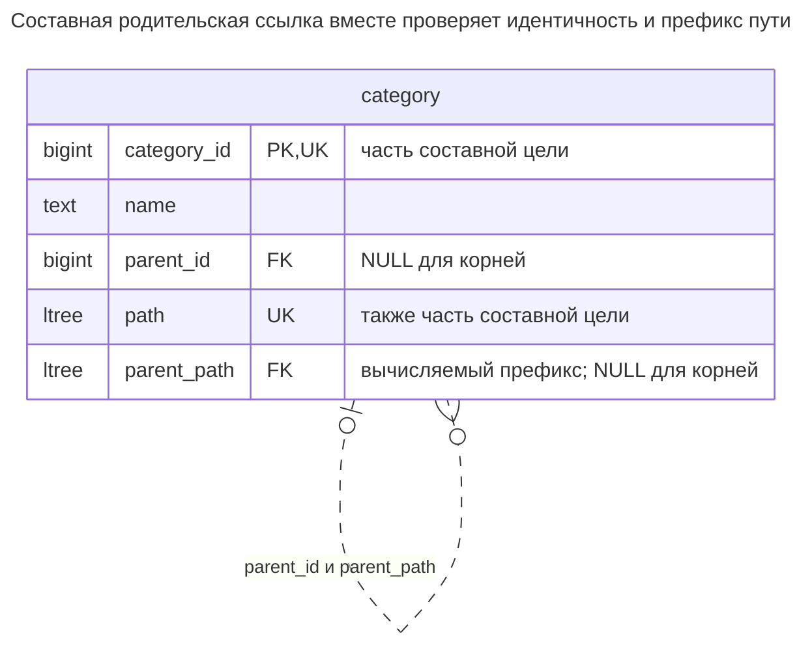
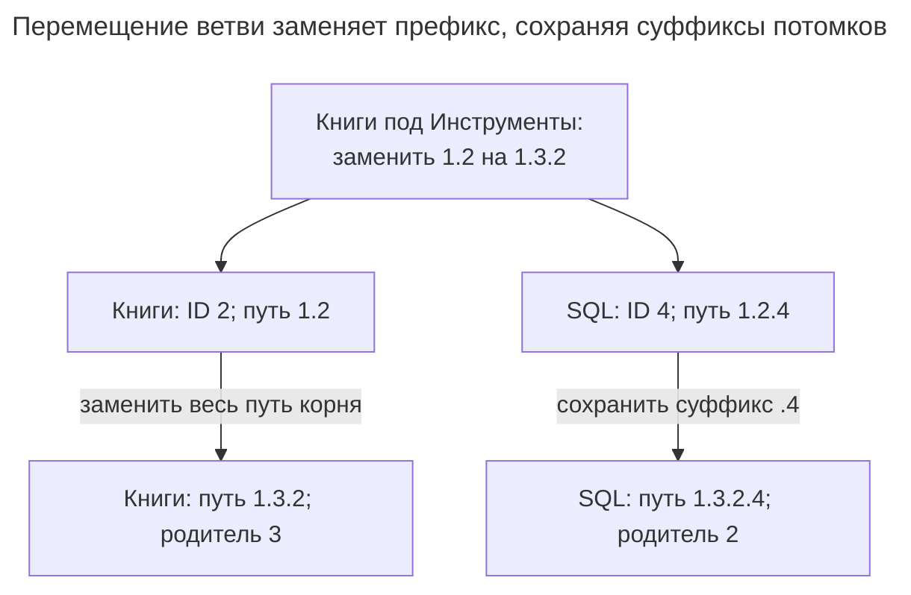
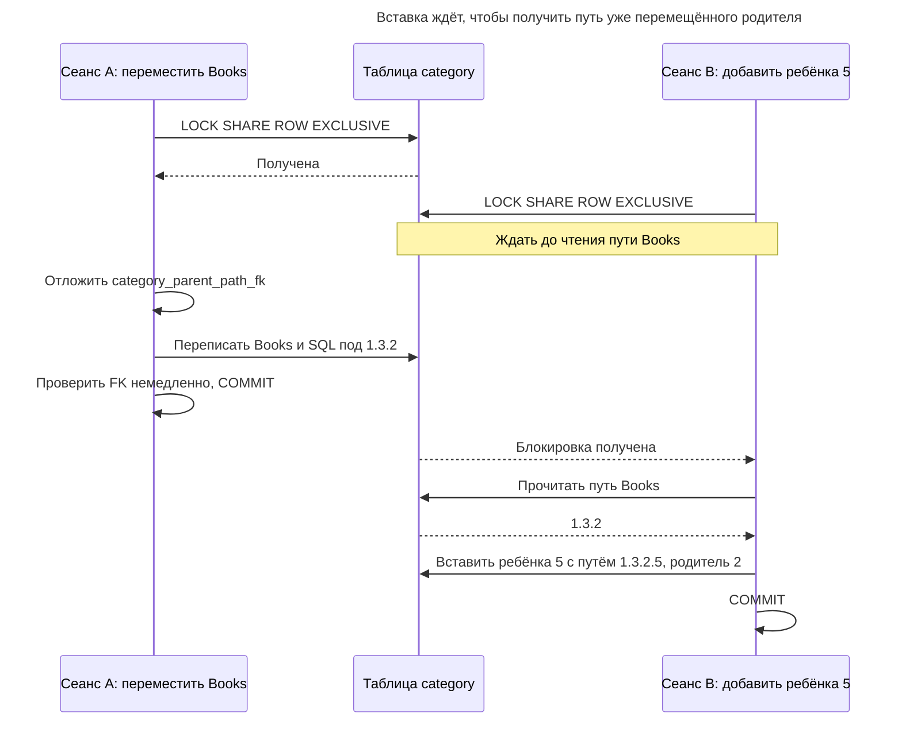
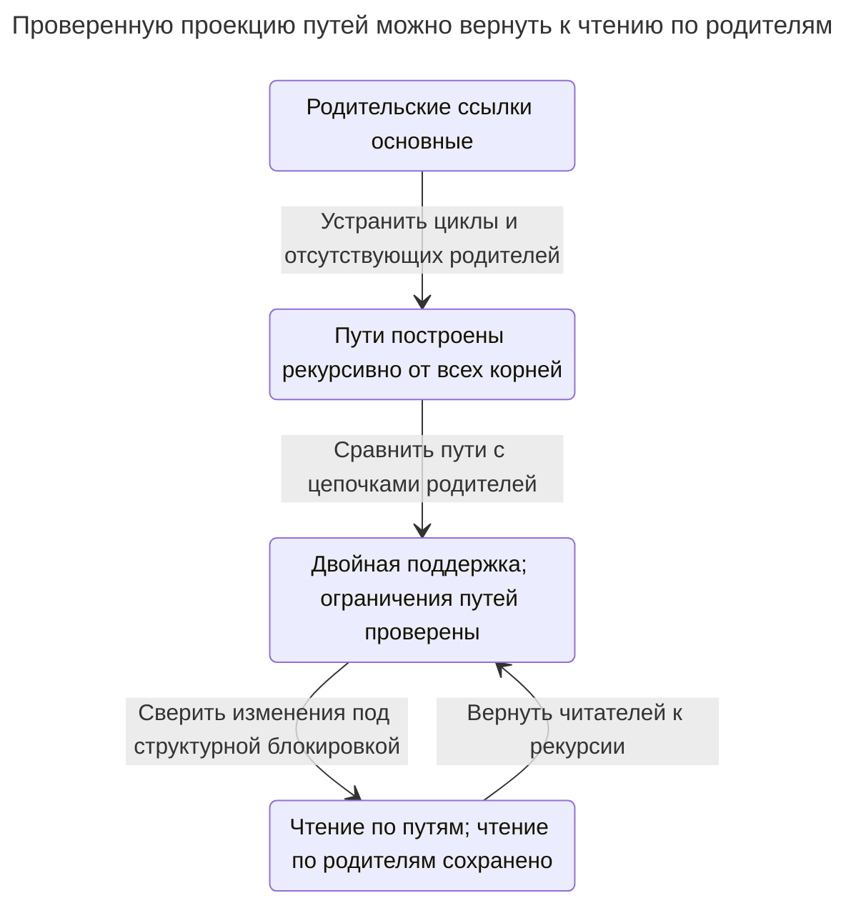

# Материализованный путь

## Назначение

Материализованный путь хранит в каждой строке полный путь от корня до узла, например `1.4.17`. Запросы поддеревьев и предков превращаются в сравнения путей, которые обслуживают подходящие индексы; PostgreSQL `ltree` и SQL Server `hierarchyid` предлагают для этого встроенные типы и операторы. Глава рассматривает кодирование пути, порядок соседей, цену перемещения поддерева с перезаписью пути каждого потомка и поддержание согласованности пути с родительской ссылкой ограничениями, триггерами или кодом приложения. [Руководство PostgreSQL `ltree`](https://www.postgresql.org/docs/18/ltree.html) документирует операторы путей меток и поддерживающие их индексы.

## Также известен как

Перечисление пути (Path enumeration), название из [слайдов Билла Карвина об иерархиях](https://www.slideshare.net/billkarwin/models-for-hierarchical-data). [MongoDB](https://www.mongodb.com/docs/manual/tutorial/model-tree-structures-with-materialized-paths/) использует «Materialized Paths»; [атрибут pathstring Кимбалла](https://www.kimballgroup.com/data-warehouse-business-intelligence-resources/kimball-techniques/dimensional-modeling-techniques/ragged-variable-depth-hierarchy/) применяет ту же идею к иерархиям измерений.

## Проблема

Вы часто читаете категорию со всеми потомками или показываете цепочку предков. Если есть только родительская ссылка, каждое чтение заново обходит иерархию. Вы готовы выполнять больше работы при перемещении ветви редактором, но хотите использовать в чтении уже вычисленных предков.

Произвольная строка кажется простым сокращением. Без границы меток префикс `1.2` совпадает и с `1.20`; без правила поддержки путь расходится с ID родителя. Изменение отображаемого имени категории не должно переписывать всех потомков. Значит, нужны однозначное кодирование, стабильные метки и явная связь пути с родительством.

## Решение

Храните путь каждого узла от корня до него самого, используя неизменяемые числовые ID как метки. Человекочитаемое имя держите отдельно. Реализация использует [расширение PostgreSQL `ltree`](https://www.postgresql.org/docs/18/ltree.html), где метки разделены точками, `<@` означает потомка или сам узел, а `@>` — предка или сам узел. Для этих операторов включения используйте GiST; обычное B-дерево по `ltree` поддерживает сравнения и равенство, но не такой поиск включения.

Сохраните `parent_id` для запросов непосредственных детей. Вычисляйте `parent_path` из пути текущей строки и задайте ссылку `(parent_id, parent_path)` на `(category_id, path)` настоящего родителя. Такой декларативный гибрид проверяет и идентичность, и префикс. Каждый родительский путь короче на одну метку, поэтому корректные ссылки не могут образовать цикл. Перемещение ветви меняет родителя её корня и переписывает все пути ветви в одной транзакции.

## Альтернативы и выбор

| Соседний паттерн | Связь | Определяющее требование |
| --- | --- | --- |
| [Список смежности](adjacency-list.md) | Замена; дополнение через сохранённую родительскую ссылку | Частые перемещения важнее заранее вычисленных предков |
| [Вложенные множества](nested-sets.md) | Замена | Вы публикуете почти статичное дерево и хотите агрегацию по интервалам |
| [Таблица замыканий](closure-table.md) | Замена | Нужны соединения предков/потомков с явным расстоянием или отдельно спроектированная модель нескольких родителей |
| `ltree` / SQL Server `hierarchyid` | Варианты реализации | Встроенные операторы и индексы оправдывают специфичный для движка SQL |

Полная таблица — в [Атласе решений](decision-atlas.md). Кодирование пути меняет хранение и индексацию, а не исходное требование одного родителя. Сочетание родительской ссылки и пути также даёт источник для перестроения пути.

## Структура



Одна строка несёт и идентичность узла, и его положение. Путь повторяет ID предков; родительский внешний ключ связывает закодированное положение с существующей строкой. ID SQL остаётся `4` после перемещения, хотя путь меняется.



Оба пути меняются, но лишь Books меняет идентичность родителя. Вычисляемый `parent_path` SQL становится `1.3.2`, совпадая с новым путём Books при отложенной проверке FK.

## Таблицы и инварианты

- **`category`** имеет стабильный первичный ключ и уникальный путь. Положительные ID становятся десятичными метками; `category_path_shape` требует совпадения последней метки с ID строки и ровно одной метки у корней.
- **`parent_path`** — хранимый вычисляемый столбец, а не ввод вызывающей стороны. PostgreSQL допускает [неизменяемые выражения генерации в пределах строки](https://www.postgresql.org/docs/18/ddl-generated-columns.html); это выражение убирает последнюю метку без поиска другой строки.
- **`category_parent_path_fk`** использует `MATCH FULL`, поэтому ID родителя и префикс должны оба быть `NULL` или вместе определять родителя. [Отложенные проверки внешних ключей](https://www.postgresql.org/docs/18/sql-createtable.html) допускают промежуточные состояния при перезаписи ветви, но требуют согласованного итога.
- **Сортировка** по пути следует порядку меток. [`ltree` сравнивает дочерние метки как текст](https://www.postgresql.org/docs/18/ltree.html), поэтому `10` предшествует `2`. Числовые ID дают стабильный порядок обхода, а не числовой порядок соседей или заданное редактором ранжирование.

## Когда применять

- Чтение поддеревьев и цепочек предков преобладает над перемещениями ветвей.
- У узла не более одного родителя, а ID остаются неизменными при смене меток или имён.
- Вы можете транзакционно поддерживать пути и не выполнять большие перезаписи в чувствительных ко времени ответа запросах.

## Последствия и компромиссы

- ➕ Сохранённые предки превращают условия поддеревьев и предков в прямые операции с путями.
- ➕ Гибридная схема отклоняет путь с неверным родителем без пользовательского триггера.
- ➖ Перемещение переписывает путь каждого потомка и его индексы; изменение ID предка сделало бы то же.
- ➖ Предки занимают место многократно, а пути растут с глубиной.
- ➖ Встроенные операторы путей и выражения вычисляемых столбцов делают реализацию специфичной для движка.

## Реализация

[Полный скрипт](../assets/materialized-path/materialized-path.sql), проверенный на PostgreSQL 18.6, устанавливает `ltree`, строит каталог из других примеров иерархий и проверяет ожидаемую ошибку внешнего ключа. Основные определения:

```sql
CREATE EXTENSION ltree;
CREATE TABLE category (
    category_id bigint PRIMARY KEY CHECK (category_id > 0),
    name text NOT NULL,
    parent_id bigint,
    path ltree NOT NULL UNIQUE,
    parent_path ltree GENERATED ALWAYS AS (
        CASE WHEN nlevel(path) > 1
             THEN subpath(path, 0, nlevel(path) - 1) END
    ) STORED,
    UNIQUE (category_id, path),
    CONSTRAINT category_path_shape CHECK (
        nlevel(path) > 0
        AND subpath(path, -1) = text2ltree(category_id::text)
        AND ((parent_id IS NULL) = (nlevel(path) = 1))
    ),
    CONSTRAINT category_parent_path_fk FOREIGN KEY (parent_id, parent_path)
        REFERENCES category (category_id, path) MATCH FULL
        DEFERRABLE INITIALLY IMMEDIATE
);
CREATE INDEX category_path_gist ON category USING gist (path);
CREATE INDEX category_parent_idx ON category (parent_id, parent_path);
```

Вставьте корень, затем получите путь ребёнка из сохранённого значения родителя. Каждый структурный писатель соблюдает один протокол блокировки:

```sql
BEGIN;
LOCK TABLE category IN SHARE ROW EXCLUSIVE MODE;
INSERT INTO category (category_id, name, parent_id, path)
VALUES (1, 'Catalog', NULL, '1');
INSERT INTO category (category_id, name, parent_id, path)
SELECT 2, 'Books', category_id, path || '2'::ltree
FROM category WHERE category_id = 1;
INSERT INTO category (category_id, name, parent_id, path)
VALUES (3, 'Tools', 1, '1.3'), (4, 'SQL', 2, '1.2.4');
COMMIT;
```

Прочитайте поддерево, включая Books, затем предков SQL, включая сам узел:

```sql
SELECT category_id, path FROM category
WHERE path <@ '1.2'::ltree ORDER BY path;
SELECT category_id, name FROM category
WHERE path @> '1.2.4'::ltree ORDER BY nlevel(path);
```

Первый запрос возвращает `(2, 1.2)` и `(4, 1.2.4)`; второй — Catalog, Books, SQL. Для непосредственных детей используйте `parent_id`, как показывает скрипт. Если в упрощённой схеме столбца нет, сочетайте включение с разницей глубины в один уровень.

Переместите Books под Tools, заменив старый префикс каждого узла ветви:

```sql
BEGIN;
LOCK TABLE category IN SHARE ROW EXCLUSIVE MODE;
SET CONSTRAINTS category_parent_path_fk DEFERRED;
WITH moving AS (
    SELECT s.category_id, s.path AS old_path,
           d.category_id AS new_parent_id,
           d.path || text2ltree(s.category_id::text) AS new_path
    FROM category AS s CROSS JOIN category AS d
    WHERE s.category_id = 2 AND d.category_id = 3
      AND NOT d.path <@ s.path
)
UPDATE category AS c
SET path = CASE WHEN c.category_id = m.category_id THEN m.new_path
                ELSE m.new_path || subpath(c.path, nlevel(m.old_path)) END,
    parent_id = CASE WHEN c.category_id = m.category_id
                     THEN m.new_parent_id ELSE c.parent_id END
FROM moving AS m WHERE c.path <@ m.old_path;
SET CONSTRAINTS category_parent_path_fk IMMEDIATE;
COMMIT;
```

Перемещение обновляет две строки. Books получает `1.3.2`, SQL — `1.3.2.4`, и лишь Books меняет `parent_id`. Условие назначения исключает перемещаемое поддерево вместе с корнем; требуйте ожидаемое число затронутых строк, чтобы не сообщить успех при отсутствующей цели или отклонённом перемещении. Отложите FK до конца перезаписи, затем принудительно проверьте до фиксации.

После перемещения изменить только родителя SQL нельзя:

```sql
UPDATE category SET parent_id = 1 WHERE category_id = 4;
```

PostgreSQL 18.6 возвращает SQLSTATE `23503`: `ERROR: insert or update on table "category" violates foreign key constraint "category_parent_path_fk"`, с уточнением `DETAIL: Key (parent_id, parent_path)=(1, 1.3.2) is not present in table "category".` Изменение лишь пути может нарушить то же ограничение. Скрипт удаляет всю ветвь Books условием включения; удаление одного предка отклоняется, пока на него ссылаются дети.

Удалите перемещённое поддерево Books одной транзакцией:

```sql
BEGIN;
LOCK TABLE category IN SHARE ROW EXCLUSIVE MODE;
DELETE FROM category WHERE path <@ '1.3.2'::ltree;
COMMIT;
```

## Поддержка в движках

- **PostgreSQL 18:** [`ltree`](https://www.postgresql.org/docs/18/ltree.html) — поставляемое расширение, устанавливаемое `CREATE EXTENSION`. Его класс операторов GiST поддерживает включение. Здесь нужен **хранимый** вычисляемый столбец: [ограничения виртуальных столбцов PostgreSQL 18](https://www.postgresql.org/docs/18/ddl-generated-columns.html) исключают пользовательские типы и функции.
- **SQL Server 2025 (17.x):** [`hierarchyid`](https://learn.microsoft.com/en-us/sql/relational-databases/hierarchical-data-sql-server?view=sql-server-ver17) — вариант с порядком обхода в глубину и `GetDescendant` для выдачи позиций между соседями. Сам по себе он не обеспечивает уникальности пути или существования родителя; руководство Microsoft также показывает схему FK с вычисляемым родителем.
- **MySQL 8.4:** текстовому пути нужны собственные кодирование и поддержка. InnoDB [не откладывает проверки внешних ключей](https://dev.mysql.com/doc/refman/8.4/en/constraint-foreign-key.html), поэтому перезаписи с отложенным составным FK выше нужна другая стратегия записи.
- **Oracle AI Database 26ai / SQLite 3:** документируют [отложенные ограничения Oracle](https://docs.oracle.com/en/database/oracle/oracle-database/26/sqlrf/constraint.html) и [отложенные внешние ключи SQLite](https://www.sqlite.org/foreignkeys.html). Они не предоставляют функции `ltree` PostgreSQL; кодирование пути и вычисляемое выражение переносите отдельно.

Для текстовой реализации ставьте разделители с обоих концов, например `/1/2/`, и ищите потомков по префиксу, привязанному к началу строки. PostgreSQL документирует [`text_pattern_ops`](https://www.postgresql.org/docs/18/indexes-opclass.html) для индексируемого сопоставления с шаблоном, когда локализованная сортировка не подходит. Поиск подстроки ID в любой части пути — другой запрос. Поиск предков может перечислять полные префиксы для поиска по равенству; это не то же самое, что один проход по префиксу потомков.

## Сбои и конкурентность

Конкурентная вставка может получить путь ребёнка из старого положения, пока другая транзакция перемещает родителя. Внешний ключ предотвращает зафиксированное рассогласование этой схемы, но не выбирает успешный запрос редактора. Пример использует [конфликтующую с собой блокировку таблицы](https://www.postgresql.org/docs/18/explicit-locking.html#LOCKING-TABLES), полученную до чтения путей при [Read Committed](https://www.postgresql.org/docs/18/transaction-iso.html#XACT-READ-COMMITTED), для сериализации структурных операций. Сохраняйте ID неизменными и включайте вставки и удаления в протокол.



Это гипотетическая вставка после перемещения примера по тому же протоколу блокировки. Она читает новый префикс лишь после фиксации перемещения, поэтому ребёнок сразу занимает правильное место.

Выполняйте всю перезапись в одной транзакции. При любой ошибке откатывайте и перед повтором вычисляйте префиксы заново по текущим строкам. Не делите большое перемещение поддерева на независимо фиксируемые пакеты: дети ссылались бы на смесь положений. Если перемещение слишком велико для одной транзакции, публикуйте отдельно построенную версию иерархии и переключайте читателей после проверки вместо показа наполовину перемещённого дерева.

## Миграция

При переходе со списка смежности сначала устраните циклы и отсутствующих родителей. Добавьте отдельную проекцию путей и заполните её рекурсивно от всех корней по стабильным ID. Оставьте родительские ссылки основными, пока управляемый писатель обновляет оба представления; сравнивайте каждый сохранённый путь с полученным из цепочки родителей.

Постройте и проверьте заменяющую таблицу с ограничениями путей до переключения чтения. Сверьте конкурентные изменения под короткой структурной блокировкой при переходе и сохраните ID, чтобы внешние ссылки других таблиц не изменились. Оставьте чтение по родителям и двойную поддержку на время отката. Вернуть рекурсивное чтение можно без изменения идентичности узлов; прекращайте запись путей лишь после отказа всех читателей от них.



Переход меняет представление чтения, оставляя стабильные ID и родительские ссылки доступными. Возврат к рекурсии возможен на всём протяжении окна отката с двойной поддержкой.

## Антипаттерны и частые ошибки

- Использовать имена как метки идентичности, заставляя исправление написания переписывать всю ветвь.
- Искать `1.2%` в произвольной строке и случайно выбирать `1.20`.
- Считать, что `ltree` или `hierarchyid` сами доказывают существование родителя.
- Перемещать только путь корня ветви или обновлять `parent_id` без перестроения путей потомков.
- Ожидать, что текстовая сортировка ID кодирует заданный приложением порядок соседей.

## Известные применения

- [Пример `ltree` PostgreSQL](https://www.postgresql.org/docs/18/ltree.html#LTREE-EXAMPLE) хранит и индексирует пути вроде `Top.Science.Astronomy`.
- [Примеры иерархических организаций Microsoft](https://learn.microsoft.com/en-us/sql/relational-databases/hierarchical-data-sql-server?view=sql-server-ver17) кодируют позиции дерева через `hierarchyid`.
- [Руководство Materialized Paths MongoDB](https://www.mongodb.com/docs/manual/tutorial/model-tree-structures-with-materialized-paths/) хранит ID предков строкой с разделителями; запросы с регулярными выражениями показывают важность корневого префикса.

## Связанные паттерны

- [Список смежности](adjacency-list.md) даёт родительские ссылки для перестроения путей.
- [Вложенные множества](nested-sets.md) заменяют кодирование пути интервальной нумерацией.
- [Таблица замыканий](closure-table.md) хранит предков отдельными индексируемыми парами.
