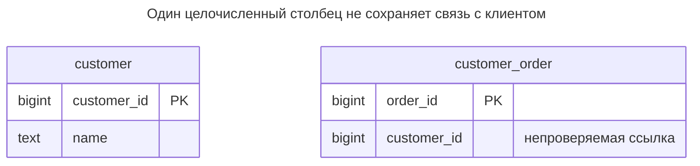
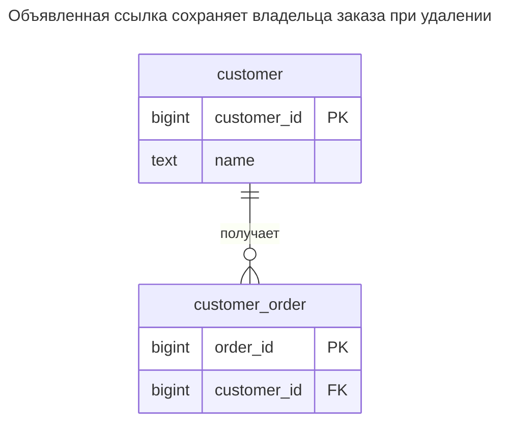
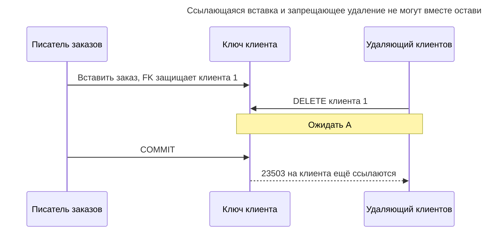
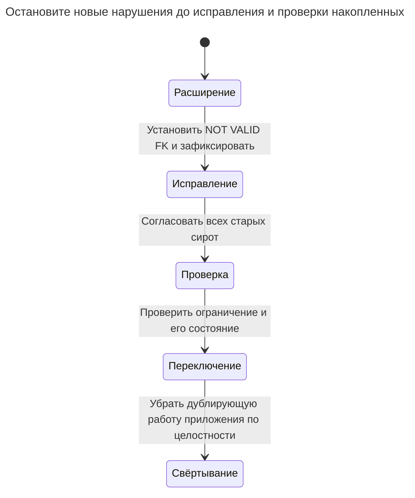

# Отсутствующие внешние ключи

Отказ от внешних ключей — хранение ссылок без объявления соответствующих ограничений, обычно ради экономии проверок или обеспечения целостности кодом приложения. Рано или поздно появляются строки, указывающие на удалённые или никогда не существовавшие записи, и каждому запросу и отчёту приходится защищаться от них. Глава показывает появление сирот, реальную цену ограничения, очистку существующих данных и добавление ограничений без длительных блокировок. Билл Карвин называет это Keyless Entry.

## Также известен как

Keyless Entry в [оглавлении SQL Antipatterns Билла Карвина](https://pragprog.com/titles/bksap1/sql-antipatterns-volume-1/). Здесь «без ключей» означает отсутствие объявленных связей, даже если у каждой таблицы есть первичный ключ.

## Контекст

Заказы принадлежат клиентам в одной базе. Приложение загружает клиента перед созданием заказа и проверяет заказы перед удалением клиента. При одном писателе этого кажется достаточно. Импорты, служебный SQL и конкурентные транзакции добавляют пути без той же последовательности проверок.

## Проблема

Вы храните `customer_id` как обычное обязательное целое число. База проверяет его наличие, но схема не определяет, какие числа обозначают клиентов и как удаление клиента влияет на существующие заказы. Предварительная проверка приложения говорит о прошлом наблюдении; она не резервирует родителя до фиксации ссылающейся записи.

Не путайте этот случай с удалённым идентификатором. Локальный внешний ключ уместен, когда сущность и её жизненный цикл принадлежат этой базе. ID удалённого сервиса, исторический идентификатор источника или временно неразрешённая промежуточная запись могут намеренно не иметь локальной цели; явно назовите этот более слабый контракт, не представляя его гарантированной локальной связью.

## Почему так делают

Вы избегаете поиска по внешним ключам и конкуренции за ключ родителя либо хотите принимать импорт в любом порядке. Это реальные эксплуатационные вопросы. Им нужны измеренная нагрузка и проект приёма данных, а не постоянное предположение, что все писатели соблюдают необъявленный инвариант. Промежуточная таблица принимает неразрешённые данные, пока опубликованные таблицы остаются ограниченными.

## Последствия

- ➖ Отчёты с внутренними соединениями молча пропускают сиротские заказы этого примера.
- ➖ Удаление родителя не имеет объявленной политики зависимостей и оставляет обязательные ссылки неразрешёнными.
- ➖ Очистка должна угадывать, является сирота ошибочной ссылкой, потерянным родителем или исторической записью.
- ➖ Команды приложения воссоздают одинаковые проверки и синхронизацию для каждого пути записи.
- ➖ Позднее добавление правила требует аудита данных и запланированного окна проверки.

## Признаки

- Столбец, названный ID другой таблицы, не имеет внешнего ключа.
- Задание исправления с антисоединением регулярно находит новых сирот.
- Массовый загрузчик выключает ограничения и предполагает, что включение проверит старые строки.
- Столбец арендатора стоит рядом с чужим ID, но ссылка не включает область принадлежности.

## Как лучше

Объявите предполагаемую связь, включая допустимость `NULL` и действие удаления. Для заказов, обязанных сохранять клиента, используйте обязательный внешний ключ с запретом удаления. Для зависимых фактов, полностью принадлежащих родителю, уместен каскад. PostgreSQL описывает [действия ссылок](https://www.postgresql.org/docs/18/ddl-constraints.html#DDL-CONSTRAINTS-FK); выбирайте сначала бизнес-смысл, затем удобство.

### Альтернативы и выбор

| Выбор | Связь | Когда выбирать |
| --- | --- | --- |
| Обычный внешний ключ | Замена непроверяемой локальной ссылки | Родитель и потомок разделяют границу целостности базы |
| Отложенный внешний ключ | Вариант реализации | Транзакции нужна временная свобода порядка вставки, но корректность к фиксации обязательна |
| Промежуточная таблица без ограничений и проверяемый импорт | Дополнение | Источники приходят не по порядку или требуют карантина до публикации |
| [Исключающая дуга](exclusive-arc.md) | Замена ссылки на несколько видов целей | Небольшому набору целей нужны настоящие внешние ключи и ровно один владелец |
| [Общая схема](shared-schema.md) | Дополнение | Принадлежность арендатору требует составной связи с областью, а не просто существующего ID |

[Откладываемое ограничение PostgreSQL](https://www.postgresql.org/docs/18/sql-set-constraints.html) переносит проверку внутри одной транзакции, а не между произвольными зафиксированными этапами загрузки. [Полиморфным связям](polymorphic-associations.md) нужна другая структура ссылки. Полная таблица — в [Атласе решений](decision-atlas.md).

## Пример

### Структура

**Было:** заказы содержат номера клиентов без объявленной связи.



У обеих таблиц есть первичные ключи. Ни один не ограничивает `customer_order.customer_id` другой таблицей.

```sql
CREATE TABLE customer (customer_id bigint PRIMARY KEY, name text NOT NULL);
CREATE TABLE customer_order (
    order_id bigint PRIMARY KEY,
    customer_id bigint NOT NULL
);
INSERT INTO customer VALUES (1, 'Harbor'), (2, 'Meadow');
INSERT INTO customer_order VALUES (10, 1), (20, 2);
DELETE FROM customer WHERE customer_id = 2;
SELECT o.order_id, o.customer_id FROM customer_order AS o
LEFT JOIN customer AS c USING (customer_id) WHERE c.customer_id IS NULL;
```

Антисоединение возвращает `(20, 2)`. Удаление прошло, оставив заказ без обязательного клиента.

**Стало:** исправляем существующую таблицу и проверяем настоящую ссылку.



У заказа должен быть один существующий клиент. У клиента может не быть заказов. Политика удаления по умолчанию запрещает удалять используемого клиента.

```sql
CREATE INDEX customer_order_customer_idx ON customer_order (customer_id);
ALTER TABLE customer_order ADD CONSTRAINT customer_order_customer_fk
    FOREIGN KEY (customer_id) REFERENCES customer (customer_id) NOT VALID;
```

[Внешний ключ `NOT VALID`](https://www.postgresql.org/docs/18/sql-altertable.html) PostgreSQL проверяет последующие записи, откладывая сканирование существующих данных. Зафиксируйте установку до последующей проверки. Старая сирота видна для исправления, а новая уже отклоняется:

```sql
INSERT INTO customer_order VALUES (30, 999);
```

PostgreSQL 18.6 возвращает SQLSTATE `23503`: `ERROR: insert or update on table "customer_order" violates foreign key constraint "customer_order_customer_fk"`. Уточнение сообщает об отсутствующем `(customer_id)=(999)`.

```sql
CREATE TABLE order_reject (
    order_id bigint PRIMARY KEY,
    customer_id bigint NOT NULL,
    reason text NOT NULL
);
BEGIN;
LOCK TABLE customer_order, customer IN SHARE ROW EXCLUSIVE MODE;
INSERT INTO order_reject
SELECT o.order_id, o.customer_id, 'missing customer'
FROM customer_order AS o LEFT JOIN customer AS c USING (customer_id)
WHERE c.customer_id IS NULL;
DELETE FROM customer_order AS o USING order_reject AS r
WHERE o.order_id = r.order_id;
COMMIT;
ALTER TABLE customer_order VALIDATE CONSTRAINT customer_order_customer_fk;
SELECT order_id, customer_id FROM customer_order ORDER BY order_id;
SELECT * FROM order_reject ORDER BY order_id;
```

Заказ `10` остаётся `(10, 1)`; таблица отказов сохраняет `(20, 2, missing customer)`. Карантин — выбранная практикумом судьба. В эксплуатации исследуйте заказ и восстановите или исправьте родителя при наличии оснований; не удаляйте коммерческие записи лишь ради успешной проверки. Два изменения атомарны, а исходные ID доступны для сверки.

```sql
DELETE FROM customer WHERE customer_id = 1;
```

PostgreSQL 18.6 возвращает SQLSTATE `23503`: `ERROR: update or delete on table "customer" violates foreign key constraint "customer_order_customer_fk" on table "customer_order"`. [Полный скрипт](../assets/missing-foreign-keys/missing-foreign-keys.sql) проверяет обе ошибки и подтверждает проверенное состояние ограничения.

### Поддержка в движках

- **PostgreSQL 18:** объявление внешнего ключа [не создаёт индекс потомка](https://www.postgresql.org/docs/18/ddl-constraints.html#DDL-CONSTRAINTS-FK). Добавляйте его для удаления родителей и поиска потомков по необходимости; не заявляйте универсальную цену производительности без измерения этих операций.
- **MySQL 8.4 / InnoDB:** [нужные индексы потомков создаются автоматически при отсутствии, а повторное включение `foreign_key_checks` не сканирует существующие данные](https://dev.mysql.com/doc/refman/8.4/en/create-table-foreign-keys.html). Включение не эквивалентно проверке PostgreSQL.
- **SQL Server:** [включённое и доверенное — отдельные состояния](https://learn.microsoft.com/en-us/sql/relational-databases/tables/disable-foreign-key-constraints-with-insert-and-update-statements?view=sql-server-ver17). Для проверки недоверенной ссылки используйте документированную процедуру `WITH CHECK CHECK CONSTRAINT`.
- **Oracle:** [`ENABLE NOVALIDATE` и `ENABLE VALIDATE`](https://docs.oracle.com/en/database/oracle/oracle-database/26/sqlrf/constraint.html) разделяют проверку новых записей и существующих строк. Переносите последовательность развёртывания, а не ключевые слова PostgreSQL.
- **SQLite:** [внешние ключи включаются для каждого соединения до транзакции](https://www.sqlite.org/foreignkeys.html#fk_enable). Объявленный, но выключенный ключ сохраняет исходную проблему.

### Сбои и конкурентность

Обычное чтение родителя не мешает другой транзакции его удалить. Объявленный внешний ключ координируется с удалением ключа родителя; [блокировки key-share PostgreSQL](https://www.postgresql.org/docs/18/explicit-locking.html#LOCKING-ROWS) запрещают удаление до завершения ссылающейся транзакции.



Если первой зафиксируется удаляющая транзакция, провалится последующая вставка. Обрабатывайте оба исхода как бизнес-конфликт. Ссылочная целостность не сохраняет удалённого клиента навсегда, а одна повышенная изоляция не заменяет отсутствующее правило связи.

### Миграция

Учтите столбцы связей и число сирот, выберите политики удаления и устраните ошибки области. Установите внешний ключ как `NOT VALID`, остановив новые нарушения, затем исправляйте накопленные. [Правила блокировок `ALTER TABLE` PostgreSQL](https://www.postgresql.org/docs/18/sql-altertable.html) требуют `SHARE ROW EXCLUSIVE` на обеих таблицах при установке и `SHARE UPDATE EXCLUSIVE` на потомке при проверке. Это шаги с меньшим влиянием, а не без блокировок.



Для большого потомка создайте вспомогательный индекс [конкурентно](https://www.postgresql.org/docs/18/sql-createindex.html#SQL-CREATEINDEX-CONCURRENTLY) вне транзакционного блока. Ограничивайте ожидания DDL, исправляйте небольшими пакетами и требуйте явной проверки до объявления успеха. Оставьте пользовательские проверки ради понятных сообщений, а окончательную гонку пусть решает база. Дисциплина развёртывания — в [Расширении и свёртывании](expand-contract.md).

## Связанные паттерны и антипаттерны

- [Полиморфные связи](polymorphic-associations.md) требуют фиксированной границы ссылок до добавления внешнего ключа.
- [Исключающая дуга](exclusive-arc.md) предоставляет фиксированные столбцы целей для разных видов родителей.
- [Общая схема](shared-schema.md) включает область принадлежности в ссылки.
- [Расширение и свёртывание](expand-contract.md) разделяет установку, очистку и проверку.
