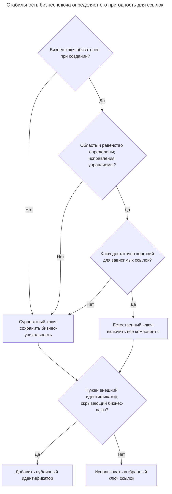
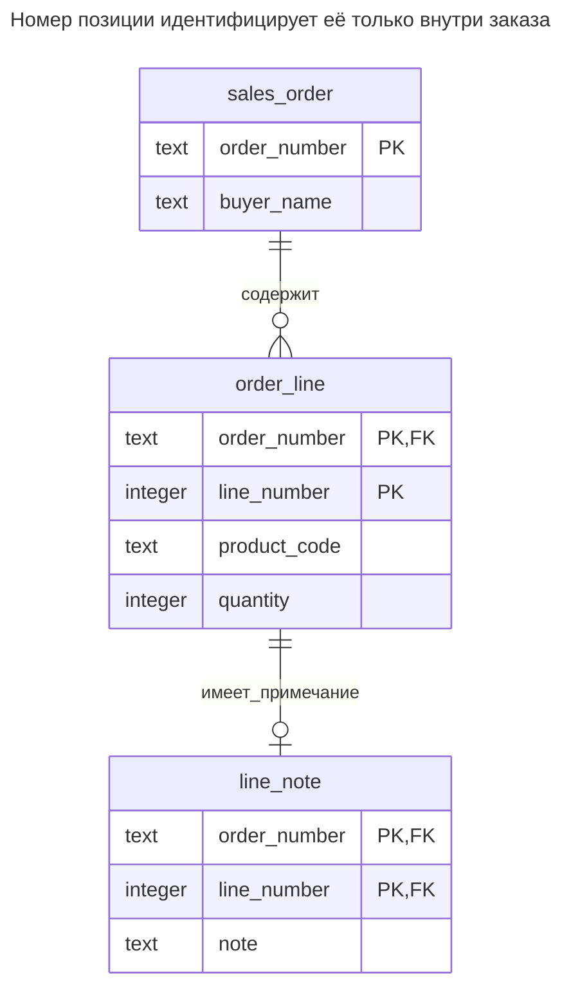
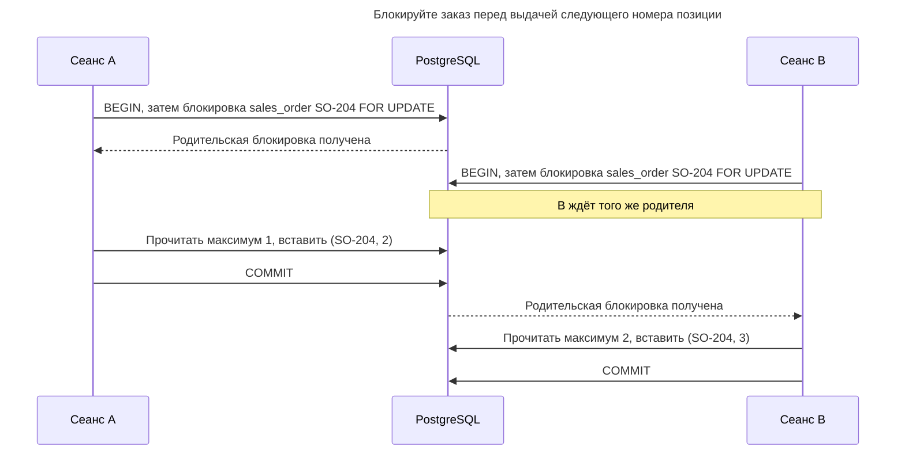

# Естественный ключ

## Назначение

Естественный ключ идентифицирует строку по атрибутам, которые бизнес уже использует: коду страны, ISBN или номеру заказа вместе с номером позиции. Если сделать его первичным ключом, можно избежать соединений ради поиска идентификатора и исключить дубликаты этого ключа самой схемой, но изменение значения потребует обновить и ссылки. Оцените, стабильно ли значение, уникально ли оно и всегда ли известно при вставке; используйте составной ключ, когда идентичность определяется несколькими атрибутами, и сохраняйте бизнес-уникальность даже при выборе суррогатного первичного ключа. Это соответствует [различию между естественными, составными и суррогатными ключами у Эмблера](https://agiledata.org/essays/keys.html).

## Также известен как

Бизнес-ключ. Составной естественный ключ содержит несколько бизнес-атрибутов. В [терминологии Эмблера](https://agiledata.org/essays/keys.html) потенциальный ключ позволяет идентифицировать строку; выбранный становится первичным, остальные — альтернативными. Слово «составной» описывает число столбцов, а не естественный или генерируемый смысл значений.

## Проблема

Отдел заказов уже обозначает позицию как «позиция 1 заказа SO-104». Если заменить это несвязанным `line_id` и не обеспечить уникальность пары, две строки смогут одновременно претендовать на эту позицию. Тогда код приложения должен решать, к какой из них относится исправление.

Пара полезна лишь в объявленной области уникальности. Номер заказа уникален во всех магазинах или только в одном магазине за один год? Могут ли операторы перенумеровывать позиции после оформления? Может ли один товар присутствовать в нескольких позициях? Если товар может повторяться, его код не заменяет номер позиции. Ответьте на эти вопросы до выбора столбцов.

## Решение

Используйте `sales_order.order_number` как первичный ключ заказа, а `(order_number, line_number)` — как первичный ключ позиции. Ссылайтесь на позицию обоими значениями. [Первичные ключи](https://www.postgresql.org/docs/18/ddl-constraints.html#DDL-CONSTRAINTS-PRIMARY-KEYS) PostgreSQL обеспечивают уникальность и отсутствие `NULL`; [составные внешние ключи](https://www.postgresql.org/docs/18/ddl-constraints.html#DDL-CONSTRAINTS-FK) ссылаются на соответствующую группу столбцов.

Оценивайте предполагаемый естественный ключ на реальных сценариях записи. Требуйте его при создании, документируйте область уникальности, определите правила равенства и выясните, кто может менять или повторно использовать значение. Если что-то из этого не определено, предпочтите другой первичный ключ. После назначения бизнес-значения вы по-прежнему можете обеспечить его корректность через `NOT NULL` и `UNIQUE`. Внешний стандарт идентификатора сам по себе не доказывает, что он обозначает сущность вашей таблицы: изданию книги и физическому экземпляру нужны разные идентификаторы.

## Альтернативы и выбор

| Соседний паттерн | Связь | Определяющее требование |
| --- | --- | --- |
| [Суррогатный ключ](surrogate-key.md) | Замена первичного ключа; дополнение к ограничению естественной уникальности | Бизнес-значения меняются, появляются поздно или делают ссылки слишком широкими |
| [Упорядоченный идентификатор](time-ordered-identifier.md) | Вариант реализации суррогатной замены | Распределённая генерация ID — отдельное от бизнес-уникальности требование |
| [Публичный идентификатор](public-identifier.md) | Дополнение | Нужен внешний идентификатор без публикации бизнес-ключа |

Полное сравнение — в [Атласе решений](decision-atlas.md). Составной ключ особенно полезен для [Таблицы связей](association-table.md); [Обязательные суррогаты](mandatory-surrogates.md) предостерегают от добавления ID с потерей инварианта пары.



Составная идентичность полезна, только когда вся её область известна и приемлема для каждой зависимой таблицы. Решение о публичном идентификаторе остаётся отдельным от выбора первичного ключа.

## Структура



Позиция непосредственно хранит номер заказа, поэтому её содержимое можно найти без соединения ради получения номера. Примечание хранит полный идентификатор позиции. В этом примере перенумерация заказа каскадно проходит через оба уровня.

## Таблицы и инварианты

- **`sales_order`** допускает один заказ для каждого номера, отличного от `NULL`.
- **`order_line`** допускает одну строку на пару из заказа и номера позиции. Она требует существующего заказа и положительных номеров позиций и количеств, но не требует непрерывной нумерации.
- **`line_note`** допускает не более одного примечания на позицию и не может ссылаться на отсутствующую позицию. Оба столбца внешнего ключа обязательны, поэтому частичная ссылка невозможна.
- **Перенумерация** использует `ON UPDATE CASCADE` на обоих внешних ключах. PostgreSQL описывает это действие в [правилах внешних ключей](https://www.postgresql.org/docs/18/ddl-constraints.html#DDL-CONSTRAINTS-FK).

## Когда применять

- Короткий бизнес-идентификатор существует до создания строки, а его область уникальности соответствует таблице.
- Вы контролируете исправления и повторное использование; изменения достаточно редки, чтобы безопасно обновлять зависимые ссылки.
- Зависимая строка или связь естественно адресуется кортежем, уже известным вызывающей стороне.

## Последствия и компромиссы

- ➕ Первичный ключ обеспечивает ту же идентичность, которой пользуется отдел заказов.
- ➕ Запросам по номеру заказа и позиции не нужен дополнительный поиск ID.
- ➖ Каждый потомок должен хранить и передавать все столбцы ключа.
- ➖ Перенумерация затрагивает потомков; публикация номера создаёт обязательства и за пределами базы данных.
- ➖ Последующее расширение области уникальности может потребовать изменить все ссылки: например, заменить номер заказа парой «магазин и заказ».

## Реализация

Запустите [полный скрипт](../assets/natural-key/natural-key.sql), чтобы проверить вставку, поиск, каскадное исправление и отклонение недопустимой записи:

```sql
CREATE TABLE sales_order (
    order_number text PRIMARY KEY,
    buyer_name text NOT NULL
);
CREATE TABLE order_line (
    order_number text NOT NULL REFERENCES sales_order (order_number)
        ON UPDATE CASCADE,
    line_number integer NOT NULL CHECK (line_number > 0),
    product_code text NOT NULL,
    quantity integer NOT NULL CHECK (quantity > 0),
    CONSTRAINT order_line_pkey PRIMARY KEY (order_number, line_number)
);
CREATE TABLE line_note (
    order_number text NOT NULL,
    line_number integer NOT NULL,
    note text NOT NULL,
    PRIMARY KEY (order_number, line_number),
    FOREIGN KEY (order_number, line_number)
        REFERENCES order_line (order_number, line_number) ON UPDATE CASCADE
);
```

Исправляйте родительский ключ вместо независимого обновления потомков:

```sql
INSERT INTO sales_order VALUES ('SO-104', 'Northwind');
INSERT INTO order_line VALUES ('SO-104', 1, 'PEN', 2);
INSERT INTO line_note VALUES ('SO-104', 1, 'Gift wrap');
SELECT product_code, quantity FROM order_line
WHERE order_number = 'SO-104' AND line_number = 1;
UPDATE sales_order SET order_number = 'SO-204'
WHERE order_number = 'SO-104';
SELECT order_number, line_number, note FROM line_note;
```

Первый запрос возвращает `(PEN, 2)`; после обновления примечание имеет вид `(SO-204, 1, Gift wrap)`. Дублирование позиции недопустимо:

```sql
INSERT INTO order_line VALUES ('SO-204', 1, 'PENCIL', 1);
```

PostgreSQL 18.6 возвращает SQLSTATE `23505`: `ERROR: duplicate key value violates unique constraint "order_line_pkey"`, с уточнением `DETAIL: Key (order_number, line_number)=(SO-204, 1) already exists.` Добавление `line_id` не оправдывает удаление ограничения уникальности пары.

## Поддержка в движках

- **PostgreSQL 18:** показанные составные ключи и каскадные обновления реализуют пример полностью.
- **MySQL 8.4 / InnoDB:** поддерживает [`ON UPDATE CASCADE`](https://dev.mysql.com/doc/refman/8.4/en/create-table-foreign-keys.html). [Вторичные индексы содержат первичный ключ](https://dev.mysql.com/doc/refman/8.4/en/innodb-index-types.html), поэтому широкий составной бизнес-ключ увеличивает и их объём.
- **SQL Server 2025 (17.x):** поддерживает [составные первичные и внешние ключи и каскадные обновления](https://learn.microsoft.com/en-us/sql/t-sql/statements/create-table-transact-sql?view=sql-server-ver17). Перед выбором каскадов проверьте весь граф зависимостей: SQL Server [отклоняет множественные каскадные пути](https://learn.microsoft.com/en-us/sql/relational-databases/errors-events/mssqlserver-1785-database-engine-error?view=sql-server-ver17).
- **Oracle AI Database 26ai:** [синтаксис внешних ключей](https://docs.oracle.com/en/database/oracle/oracle-database/26/sqlrf/constraint.html) предлагает действия `ON DELETE`, но не `ON UPDATE CASCADE`. Выбирайте неизменяемые естественные ключи или проектируйте явную процедуру исправления вместо прямого переноса этого обновления.
- **SQLite 3:** обычные таблицы могут [допускать `NULL` в нецелочисленных первичных ключах](https://www.sqlite.org/lang_createtable.html#the_primary_key); явно задавайте `NOT NULL` или используйте [`WITHOUT ROWID`](https://www.sqlite.org/withoutrowid.html). Включайте [проверку внешних ключей для каждого соединения](https://www.sqlite.org/foreignkeys.html#fk_enable).

## Сбои и конкурентность

Разрешайте конфликтующие вставки ограничением уникальности вместо проверки свободной пары в коде приложения. PostgreSQL [ожидает конфликтующие незафиксированные записи индекса](https://www.postgresql.org/docs/18/index-unique-checks.html), прежде чем решить, существует ли дубликат. Этим правилам целостности не нужны общая блокировка приложения или сериализуемая изоляция.

Выдача номера позиции — другая задача. Если вы вычисляете `MAX(line_number) + 1`, сериализуйте выдачу в пределах заказа: например, берите [блокировку `FOR UPDATE`](https://www.postgresql.org/docs/18/explicit-locking.html#LOCKING-ROWS) на родителе внутри транзакции вставки, причём все участники должны соблюдать этот протокол. Иначе ожидайте конфликт и повторяйте попытку. При исправлении нескольких заказов соблюдайте единый порядок блокировок. После неопределённого результата фиксации прочитайте исходную пару и сравните содержимое; не создавайте автоматически новую позицию с другим номером.



При изоляции read committed сеанс B читает номера позиций новым оператором после захвата блокировки. Первичный ключ по-прежнему отклонит повтор пары, если писатель обойдёт протокол выдачи номеров.

## Миграция

Сначала найдите `NULL`, дубликаты и значения, равенство которых приложение трактует иначе. Исправьте их до того, как бизнес-ключ станет основным. Сохраняйте текущий суррогат, пока [конкурентно](https://www.postgresql.org/docs/18/sql-createindex.html#SQL-CREATEINDEX-CONCURRENTLY) создаёте уникальный индекс на естественных столбцах. Добавьте столбцы естественных ссылок потомкам, записывайте обе формы и заполните новые значения через старый ID. Добавьте и [проверьте новые внешние ключи](https://www.postgresql.org/docs/18/sql-altertable.html), затем сравните оба пути перед переключением чтения. Предусмотрите короткие окна блокировок DDL и отложите удаление старых ссылок.

Суррогатный первичный ключ можно сохранить навсегда, а естественный предоставить как альтернативный. Чтобы отменить логическое переключение, пока оба набора столбцов сохранены, восстановите старый путь чтения и продолжайте двойную запись. Если бизнес-значения уже исправляли, ищите по сохранённому суррогатному соответствию, а не по устаревшему номеру.

```mermaid
---
title: Проверяйте естественные ссылки, пока сохранено суррогатное соответствие
---
stateDiagram-v2
  direction TB
  state "Действуют суррогатные ссылки" as Old
  state "Бизнес-значения очищены и уникальны" as Clean
  state "Обе формы ссылок записаны и заполнены" as Dual
  state "Естественные FK проверены; пути согласованы" as Valid
  state "Чтение по естественному ключу" as Natural
  state "Суррогат сохранён как соответствие" as Retained
  [*] --> Old
  Old --> Clean: Устранить NULL и дубликаты
  Clean --> Dual: Добавить столбцы потомкам
  Dual --> Valid: Проверить и сравнить
  Valid --> Natural: Переключить чтение
  Natural --> Retained: Сохранить идентичность для отката
  Retained --> Old: Вернуть старое чтение; сохранить двойную запись
  class Clean,Dual,Valid,Natural accent
  class Old,Retained muted
```



Логическое переключение не требует удаления суррогатного первичного ключа. Сохранённое соответствие позволяет при откате найти ту же сущность даже после изменения бизнес-номера.

## Антипаттерны и частые ошибки

- Объявлять значение стабильным лишь потому, что оно ещё не менялось. Выясните, как обрабатываются слияния, исправления и повторное использование идентификаторов.
- Пропускать часть составной ссылки: число `1` само по себе не идентифицирует позицию.
- Принимать порядок отображения за идентичность. Перестановка списка не должна незаметно переименовывать строки, на которые ссылаются другие таблицы; см. [Упорядоченная коллекция](ordered-collection.md).
- Добавлять суррогат и удалять естественную уникальность; см. [Обязательные суррогаты](mandatory-surrogates.md).

## Известные применения

- [Статья Эмблера о ключах](https://agiledata.org/essays/keys.html) объясняет естественные ключи через существующие атрибуты реального мира и явно выделяет составные ключи.
- [Примеры ограничений PostgreSQL](https://www.postgresql.org/docs/18/ddl-constraints.html#DDL-CONSTRAINTS-FK) используют пару «товар и заказ» как первичный ключ `order_items`: идентичность принадлежит связи, а не новому генерируемому столбцу.

## Связанные паттерны

- [Суррогатный ключ](surrogate-key.md) изолирует ссылки от изменяемых бизнес-идентификаторов.
- [Таблица связей](association-table.md) использует составную идентичность отношений.
- [Упорядоченный идентификатор](time-ordered-identifier.md) — вариант замены естественного первичного ключа генерируемым.
- [Публичный идентификатор](public-identifier.md) позволяет не публиковать чувствительный бизнес-ключ.
- [Обязательные суррогаты](mandatory-surrogates.md) описывает цену добавления ID без сохранения бизнес-идентичности.
