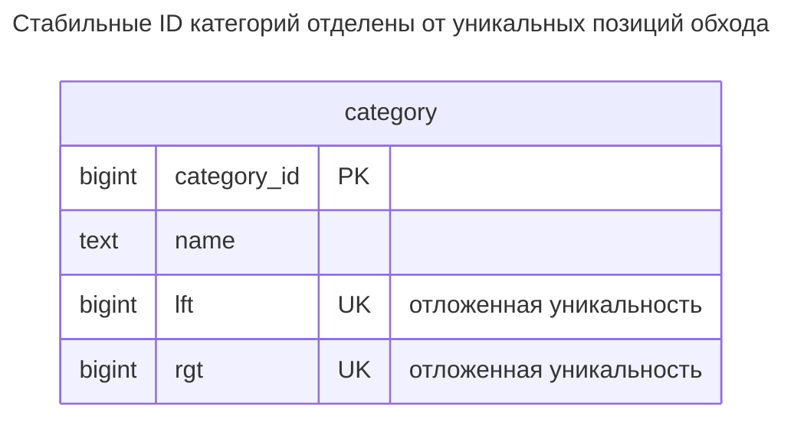
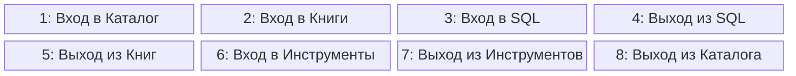
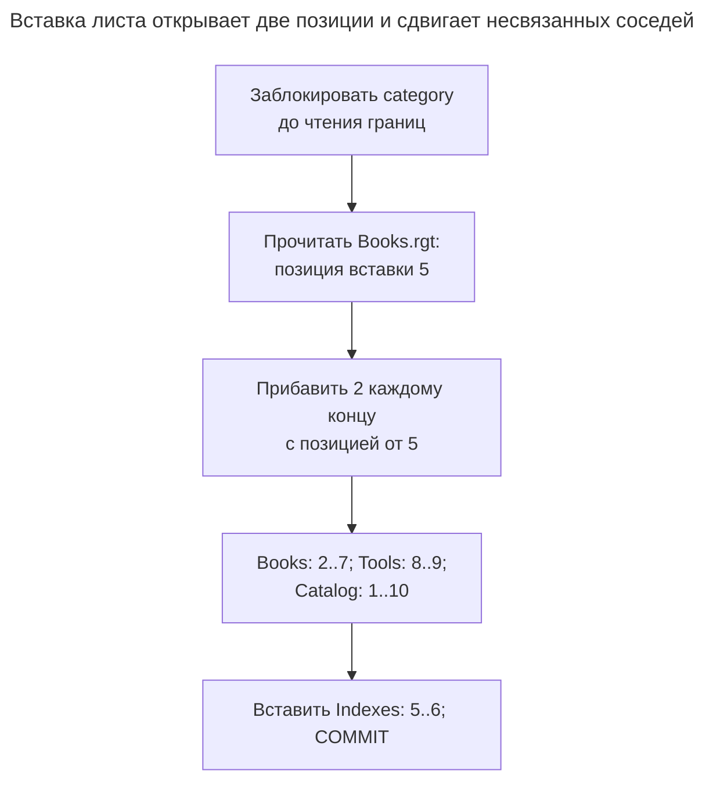
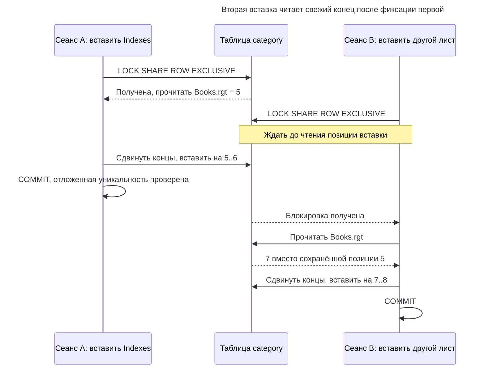

# Вложенные множества

## Назначение

Вложенные множества нумеруют узлы дерева левыми и правыми границами обхода в глубину, чтобы границы каждого потомка лежали внутри границ предка. Чтение целого поддерева, подсчёт потомков и упорядочивание дерева для отображения становятся одиночными диапазонными запросами без рекурсии. Цена переносится на запись: вставка или перемещение узла перенумеровывает большую часть таблицы под блокировкой. Глава показывает, когда часто читаемая и редко меняемая иерархия, например каталог товаров, оправдывает этот компромисс. [Руководство MongoDB по вложенным множествам](https://www.mongodb.com/docs/manual/tutorial/model-tree-structures-with-nested-sets/) иллюстрирует границы обхода и рекомендует модель статичным деревьям.

## Также известен как

Модель вложенных множеств (Nested set model). И [слайды Билла Карвина об иерархиях](https://www.slideshare.net/billkarwin/models-for-hierarchical-data), и [руководство MongoDB по деревьям](https://www.mongodb.com/docs/manual/tutorial/model-tree-structures-with-nested-sets/) используют название «Nested Sets».

## Проблема

Вы публикуете дерево категорий, меняющееся редакционными пакетами, а читатели постоянно запрашивают целые ветви и количество узлов. Пересчитывать достижимость при каждом чтении необязательно, если можно подготовить стабильное представление при публикации. Нужны узлы в порядке отображения и выбор потомков по интервалу.

Сложность перемещается в сопровождение. Вставке ребёнка нужны две новые позиции обхода. Перемещение ветви меняет её положение относительно других узлов, хотя их имена и идентичности не меняются. Поэтому [рекомендации MongoDB по вложенным множествам](https://www.mongodb.com/docs/manual/tutorial/model-tree-structures-with-nested-sets/) явно предпочитают статичные деревья изменяемым.

## Решение

При обходе в глубину назначайте `lft` узла при входе и `rgt` при выходе, используя каждое целое от `1` до `2n` ровно один раз. Интервал предка строго содержит интервал каждого потомка. Поддерево вместе с корнем — диапазон левых концов внутри границ этого корня. Сортировка по `lft` даёт прямой порядок обхода.

Отделяйте идентичность категории от этих позиций. Реализация использует классическую плотную нумерацию, открывает промежуток в две позиции для вставки листа и сдвигает целый интервал для перемещения ветви. Это поддерживаемое кодирование: проверки строки и два уникальных ограничения не доказывают, что все интервалы образуют дерево. Ограничьте структурную запись протоколом нумерации и проверяйте его глобальные инварианты.

## Альтернативы и выбор

| Соседний паттерн | Связь | Определяющее требование |
| --- | --- | --- |
| [Список смежности](adjacency-list.md) | Замена; дополнение как редактируемое исходное дерево | Частые изменения и простой поиск непосредственных детей важнее заранее рассчитанного диапазонного чтения |
| [Материализованный путь](materialized-path.md) | Замена | Чтение поддеревьев преобладает, но перемещения должны переписывать лишь перемещаемую ветвь, а не позиции в других местах |
| [Таблица замыканий](closure-table.md) | Замена | Соединения предков и запросы с ограничением глубины оправдывают дополнительные строки без глобальной нумерации обхода |

Полное сравнение семейства — в [Атласе решений](decision-atlas.md). Промежутки между номерами — вариант реализации, но арифметический подсчёт потомков ниже тогда перестаёт работать. Не считайте разреженную нумерацию взаимозаменяемой с этой плотной.

## Структура



Каждая строка хранит категорию и её интервал; в этом варианте нет столбца родителя и родительского внешнего ключа. Два уникальных ограничения различают левые и правые позиции внутри соответствующих столбцов, а глобальная корректность дерева всё ещё требует протокола записи и проверок.



Читайте слева направо по строкам: позиции входа и выхода обхода в глубину кодируют вложенные интервалы, помещая SQL `[3,4]` внутрь Books `[2,5]`. Tools `[6,7]` не пересекается с Books, а все восемь позиций использованы ровно один раз.

## Таблицы и инварианты

- **`category`** сохраняет `category_id` первичным ключом и проверяет `0 < lft < rgt` через `category_bounds`.
- **Уникальность концов** обеспечивается отдельно для левых и правых позиций. Откладываемые уникальные ограничения разрешают перенумерации проходить через временные конфликты индекса до конца транзакции; см. [правила момента проверки PostgreSQL](https://www.postgresql.org/docs/18/sql-createtable.html).
- **Глобальная форма** требует непересекающихся или полностью вложенных интервалов без перекрёстных пересечений. Ни один левый конец не может совпадать с правым, а плотная нумерация использует все позиции `1..2n`. Протокол записи и проверка скрипта контролируют эти условия; одного DDL недостаточно.
- **Политика корня** задаётся отдельно. Правила могут кодировать лес; в примере один корень. Требованию ровно одного корня нужна дополнительная глобальная проверка.

## Когда применять

- Вы публикуете иерархию пакетами и многократно читаете между изменениями.
- Вывод поддеревьев в прямом порядке обхода и подсчёт по плотной нумерации — основные запросы.
- Вы можете сериализовать изменения или строить новое представление чтения отдельно от действующих читателей.

## Последствия и компромиссы

- ➕ Диапазон левых концов выбирает полное поддерево без рекурсии.
- ➕ При этой плотной кодировке `(rgt - lft - 1) / 2` считает строгих потомков без их обхода.
- ➖ Открытие промежутка может переписать узлы за пределами изменяемой ветви; число зависит от её позиции.
- ➖ Для непосредственных детей нужно исключать промежуточных предков либо отдельно поддерживать родительскую ссылку или глубину.
- ➖ Ни уникальность концов, ни `lft < rgt` не доказывают корректность дерева. Повреждение может незаметно исказить диапазонное чтение.

## Реализация

[Полный скрипт PostgreSQL 18.6](../assets/nested-sets/nested-sets.sql) включает вставку, перемещение, удаление, отклонение интервала и проверки плотности и пересечений. При перенумерации сохраняйте стабильные ID:

```sql
CREATE TABLE category (
    category_id bigint PRIMARY KEY,
    name text NOT NULL,
    lft bigint NOT NULL,
    rgt bigint NOT NULL,
    CONSTRAINT category_bounds CHECK (lft > 0 AND lft < rgt),
    CONSTRAINT category_left_key UNIQUE (lft) DEFERRABLE INITIALLY DEFERRED,
    CONSTRAINT category_right_key UNIQUE (rgt) DEFERRABLE INITIALLY DEFERRED
);
INSERT INTO category VALUES
    (1, 'Catalog', 1, 8), (2, 'Books', 2, 5),
    (4, 'SQL', 3, 4), (3, 'Tools', 6, 7);
```

Прочитайте Books и SQL, посчитайте единственного строгого потомка Books и прочитайте предков SQL:

```sql
SELECT c.category_id, c.name FROM category AS p
JOIN category AS c ON c.lft BETWEEN p.lft AND p.rgt
WHERE p.category_id = 2 ORDER BY c.lft;
SELECT (rgt - lft - 1) / 2 AS descendants
FROM category WHERE category_id = 2;
SELECT p.category_id FROM category AS c
JOIN category AS p ON p.lft < c.lft AND p.rgt > c.rgt
WHERE c.category_id = 4 ORDER BY p.lft;
```

Уникальное ограничение `lft` предоставляет B-дерево, обслуживающее диапазонный доступ; PostgreSQL документирует, что [уникальные ограничения создают индексы](https://www.postgresql.org/docs/18/ddl-constraints.html#DDL-CONSTRAINTS-UNIQUE-CONSTRAINTS). Формула количества предполагает корректную **плотную** нумерацию, а не просто отсутствие перекрёстных пересечений. Для строгих потомков исключайте выбранный узел; запрос поддерева намеренно включает его.

Вставьте Indexes последним ребёнком Books. Читайте позицию вставки лишь после получения блокировки, затем сдвигайте оба конца и вставляйте в промежуток:

```sql
BEGIN;
LOCK TABLE category IN SHARE ROW EXCLUSIVE MODE;
CREATE TEMP TABLE insertion ON COMMIT DROP AS
SELECT rgt AS pos FROM category WHERE category_id = 2;
UPDATE category SET
    lft = CASE WHEN lft >= i.pos THEN lft + 2 ELSE lft END,
    rgt = CASE WHEN rgt >= i.pos THEN rgt + 2 ELSE rgt END
FROM insertion AS i WHERE rgt >= i.pos;
INSERT INTO category
SELECT 5, 'Indexes', pos, pos + 1 FROM insertion;
COMMIT;
```



Промежуток открывается на старом правом конце Books, поэтому Tools сдвигается, хотя находится вне изменяемой ветви. Концы SQL остаются `[3,4]`, а новый лист занимает две освобождённые позиции.

Books становится `[2,7]`; новый лист — `[5,6]`, Tools сдвигается в `[8,9]`. Чтобы переместить Books под Tools, используйте текущий правый конец Tools как цель вставки. Следующее обновление переносит концы внутри интервала Books и сдвигает концы между старым и новым положениями:

```sql
BEGIN;
LOCK TABLE category IN SHARE ROW EXCLUSIVE MODE;
WITH move AS (
    SELECT s.lft AS lo, s.rgt AS hi, s.rgt - s.lft + 1 AS width,
           d.rgt AS target
    FROM category AS s CROSS JOIN category AS d
    WHERE s.category_id = 2 AND d.category_id = 3
      AND NOT d.lft BETWEEN s.lft AND s.rgt
)
UPDATE category SET
    lft = CASE
        WHEN lft BETWEEN m.lo AND m.hi THEN lft +
            CASE WHEN m.target < m.lo THEN m.target - m.lo
                 ELSE m.target - m.hi - 1 END
        WHEN m.target < m.lo AND lft >= m.target AND lft < m.lo
            THEN lft + m.width
        WHEN m.target > m.hi AND lft > m.hi AND lft < m.target
            THEN lft - m.width
        ELSE lft END,
    rgt = CASE
        WHEN rgt BETWEEN m.lo AND m.hi THEN rgt +
            CASE WHEN m.target < m.lo THEN m.target - m.lo
                 ELSE m.target - m.hi - 1 END
        WHEN m.target < m.lo AND rgt >= m.target AND rgt < m.lo
            THEN rgt + m.width
        WHEN m.target > m.hi AND rgt > m.hi AND rgt < m.target
            THEN rgt - m.width
        ELSE rgt END
FROM move AS m;
COMMIT;
```

После этого прямой порядок обхода: Catalog `[1,10]`, Tools `[2,9]`, Books `[3,8]`, SQL `[4,5]`, Indexes `[6,7]`. CTE отклоняет цель внутри перемещаемой ветви. Требуйте существования источника и назначения и ненулевого числа обновлённых строк; ноль строк не означает успешного перемещения. Скрипт также удаляет весь интервал Books и закрывает промежуток, оставляя Catalog `[1,4]` и Tools `[2,3]`.

Обратный интервал недопустим даже вне протокола сопровождения:

```sql
INSERT INTO category VALUES (99, 'Invalid', 12, 11);
```

PostgreSQL 18.6 возвращает SQLSTATE `23514`: `ERROR: new row for relation "category" violates check constraint "category_bounds"`, с уточнением `DETAIL: Failing row contains (99, Invalid, 12, 11).` Это доказывает локальную проверку границ, а не глобальную корректность дерева. Последнюю скрипт отдельно проверяет до удаления.

Удалите перемещённое поддерево Books в одной транзакции:

```sql
BEGIN;
LOCK TABLE category IN SHARE ROW EXCLUSIVE MODE;
CREATE TEMP TABLE removal ON COMMIT DROP AS
SELECT lft AS lo, rgt AS hi, rgt - lft + 1 AS width
FROM category WHERE category_id = 2;
DELETE FROM category USING removal AS r WHERE lft BETWEEN r.lo AND r.hi;
UPDATE category SET
    lft = CASE WHEN lft > r.hi THEN lft - r.width ELSE lft END,
    rgt = CASE WHEN rgt > r.hi THEN rgt - r.width ELSE rgt END
FROM removal AS r WHERE rgt > r.hi;
COMMIT;
```

## Поддержка в движках

- **PostgreSQL 18:** [откладываемые уникальные ограничения](https://www.postgresql.org/docs/18/sql-createtable.html) поддерживают перестановки концов внутри транзакции. Они — часть реализации, а не неотъемлемое свойство вложенных множеств.
- **Oracle AI Database 26ai:** [откладываемые ограничения](https://docs.oracle.com/en/database/oracle/oracle-database/26/sqlrf/constraint.html) тоже позволяют проверку в конце транзакции. Адаптируйте числовые типы и синтаксис обновления; сохраняйте стабильные ID узлов.
- **MySQL 8.4 / SQL Server 2025 (17.x):** документированные [синтаксис уникальных индексов MySQL](https://dev.mysql.com/doc/refman/8.4/en/create-index.html) и [синтаксис ограничений SQL Server](https://learn.microsoft.com/en-us/sql/t-sql/statements/alter-table-table-constraint-transact-sql?view=sql-server-ver17) не предоставляют отложенную уникальность PostgreSQL. Планируйте промежуточные позиции без коллизий или публикацию отдельно пронумерованной версии; не копируйте перестановку, предполагая тот же момент проверки.
- **SQLite 3:** [одновременно выполняется лишь одна транзакция записи](https://www.sqlite.org/lang_transaction.html). Начинайте её до чтения позиций и обрабатывайте занятость. Документированный [синтаксис `UNIQUE`](https://www.sqlite.org/lang_createtable.html) SQLite не имеет отложенной проверки, поэтому при переносе используйте промежуточные позиции без коллизий или отдельную пронумерованную версию.

## Сбои и конкурентность

Две вставки могут прочитать один правый конец и обе попытаться открыть один промежуток. Конкурентное перемещение тоже способно сделать все сохранённые позиции устаревшими. Пример работает при [Read Committed](https://www.postgresql.org/docs/18/transaction-iso.html#XACT-READ-COMMITTED) и получает [`SHARE ROW EXCLUSIVE`](https://www.postgresql.org/docs/18/explicit-locking.html#LOCKING-TABLES) до чтения границ. Её используют все структурные писатели. Открытие промежутка, вставку и проверку держите в одной транзакции и при ошибке откатывайте всю операцию.



Второй лист — гипотетическая конкурентная вставка в Books. Её промежуток выбирается из зафиксированных границ, поэтому она не использует сохранённую позицию первой вставки.

Оператор перемещения обновляет все строки примера, включая неизменённые концы; промышленная реализация может сузить диапазон после доказательства того же преобразования. Блокировки строки узла недостаточно, потому что редактирование нумерации затрагивает другие узлы. Никогда не фиксируйте половину перенумерации и не повторяйте с позициями, сохранёнными до отката. При неопределённой фиксации проверяйте текущих предков узла под блокировкой перед решением о повторе.

## Миграция

При переходе с родительских ссылок считайте вложенные множества новой проекцией. Проверьте исходное дерево, выберите явный порядок соседей и назначьте номера входа/выхода в теневой таблице. Проверьте все `2n` концов, найдите перекрёстные пересечения и сравните каждое поддерево с исходным обходом до публикации результата.

При действующих редакторах фиксируйте структурные изменения во время построения и сверяйте под короткой паузой структурной записи. Обычное чтение остаётся на старом представлении до готовности новой версии. Сначала переключите чтение, сохраняя исходное дерево и путь перестроения; переключайте запись лишь при оправданности прямого сопровождения вложенных множеств. Для отката верните чтение к сохранённым родителям. Если границы — единственный источник, восстановите родителя каждого узла как ближайший содержащий интервал до удаления границ; отклоните повреждённые пересечения до преобразования.

```mermaid
---
title: Публикуйте пронумерованные интервалы лишь после сравнения с исходным деревом
---
stateDiagram-v2
  state "Проверенное дерево родителей" as Source
  state "Теневые интервалы пронумерованы в порядке соседей" as Numbered
  state "Плотность, пересечения и поддеревья проверены" as Audited
  state "Чтение вложенных множеств опубликовано; источник сохранён" as Published
  [*] --> Source
  Source --> Numbered: Назначить позиции входа и выхода
  Numbered --> Audited: Сравнить с исходным обходом
  Audited --> Published: Приостановить структурную запись; сверить изменения
  Published --> Source: Вернуть чтение к сохранённым родителям
  class Source muted
  class Numbered,Audited,Published accent
```



Проверка контролирует смысл каждого интервала и все `2n` концов. Поддерживаемое родительское дерево даёт цель отката читателей и источник перестроения проекции.

## Антипаттерны и частые ошибки

- Утверждать, что два уникальных ограничения доказывают дерево: они не обнаруживают повтор конца в разных столбцах или перекрёстные интервалы.
- Применять плотную формулу количества после введения промежутков или мягко удалённых узлов, чьи позиции остаются занятыми.
- Ссылаться на `lft` как ID узла из других таблиц, превращая изменение порядка отображения в смену идентичности.
- Выбирать вложенные множества для иерархии, где основная операция — частое перетаскивание к другому родителю.
- Обещать фиксированный процент переписанных строк при вставке; диапазон зависит от точки вставки и политики нумерации.

## Известные применения

- [Руководство Nested Sets MongoDB](https://www.mongodb.com/docs/manual/tutorial/model-tree-structures-with-nested-sets/) показывает категории книг с левыми/правыми позициями обхода и рекомендует модель статичным деревьям.
- [Слайды Карвина об иерархиях](https://www.slideshare.net/billkarwin/models-for-hierarchical-data) показывают открытие промежутка сдвигом границ перед вставкой ребёнка. SQL здесь — отдельная реализация с явной транзакцией и моментом проверки ограничений.

## Связанные паттерны

- [Список смежности](adjacency-list.md) — удобный редактируемый источник для публикации вложенных множеств.
- [Материализованный путь](materialized-path.md) ограничивает перезапись путей при перемещении потомками ветви.
- [Таблица замыканий](closure-table.md) материализует достижимость без позиций обхода.
