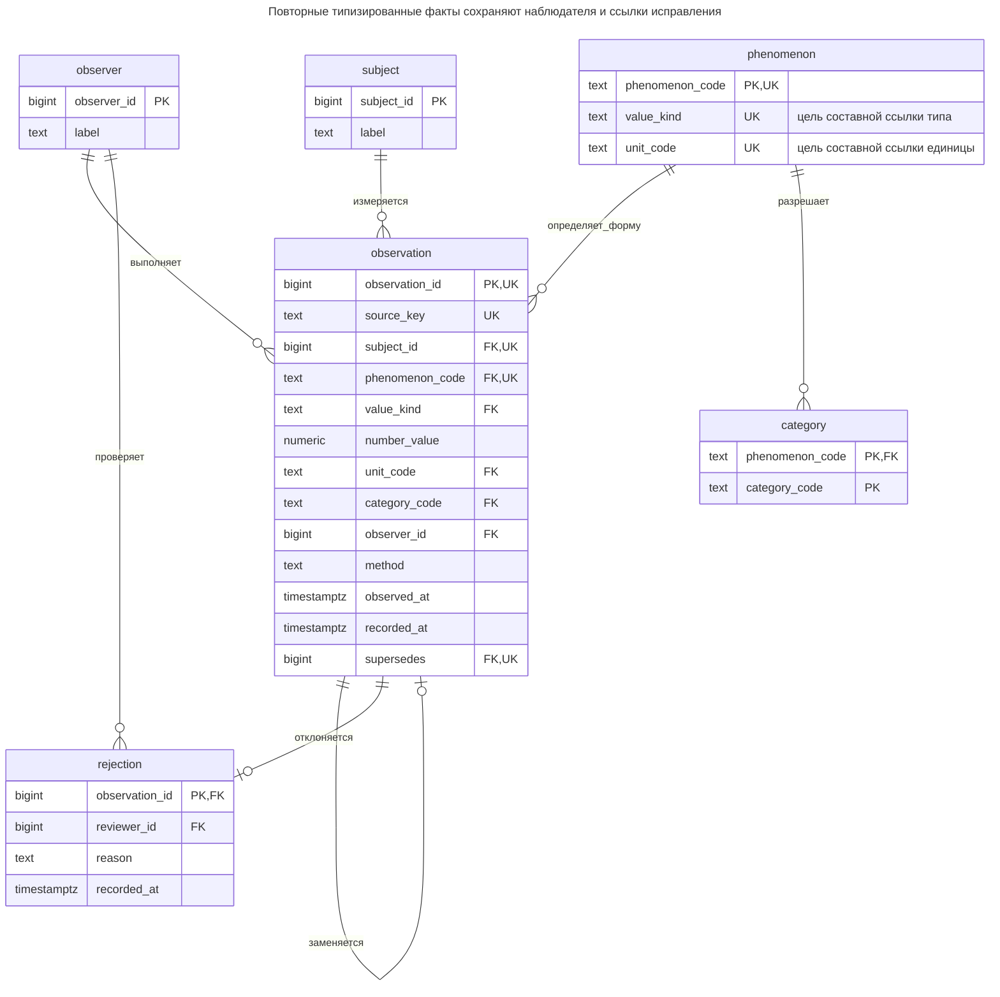
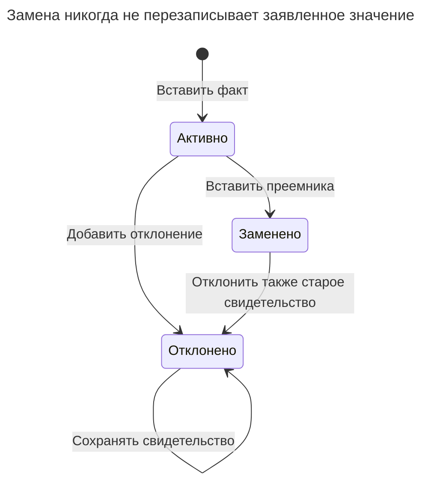
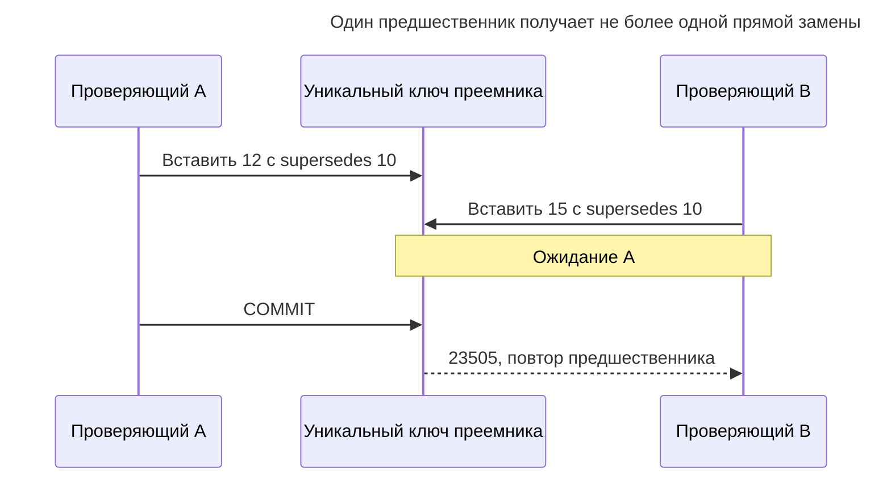
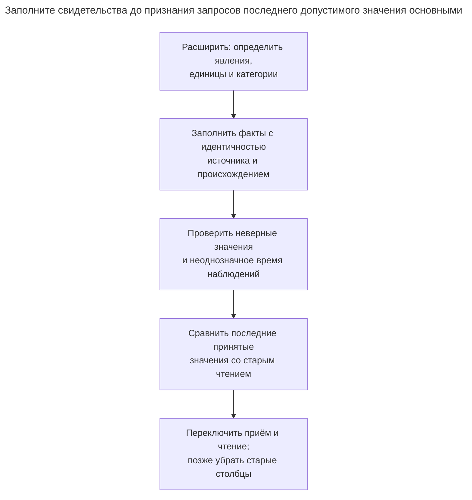

# Наблюдение

## Назначение

Наблюдение записывает измерение или оценку как самостоятельный факт: какое явление наблюдалось, значение или категорию, метод, наблюдателя и время. Так устроены лабораторные результаты, показания датчиков и проверки качества: измерения не занимают фиксированные столбцы, а новые виды наблюдений появляются без миграций. Глава показывает таблицы наблюдений и явлений, числовые и категориальные значения, отметки отклонения и замены, запрос последнего допустимого значения.

## Также известен как

Measurement record; assessment record — запись измерения, запись оценки. [HL7 FHIR R4 Observation](https://hl7.org/fhir/R4/observation.html) представляет измерения и простые утверждения с объектом, значением, методом, исполнителем и временем. Здесь приведена небольшая прикладная модель, а не отображение хранения FHIR или заявление о соответствии FHIR.

## Проблема

Вы храните массу партии в `batch.mass_kg`. Второе взвешивание перезаписывает первое. Калибровка затем показывает ошибочность первого результата, а позднее показание оказывается относящимся к другой партии. Один текущий столбец не объясняет, какой результат когда наблюдался, какой отклонён и какой исправил прежнее утверждение.

Добавление `mass_2` сохраняет ещё один результат, но превращает повторение в изменение схемы. Общая строка `(name, text_value)` допускает повторение, теряя числовой тип, правила единиц и происхождение. Нужны повторные факты с явным смыслом и жизненным циклом, а не безграничный набор текущих атрибутов.

## Решение

Определите каждое явление и форму его значения. Записывайте наблюдение с объектом, типизированным значением, методом, наблюдателем, временем наблюдения и временем регистрации. Для числовых явлений пример принимает одну настроенную единицу; другие нормализуйте через [Величину](quantity.md) до вставки. Для категориальных явлений ссылайтесь на словарь категорий конкретного явления.

Сделайте факты наблюдений неизменяемыми. Замена — другое наблюдение, ссылающееся на предшественника; отклонение — отдельная запись с проверяющим и причиной. Выводите `active`, `superseded`, `rejected` из этих фактов вместо независимого обновления флага статуса. Тогда флаг и ссылка исправления не расходятся. Политика намеренно оставляет прежний результат заменённым, даже если замену позже отклоняют; она не восстанавливает старый результат молча.

## Альтернативы и выбор

| Соседний паттерн | Связь | Определяющее требование |
| --- | --- | --- |
| Фиксированные столбцы объекта | Замена | Важно только текущее значение, повторные свидетельства не нужны |
| [Типизированные свойства](typed-properties.md) | Замена для текущих настраиваемых атрибутов; дополнение для метаданных | Нужно одно редактируемое свойство, а не независимо наблюдаемые факты |
| [Величина](quantity.md) | Дополнение | Числовым результатам нужны совместимые единицы и преобразование |
| [Таблица истории](history-table.md) | Дополнение; замена для вопросов о прошлых строках | Нужны прежние состояния строк базы; время наблюдения и научное происхождение — другой контракт |

Полная таблица — в [Атласе решений](decision-atlas.md). Запись наблюдения не равнозначна обновлению объекта: наблюдение может прийти поздно или противоречить другому, не меняя идентичность объекта.

## Структура



Много наблюдений могут описывать один объект и явление. У предшественника не более одной прямой замены. Составные ключи сохраняют объект и явление при исправлении; аннотации `UK` обозначают несколько составных целей из DDL, а не независимую уникальность объекта или явления.

## Таблицы и инварианты

- **`phenomenon` / `category`** определяют числовую или категориальную форму, настроенную числовую единицу и разрешённые коды категорий. Считайте определения управляемыми метаданными: изменение смысла единицы — новое определение, а не безобидная правка метки.
- **`observation`** имеет уникальный ключ источника для повторов импорта. Проверка формы требует ровно применимые поля значения; составные внешние ключи согласуют заявленный вид, настроенную единицу и словарь категорий.
- **Ссылки замены** остаются в одном объекте и явлении. `UNIQUE (supersedes)` запрещает конкурирующих прямых преемников; `supersedes < observation_id` делает циклы невозможными в примере. Выдавайте исправлению ID больше предшественника; порядок — правило реализации, а не время наблюдения.
- **`rejection`** допускает одно сохраняемое отклонение факта с указанным проверяющим. Пример не предоставляет отзыва отклонения.
- **Неизменяемость** обеспечивают запреты обновления/удаления. Отделяйте приложение от владельца и не выдавайте `TRUNCATE` или изменение схемы; [привилегии PostgreSQL](https://www.postgresql.org/docs/18/sql-grant.html) отличают их от записи строк. Лабораторный скрипт работает владельцем ради механики, а не полной настройки ролей.

## Когда применять

- У объекта есть повторные показания или оценки с независимо полезным происхождением.
- Результаты могут приходить поздно, отклоняться или заменяться без удаления свидетельств.
- Новые явления в поддерживаемом числовом/категориальном словаре должны добавляться как данные.

## Последствия и компромиссы

- ➕ Исправление сохраняет исходное утверждение и замену.
- ➕ Числовые и категориальные результаты разделяют происхождение, сохраняя разные правила значений.
- ➖ «Последний» требует политики запроса: принятый статус, время наблюдения, метод и детерминированное разрешение равенства.
- ➖ Новые примитивные формы, составные результаты или интервалы неопределённости всё ещё требуют проектирования; это не безграничное расширение без схемы.
- ➖ Сохраняемые свидетельства и индексы растут с каждым показанием, включая отклонённые.

## Реализация

[Полный скрипт PostgreSQL 18.6](../assets/observation/observation.sql) реализует таблицы, неизменяемые факты и выводимый жизненный цикл:

```sql
CREATE SCHEMA observation_example;
SET search_path = observation_example, public;

CREATE TABLE subject (subject_id bigint PRIMARY KEY, label text NOT NULL);
CREATE TABLE observer (observer_id bigint PRIMARY KEY, label text NOT NULL);
CREATE TABLE phenomenon (
    phenomenon_code text PRIMARY KEY,
    value_kind text NOT NULL CHECK (value_kind IN ('number', 'category')),
    unit_code text,
    UNIQUE (phenomenon_code, value_kind),
    UNIQUE (phenomenon_code, unit_code),
    CHECK ((value_kind = 'number' AND unit_code IS NOT NULL)
        OR (value_kind = 'category' AND unit_code IS NULL))
);
CREATE TABLE category (
    phenomenon_code text REFERENCES phenomenon (phenomenon_code),
    category_code text,
    PRIMARY KEY (phenomenon_code, category_code)
);
CREATE TABLE observation (
    observation_id bigint PRIMARY KEY,
    source_key text NOT NULL UNIQUE,
    subject_id bigint NOT NULL REFERENCES subject (subject_id),
    phenomenon_code text NOT NULL,
    value_kind text NOT NULL,
    number_value numeric,
    unit_code text,
    category_code text,
    method text NOT NULL,
    observer_id bigint NOT NULL REFERENCES observer (observer_id),
    observed_at timestamptz NOT NULL,
    recorded_at timestamptz NOT NULL DEFAULT clock_timestamp(),
    supersedes bigint UNIQUE,
    UNIQUE (observation_id, subject_id, phenomenon_code),
    FOREIGN KEY (phenomenon_code, value_kind) REFERENCES phenomenon (phenomenon_code, value_kind),
    FOREIGN KEY (phenomenon_code, unit_code) REFERENCES phenomenon (phenomenon_code, unit_code),
    FOREIGN KEY (phenomenon_code, category_code) REFERENCES category (phenomenon_code, category_code),
    FOREIGN KEY (supersedes, subject_id, phenomenon_code)
        REFERENCES observation (observation_id, subject_id, phenomenon_code),
    CHECK (supersedes < observation_id),
    CONSTRAINT observation_value_shape CHECK (
        (value_kind = 'number' AND number_value IS NOT NULL
         AND number_value > '-Infinity'::numeric AND number_value < 'Infinity'::numeric
         AND unit_code IS NOT NULL AND category_code IS NULL)
        OR (value_kind = 'category' AND category_code IS NOT NULL
            AND number_value IS NULL AND unit_code IS NULL)
    )
);
CREATE TABLE rejection (
    observation_id bigint PRIMARY KEY REFERENCES observation (observation_id),
    reviewer_id bigint NOT NULL REFERENCES observer (observer_id),
    reason text NOT NULL,
    recorded_at timestamptz NOT NULL DEFAULT clock_timestamp()
);
CREATE INDEX observation_latest_idx
    ON observation (subject_id, phenomenon_code, observed_at DESC, observation_id DESC);
CREATE FUNCTION reject_fact_mutation() RETURNS trigger LANGUAGE plpgsql SET search_path = observation_example, pg_temp AS $$
BEGIN
    RAISE EXCEPTION 'observation facts are immutable' USING ERRCODE = '23514';
END $$;
CREATE TRIGGER observation_immutable BEFORE UPDATE OR DELETE ON observation
    FOR EACH ROW EXECUTE FUNCTION reject_fact_mutation();
CREATE TRIGGER rejection_immutable BEFORE UPDATE OR DELETE ON rejection
    FOR EACH ROW EXECUTE FUNCTION reject_fact_mutation();
CREATE VIEW observation_state AS
SELECT o.*, CASE
    WHEN EXISTS (SELECT FROM rejection AS r WHERE r.observation_id = o.observation_id) THEN 'rejected'
    WHEN EXISTS (SELECT FROM observation AS n WHERE n.supersedes = o.observation_id) THEN 'superseded'
    ELSE 'active' END AS status
FROM observation AS o;
```

`observed_at` записывает заявленное время события. `recorded_at` по умолчанию использует [`clock_timestamp()`](https://www.postgresql.org/docs/18/functions-datetime.html#FUNCTIONS-DATETIME-CURRENT) PostgreSQL — реальное время обработки, а не фиксации. Сегодня можно принять старое измерение, не делая вид, что оно было известно во время события. FHIR R4 тоже различает [время действия и время выдачи](https://hl7.org/fhir/R4/observation.html); поля примера имеют собственную явно заданную семантику.

```sql
INSERT INTO subject VALUES (1, 'Batch A');
INSERT INTO observer VALUES (1, 'Scale operator'), (2, 'Quality reviewer');
INSERT INTO phenomenon VALUES ('mass', 'number', 'kg'), ('appearance', 'category', NULL);
INSERT INTO category VALUES ('appearance', 'pass'), ('appearance', 'fail');
INSERT INTO observation
    (observation_id, source_key, subject_id, phenomenon_code, value_kind,
     number_value, unit_code, method, observer_id, observed_at)
VALUES (10, 'scale:10', 1, 'mass', 'number', 20, 'kg', 'bench scale', 1, '2026-11-01 10:00Z');
INSERT INTO observation
    (observation_id, source_key, subject_id, phenomenon_code, value_kind,
     category_code, method, observer_id, observed_at)
VALUES (11, 'inspection:11', 1, 'appearance', 'category', 'pass', 'visual', 2, '2026-11-01 10:01Z');
```

Начальные факты — масса `20 kg` и внешний вид `pass`. После калибровки добавьте исправленную массу с тем же моментом наблюдения:

```sql
BEGIN;
SELECT subject_id FROM subject WHERE subject_id = 1 FOR UPDATE;
INSERT INTO observation
    (observation_id, source_key, subject_id, phenomenon_code, value_kind,
     number_value, unit_code, method, observer_id, observed_at, supersedes)
VALUES (12, 'scale:12', 1, 'mass', 'number', 2, 'kg', 'recalibrated scale', 1,
        '2026-11-01 10:00Z', 10);
COMMIT;
```

Результат `10` теперь выводится как `superseded`; `12` активен. Более новое показание массы `13` отклоняется как относящееся к другой партии. Следующий запрос возвращает `(12, 2, kg)`, а не отклонённые 99 кг:

```sql
INSERT INTO observation
    (observation_id, source_key, subject_id, phenomenon_code, value_kind,
     number_value, unit_code, method, observer_id, observed_at)
VALUES (13, 'scale:13', 1, 'mass', 'number', 99, 'kg', 'bench scale', 1, '2026-11-02 10:00Z');
INSERT INTO rejection (observation_id, reviewer_id, reason) VALUES (13, 2, 'Wrong batch on scale');
SELECT observation_id, number_value, unit_code
FROM observation_state
WHERE subject_id = 1 AND phenomenon_code = 'mass' AND status = 'active'
ORDER BY observed_at DESC, observation_id DESC LIMIT 1;
```

Для «последнего по каждому явлению» применяйте то же условие статуса до выбора одной строки явления. ID детерминированно разрешает равенство, но не доказывает надёжность показания. Если методы имеют разный авторитет, выразите это явным условием или политикой ранжирования.



Состояния — проекции сохранённых строк. Отклонение преемника не возвращает предшественника в активное состояние; если нужно именно такое исправление, необходимо новое проверенное наблюдение.

Менять принятое значение на месте недопустимо:

```sql
UPDATE observation SET number_value = 3 WHERE observation_id = 12;
```

PostgreSQL 18.6 возвращает SQLSTATE `23514`: `ERROR: observation facts are immutable`. Скрипт также проверяет отказ `observation_value_shape` (`23514`) и нарушение `observation_supersedes_key` вторым преемником (`23505`). Новое явление требует только метаданных, пока укладывается в две поддерживаемые формы; новой форме значения нужно изменение схемы.

## Поддержка в движках

- **PostgreSQL 18:** составные внешние ключи и проверка формы строки обеспечивают толкование; строчные триггеры защищают сохранённые факты. Поля `NULL` намеренно исключают неприменимую ссылку категории или единицы согласно [семантике `NULL` внешних ключей](https://www.postgresql.org/docs/18/ddl-constraints.html#DDL-CONSTRAINTS-FK).
- **MySQL 8.4 / InnoDB:** [немедленные внешние ключи](https://dev.mysql.com/doc/refman/8.4/en/create-table-foreign-keys.html) подходят вставке предшественника до преемника. При переносе DDL сохраняйте проверку числа/категории.
- **SQL Server 2025 (17.x):** реализуйте неизменяемость правами и [DML-триггерами, учитывающими множества](https://learn.microsoft.com/en-us/sql/relational-databases/triggers/create-dml-triggers-to-handle-multiple-rows-of-data?view=sql-server-ver17), вместо копирования построчного тела PL/pgSQL.
- **Oracle AI Database 26ai:** Oracle [считает строки нулевой длины значением `NULL`](https://docs.oracle.com/en/database/oracle/oracle-database/26/sqlrf/Nulls.html). При переносе контракта метаданных определяйте коды категорий и идентификаторы методов как непустые значения.
- **SQLite 3:** включайте [внешние ключи](https://www.sqlite.org/foreignkeys.html) и намеренно выбирайте точное числовое представление; [сродство типов](https://www.sqlite.org/datatype3.html) не равно `numeric` PostgreSQL.

## Сбои и конкурентность

Два проверяющих могут исправлять результат `10`. Оба способны создать внутренне корректные значения, но оба не должны стать его прямыми преемниками. Уникальная ссылка предшественника отклоняет проигравшего. [Проверки конфликтов уникального индекса PostgreSQL](https://www.postgresql.org/docs/18/index-unique-checks.html) ожидают исход первого писателя; проиграв, перечитайте цепочку вместо слепого исправления нового преемника.



Если проверка затрагивает другие факты объекта, блокируйте его строку до чтения и добавления, как в примере исправления. Отклонение и замена могут сосуществовать: представление отдаёт приоритет отклонению этого факта. Если предметная область запрещает исправлять отклонённые факты, добавьте согласованный контроль; эта схема разрешает. Для повторов импорта найдите сохранённый `source_key` и сравните полезную нагрузку до признания дубликата успехом.

## Миграция

Определите метаданные явлений и единицы источников до импорта существующих столбцов значений. Записывайте достоверное время наблюдения лишь при его наличии в источнике; иначе используйте явно документированную политику начального снимка вместо выдуманных исторических измерений. Сохраняйте исходные ключи для повторяемых импортов.



Синхронизируйте старые столбцы с проекцией текущих принятых значений в окне отката. Если старые читатели не представляют несколько конкурирующих наблюдений, сохраняйте таблицы фактов и при откате чтения. Столбец текущего значения не может быть единственной резервной копией накопленных свидетельств.

## Антипаттерны и частые ошибки

- Заменять старое значение, сохраняя только флаг «отредактировано».
- Сортировать по времени регистрации, когда нужен последний результат по времени события.
- Выбирать новейшую строку до исключения отклонённых и заменённых результатов.
- Использовать один неограниченный словарь категорий для независимых явлений.
- Называть эту компактную схему полной клинической моделью обмена.

## Известные применения

- [FHIR R4 Observation](https://hl7.org/fhir/R4/observation.html) включает варианты величин и кодированных значений, метод, исполнителя, время действия и статус. Это конкретный пример моделирования вокруг наблюдений с более богатым контрактом, чем две формы этой схемы.

## Связанные паттерны

- [Величина](quantity.md) обрабатывает совместимость единиц до приёма.
- [Типизированные свойства](typed-properties.md) управляют настраиваемыми текущими атрибутами.
- [Таблица истории](history-table.md) сохраняет версии базы, отвечая на другой вопрос, чем время измерения.
