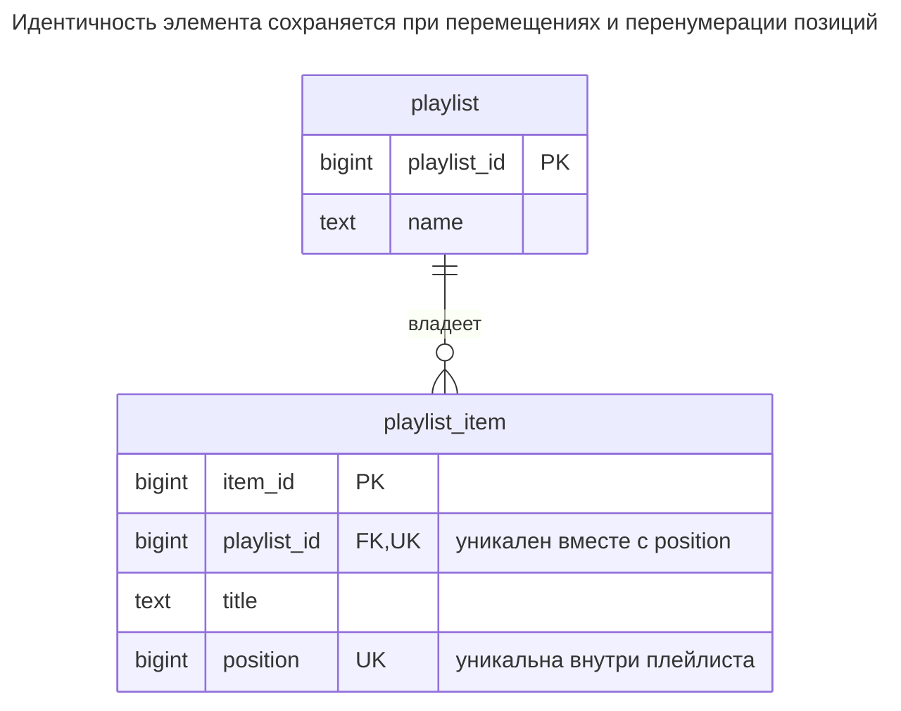
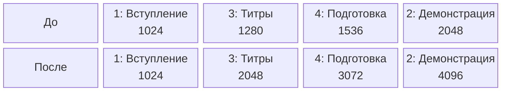
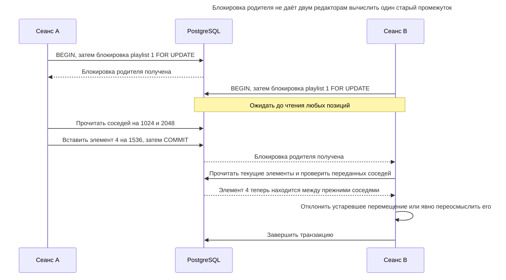
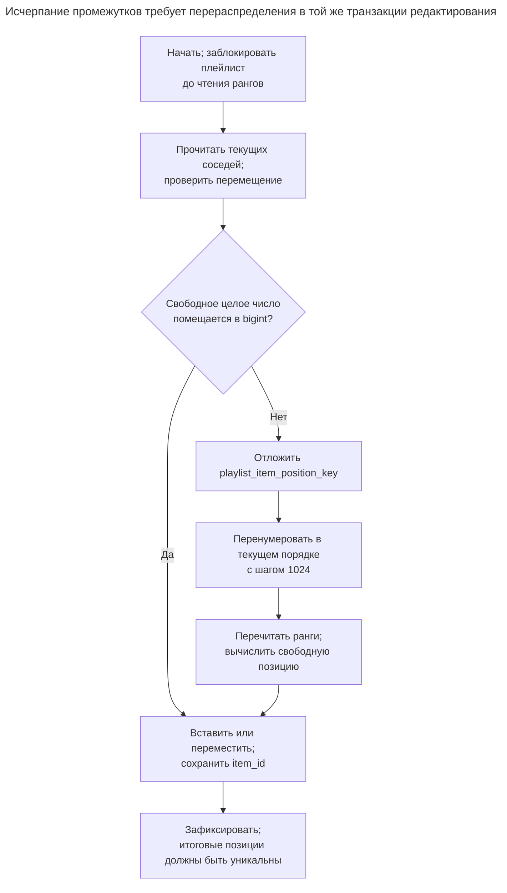

# Упорядоченная коллекция

## Назначение

Упорядоченная коллекция хранит порядок, заданный самими пользователями: треки плейлиста, шаги контрольного списка, карточки колонки доски. Глава сравнивает целочисленные позиции с перенумерацией, позиции с промежутками, дробные и лексикографические ранги, позволяющие вставить элемент между соседями без изменения остальных, и связный список ссылок. Она показывает, как сохранять уникальность позиций внутри коллекции, как конфликтуют конкурентные перемещения и что делать при исчерпании промежутков.

## Также известен как

Столбец позиции; столбец ранга. Дробная индексация (fractional indexing) — одна из реализаций: [библиотека Rocicorp](https://github.com/rocicorp/fractional-indexing) генерирует сортируемые ключи между соседними ключами. Позиция и идентичность строки служат разным целям.

## Проблема

Плейлист создаётся в порядке Intro, Demo, Credits, но владелец перемещает Credits перед Demo. Время создания больше не описывает порядок. Если использовать первичный ключ как позицию, перемещение трека изменит идентичность, на которую ссылаются примечания и события воспроизведения.

Нужна также политика для двух редакторов, перетаскивающих карточки в один промежуток. Уникальные позиции могут отклонить коллизию, но не решают, чьё намерение должно победить. Система рангов уменьшает объём перезаписи, но не определяет смысл конкурентного редактирования.

## Решение

Храните неизменяемый `item_id` и изменяемую позицию в пределах `playlist_id`. Читайте с `ORDER BY position`. PostgreSQL явно [не гарантирует порядок без `ORDER BY`](https://www.postgresql.org/docs/18/queries-order.html), даже если текущий проход по индексу выглядит правильным. Требуйте позицию без `NULL` и уникальность `(playlist_id, position)`.

Начните с целочисленных позиций с шагом 1024. Вставляйте или перемещайте в свободный промежуток. Когда подходящего целого числа нет, перенумеруйте коллекцию под той же блокировкой родителя, которую берёт каждая вставка, удаление и перемещение. Используйте откладываемое ограничение уникальности, чтобы многострочная перенумерация могла проходить через временные коллизии внутри транзакции. Этот пример предпочитает простой сериализованный протокол редактирования сложной генерации рангов.

## Альтернативы и выбор

| Соседний паттерн или представление | Связь | Определяющее требование |
| --- | --- | --- |
| Плотные целые числа, например 1, 2, 3 | Вариант реализации | Списки достаточно малы, чтобы при вставке сдвигать оставшуюся часть |
| Целые числа с промежутками | Используемый здесь вариант | Большинство вставок должны менять один элемент; редкая перенумерация приемлема |
| Дробные числовые позиции | Вариант реализации | Удобно брать середину, и вы умеете обнаруживать исчерпание точности и перераспределять позиции |
| Лексикографические строки рангов | Вариант реализации | Вы готовы поддерживать генератор рангов, длинные ключи и точный контракт сравнения строк |
| Ссылки на предыдущий/следующий элемент | Замена представления | Преобладает обход соседей; вы можете поддерживать одну связную цепочку без циклов |
| [Таблица связей](association-table.md) | Дополнение | Элементы связывают повторно используемые треки с плейлистами; позиция принадлежит вхождению или связи |
| [Столбец версии](version-column.md) | Дополнение | Нужно отклонять перемещения на основе устаревшего снимка коллекции |

Полное сравнение — в [Атласе решений](decision-atlas.md). Если порядок целиком выводится из имени или временной метки, задавайте детерминированную сортировку в запросе вместо поддержки ещё одного изменяемого атрибута.

Для числовых середин повторные вставки в один интервал в итоге исчерпывают фиксированное число десятичных разрядов; плавающая точка тоже имеет конечную точность. [Правила числовых типов PostgreSQL](https://www.postgresql.org/docs/18/datatype-numeric.html) различают точный `numeric` и неточную плавающую точку. Точное хранение не делает объявленный масштаб бесконечным. Определите порог перераспределения вместо предположения, что середина всегда будет отличаться от границ.

Для лексикографических рангов соблюдайте правила сравнения генератора на всём пути. [Rocicorp документирует регистрозависимое сравнение](https://github.com/rocicorp/fractional-indexing#sorting); для ASCII-алфавита текстовый ранг PostgreSQL может использовать [`COLLATE "C"`](https://www.postgresql.org/docs/18/collation.html). Два писателя с одинаковыми соседями всё равно могут выбрать одинаковый ключ. Связный список меняет задачу сопровождения: внешний ключ проверяет существование соседа, а не то, что каждый элемент достижим ровно один раз из единственной головы. Атомарное переподключение нескольких указателей и обнаружение циклов становятся вашей обязанностью.

## Структура



Связь показывает владение, а составное ограничение уникальности задаёт область позиций одним плейлистом. Перемещение или перенумерация элемента меняет позицию, но не первичный ключ.

## Таблицы и инварианты

- **`playlist`** владеет коллекцией и предоставляет строку для блокировки ещё до появления первого элемента.
- **`playlist_item`** имеет глобально уникальный `item_id`, обязательного владельца и неотрицательную позицию. Уникальность в области плейлиста запрещает совпадения; она не требует непрерывности позиций или начала с нуля.
- **Повторяющимся трекам** нужна идентичность вхождения. Если плейлист допускает один трек дважды, не используйте `(playlist_id, track_id)` как уникальный ключ элемента.
- **Протокол редактирования** требует, чтобы каждый писатель блокировал владельца до чтения рангов. Ограничения обеспечивают допустимость сохранённых позиций; протокол приложения сохраняет смысл перемещения относительно текущих соседей.

## Когда применять

- Пользователи перетаскивают, вставляют или переупорядочивают элементы независимо от времени создания.
- Другие таблицы ссылаются на элементы, чья идентичность должна переживать перемещения.
- Вы можете сериализовать изменения одной коллекции, позволяя независимое изменение остальных.

## Последствия и компромиссы

- ➕ Перемещение в свободный промежуток переписывает позицию одного элемента.
- ➕ Ограничения не позволяют двум элементам занимать одну позицию в коллекции.
- ➖ Перенумерация записывает всю затронутую коллекцию и дольше удерживает блокировку редактирования.
- ➖ Популярная коллекция становится точкой сериализации при этом протоколе.
- ➖ Страницы на основе смещения могут сдвигаться после перемещений. При изменении порядка клиентам нужна явная политика обновления или снимков.

## Реализация

[Полный скрипт](../assets/ordered-collection/ordered-collection.sql) демонстрирует вставку в промежуток, перемещение, перенумерацию, обмен и отклонение коллизии:

```sql
CREATE TABLE playlist (
    playlist_id bigint PRIMARY KEY,
    name text NOT NULL
);
CREATE TABLE playlist_item (
    item_id bigint PRIMARY KEY,
    playlist_id bigint NOT NULL REFERENCES playlist (playlist_id)
        ON DELETE CASCADE,
    title text NOT NULL,
    position bigint NOT NULL CHECK (position >= 0),
    CONSTRAINT playlist_item_position_key UNIQUE (playlist_id, position)
        DEFERRABLE INITIALLY IMMEDIATE
);
INSERT INTO playlist VALUES (1, 'Launch');
INSERT INTO playlist_item VALUES
    (1, 1, 'Intro', 1024),
    (2, 1, 'Demo', 2048),
    (3, 1, 'Credits', 3072);
```

Сначала заблокируйте владельца, затем прочитайте текущих соседей и вычислите свободную позицию. Фиксированные числа ниже соответствуют исходному списку. При обработке запроса найдите переданные ID соседей под блокировкой, проверьте, что они всё ещё принадлежат этому плейлисту и соседствуют после исключения перемещаемого элемента, и явно отклоните или переосмыслите устаревший запрос.

```sql
BEGIN;
SELECT playlist_id FROM playlist WHERE playlist_id = 1 FOR UPDATE;
SELECT item_id, position FROM playlist_item
WHERE playlist_id = 1 ORDER BY position;
INSERT INTO playlist_item VALUES (4, 1, 'Setup', 1536);
UPDATE playlist_item SET position = 1280
WHERE playlist_id = 1 AND item_id = 3;
COMMIT;
SELECT item_id, title, position FROM playlist_item
WHERE playlist_id = 1 ORDER BY position;
```

Теперь порядок — `1, 3, 4, 2`: Intro, Credits, Setup, Demo. Для произвольного промежутка требуйте, чтобы разность верхней и нижней позиций превышала единицу; вычисляйте середину без переполнения `bigint`. На краю проверяйте границы перед прибавлением или вычитанием шага. Если значение не помещается, перераспределите позиции и вычислите заново под той же блокировкой:

```sql
BEGIN;
SELECT playlist_id FROM playlist WHERE playlist_id = 1 FOR UPDATE;
SET CONSTRAINTS playlist_item_position_key DEFERRED;
WITH ranked AS (
    SELECT item_id,
           row_number() OVER (ORDER BY position, item_id) * 1024 AS new_position
    FROM playlist_item WHERE playlist_id = 1
)
UPDATE playlist_item AS i SET position = r.new_position
FROM ranked AS r WHERE i.item_id = r.item_id;
COMMIT;
```

Позиции равны `1024, 2048, 3072, 4096` при прежнем порядке элементов. PostgreSQL поддерживает [отложенные проверки уникальности](https://www.postgresql.org/docs/18/sql-createtable.html); зафиксированный результат всё равно должен быть уникальным. Это защищает обмен и перенумерацию от временных дубликатов, не допуская итоговых совпадений. Такое откладываемое ограничение не может быть арбитром `ON CONFLICT`, поэтому не считайте коллизии рангов операциями upsert.



Перераспределение сохраняет порядок элементов `1, 3, 4, 2` и восстанавливает шаг 1024 между позициями. Блоки показывают отсортированные строки до и после обновления SQL, а не сохранённые указатели соседей.

```sql
UPDATE playlist_item SET position = 1024
WHERE playlist_id = 1 AND item_id = 2;
```

Вне транзакции с отложенной проверкой PostgreSQL 18.6 немедленно отклоняет это с SQLSTATE `23505`: `ERROR: duplicate key value violates unique constraint "playlist_item_position_key"`, с уточнением `DETAIL: Key (playlist_id, "position")=(1, 1024) already exists.` Скрипт также пытается сохранить совпадающие позиции к моменту отложенной проверки и проверяет отказ.

## Поддержка в движках

- **PostgreSQL 18:** откладываемое ограничение уникальности позволяет показанные перенумерацию и обмены. Сохраняйте `ORDER BY` в каждом упорядоченном чтении.
- **MySQL 8.4 / InnoDB:** [уникальные ограничения проверяются построчно](https://dev.mysql.com/doc/refman/8.4/en/ansi-diff-foreign-keys.html). Внутри транзакции с блокировкой используйте зарезервированный непересекающийся диапазон временных позиций до назначения итоговых, проверяя переполнение.
- **SQL Server 2025 (17.x):** [синтаксис `UNIQUE`](https://learn.microsoft.com/en-us/sql/t-sql/statements/create-table-transact-sql?view=sql-server-ver17) не имеет откладывания в стиле PostgreSQL. Двухэтапное перемещение через неиспользуемые позиции устраняет зависимость от порядка обновления.
- **Oracle AI Database 26ai:** [откладываемые уникальные ограничения](https://docs.oracle.com/en/database/oracle/oracle-database/26/sqlrf/constraint.html) поддерживают проверку в конце транзакции; адаптируйте типы ключа и позиции.
- **SQLite 3:** объявление [`UNIQUE`](https://www.sqlite.org/lang_createtable.html#unique_constraints) не предлагает отложенную уникальность. Используйте непересекающиеся временные позиции; [`BEGIN IMMEDIATE`](https://www.sqlite.org/lang_transaction.html#deferred_immediate_and_exclusive_transactions) получает транзакцию записи вместо блокировки родительской строки PostgreSQL и может завершиться с `SQLITE_BUSY`.

## Сбои и конкурентность

При PostgreSQL read committed получайте [блокировку родительской строки](https://www.postgresql.org/docs/18/explicit-locking.html#LOCKING-ROWS) до оператора, читающего позиции, и удерживайте до фиксации. Каждый писатель, вставляющий, удаляющий, перемещающий или перераспределяющий элементы, должен соблюдать протокол. Блокировка только существующих элементов не охватывает пустую коллекцию и не создаёт общей точки сериализации. При перемещении между коллекциями блокируйте обоих родителей в порядке возрастания ID до проверки любого списка.

Сериализация не позволяет конкурентным вычислениям использовать один старый промежуток. Она не показывает, видел ли пользователь устаревший список. Если это важно, добавьте [Столбец версии](version-column.md) на уровне коллекции и отклоняйте устаревшую ожидаемую версию. Повторяйте неудачные транзакции с начала, заново читая соседей. После неопределённой фиксации прочитайте текущее положение элемента или используйте [Запись идемпотентности](idempotency-record.md); слепой повтор «сдвинуть на одну позицию влево» может сдвинуть дважды. [Атомарность транзакций PostgreSQL](https://www.postgresql.org/docs/18/tutorial-transactions.html) означает, что неудачное перераспределение не оставляет зафиксированного наполовину перенумерованного списка.



B видит вставку A, потому что читает позиции после получения блокировки. Сериализация предоставляет актуальные данные, но приложение всё ещё должно решить судьбу запроса с устаревшими соседями.



Удерживайте блокировку владельца на протяжении перенумерации и запрошенного изменения, чтобы другой писатель не занял новый промежуток. Откладывание допускает временные коллизии, но итоговые зафиксированные позиции должны оставаться различными и не выходить за границы.

## Миграция

Добавьте допускающие `NULL` позиции, затем явно определите начальный порядок: например, по времени создания с ID элемента для разрешения совпадений. У неупорядоченной таблицы нельзя восстановить исторический порядок вставки. Внедрите протокол блокировки родителя до переноса данных; назначайте ранги по одной коллекции под этой блокировкой и обеспечьте их назначение новыми писателями.

До добавления обязательности и уникальности в запланированном окне DDL проверьте полноту и совпадения. Переключите чтение на явную сортировку и сохраняйте прежнее правило порядка в период [Расширения и свёртывания](expand-contract.md). Возврат к вычисляемому порядку отбрасывает пользовательские перемещения; сохраняйте ранги, если перемещения должны пережить последующее развёртывание. Смена представления рангов требует согласовать со всеми писателями новые правила сравнения и перераспределения до удаления старого столбца.

## Антипаттерны и частые ошибки

- Делать позицию стабильным первичным ключом, превращая каждое перемещение в изменение идентичности.
- Считать промежутки неисчерпаемыми или использовать середины с плавающей точкой без обработки коллизий.
- Откладывать уникальность без сериализации: ошибка в конце транзакции — не политика конкурентности.
- Считать строки рангов обычным текстом с лингвистической сортировкой, когда генератор требует другого порядка.
- Строить связный список с внешними ключами и считать, что они также доказывают достижимость и отсутствие циклов.

## Известные применения

- Django [`order_with_respect_to`](https://docs.djangoproject.com/en/5.2/ref/models/options/#order-with-respect-to) добавляет столбец `_order` для сортировки объектов относительно родителя. Это пример столбца позиции, а не протокола уникальности и блокировки из этой главы.
- [Rocicorp fractional-indexing](https://github.com/rocicorp/fractional-indexing) предоставляет `generateKeyBetween` и `generateNKeysBetween` для строковых рангов. Это вариант реализации, а не ограничение базы данных или решение конкурирующих перемещений.

## Связанные паттерны

- [Таблица связей](association-table.md) хранит повторно используемое участие независимо от порядка.
- [Естественный ключ](natural-key.md) объясняет, почему идентификатор позиции заказа не следует бездумно превращать в изменяемую позицию отображения.
- [Столбец версии](version-column.md) отклоняет изменения по устаревшему представлению коллекции.
- [Запись идемпотентности](idempotency-record.md) отличает повтор запроса от ещё одного перемещения.
- [Расширение и свёртывание](expand-contract.md) задаёт этапы изменения представления рангов.
