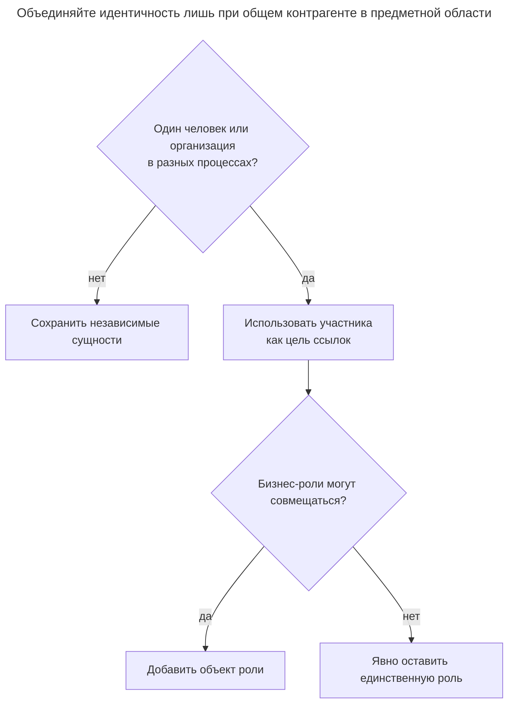
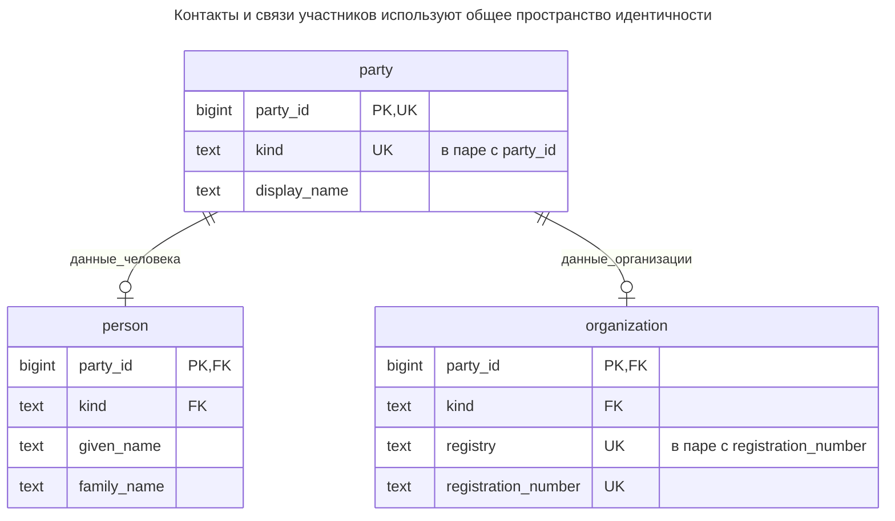
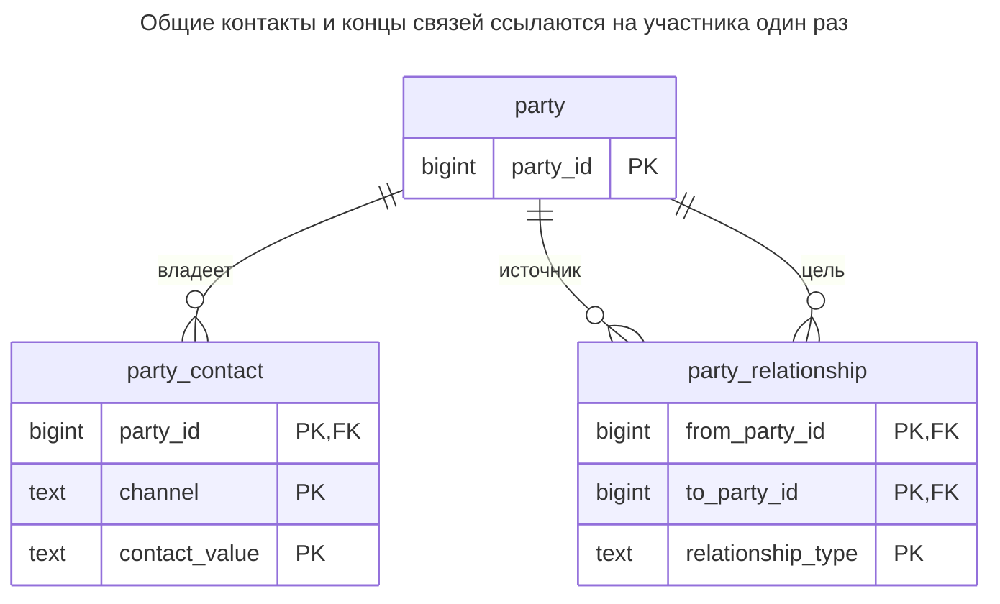
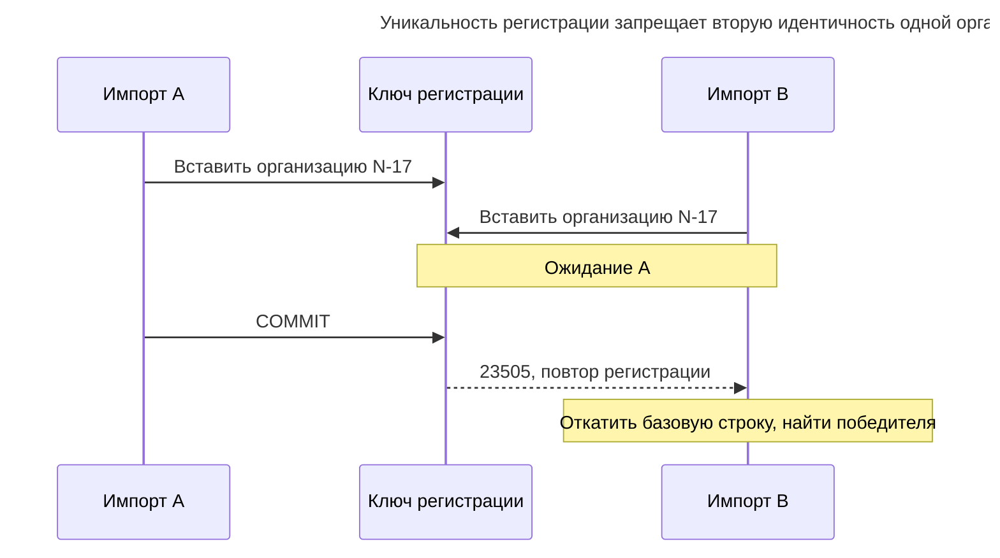
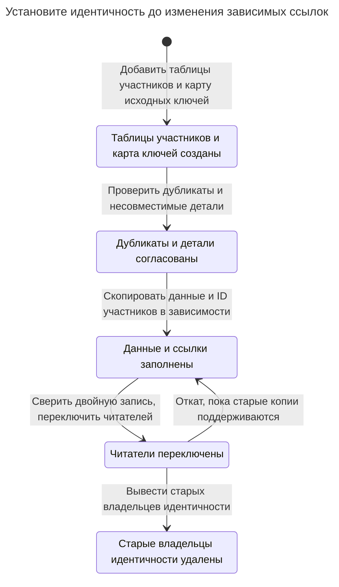

# Участник

## Назначение

Участник — общий супертип людей и организаций: клиенты, поставщики, сотрудники и партнёры являются участниками, а остальная схема ссылается на одну таблицу. Адреса, контакты, соглашения и платежи связываются с участником один раз вместо дублирования для каждого вида контрагента; одна компания может быть и поставщиком, и клиентом, не превращаясь в две записи. Глава показывает таблицы участника, человека и организации, связи участников и границу, за которой общая таблица становится излишней абстракцией для предметной области.

## Также известен как

Party model — модель участников; супертип человека и организации. [Organization Structures](https://martinfowler.com/apsupp/accountability.pdf) Фаулера, страницы 5–6, описывает Party как общую абстракцию людей и организационных единиц. Реляционная схема ниже — реализация этой главы.

## Проблема

Модуль закупок называет Northwind поставщиком, модуль продаж — клиентом. Каждый хранит собственные название компании, email и регистрационный номер. Исправление достигает одной копии и пропускает другую. Платежу затем нужны два возможных столбца получателя, хотя оба получателя — одна организация.

Противоположная ошибка — объединять всё, у чего есть название. Человек, торговая компания и склад не взаимозаменяемы лишь потому, что у каждого есть контакты. Определите, какие сущности действительно могут подписывать соглашения, получать платежи или играть бизнес-роли. Место доставки может оставаться местом, принадлежащим участнику.

## Решение

Создайте одну идентичность `party` для каждого человека или организации. Разместите общие отображаемые и контактные данные за этим ключом. Атрибуты только человека и только организации храните в расширениях с общим ключом. Пусть соглашения и другие общие связи ссылаются на ключ участника, а связи, которым нужна именно организация, — на расширение организации.

Отделяйте идентичность от участия. Northwind получает роль клиента и роль поставщика без нового ID участника; это решение принадлежит [Объекту роли](role-object.md). [Статья Фаулера о ролях](https://martinfowler.com/apsupp/roles.pdf) явно отделяет общие свойства носителя от играемых объектом ролей. Смена роли не меняет идентичность человека и не превращает человека в организацию.

## Альтернативы и выбор

| Соседний паттерн | Связь | Определяющее требование |
| --- | --- | --- |
| [Таблицы классов](class-table-inheritance.md) | Вариант реализации | Таблицы подтипов с общим ключом подходят обязательным полям; используйте усиленную полноту этого паттерна, если к фиксации у каждого участника должны быть детали |
| [Объект роли](role-object.md) | Дополнение | Участник может быть клиентом и поставщиком с независимыми периодами участия |
| Отдельные сущности клиента и поставщика | Замена | У них действительно разные жизненные циклы и нет общих операций с контрагентом |

Полная таблица — в [Атласе решений](decision-atlas.md). Общий ключ полезен, когда в предметной области есть общая сущность, а не просто похожие столбцы.



Сначала установите общую идентичность, затем решите, нужны ли участию отдельные строки. Таблица ролей не определяет, описывают ли две регистрации одну организацию.

## Структура



В каждом расширении не более одной строки для участника. Составные ссылки с дискриминатором запрещают расширение человека для организации, но намеренно разрешают новому участнику пока не иметь расширения. Аннотации `UK` обозначают составные ключи, а не уникальность вида или реестра по отдельности.



Контакт принадлежит идентичности независимо от ролей. Каждая связь имеет два проверенных конца-участника; её тип задаёт смысл, а дополнительные бизнес-правила остаются отдельными.

## Таблицы и инварианты

- **`party`** владеет стабильной идентичностью и обязательным видом. Отображаемое имя — метка, а не ключ устранения дубликатов.
- **`person` / `organization`** содержат необязательные записи деталей выбранного вида. `organization_registration_key` идентифицирует организацию в реестре примера; определите, какой выдающий орган обозначает реальный ключ реестра.
- **`party_contact`** принадлежит участнику один раз независимо от ролей. Общий семейный email разрешён, поскольку уникальность задаётся участником, каналом и значением.
- **`party_relationship`** проверяет концы и запрещает самоссылки. Она допускает оба названных вида связей между участниками любого вида; не обеспечивает дочерние организации только между организациями, ацикличность или периоды бизнес-действительности. Добавьте эти правила до трактовки общей связи как организационной структуры.

## Когда применять

- Несколько процессов ссылаются на тех же людей и организации и нуждаются в общих изменениях контактов.
- Платёж, соглашение или сообщение могут адресоваться контрагенту любого вида.
- Ваш процесс установления идентичности может отличить общие сущности от похожих названий.

## Последствия и компромиссы

- ➕ У исправлений контактов и общих ссылок один владелец.
- ➕ Добавление бизнес-роли не дублирует контрагента.
- ➖ Чтение полного подтипа требует соединения с таблицей деталей; доступ между процессами также требует явной политики авторизации.
- ➖ Объединение идентичностей становится операцией предметной области над всеми ссылками, а не обновлением имени.
- ➖ Универсальная `party` может скрыть значимые границы, если включить места, товары или несвязанные идентичности только ради повторного использования.

## Реализация

[Полный скрипт PostgreSQL 18.6](../assets/party/party.sql) создаёт контакты и связь контактного лица, проверяет неверный подтип и повторную регистрацию, переименовывает организацию. Основная схема:

```sql
CREATE SCHEMA party_example;
SET search_path = party_example, public;

CREATE TABLE party (
    party_id bigint PRIMARY KEY,
    kind text NOT NULL CHECK (kind IN ('person', 'organization')),
    display_name text NOT NULL,
    UNIQUE (party_id, kind)
);
CREATE TABLE person (
    party_id bigint PRIMARY KEY,
    kind text NOT NULL DEFAULT 'person' CHECK (kind = 'person'),
    given_name text NOT NULL,
    family_name text NOT NULL,
    CONSTRAINT person_party_kind_fk FOREIGN KEY (party_id, kind)
        REFERENCES party (party_id, kind)
);
CREATE TABLE organization (
    party_id bigint PRIMARY KEY,
    kind text NOT NULL DEFAULT 'organization' CHECK (kind = 'organization'),
    registry text NOT NULL,
    registration_number text NOT NULL,
    CONSTRAINT organization_registration_key UNIQUE (registry, registration_number),
    FOREIGN KEY (party_id, kind) REFERENCES party (party_id, kind)
);
CREATE TABLE party_contact (
    party_id bigint REFERENCES party (party_id),
    channel text CHECK (channel IN ('email', 'phone', 'postal')),
    contact_value text NOT NULL,
    PRIMARY KEY (party_id, channel, contact_value)
);
CREATE TABLE party_relationship (
    from_party_id bigint REFERENCES party (party_id),
    to_party_id bigint REFERENCES party (party_id),
    relationship_type text CHECK (relationship_type IN ('contact_for', 'subsidiary_of')),
    PRIMARY KEY (from_party_id, to_party_id, relationship_type),
    CHECK (from_party_id <> to_party_id)
);
CREATE INDEX party_relationship_target_idx ON party_relationship (to_party_id);
```

[Составной внешний ключ](https://www.postgresql.org/docs/18/ddl-constraints.html#DDL-CONSTRAINTS-FK) PostgreSQL проверяет ID вместе с видом. В отличие от ссылки только на ID, он запрещает неправильное расширение. Создавайте базовую строку и известные детали атомарно, хотя неполные участники разрешены:

```sql
BEGIN;
INSERT INTO party VALUES (1, 'organization', 'Northwind'), (2, 'person', 'Ada Lee');
INSERT INTO organization (party_id, registry, registration_number) VALUES (1, 'demo-registry', 'N-17');
INSERT INTO person (party_id, given_name, family_name) VALUES (2, 'Ada', 'Lee');
INSERT INTO party_contact VALUES (1, 'email', 'orders@example.com');
INSERT INTO party_relationship VALUES (2, 1, 'contact_for');
COMMIT;
SELECT p.display_name, c.contact_value
FROM party AS p JOIN party_contact AS c USING (party_id) WHERE p.party_id = 1;
UPDATE party SET display_name = 'Northwind Trading' WHERE party_id = 1;
SELECT p.display_name, o.registration_number
FROM party AS p JOIN organization AS o USING (party_id);
```

Первый запрос возвращает `(Northwind, orders@example.com)`; после переименования запрос организации возвращает `(Northwind Trading, N-17)`. Ни ID, ни ссылка контактного лица не меняются. Добавить организации детали человека недопустимо:

```sql
INSERT INTO person (party_id, given_name, family_name) VALUES (1, 'Wrong', 'Type');
```

PostgreSQL 18.6 возвращает SQLSTATE `23503`: `ERROR: insert or update on table "person" violates foreign key constraint "person_party_kind_fk"`. Вторая организация с теми же реестром и регистрационным номером нарушит `organization_registration_key` с `23505`. Скрипт проверяет обе диагностики.

Не трактуйте отсутствие расширения как неизвестный вид: `party.kind` по-прежнему обязателен. Если регистрация требует полных деталей до активации, добавьте явное состояние регистрации и проверку полноты либо используйте реализацию обязательного подтипа из [Таблиц классов](class-table-inheritance.md).

## Поддержка в движках

- **PostgreSQL 18:** модель реализуют обычные таблицы с общим ключом. Этому примеру не нужно отложенное ограничение полноты.
- **MySQL 8.4 / InnoDB:** [внешние ключи проверяются немедленно](https://dev.mysql.com/doc/refman/8.4/en/create-table-foreign-keys.html); вставка базы до расширения работает, но вариант с отложенной циклической полнотой требует перепроектирования.
- **SQL Server 2025 (17.x) / Oracle AI Database 26ai:** сохраняйте составные проверки концов при переносе типов. Если добавляете процедурные проверки жизненного цикла, [DML-триггеры SQL Server должны обрабатывать множества строк](https://learn.microsoft.com/en-us/sql/relational-databases/triggers/create-dml-triggers-to-handle-multiple-rows-of-data?view=sql-server-ver17); [откладываемые ограничения Oracle](https://docs.oracle.com/en/database/oracle/oracle-database/26/sqlrf/constraint.html) дают другой вариант времени проверки для усиленной полноты подтипов.
- **SQLite 3:** включайте [внешние ключи на каждом соединении](https://www.sqlite.org/foreignkeys.html). Иначе ссылки с дискриминатором не защищают принадлежность подтипу.

## Сбои и конкурентность

Два импорта могут одновременно решить, что регистрация `N-17` в `demo-registry` новая. Считайте ограничение уникальности решающим, затем найдите выигравшую организацию и добавьте нужную роль в новой транзакции. [Проверки уникальных индексов PostgreSQL](https://www.postgresql.org/docs/18/index-unique-checks.html) ожидают конфликтующие незафиксированные вставки до определения результата. Не перехватывайте конфликт, оставляя проигравшую базовую строку участника сиротой; создавайте обе строки в одной транзакции.



Так обнаруживаются лишь дубликаты, покрытые выбранным ключом реестра. Для записей без сопоставимых идентификаторов нужен явный процесс сопоставления и проверки. При объединении блокируйте обоих участников по возрастанию ID, согласуйте конфликтующие детали, перенаправьте зависимости и запишите соответствие старого новому одной согласованной операцией. Сохраняйте возможность найти старую идентичность, если внешние системы ещё её используют.

## Миграция

Постройте явное соответствие каждого старого ключа клиента или поставщика ID участника. Не приравнивайте одинаковые целые числа разных таблиц и не объединяйте совпавшие отображаемые имена автоматически. Разрешите подтверждённые свидетельствами совпадения, затем заполните общие контакты и детали подтипов. Оставьте ролевые поля в исходной роли вместо переноса всех полей в `party`.



Переключайте каждую зависимость лишь после получения одной цели для каждой старой ссылки. В окне отката сохраняйте карту исходных ключей и синхронизированные старые представления. Участника с обеими ролями нельзя без потери информации свернуть обратно в единственный взаимоисключающий флаг «клиент или поставщик».

## Антипаттерны и частые ошибки

- Использовать клиента и поставщика как исключающие виды идентичности, хотя одна организация может быть обоими.
- Устранять дубликаты людей по имени или глобально уникальному email без поддерживающего это правила предметной области.
- Объявлять наличие ровно одного расширения на основании дочерних внешних ключей; схема намеренно допускает отсутствие деталей.
- Считать любую типизированную связь участников корректным деревом или юридически значимой связью без собственных правил.

## Известные применения

- [Пример Party Фаулера](https://martinfowler.com/apsupp/accountability.pdf), страница 5, объединяет частных и корпоративных клиентов телефонной компании. Пример адресной книги также обосновывает контакты, связанные с любым видом.
- Раздел Accountability той же статьи моделирует типизированные связи участников. Простая таблица связей здесь показывает идентичность концов, но не реализует полную модель правил статьи.

## Связанные паттерны

- [Объект роли](role-object.md) отделяет меняющиеся роли участника от идентичности.
- [Таблицы классов](class-table-inheritance.md) объясняют хранение подтипов и более сильную гарантию ровно одного расширения.
