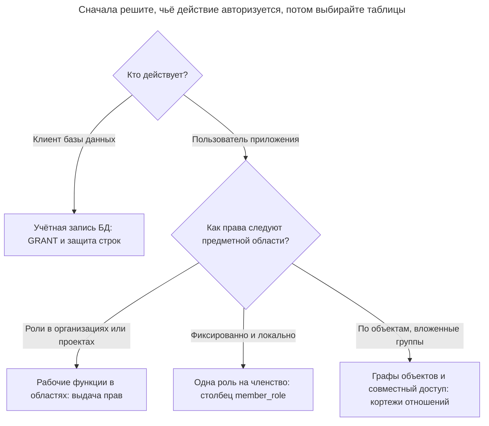
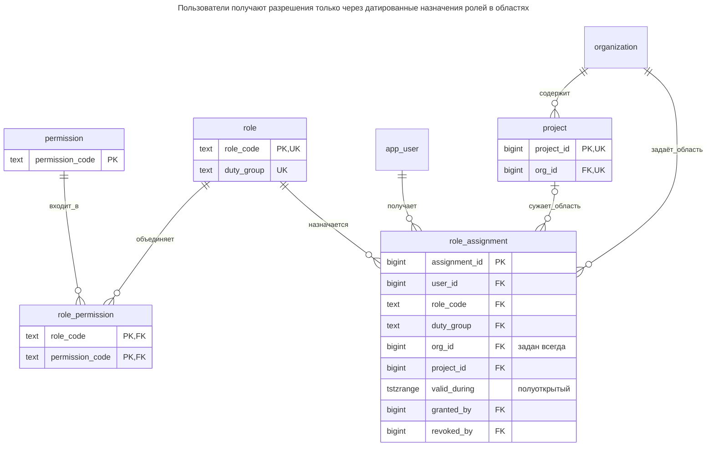
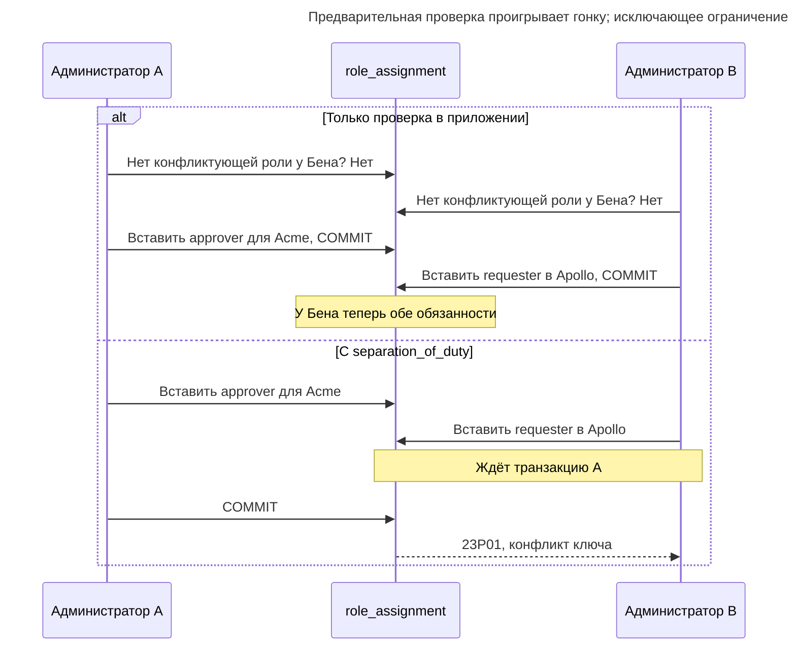
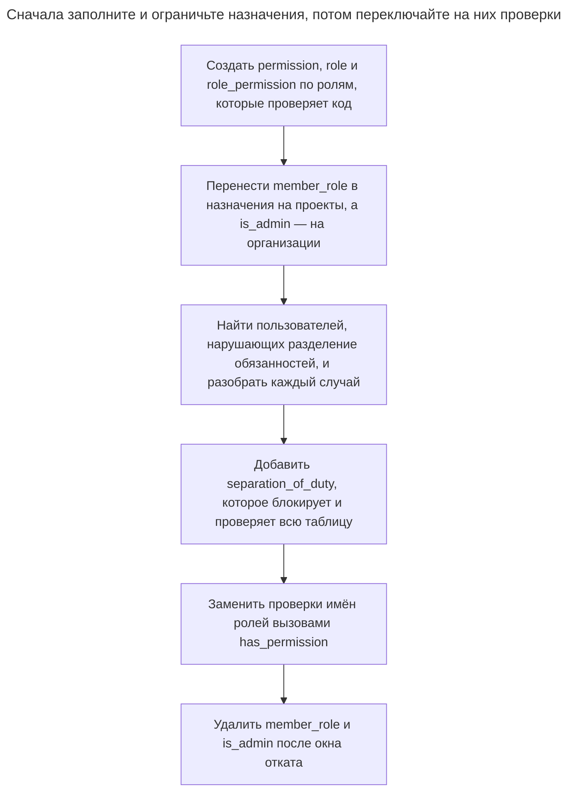

# Выдача прав

## Назначение

Выдача прав хранит авторизацию приложения как данные: словарь действий, роли, которые объединяют действия, и назначения, дающие пользователю роль в области действия — во всей организации или в одном проекте — на заданный период. Один запрос тогда отвечает, может ли пользователь U выполнить действие P в проекте X в момент T, с учётом прав, унаследованных от организации, а ограничения таблицы назначений обеспечивают разделение обязанностей: никто не может одновременно подавать и утверждать расходы одной организации. Это строки о конечных пользователях вашего приложения, а не роли PostgreSQL и не `GRANT`, которые определяют, что учётная запись базы данных может делать с таблицами. Модель следует [ролевому управлению доступом NIST](https://csrc.nist.gov/projects/role-based-access-control).

## Также известен как

Role-based access control (RBAC), ролевое управление доступом; назначение пользователей ролям и разрешений ролям — отношения, которые [FAQ NIST по RBAC](https://csrc.nist.gov/projects/role-based-access-control/faqs) называет основой Core RBAC в ANSI INCITS 359-2004. [Модель RBAC NIST](https://tsapps.nist.gov/publication/get_pdf.cfm?pub_id=916402) Сэнду, Феррайоло и Куна (2000) называет свои уровни flat, hierarchical, constrained и symmetric RBAC. Не путайте этот паттерн с паттерном [Объект роли](role-object.md): объект роли записывает деловую роль участника, например клиента или поставщика, с её собственными атрибутами, а выдача прав записывает, какие действия пользователь может выполнять в приложении и где.

## Проблема

Ваше приложение для учёта расходов начиналось с `app_user.is_admin` и столбца `member_role` в членстве в проекте. Потом Acme попросила финансового руководителя, который утверждает расходы во всех проектах Acme, но не в проектах Globex, подрядчика, который читает один проект до марта, и правило аудитора: никто не утверждает расходы, которые мог сам подать. Флаг не говорит, где он действует, роль в членстве не покрывает проекты, которых ещё нет, а проверки расползаются по контроллерам в виде `if role == 'admin' or role == 'editor'`.

Привилегии базы данных здесь не помогают. Сервис подключается через одну учётную запись из пула, как объясняет глава [Журнал аудита](audit-log.md), и эта запись должна видеть строки всех арендаторов. Роль PostgreSQL на каждого конечного пользователя переносит бизнес-авторизацию в общекластерные объекты каталога, которые не охватывают ни ваши миграции, ни модель арендаторов, ни журнал аудита. Вопрос «может ли Бен утвердить этот расход?» относится к данным приложения.

## Решение

Разделите четыре вещи. `permission` — закрытый словарь действий, которые проверяет код, например `expense.approve`; код никогда не проверяет имена ролей. `role` называет рабочую функцию, а `role_permission` собирает в неё действия. `role_assignment` даёт одному пользователю одну роль в одной области действия на полуоткрытый период. Пользователи получают разрешения только через роли, как в модели NIST: нет таблицы «пользователь — разрешение», через которую можно обойти проверку того, кто чем владеет.

Область действия — настоящая ссылка, а не пара `(scope_type, scope_id)`; см. [Полиморфные связи](polymorphic-associations.md). В этом примере каждый проект лежит ровно в одной организации, организация одновременно служит арендатором, и назначение всегда указывает свой `org_id`. Непустой `project_id` сужает его до одного проекта, а составной внешний ключ `(org_id, project_id)` доказывает, что проект принадлежит этой организации. Это не исключающая дуга: проверки «ровно один» нет, потому что вложенность делает ссылку на организацию обязательной, а необязательной остаётся только более узкая ссылка на проект. Когда появится вид области вне этого дерева, используйте паттерн [Исключающая дуга](exclusive-arc.md) — по одному допускающему NULL внешнему ключу на вид с проверкой «ровно один» — или отдельную таблицу назначений для каждого вида области; правда, в отдельных таблицах конфликтующие назначения уже не видны одному исключающему ограничению.

Разделение обязанностей — это ограничение на назначения. Каждая роль относится к группе обязанностей `duty_group`; роли одной группы конфликтуют. Строка назначения несёт группу, связанную с ролью составным внешним ключом, а исключающее ограничение отклоняет две разные роли одной группы у одного пользователя в одной организации с пересекающимися периодами. Сравнение целых организаций, а не равных областей, сделано намеренно: утверждающий на уровне организации наследует право утверждать в каждом проекте, поэтому дополнительная роль подающего в одном проекте — тот же конфликт. NIST называет правило на назначения статическим разделением обязанностей; правило на роли, одновременно активированные в сеансе, — динамическое разделение обязанностей, и здесь оно не рассматривается. Роли остаются плоскими: наследование идёт по областям, а не от роли к роли. FAQ описывает компоненты стандарта сверх Core RBAC как независимые друг от друга, а статья 2000 года строит свой уровень constrained поверх уровня hierarchical.

## Альтернативы и выбор

| Механизм | Отношение | Решающее требование |
| --- | --- | --- |
| Роли PostgreSQL, `GRANT` и защита строк, как в паттерне [Общая схема](shared-schema.md) | Дополнение | Ограничить, что учётная запись базы данных может читать или менять; RLS может проверять условие арендатора или разрешения ниже приложения |
| `member_role` в паттерне [Таблица связей](association-table.md) | Замена для простых случаев | Одна фиксированная роль на членство, без наследования между областями и без правил конфликтов |
| Списки доступа на каждый объект | Замена | Каждый объект открывается отдельно пользователям или группам, и роли мало что добавляют |
| Кортежи отношений | Обобщение | Доступ следует графам объектов, вложенным группам и совместному доступу, как в Zanzibar |
| [Период действия](effective-dating.md) | Дополнение | Права начинаются и заканчиваются в деловые моменты, а проверка должна отвечать для прошлого момента |
| [Журнал аудита](audit-log.md) | Дополнение | Нужно показать, кто выдал или отозвал что, когда и почему |

Полное сравнение — в [Атласе решений](decision-atlas.md).



Ветка кортежей — общая форма этой главы. [Zanzibar](https://www.usenix.org/conference/atc19/presentation/pang) (Pang и др., USENIX ATC 2019) хранит списки доступа как кортежи отношений в записи `object#relation@user`, например `doc:readme#owner@10`, где пользователем может быть набор пользователей, такой как `group:eng#member`. Статья определяет ключ кортежа как пространство имён, ID объекта, отношение и пользователя. Связь документа с папкой сама хранится кортежем, `doc:readme#parent@folder:A#...`, но правила, превращающие связи в доступ, например «редакторы — тоже читатели» или «наследовать читателей родительской папки», задаёт конфигурация пространства имён через правила переписывания наборов пользователей (userset rewrite). Строка `role_assignment` соответствует кортежу вроде `project:10#requester@2`, а наследование от организации — хранимому кортежу `project:10#parent@org:1#...` вместе с правилом переписывания, которое по нему проходит. Единая таблица кортежей с ключом из пространства имён и ID объекта не может иметь внешних ключей к вашим таблицам областей. Выбирайте её, когда язык политик важнее реляционных гарантий.

## Структура



`permission`, `role` и `role_permission` меняются с релизами; `role_assignment` меняется ежедневно. Обратите внимание на две составные ссылки из `role_assignment`: `(role_code, duty_group)` на `role` и `(org_id, project_id)` на `project`. Оба столбца каждой пары лежат в строке назначения, поэтому ограничение этой таблицы видит группу обязанностей и организацию без соединения.

## Таблицы и инварианты

- **`permission`** — словарь действий. Приложение проверяет эти коды; добавление кода — это релиз, как добавление значения в справочник (см. [Таблица значений](lookup-table.md)).
- **`role`** называет рабочую функцию и её `duty_group`. Роли без конфликтов получают собственную группу. `UNIQUE (role_code, duty_group)` — цель составного внешнего ключа назначений.
- **`role_permission`** объединяет действия в роли, ключ — пара.
- **`role_assignment`** выдаёт одну роль одному пользователю в одной области. `assignment_role_fkey` требует, чтобы скопированная группа совпадала с группой роли, а `ON UPDATE CASCADE` перепроверяет существующие назначения, когда роль переходит в другую группу. `assignment_project_fkey` отклоняет проект из другой организации; при `MATCH SIMPLE` по умолчанию он не проверяется, если `project_id` пуст, и тогда неизвестную организацию отклоняет отдельный внешний ключ `org_id`. `assignment_period_check` требует непустой период с началом. `separation_of_duty` отклоняет конфликтующие роли с пересекающимися периодами.
- **Ответственность:** `granted_by` и `revoked_by` говорят, кто отвечает за текущее состояние назначения. Причина, ID запроса и прежние версии строки принадлежат журналу аудита (см. [Журнал аудита](audit-log.md)), который пишется в той же транзакции.

## Когда применять

- Много пользователей выполняют немного рабочих функций, и администраторы назначают функции, а не отдельные действия.
- Права действуют внутри арендатора или ресурса, а более широкие области должны покрывать более узкие.
- Нужно запрещать сочетания, которые никому нельзя иметь, или отвечать, кто что мог делать в прошлый момент.

## Последствия и компромиссы

- ➕ Одни и те же таблицы отвечают на вопросы «может ли U выполнить P в X?», «почему?» и «кто может выполнить P в X?»; уже уровень flat модели NIST требует узнавать, какие роли есть у пользователя и у каких пользователей есть роль.
- ➕ Конфликтующее назначение отклоняет база данных, каким бы экраном администратора или импортом оно ни создавалось.
- ➕ Срочные права и отзыв сохраняют историю, поэтому прошлое решение можно объяснить по строкам.
- ➖ Исключающее ограничение сравнивает целые группы обязанностей и не выражает произвольную матрицу совместимости; тот же предел конфликтных групп объясняет [Объект роли](role-object.md).
- ➖ Наследование идёт только по закодированному дереву областей. Иерархиям ролей, запрещающим правилам и условиям на атрибуты нужны дополнительные таблицы или движок политик.
- ➖ Каждая проверка прав — это запрос. Кэширование решений в приложении задерживает отзыв на время жизни кэша.

## Реализация

[Полный скрипт для PostgreSQL 18.7](../assets/permission-grant/permission-grant.sql) проверяет наследование, границу арендатора, полуоткрытое истечение, запросы объяснения и обратного поиска, все случаи разделения обязанностей, отзыв и повторную выдачу, а также приведённые ниже отказы. Главная таблица и запрос:

```sql
CREATE EXTENSION IF NOT EXISTS btree_gist;
CREATE TABLE role_assignment (
    assignment_id bigint PRIMARY KEY,
    user_id bigint NOT NULL REFERENCES app_user (user_id),
    role_code text NOT NULL,
    duty_group text NOT NULL,
    org_id bigint NOT NULL REFERENCES organization (org_id),
    project_id bigint,
    valid_during tstzrange NOT NULL,
    granted_by bigint NOT NULL REFERENCES app_user (user_id),
    revoked_by bigint REFERENCES app_user (user_id),
    CONSTRAINT assignment_role_fkey FOREIGN KEY (role_code, duty_group)
        REFERENCES role (role_code, duty_group) ON UPDATE CASCADE,
    CONSTRAINT assignment_project_fkey FOREIGN KEY (org_id, project_id)
        REFERENCES project (org_id, project_id),
    CONSTRAINT assignment_period_check
        CHECK (NOT isempty(valid_during) AND NOT lower_inf(valid_during)),
    CONSTRAINT assignment_revocation_check
        CHECK (revoked_by IS NULL OR NOT upper_inf(valid_during)),
    CONSTRAINT separation_of_duty EXCLUDE USING gist (
        org_id WITH =, user_id WITH =, duty_group WITH =,
        role_code WITH <>, valid_during WITH &&)
);

CREATE FUNCTION permission_source(p_user bigint, p_permission text, p_project bigint, p_at timestamptz)
RETURNS TABLE (assignment_id bigint, role_code text, scope text)
LANGUAGE sql STABLE
BEGIN ATOMIC
    SELECT a.assignment_id, a.role_code,
           CASE WHEN a.project_id IS NULL THEN 'organization' ELSE 'project' END
    FROM project AS p
    JOIN role_assignment AS a
      ON a.org_id = p.org_id
     AND (a.project_id IS NULL OR a.project_id = p.project_id)
    JOIN role_permission AS rp ON rp.role_code = a.role_code
    WHERE p.project_id = p_project AND a.user_id = p_user
      AND rp.permission_code = p_permission AND a.valid_during @> p_at;
END;
CREATE FUNCTION has_permission(p_user bigint, p_permission text, p_project bigint, p_at timestamptz)
RETURNS boolean LANGUAGE sql STABLE
RETURN EXISTS (SELECT FROM permission_source(p_user, p_permission, p_project, p_at));
```

Элемент `role_code WITH <>` превращает исключение в правило конфликта, а не уникальности: две строки конфликтуют, только если их роли различаются. [`btree_gist`](https://www.postgresql.org/docs/18/btree-gist.html) даёт GiST-поддержку `=` и `<>` для скалярных столбцов. Поскольку оператор — `<>`, Бен может одновременно быть подающим в Apollo и в Borealis.

Скрипт выдаёт Аде `editor` на всю Acme, Бену `requester` в Apollo и Саю `viewer` в Borealis на `[2026-01-01, 2026-03-01)`. Тогда `has_permission(1, 'project.edit', 11, '2026-02-01')` истинно через назначение на организацию, а тот же вызов для проекта 20 из Globex ложен. `permission_source` возвращает причину `100, editor, organization`. Сай может читать Borealis в `2026-02-28 23:59:59` и не может в `2026-03-01 00:00:00`. Передавайте момент явно: `now()` зафиксировано на всю транзакцию, что верно для одного запроса, но неверно для теста или отчёта. Обратный вопрос «кто может утверждать расходы в Apollo?» — та же функция, применённая к каждому пользователю.

После того как Ада становится `approver` организации, назначение подающим в Apollo отклоняется:

```sql
INSERT INTO role_assignment
    (assignment_id, user_id, role_code, duty_group, org_id, project_id, valid_during, granted_by)
SELECT 106, 1, role_code, duty_group, 1, 10, '[2026-02-01,)', 9
FROM role WHERE role_code = 'requester';
```

PostgreSQL 18.7 возвращает SQLSTATE `23P01`: `ERROR: conflicting key value violates exclusion constraint "separation_of_duty"` с `DETAIL: Key (org_id, user_id, duty_group, role_code, valid_during)=(1, 1, expense, requester, ["2026-02-01 00:00:00+00",)) conflicts with existing key (org_id, user_id, duty_group, role_code, valid_during)=(1, 1, expense, approver, ["2026-01-01 00:00:00+00",)).` Назначение Бена утверждающим в Globex принимается, потому что организация другая. Проект Globex под `org_id` Acme вызывает `23503`: `ERROR: insert or update on table "role_assignment" violates foreign key constraint "assignment_project_fkey"`, `DETAIL: Key (org_id, project_id)=(1, 20) is not present in table "project".` Указание `duty_group = 'approver'` для роли утверждающего так же нарушает `assignment_role_fkey`.

Назначение проходит короткий жизненный цикл, и меняются только период и столбцы отзыва:

```mermaid
---
title: Истечение и отзыв закрывают период; ни то ни другое не удаляет действовавшее назначение
---
stateDiagram-v2
    state "Запланировано (scheduled)" as scheduled
    state "Действует (active)" as active
    state "Истекло (expired)" as expired
    state "Отозвано (revoked)" as revoked
    [*] --> scheduled: Вставка с будущей нижней границей
    scheduled --> active: Нижняя граница наступила
    scheduled --> [*]: Отменено до начала, строка удалена
    active --> expired: Верхняя граница наступила
    active --> revoked: Верхняя граница — момент отзыва, задан revoked_by
    expired --> [*]
    revoked --> [*]
    class scheduled muted
    class active accent
    class revoked warn
```



Отзывайте, закрывая период в момент отзыва, чтобы история сохранила время, когда право действовало:

```sql
UPDATE role_assignment
SET valid_during = tstzrange(lower(valid_during), '2026-06-01'), revoked_by = 9
WHERE assignment_id IN (101, 104) AND valid_during @> TIMESTAMPTZ '2026-06-01';
```

Бен может подавать расходы в `2026-05-31` и не может в `2026-06-01`. Назначение утверждающим с `2026-06-01` теперь принимается, а задним числом с `2026-05-01` по-прежнему пересекается с закрытым периодом подающего и падает с `23P01`. Назначение, которое ещё не началось, нельзя закрыть в момент его начала: период становится пустым, и `assignment_period_check` вызывает `23514`, поэтому удалите строку и запишите отмену в журнал аудита. Установка `revoked_by` на бессрочном назначении тоже нарушает `assignment_revocation_check`. Перенос `editor` в группу `expense` каскадом доходит до назначений Ады и нарушает `separation_of_duty`: изменение политики проверяется на существующих назначениях.

## Поддержка в движках

- **PostgreSQL 18:** исключающие ограничения с [диапазонными типами](https://www.postgresql.org/docs/18/rangetypes.html) и `btree_gist` выражают правило декларативно. [Роли и `GRANT`](https://www.postgresql.org/docs/18/sql-grant.html) остаются уровнем учётных записей базы данных; [политика защиты строк](https://www.postgresql.org/docs/18/ddl-rowsecurity.html) может вызывать `has_permission`, чтобы применять права приложения ниже сервиса, с оговорками о доверенном контексте из главы [Общая схема](shared-schema.md).
- **MySQL 8.4:** исключающих ограничений нет, а [`CHECK`](https://dev.mysql.com/doc/refman/8.4/en/create-table-check-constraints.html) не читает другие строки. Сериализуйте выдачу прав одному пользователю, блокируя его строку через [`SELECT ... FOR UPDATE`](https://dev.mysql.com/doc/refman/8.4/en/innodb-locking-reads.html), затем проверяйте конфликты и вставляйте в одной транзакции.
- **SQL Server 2025 (17.x):** триггер должен обрабатывать [многострочные вставки](https://learn.microsoft.com/en-us/sql/relational-databases/triggers/create-dml-triggers-to-handle-multiple-rows-of-data?view=sql-server-ver17), а проверки двух писателей нужно сериализовать по ключу, например по организации и пользователю, скажем через [`sp_getapplock`](https://learn.microsoft.com/en-us/sql/relational-databases/system-stored-procedures/sp-getapplock-transact-sql?view=sql-server-ver17).
- **Oracle AI Database 26ai:** [ограничения CHECK не могут содержать подзапросы](https://docs.oracle.com/en/database/oracle/oracle-database/26/sqlrf/constraint.html). Блокируйте строку пользователя через [`SELECT ... FOR UPDATE`](https://docs.oracle.com/en/database/oracle/oracle-database/26/sqlrf/SELECT.html) в процедуре выдачи перед проверкой.
- **SQLite 3:** [`BEGIN IMMEDIATE`](https://www.sqlite.org/lang_transaction.html) сериализует писателей, поэтому проверка с последующей вставкой внутри неё безопасна. Включайте [внешние ключи](https://www.sqlite.org/foreignkeys.html) в каждом соединении для ссылок на области и роли.

## Сбои и конкурентность

Два администратора одновременно выдают Бену конфликтующие роли. Проверка в коде приложения читает только зафиксированные строки, поэтому при Read Committed обе проверки проходят:



Если A вместо этого откатывается, вставка B проходит. Лабораторный скрипт проверяет последовательный отказ; само ожидание требует двух сеансов. Считайте `23P01` деловым отказом, который нужно показать администратору, а не ошибкой для повтора.

Отзыв тоже соревнуется с проверками. Запрос, который проверил право и затем работает несколько секунд, может действовать уже после фиксации отзыва. Выполняйте проверку и действие в одной транзакции, а если действие не должно пережить право, блокируйте строки-источники через `SELECT ... FROM role_assignment ... FOR SHARE`: PostgreSQL документирует, что [разделяемая блокировка строки блокирует `UPDATE`](https://www.postgresql.org/docs/18/explicit-locking.html#LOCKING-ROWS), поэтому отзывающее обновление ждёт окончания действия. Zanzibar называет распределённый вариант этой проблемы «новым врагом» (new enemy): проверка игнорирует порядок изменений ACL или применяет старый ACL к новому содержимому. Он вычисляет каждую проверку на снимке не старше момента, записанного в непрозрачном токене, который статья называет zookie. В одной базе PostgreSQL при Read Committed каждый оператор берёт новый снимок, поэтому действие упорядочивает перед отзывом блокировка строки, а не снимок.

## Миграция

От столбца `member_role` в членстве в проекте и флага `is_admin` постройте таблицы прав рядом с ними и переведите проверки с имён ролей на коды разрешений.



Начинайте каждый перенесённый период с момента миграции, если нет свидетельств более ранней даты выдачи. Исключающее ограничение нельзя добавить как `NOT VALID` и проверить позже; PostgreSQL 18.7 возвращает `0A000`: `ERROR: EXCLUDE constraints cannot be marked NOT VALID`. [`ALTER TABLE`](https://www.postgresql.org/docs/18/sql-altertable.html) строит его индекс и проверяет каждую строку под блокировкой `ACCESS EXCLUSIVE`, поэтому сначала разрешите конфликты и добавляйте ограничение, пока таблица мала. Пока старые столбцы не удалены, поддерживайте их как проекцию назначений, чтобы откат приложения нашёл актуальные данные. Само переключение выполняйте по паттерну [Расширение и свёртывание](expand-contract.md).

## Антипаттерны и частые ошибки

- Проверка имён ролей в коде: новая роль требует релиза, и ни один запрос не скажет, кто может выполнить действие.
- Выдача разрешений напрямую пользователям в обход ролей, из-за чего нельзя проверить, кто чем владеет.
- Хранение области как `(scope_type, scope_id)` без внешних ключей: назначения переживают удаление проекта или указывают в другого арендатора.
- Разделение обязанностей только между равными областями: утверждающий на уровне организации становится подающим в проекте и утверждает собственный расход.
- Группа конфликтов только в `role`, где ограничение на назначения её не видит, или ввод группы вызывающим кодом без внешнего ключа.
- Удаление отозванных назначений, после которого никто не объяснит решение, принятое, пока они действовали.
- Отдельная роль PostgreSQL на каждого конечного пользователя ради `GRANT`, смешивающая бизнес-авторизацию с администрированием базы данных.

## Известные применения

- [Проект RBAC NIST](https://csrc.nist.gov/projects/role-based-access-control) прослеживает модель от Феррайоло и Куна (1992) до ANSI INCITS 359-2004, пересмотренного как INCITS 359-2012. Его FAQ перечисляет компоненты стандарта: Core RBAC с назначением пользователей ролям и разрешений ролям, иерархический RBAC, статическое разделение обязанностей на назначениях и динамическое разделение обязанностей при активации ролей в сеансе.
- [Zanzibar](https://www.usenix.org/conference/atc19/presentation/pang) вычисляет управление доступом для сервисов Google, включая Calendar, Cloud, Drive, Maps, Photos и YouTube. Статья сообщает о более чем двух триллионах ACL, хранящихся как кортежи отношений в Spanner.

## Связанные паттерны

- [Объект роли](role-object.md) моделирует деловые роли участников; его конфликтные группы используют похожую технику исключения.
- [Участник](party.md) — частый выбор субъекта, когда права выдаются организациям, а не только людям.
- [Общая схема](shared-schema.md) ограничивает строки арендатором и применяет доступ через защиту строк.
- [Исключающая дуга](exclusive-arc.md) и [Полиморфные связи](polymorphic-associations.md) объясняют, почему ссылки на области — настоящие внешние ключи.
- [Период действия](effective-dating.md) объясняет полуоткрытые периоды.
- [Журнал аудита](audit-log.md) записывает, кто выдал и отозвал каждое назначение и почему.
- [Таблица связей](association-table.md) — более простая схема «членство с ролью», которую этот паттерн заменяет, когда появляются области и конфликты.
