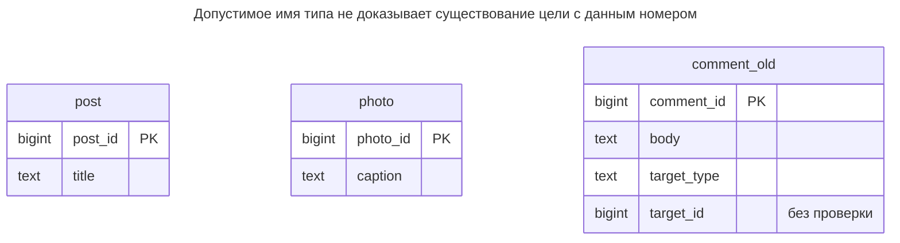
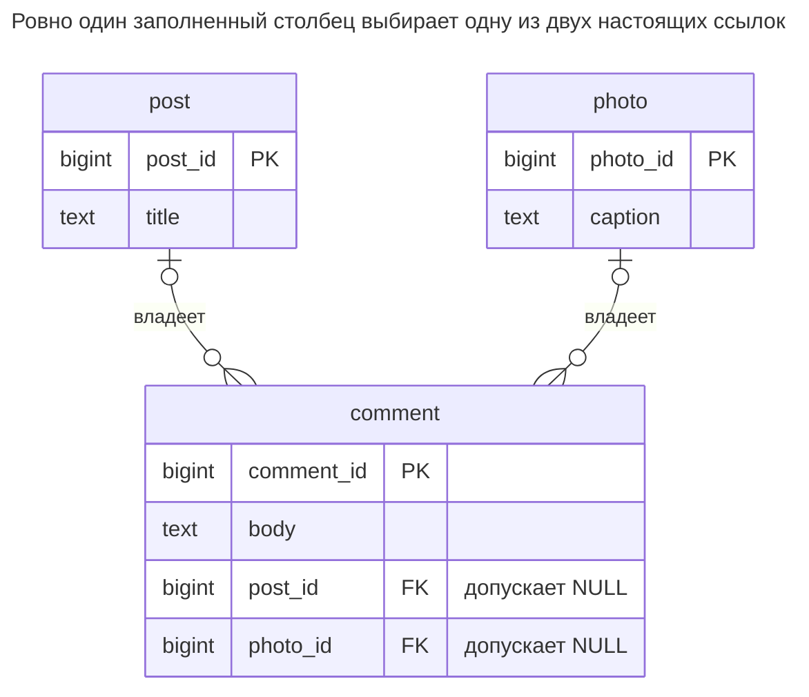
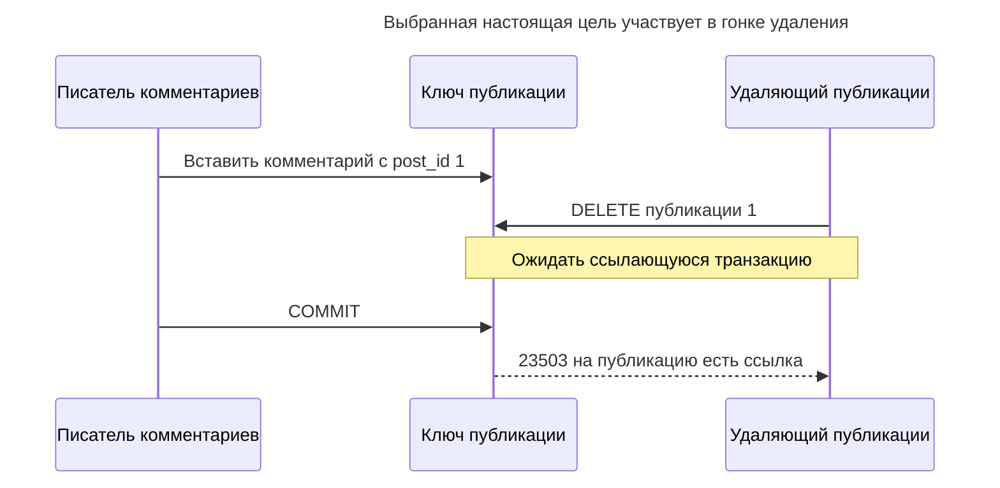
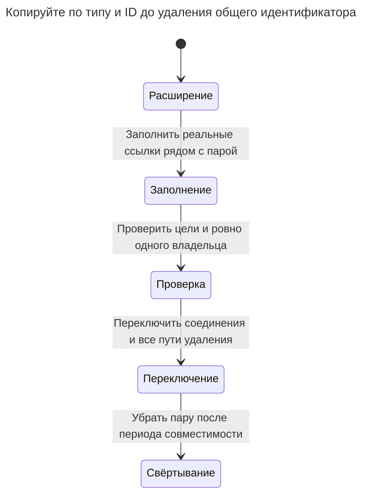

# Полиморфные связи

Полиморфные связи ссылаются на строку одной из нескольких таблиц парой столбцов — типом и ID цели, — как полиморфные ассоциации Rails и обобщённые связи Django. Внешний ключ не может проверить такую ссылку, поэтому база допускает комментарий к никогда не существовавшей записи, а соединения с целями должны учитывать тип. Глава показывает вред и три выхода: исключающую дугу, отдельную таблицу связей на каждую цель и общий супертип. Каталог Билла Карвина использует то же название.

## Также известен как

Polymorphic Associations в [оглавлении SQL Antipatterns Билла Карвина](https://pragprog.com/titles/bksap1/sql-antipatterns-volume-1/). Rails так же называет [механизм связи по типу и ID](https://guides.rubyonrails.org/association_basics.html#polymorphic-associations). Возможность описывает отображение приложения; глава исследует отсутствующую гарантию связи в базе.

## Контекст

Комментарии принадлежат публикациям или фотографиям. У родительских таблиц независимые ключи, поэтому публикация `1` и фото `1` сосуществуют. Вы хотите единые API и таблицу комментариев без нового столбца цели при добавлении очередного комментируемого вида.

## Проблема

Вы храните тип и ID цели, но не объявляете ссылку этого ID на настоящего родителя. Проверка написания типа отклонит `photograph`, но не докажет существование фото `999`. Обычный [внешний ключ PostgreSQL называет одну целевую таблицу](https://www.postgresql.org/docs/18/ddl-constraints.html#DDL-CONSTRAINTS-FK), а не таблицу, выбираемую значением другого столбца.

Соединения с учётом цели возможны, как показывает пример; `CASE` не обязателен. Структурная проблема в том, что каждый запрос и операция жизненного цикла должны правильно трактовать дискриминатор. Rails [описывает синхронизацию имени класса](https://guides.rubyonrails.org/association_basics.html#polymorphic-associations) при изменении сохранённого имени модели. [Документация GenericForeignKey Django](https://docs.djangoproject.com/en/5.2/ref/contrib/contenttypes/#generic-relations) описывает удаление цели, оставляющее ID, разрешаемые в `None`; настроенная `GenericRelation` имеет дополнительное поведение удаления. Не приписывайте всем обобщённым отображениям единую политику удаления.

## Почему так делают

Одна обобщённая возможность присоединяется ко многим моделям с небольшим объёмом DDL на цель. Это оправдано для реестра плагинов, закладки без гарантии сохранности или идентификатора удалённого ресурса, цель которого исчезает независимо. Это другой контракт, чем комментарий, обязанный всегда иметь одного существующего локального владельца.

## Последствия

- ➖ Пример принимает ссылки на отсутствующие цели, оставляя их интерпретацию до чтения.
- ➖ Переименование типа меняет и хранимые данные, и приложение.
- ➖ Удалению родителя нужна полная политика с учётом типов вне обычного графа внешних ключей.
- ➖ Совпадение по ID без типа может привязать комментарий не к той сущности.
- ➖ Индекс обобщённого ID ускоряет поиск, не доказывая существование цели.

## Признаки

- Есть `target_type` и `target_id` без фиксированной границы ссылок.
- Код удаления вручную перечисляет всех обобщённых потомков.
- Переименование модели требует обновить строки типов в данных.
- Задание исправления проверяет несколько родителей в поиске сирот.

## Как лучше

Для небольшого управляемого набора целей используйте [Исключающую дугу](exclusive-arc.md): необязательный внешний ключ на каждого родителя и проверку ровно одного. Для осмысленного общего семейства сущностей используйте общий супертип. Для независимых семейств связей перенесите ссылки в таблицы связей конкретных целей. [Загруженные автором слайды Карвина](https://www.slideshare.net/slideshow/practical-object-oriented-models-in-sql/1762095) называют альтернативы; ограничения примера — реализация этой главы.

### Альтернативы и выбор

| Соседний паттерн | Связь | Определяющее требование |
| --- | --- | --- |
| [Исключающая дуга](exclusive-arc.md) | Замена | Немного видов родителей; ровно один владелец потомка |
| Отдельные [Таблицы связей](association-table.md) целей | Замена размещения ссылок | Связи развиваются независимо или допустимы несколько целей |
| [Таблицы классов](class-table-inheritance.md) | Замена идентичности цели | Виды родителей имеют настоящие общие идентичность и жизненный цикл |
| Непроверяемый внешний идентификатор | Вариант более слабого контракта | Отсутствующие или удалённые цели явно разрешены и обрабатываются |

Таблицы конкретных целей по отдельности обеспечивают существование, но совместно не требуют ровно одной связи во всех таблицах. Общий супертип даёт настоящую общую цель внешнего ключа, но требует собственных правил полноты подтипов. Эти цены входят в выбор; см. [Атлас решений](decision-atlas.md).

## Пример

### Структура

**Было:** тип и ID намекают на две возможные связи, но не объявляют ни одной.



Связи внешних ключей не показаны, поскольку их нет. Одинаковые числовые ключи родительских таблиц остаются разными идентичностями.

```sql
CREATE TABLE post (post_id bigint PRIMARY KEY, title text NOT NULL);
CREATE TABLE photo (photo_id bigint PRIMARY KEY, caption text NOT NULL);
CREATE TABLE comment_old (
    comment_id bigint PRIMARY KEY,
    body text NOT NULL,
    target_type text NOT NULL CHECK (target_type IN ('post', 'photo')),
    target_id bigint NOT NULL
);
INSERT INTO post VALUES (1, 'Schema notes');
INSERT INTO photo VALUES (1, 'Whiteboard');
INSERT INTO comment_old VALUES
    (10, 'Useful', 'post', 1), (11, 'Clear', 'photo', 1), (12, 'Lost', 'post', 999);
SELECT c.comment_id FROM comment_old AS c
LEFT JOIN post AS p ON c.target_type = 'post' AND c.target_id = p.post_id
LEFT JOIN photo AS f ON c.target_type = 'photo' AND c.target_id = f.photo_id
WHERE p.post_id IS NULL AND f.photo_id IS NULL;
```

Поиск сирот возвращает комментарий `12`, хотя `post` — разрешённый тип. Это не ошибка синтаксиса или загрузки ORM; строка удовлетворяет всем объявленным ограничениям.

**Стало:** сохраняем два пространства родителей и ограничиваем выбор в строке комментария.



Каждая связь отдельно необязательна. Проверка строки требует ровно одну из двух, а не ноль или две.

```sql
CREATE TABLE comment (
    comment_id bigint PRIMARY KEY,
    body text NOT NULL,
    post_id bigint REFERENCES post (post_id),
    photo_id bigint REFERENCES photo (photo_id),
    CONSTRAINT comment_one_target CHECK (
        (post_id IS NOT NULL AND photo_id IS NULL)
        OR (post_id IS NULL AND photo_id IS NOT NULL)
    )
);
CREATE INDEX comment_post_idx ON comment (post_id);
CREATE INDEX comment_photo_idx ON comment (photo_id);
CREATE TABLE comment_reject (LIKE comment_old INCLUDING ALL);
BEGIN;
LOCK TABLE comment_old, post, photo IN SHARE ROW EXCLUSIVE MODE;
INSERT INTO comment
SELECT c.comment_id, c.body,
       CASE WHEN c.target_type = 'post' THEN p.post_id END,
       CASE WHEN c.target_type = 'photo' THEN f.photo_id END
FROM comment_old AS c
LEFT JOIN post AS p ON c.target_type = 'post' AND c.target_id = p.post_id
LEFT JOIN photo AS f ON c.target_type = 'photo' AND c.target_id = f.photo_id
WHERE p.post_id IS NOT NULL OR f.photo_id IS NOT NULL;
INSERT INTO comment_reject
SELECT c.* FROM comment_old AS c
WHERE NOT EXISTS (SELECT 1 FROM comment AS n WHERE n.comment_id = c.comment_id);
COMMIT;
SELECT comment_id, body FROM comment WHERE post_id = 1;
SELECT comment_id, target_type, target_id FROM comment_reject;
```

У публикации `1` есть `(10, Useful)`. Таблица отказов сохраняет комментарий `(12, post, 999)` для расследования. Комментарий `11` остаётся у фото `1`; заполнение только по ID перепутало бы его с публикацией.

```sql
INSERT INTO comment VALUES (13, 'Ambiguous', 1, 1);
```

PostgreSQL 18.6 возвращает SQLSTATE `23514`: `ERROR: new row for relation "comment" violates check constraint "comment_one_target"`. Единственная, но отсутствующая цель отклоняется отдельно:

```sql
INSERT INTO comment VALUES (14, 'Missing', 999, NULL);
```

Это даёт SQLSTATE `23503`: `ERROR: insert or update on table "comment" violates foreign key constraint "comment_post_id_fkey"`. [Полный скрипт](../assets/polymorphic-associations/polymorphic-associations.sql) проверяет оба ограничения. Практикум запрещает удаление используемых родителей; выбирайте каскады лишь тогда, когда удаление владельца должно удалять его комментарии.

### Поддержка в движках

- **PostgreSQL 18:** достаточно явных предикатов `NULL`. [`num_nonnulls`](https://www.postgresql.org/docs/18/functions-comparison.html) — более короткий вариант для длинной дуги.
- **MySQL 8.4:** [ограничения CHECK ограничивают сочетания с действиями внешних ключей](https://dev.mysql.com/doc/refman/8.4/en/create-table-check-constraints.html). Не добавляйте дуге каскады без проверки ограничений; практикум использует обычные запрещающие ссылки.
- **SQL Server:** [множественные каскадные пути могут отклоняться](https://learn.microsoft.com/en-us/sql/relational-databases/errors-events/mssqlserver-1785-database-engine-error?view=sql-server-ver17). Оцените полный граф родителей до выбора каскадного владения.
- **Oracle:** [внешние ключи поддерживают действия `ON DELETE`](https://docs.oracle.com/en/database/oracle/oracle-database/26/sqlrf/constraint.html); явная проверка двух целей не зависит от считающей функции PostgreSQL.
- **SQLite:** [включайте внешние ключи для каждого соединения](https://www.sqlite.org/foreignkeys.html#fk_enable), чтобы существование целей действительно проверялось.

### Сбои и конкурентность

При запрещающих ссылках удаление ключа родителя ждёт ссылающуюся транзакцию и завершается ошибкой, если ссылка зафиксирована. Координацию обеспечивает [поведение блокировок key-share PostgreSQL](https://www.postgresql.org/docs/18/explicit-locking.html#LOCKING-ROWS).



При переназначении меняйте оба целевых столбца одним оператором. Отдельные очистка старой цели и установка новой прошли бы через запрещённую строку с двумя `NULL`. Если конкурентные редакторы должны обнаруживать конфликт переназначения, включите прежнюю цель в предикат обновления и требуйте одну затронутую строку.

### Миграция

Учтите сохранённые написания типов и разберите все отсутствующие цели. Расширьте таблицу допускающими `NULL` столбцами целей, затем заполняйте по типу и ID под теми же блокировками строк, что у текущих писателей. Установите и проверьте внешние ключи отдельных целей до признания их основными. Проверку ровно одного установите после того, как новые писатели заполняют дугу; проверка `NOT VALID` всё равно проверяет новые версии строк.



Практикум приостанавливает запись источника и родителей на время копирования. При большом объёме используйте [поэтапную проверку ограничений](https://www.postgresql.org/docs/18/sql-altertable.html) и координируйте удаление родителей во время перехода: одна двойная запись комментариев не делает старый обобщённый код удаления безопасным. Сохраняйте пару и карантин до завершения отката и сверки; см. [Расширение и свёртывание](expand-contract.md).

## Связанные паттерны и антипаттерны

- [Исключающая дуга](exclusive-arc.md) развивает исправление для короткого списка целей.
- [Таблицы классов](class-table-inheritance.md) дают общий супертип для ссылок.
- [Таблица связей](association-table.md) разделяет связи конкретных целей.
- [Отсутствующие внешние ключи](missing-foreign-keys.md) объясняют локальную целостность, которой не даёт обобщённая пара.
