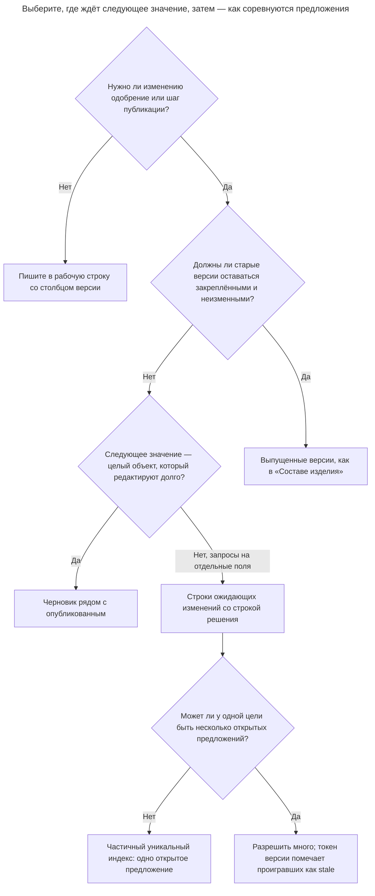
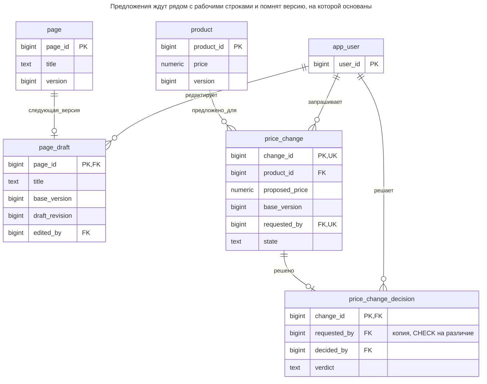
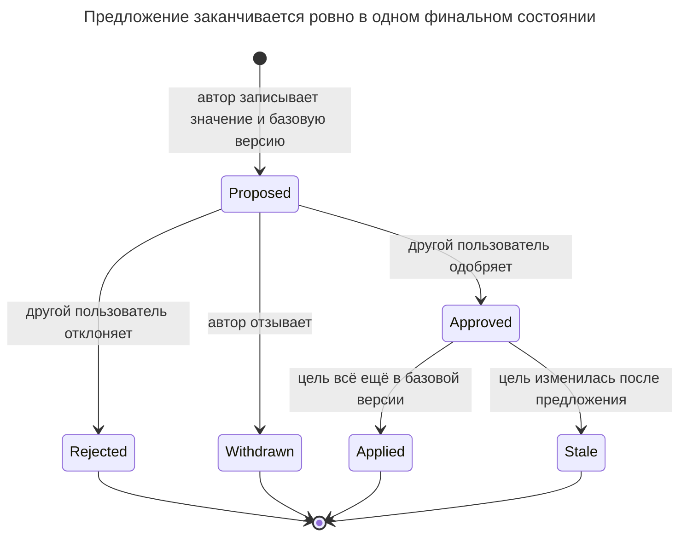
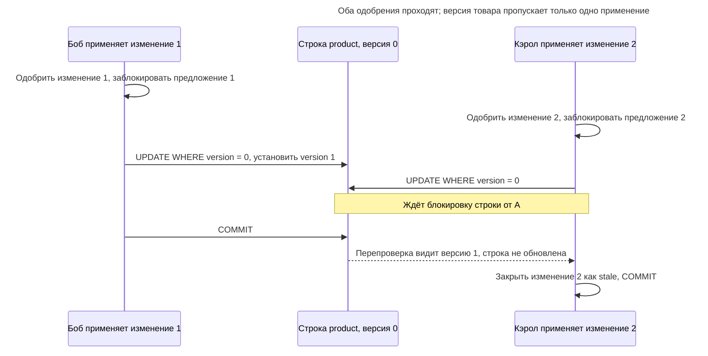

# Предложенное изменение

## Назначение

Предложенное изменение записывается до того, как вступает в силу. Оно лежит рядом с рабочими данными, пока его не одобрят или не опубликуют, а затем одна защищённая команда переносит его в рабочую строку. Глава показывает две формы и когда какая выигрывает. В первой черновая копия объекта редактируется рядом с опубликованной. Во второй строки ожидающих изменений хранят предложенное значение, автора запроса и состояние. Глава показывает, как схема гарантирует, что одобряющий — не автор запроса, проходит жизненный цикл от предложения до применения и делает применение атомарным и способным заметить, что цель изменилась после того, как предложение было сделано. Она также сравнивает две политики для нескольких ожидающих предложений к одной цели и показывает, что происходит, когда два проверяющих действуют одновременно.

## Также известен как

Maker-checker («исполнитель и контролёр»); принцип четырёх глаз; черновик и публикация в системах управления контентом. В книге Фаулера [*Analysis Patterns*](https://martinfowler.com/books/ap.html) есть родственный паттерн Proposed and Implemented Action.

## Проблема

Товаровед хочет поднять цену кофемашины со 100.00 до 120.00, а правила магазина требуют, чтобы каждое изменение цены одобрил второй человек. Если новая цена сразу попадает в `product.price` с флагом `needs_review`, покупатели видят неодобренную цену, а каждый читатель должен помнить о флаге. Если предложение живёт в тикете, после одобрения его кто-то перепечатывает, и ничто не связывает рабочую цену с решением, которое её разрешило.

Предложения ещё и состязаются. Алиса предлагает 120.00, Боб — 110.00, оба — глядя на 100.00. Боб одобряет предложение Алисы, Кэрол — предложение Боба, и оба применяются по очереди. Вторая запись молча заменяет первую, хотя её одобряющий оценивал изменение от 100.00, а не от цены, которая действовала в момент применения. Правило в приложении «нельзя одобрить собственный запрос» не помогает скрипту, админке или второму сервису, который пишет решение напрямую.

У контента та же проблема в более крупном масштабе. Редактор несколько дней готовит следующую версию страницы с ценами, а читатели продолжают видеть текущую. Наполовину отредактированную строку нельзя показывать читателям, а рецензент, одобривший текст вторника, не должен в итоге опубликовать текст среды.

## Решение

Читатели и внешние ключи видят только рабочую строку. Предложенное состояние живёт в другой таблице, и одна команда переносит его в рабочую строку под двумя условиями: решение это разрешает, и рабочая строка всё ещё в той версии, на которой основано предложение.

- **Черновик рядом с опубликованным.** `page_draft` хранит не больше одного черновика на страницу: те же столбцы, что у `page`, `base_version` — версию страницы, с которой черновик начат, и `draft_revision`, который растёт при каждом сохранении. Публикация блокирует ту ревизию черновика, которую видел рецензент, копирует её поверх `page`, только если `page.version` всё ещё равна `base_version`, и удаляет черновик — всё одной командой.
- **Строки ожидающих изменений.** `price_change` хранит предложенное значение, `base_version` товара, автора запроса и состояние. Отдельная строка `price_change_decision` фиксирует проверяющего. Она копирует `requested_by` через составной внешний ключ, поэтому `CHECK` в этой одной строке может сравнить автора запроса с одобряющим. Применение требует одобряющего решения, блокирует предложение, обновляет товар только в версии `base_version` и закрывает предложение как `applied` или `stale` в той же команде.

Условие на рабочую строку — это токен из главы [Столбец версии](version-column.md). Здесь токен хранит строка предложения, а в той главе — форма редактора.

## Альтернативы и выбор

| Вариант | Отношение | Решающее требование |
| --- | --- | --- |
| Черновик рядом с опубликованным | Вариант реализации | Следующую версию целого объекта, часто с дочерними строками, редактируют днями; следующая версия бывает только одна |
| Строки ожидающих изменений | Вариант реализации | Отдельные поля меняются по запросу, предлагать могут несколько человек, и каждое решение нужно сохранить |
| Одна таблица со столбцом `stage` в ключе | Вариант реализации | Читатели всегда могут фильтровать по стадии; ничто не ссылается только на опубликованную строку |
| [Столбец версии](version-column.md) | Дополнение | Применение и публикация опираются на его токен, чтобы заметить изменившуюся цель |
| [История статусов](status-history.md) | Дополнение | Жизненному циклу предложения нужны таблица переходов, несколько шагов одобрения или запись каждого перехода |
| [Состав изделия](bill-of-materials.md) | Замена для выпущенных структур | Выпущенные версии должны оставаться неизменными, потому что на них ссылаются; исправление — новая версия, а не перезапись |
| [Таблица истории](history-table.md) | Дополнение | Нужны прежние значения цели после применения предложений |
| [Журнал аудита](audit-log.md) | Дополнение | Нужно записывать контекст запроса, отклонённые попытки и действия над многими таблицами |

Полное сравнение — в [Атласе решений](decision-atlas.md).



Черновики и выпущенные версии похожи, но по-разному обходятся со старым значением: публикация его перезаписывает, а выпуск сохраняет, чтобы другие строки могли и дальше на него ссылаться.

## Структура



В рабочих таблицах `page` и `product` нет столбцов предложений, поэтому читатели запрашивают их как раньше. У страницы не больше одного черновика, и его ключ — ID самой страницы. У предложения не больше одного решения, а внешний ключ решения охватывает `(change_id, requested_by)`, поэтому автор запроса, с которым идёт сравнение, — настоящий автор предложения.

## Таблицы и инварианты

- **`page`** — то, что видят читатели. Её `version` растёт при каждой записи, будь то публикация или прямое срочное исправление.
- **`page_draft`** разделяет первичный ключ с `page`, поэтому у страницы не больше одного черновика. `base_version` фиксирует, с какой опубликованной версии начат черновик. `draft_revision` растёт при каждом сохранении, поэтому одобрение рецензента может назвать точную ревизию, которую оно покрывает.
- **`product`** — рабочая цель со своим токеном версии.
- **`price_change`** — одно предложение: цель, предложенное значение, `base_version`, автор запроса, состояние и время закрытия. `price_change_state_known` ограничивает состояния. `price_change_closed_when_final` требует `closed_at` ровно тогда, когда состояние финальное. `price_change_requester_key` делает `(change_id, requested_by)` целью внешнего ключа.
- **`price_change_decision`** — строка проверяющего: одна на предложение, это гарантирует её первичный ключ. `price_change_decision_proposal_fkey` связывает её `requested_by` с автором предложения, а `price_change_decision_four_eyes` требует `decided_by <> requested_by`. Оба столбца `NOT NULL`, потому что `<>` с операндом NULL проходит `CHECK`.
- **Чего ограничения не покрывают.** CHECK сравнивает ID пользователей. Он не знает, что две учётные записи принадлежат одному человеку, и доверяет тому, что `requested_by` берётся из контекста аутентификации, а не из тела запроса. Когда решение уже есть, внешний ключ не даёт изменить `requested_by` у предложения. До этого выдайте приложению [`UPDATE` на `price_change`](https://www.postgresql.org/docs/18/ddl-priv.html) только для `state` и `closed_at`. Применение присоединяет строку одобряющего решения, поэтому предложение, помеченное `approved` без неё, до рабочей строки не доходит. Остальное соответствие состояния и вердикта, например `rejected` при строке `reject`, поддерживает путь записи — так же, как [История статусов](status-history.md) поддерживает исходное состояние перехода.

## Когда применять

- Политика, регулятор или договор с клиентом требует, чтобы изменения цен, лимитов, счетов для выплат или прав одобрял второй человек.
- Контент готовят постепенно и публикуют разом, а читатели тем временем видят текущую версию.
- Изменения одной записи могут предлагать несколько человек, и устаревшее предложение никогда не должно перезаписать более новое значение.
- Позже нужно ответить, кто запросил изменение, кто его одобрил и от какого значения оно отталкивалось.

## Последствия и компромиссы

- ➕ Читатели и внешние ключи продолжают работать с рабочей таблицей без изменений; ничего неодобренного они не видят.
- ➕ Правило четырёх глаз действует для любого, кто вставляет решение, а не только для одного экрана приложения.
- ➕ Устаревшее предложение явно не проходит и закрывается как `stale`, вместо того чтобы перезаписать более новые данные.
- ➕ Каждое предложение хранит автора, решение и итог и после применения.
- ➖ Каждому защищённому полю нужны своя форма предложения и своя команда применения; универсальные предложения «для любого столбца» теряют типы и ограничения.
- ➖ Если цель меняется часто, долгоживущие предложения устаревают, и их приходится подавать заново.
- ➖ Черновик, копирующий целый объект, должен копировать и публиковать и его дочерние строки, и команда публикации растёт вместе с ними.
- ➖ Схема проверяет разные ID, а не разных людей и не нужную роль; авторизация остаётся за приложением.

## Реализация

[Полный скрипт для PostgreSQL 18.7](../assets/proposed-change/proposed-change.sql) проверяет публикацию черновика, устаревшие публикации, проверку четырёх глаз, внешний ключ на автора запроса, одно решение на предложение, предложения на основе устаревшей версии, итоги `applied` и `stale`, состояние `approved` без решения, отзыв и обе политики для открытых предложений:

```sql
CREATE TABLE price_change (
    change_id bigint PRIMARY KEY,
    product_id bigint NOT NULL REFERENCES product (product_id),
    proposed_price numeric(12, 2) NOT NULL CHECK (proposed_price > 0),
    base_version bigint NOT NULL,
    requested_by bigint NOT NULL REFERENCES app_user (user_id),
    requested_at timestamptz NOT NULL DEFAULT now(),
    state text NOT NULL DEFAULT 'proposed',
    closed_at timestamptz,
    CONSTRAINT price_change_state_known CHECK
        (state IN ('proposed', 'approved', 'rejected', 'withdrawn', 'applied', 'stale')),
    CONSTRAINT price_change_closed_when_final CHECK
        ((state IN ('proposed', 'approved')) = (closed_at IS NULL)),
    CONSTRAINT price_change_requester_key UNIQUE (change_id, requested_by)
);
CREATE TABLE price_change_decision (
    change_id bigint PRIMARY KEY,
    requested_by bigint NOT NULL,
    decided_by bigint NOT NULL REFERENCES app_user (user_id),
    verdict text NOT NULL CHECK (verdict IN ('approve', 'reject')),
    decided_at timestamptz NOT NULL DEFAULT now(),
    CONSTRAINT price_change_decision_proposal_fkey FOREIGN KEY (change_id, requested_by)
        REFERENCES price_change (change_id, requested_by),
    CONSTRAINT price_change_decision_four_eyes CHECK (decided_by <> requested_by)
);
```

Предложение фиксирует версию, которую видел его автор. `WHERE version = 0` повторяет версию, показанную клиенту, поэтому предложение не может опираться на уже изменившееся значение:

```sql
INSERT INTO price_change (change_id, product_id, proposed_price, base_version, requested_by)
SELECT 1, product_id, 120.00, version, 1 FROM product
WHERE product_id = 1 AND version = 0;
```

Решение меняет состояние и вставляет строку решения одной командой. Если не удаётся одна часть, не выполняется ни одна:

```sql
WITH moved AS (
    UPDATE price_change SET state = 'approved'
    WHERE change_id = 1 AND state = 'proposed'
    RETURNING change_id, requested_by
)
INSERT INTO price_change_decision (change_id, requested_by, decided_by, verdict)
SELECT change_id, requested_by, 2, 'approve' FROM moved;
```

Когда Алиса (пользователь 1) выполняет это для собственного предложения, PostgreSQL 18.7 выдаёт SQLSTATE `23514`: `ERROR: new row for relation "price_change_decision" violates check constraint "price_change_decision_four_eyes"`, и предложение остаётся в `proposed`. Вставка решения, где автором запроса назван Боб, выдаёт `23503`: `ERROR: insert or update on table "price_change_decision" violates foreign key constraint "price_change_decision_proposal_fkey"` с `DETAIL: Key (change_id, requested_by)=(1, 2) is not present in table "price_change".` Второе решение через ту же команду не находит строки в `proposed` и ничего не вставляет. Прямая вторая вставка падает с `23505` на `price_change_decision_pkey`.



Открыты только `Proposed` и `Approved`, а `price_change_closed_when_final` требует `closed_at` во всех остальных состояниях. В `Stale` предложение попадает только при попытке применения: одобрение не замораживает цель, поэтому подходит ли предложение до сих пор, решается в момент применения. Одобрение и применение могут идти в одной транзакции, если политика звучит как «одобрить — значит применить сразу».

Применение требует строки одобряющего решения и сначала блокирует предложение. Затем оно обновляет цель, только если она всё ещё в базовой версии, и закрывает предложение с итогом:

```sql
WITH proposal AS (
    SELECT pc.change_id, pc.product_id, pc.proposed_price, pc.base_version
    FROM price_change pc
    JOIN price_change_decision d
      ON d.change_id = pc.change_id AND d.verdict = 'approve'
    WHERE pc.change_id = 1 AND pc.state = 'approved'
    FOR UPDATE OF pc
), target AS (
    UPDATE product p
    SET price = proposal.proposed_price, version = p.version + 1
    FROM proposal
    WHERE p.product_id = proposal.product_id AND p.version = proposal.base_version
    RETURNING p.product_id
)
UPDATE price_change c
SET state = CASE WHEN EXISTS (SELECT FROM target) THEN 'applied' ELSE 'stale' END,
    closed_at = now()
FROM proposal
WHERE c.change_id = proposal.change_id
RETURNING c.state;
```

Изменение 1 возвращает `applied`, и товар переходит на 120.00 в версии 1. Изменение 2, 110.00 от Боба, одобрено относительно версии 0. Его применение возвращает `stale` и оставляет цену 120.00. Повторное применение изменения 1 не возвращает строк, потому что оно больше не `approved`. Предложение, которому состояние `approved` выставили напрямую, без строки решения, тоже не применяется, поэтому `CHECK` четырёх глаз стоит между каждым предложением и рабочей строкой. [Модифицирующий `WITH`](https://www.postgresql.org/docs/18/queries-with.html#QUERIES-WITH-MODIFYING) выполняет все три части одной командой, поэтому ни один читатель не увидит новую цену без закрытого предложения.

Скрипт выше позволяет нескольким предложениям для одного товара оставаться открытыми и разбирается с ними при применении. Чтобы разрешить только одно открытое предложение на цель, добавьте частичный уникальный индекс, который считает `approved` открытым:

```sql
CREATE UNIQUE INDEX price_change_one_open
    ON price_change (product_id)
    WHERE state IN ('proposed', 'approved');
```

Тогда второе открытое предложение для товара выдаёт `23505`: `ERROR: duplicate key value violates unique constraint "price_change_one_open"`, `DETAIL: Key (product_id)=(1) already exists.` После того как первое предложение отклонено, отозвано, применено или помечено устаревшим, новое принимается. Выбирайте эту политику, когда люди должны видеть открытый запрос и обсуждать его, а не соревноваться с ним. Разрешайте много предложений, когда запросы приходят из независимых источников и устаревшее предложение дёшево повторить.

Форма с черновиком использует то же условие. Рецензент одобрил ревизию черновика 2, поэтому публикация называет её:

```sql
WITH draft AS (
    SELECT page_id, title, body, base_version
    FROM page_draft
    WHERE page_id = 1 AND draft_revision = 2
    FOR UPDATE
), published AS (
    UPDATE page p
    SET title = draft.title, body = draft.body, version = p.version + 1
    FROM draft
    WHERE p.page_id = draft.page_id AND p.version = draft.base_version
    RETURNING p.page_id, p.version
)
DELETE FROM page_draft d
USING published WHERE d.page_id = published.page_id
RETURNING published.version;
```

Если редактор сохранил ревизию 3 после рецензии или срочное исправление продвинуло `page.version`, команда не возвращает строк, и черновик остаётся ждать новой рецензии. Скрипт проверяет оба случая.

## Поддержка в движках

- **PostgreSQL 18:** [частичные уникальные индексы](https://www.postgresql.org/docs/18/indexes-partial.html), многостолбцовые ограничения `CHECK`, составные внешние ключи и модифицирующий `WITH` покрывают всё, что здесь нужно. Применение опирается на то, что Read Committed перепроверяет условие `WHERE` у цели после ожидания блокировки ([изоляция транзакций](https://www.postgresql.org/docs/18/transaction-iso.html)).
- **MySQL 8.4:** [ограничения `CHECK`](https://dev.mysql.com/doc/refman/8.4/en/create-table-check-constraints.html) проверяются. Чтобы получить эффект частичного уникального индекса, воспользуйтесь тем, что [индекс `UNIQUE` допускает несколько значений NULL](https://dev.mysql.com/doc/refman/8.4/en/create-index.html): проиндексируйте генерируемый столбец, который содержит `product_id`, пока предложение открыто, и NULL после закрытия. Выполняйте применение отдельными командами в одной транзакции — заблокируйте предложение через `SELECT ... FOR UPDATE`, выполните условный `UPDATE` цели, проверьте `ROW_COUNT()` и закройте предложение.
- **SQL Server 2025 (17.x):** [фильтрованный индекс](https://learn.microsoft.com/en-us/sql/relational-databases/indexes/create-filtered-indexes?view=sql-server-ver17) может быть `UNIQUE`, а его предикат принимает `state IN ('proposed', 'approved')` согласно [грамматике `CREATE INDEX`](https://learn.microsoft.com/en-us/sql/t-sql/statements/create-index-transact-sql?view=sql-server-ver17). Фильтр нельзя задать у ограничения уникальности, только у уникального индекса.
- **Oracle AI Database 26ai:** строки, у которых ключ индекса целиком NULL, не индексируются, а справочник [`CREATE INDEX`](https://docs.oracle.com/en/database/oracle/oracle-database/26/sqlrf/CREATE-INDEX.html) отмечает, что функциональный уникальный индекс может задать условное ограничение уникальности: проиндексируйте `CASE WHEN state IN ('proposed', 'approved') THEN product_id END`.
- **SQLite 3:** [частичные индексы](https://www.sqlite.org/partialindex.html) могут быть `UNIQUE` (начиная с 3.8.0). Ограничения `CHECK` работают так же, как здесь, а составные [внешние ключи](https://www.sqlite.org/foreignkeys.html) проверяются, когда включён `PRAGMA foreign_keys`. Единственный писатель сериализует применение.

## Сбои и конкурентность

Два проверяющих одновременно одобряют конфликтующие предложения для одного товара. Оба одобрения проходят, потому что затрагивают разные строки предложений. Исход решает токен версии при применении. В прогоне с двумя сеансами на PostgreSQL 18.7 при Read Committed второе применение ждало блокировку строки товара, взятую первой транзакцией, а затем вернуло `stale`:



После ожидания PostgreSQL перечитывает только заблокированную строку цели; строка предложения, присоединённая к обновлению, не перечитывается. Поэтому устаревание обнаруживается лишь потому, что меняющееся значение, `version`, лежит в строке цели и сравнивается с неизменной `base_version` предложения. Во всех путях блокируйте предложение раньше цели. Команда решения трогает только предложение, поэтому одобрения и применения берут блокировки в одном порядке и не могут взаимно заблокироваться на этих строках. Не давайте выигравшему применению закрывать соседние предложения: оно блокировало бы их после товара, пока другой сеанс держит соседнее предложение и ждёт товар. Пусть каждое предложение узнаёт о своём устаревании при собственном применении.

Два проверяющих, одобряющих одно и то же предложение, — вторая гонка. Второй `UPDATE ... WHERE state = 'proposed'` ждёт первого, затем видит, что состояние изменилось, и ничего не обновляет, поэтому вторая строка решения не пишется. Первичный ключ решения страхует от писателей, которые обходят эту команду. При политике одного открытого предложения два автора, предлагающие одновременно, сталкиваются на `price_change_one_open`: вторая вставка ждёт первую транзакцию и затем падает с `23505`.

При Repeatable Read или Serializable ожидающее применение вместо перепроверки падает. В том же прогоне с двумя сеансами при Repeatable Read оно выдало SQLSTATE `40001`: `ERROR: could not serialize access due to concurrent update` ([Repeatable Read](https://www.postgresql.org/docs/18/transaction-iso.html#XACT-REPEATABLE-READ)). Повторите всю транзакцию. Повтор прочитает новую версию и закроет предложение как `stale`; никогда не подставляйте новую версию вместо `base_version`.

Если ответ на применение потерян, выполните применение ещё раз. Закрытое предложение не вернёт строк, а его `state` скажет вызывающей стороне, что произошло. Публикация состязается с редактором так же. В прогоне с двумя сеансами `FOR UPDATE` на черновике заставил публикацию ждать параллельного сохранения ревизии 3, а условие `draft_revision = 2` затем не вернуло строк, и не прошедший рецензию текст остался в черновике.

## Миграция

Исходная точка — прямые записи в `product.price`. Добавьте `price_change` и `price_change_decision` и направьте правки цен из приложения в предложения, пока старый путь записи ещё работает. Ничего не заполняйте задним числом: у прошлых изменений нет одобряющего, и придуманный одобряющий фальсифицирует запись. Когда все писатели создают предложения, замените табличный `UPDATE` роли приложения на `product` грантами на столбцы без `price`; [`REVOKE` на уровне столбца](https://www.postgresql.org/docs/18/sql-revoke.html) сам по себе не снимает табличный грант. Оберните команду применения в функцию `SECURITY DEFINER`, владелец которой сохраняет `UPDATE` на `price`, и выдайте приложению только `EXECUTE` на неё. Правки, начатые до переключения, при применении станут `stale`, если опирались на более старую версию, — именно это и нужно. Чтобы откатиться, снова выдайте прямой `UPDATE`; таблицы предложений останутся как история. Выстройте шаги по схеме [расширения и свёртывания](expand-contract.md).

Для черновиков создайте пустую `page_draft`. С этого момента сохранения редакторов идут в черновик, а первая публикация каждой страницы использует защищённую команду.

## Антипаттерны и частые ошибки

- Записывать предложенное значение в рабочую строку с флагом `pending`. Каждый читатель должен фильтровать, а забытый фильтр публикует неодобренные данные.
- Проверять «одобряющий — не автор запроса» только на одном экране приложения. Скрипт или второй сервис пишет решение напрямую.
- Сравнивать одобряющего и автора, когда любой из столбцов может быть NULL. `NULL <> 1` не ложно, поэтому `CHECK` проходит.
- Применять без условия по версии. Побеждает последнее применённое предложение, на что бы оно ни опиралось.
- Хранить в предложении снимок всей строки и копировать его обратно. Поля, изменившиеся тем временем, откатываются.
- Публиковать последний черновик, когда рецензент одобрил более раннюю ревизию.
- Удалять предложения после применения: так теряется, кто запросил и кто одобрил рабочее значение.

## Известные применения

- [Draft & Publish в Strapi](https://docs.strapi.io/cms/features/draft-and-publish) хранит черновую и опубликованную версии документа рядом и помечает опубликованный документ с неопубликованными правками черновика как *Modified*.
- [Sanity](https://www.sanity.io/docs/content-lake/drafts) хранит черновик как отдельный документ по пути `drafts.`. Публикация копирует его содержимое в документ без этого префикса, а черновики не отдаются на неаутентифицированные запросы.
- Расширение MediaWiki [FlaggedRevs](https://www.mediawiki.org/wiki/Extension:FlaggedRevs) позволяет рецензентам оценивать ревизии и по умолчанию показывать проверенную стабильную версию, а страницы, чья последняя ревизия не проверена, попадают в список страниц с ожидающими правками.
- [Защищённые ветки](https://docs.github.com/en/repositories/configuring-branches-and-merges-in-your-repository/managing-protected-branches/about-protected-branches) GitHub могут требовать, чтобы последний рецензируемый push одобрил не тот, кто его сделал, и могут снимать устаревшие одобрения, когда новые коммиты меняют diff.

## Связанные паттерны

- [Столбец версии](version-column.md) даёт токен, который проверяют применение и публикация.
- [История статусов](status-history.md) записывает каждый шаг более длинного процесса одобрения и проверяет переходы по таблице.
- [Таблица истории](history-table.md) хранит прежние значения цели после применения предложений.
- [Состав изделия](bill-of-materials.md) выпускает неизменяемые версии вместо перезаписи опубликованной.
- [Журнал аудита](audit-log.md) записывает контекст запроса и отклонённые попытки вокруг каждого решения.
- [Расширение и свёртывание](expand-contract.md) задаёт порядок перехода от прямых записей к предложениям.
