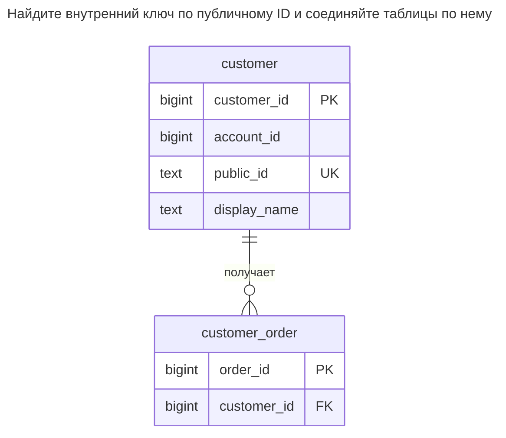
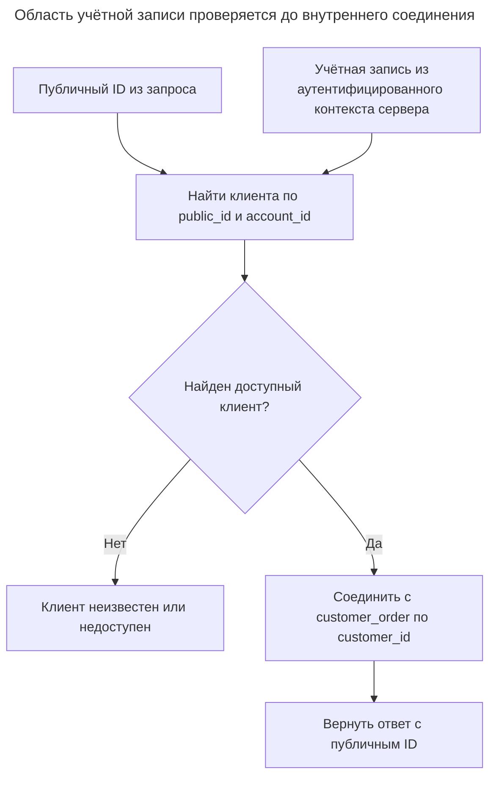
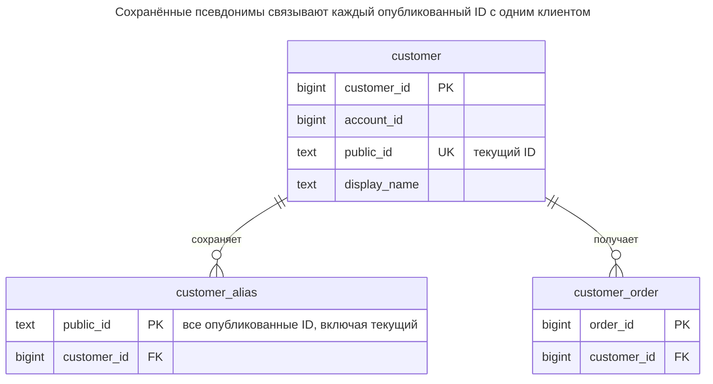
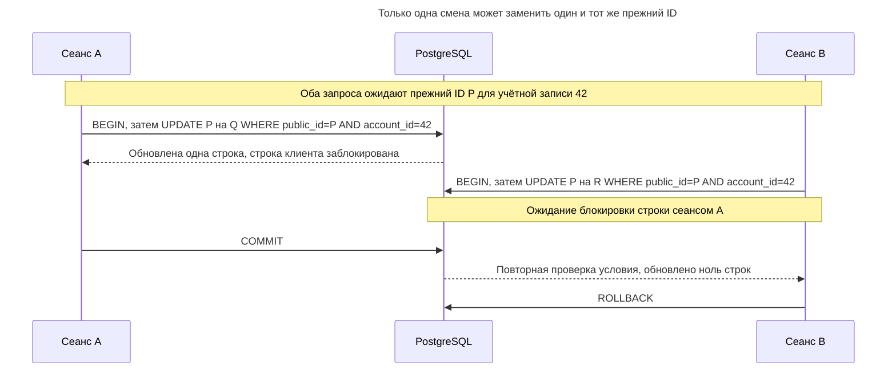
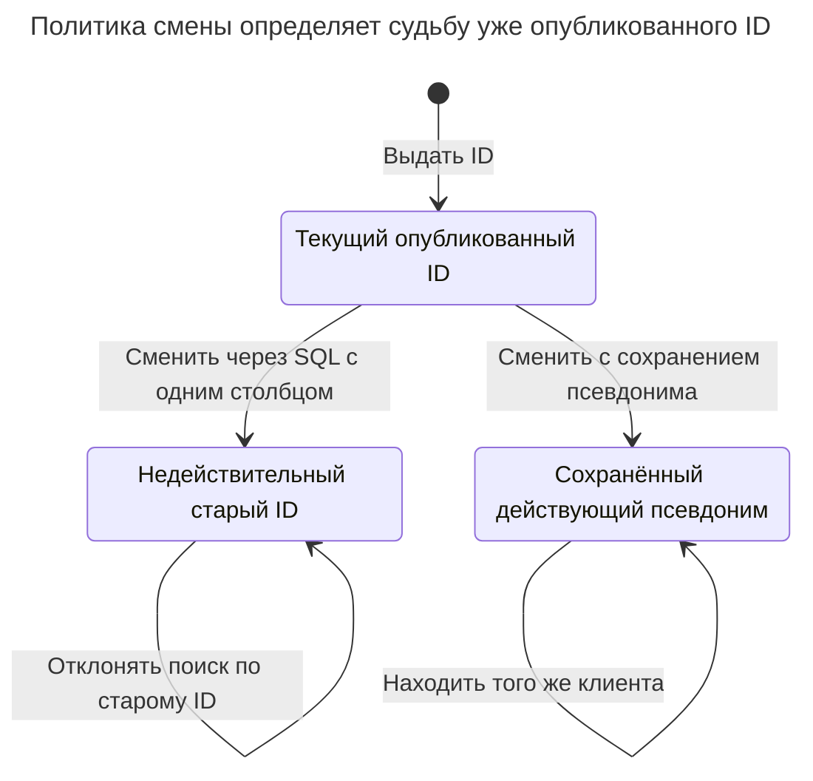

# Публичный идентификатор

## Назначение

Публичный идентификатор — ID, выходящий за пределы базы данных в URL, ответах API, обращениях в поддержку и логах. Осознанно выбирайте между публикацией внутреннего ключа и отдельным внешним идентификатором: последовательные целые числа упрощают перебор и могут раскрыть объём выдачи, а отдельный случайный ID, возможно с префиксом вроде `cus_...`, помогает определить вид объекта, поддерживает управляемую смену и не участвует во внутренних соединениях. Храните и индексируйте внешний ID, находите по нему внутренний ключ и считайте опубликованный ID контрактом, от которого трудно отказаться. [Статья Пола Эсьеса об идентификаторах объектов Stripe](https://dev.to/stripe/designing-apis-for-humans-object-ids-3o5a) объясняет причины отказа от перебираемых значений и использования префиксов.

## Также известен как

External ID; непрозрачный идентификатор объекта; идентификатор с префиксом, если представление подсказывает тип. В [статье Stripe об ID объектов](https://dev.to/stripe/designing-apis-for-humans-object-ids-3o5a) используются идентификаторы клиентов вида `cus_...`. Префикс описывает представление, но не задаёт границу авторизации.

## Проблема

Приложение соединяет заказы с клиентами по целочисленному ключу. Возвращать число через API удобно, но клиенты сохраняют его, добавляют в закладки и копируют в обращения в поддержку. Теперь замена или объединение хранилищ требует сохранить смысл каждого опубликованного числа.

URL с последовательными числами также подсказывает вызывающей стороне очевидного следующего кандидата для запроса. Из-за пропусков разность ID не равна точному числу строк, но вы всё равно можете не хотеть публиковать схему выдачи. С другой стороны, второй ID — это ещё один индекс и ещё один идентификатор для диагностики. Если внутренний ключ уже отвечает внешнему контракту, его публикация может быть разумным решением.

## Решение

Сохраните `customer_id` для внутренних ссылок. Добавьте обязательный уникальный `public_id`, генерируемый независимо от внутреннего ключа, и возвращайте на границе API только его. Находите по нему клиента в области учётной записи вызывающей стороны, затем выполняйте внутренние соединения по `customer_id`. Схема с двумя ключами здесь — пример проектирования, а не утверждение о закрытой схеме базы данных Stripe.

Для собственного API выберите документированное представление: например, `cus_` и случайный UUIDv4. В PostgreSQL 18 случайный UUID выдаёт [`uuidv4()`](https://www.postgresql.org/docs/18/functions-uuid.html). Обещайте потребителям непрозрачную строку: значение нужно хранить и возвращать целиком, не выводя из него права, время или внутренние ID. Префикс можно использовать для своей валидации и инструментов поддержки, сохранив право развивать формат по политике совместимости API.

## Альтернативы и выбор

| Соседний паттерн | Связь | Определяющее требование |
| --- | --- | --- |
| [Суррогатный ключ](surrogate-key.md) | Дополнение; прямая публикация заменяет отдельный публичный столбец | Публикуйте внутренний ID, только если его стабильность, раскрываемые сведения и представление отвечают внешнему контракту |
| [Естественный ключ](natural-key.md) | Дополнение; публикация даёт альтернативный внешний идентификатор | Бизнес-ключ уже публичен, стабилен и безопасен для раскрытия |
| [Упорядоченный идентификатор](time-ordered-identifier.md) | Вариант внутренней идентичности или альтернативного публичного значения | Прежде чем публиковать, примите раскрытие встроенного времени генерации |

Полное сравнение — в [Атласе решений](decision-atlas.md). Избегайте [Обязательных суррогатов](mandatory-surrogates.md): два ключа оправданы разными контрактами, а не правилом, что каждой таблице нужны оба.

## Структура



Многие заказы ссылаются на одного клиента по внутреннему ключу. Публичный поиск должен учитывать область аутентифицированной учётной записи; знания допустимого ID недостаточно. Пример включает фильтр учётной записи, но оставляет проверку учётных данных приложению.



Область учётной записи определяется аутентификацией независимо от запрошенного ID. Только разрешённое совпадение даёт внутренний ключ для последующих соединений.

## Таблицы и инварианты

- **`customer`** содержит по одному глобально уникальному `public_id` на строку; это обеспечивает `customer_public_id_key`. Ограничение `customer_public_id_shape` допускает только выбранный этим API префикс и форму UUIDv4 в нижнем регистре.
- **`customer_order`** ссылается на `customer_id`, поэтому смена публичного ID не переписывает ссылки из заказов.
- **Принадлежность учётной записи** проверяется при поиске по ID. Здесь `account_id` — обязательный атрибут владельца; пример не моделирует таблицу учётных записей и не реализует авторизацию на уровне базы данных.
- **Равенство строк** задано явно: [правило сортировки `C`](https://www.postgresql.org/docs/18/collation.html) PostgreSQL сравнивает значения байтов. Локальное ограничение формата схемы не подходит для хранения произвольных сторонних идентификаторов.

## Когда применять

- Вы хотите менять выдачу внутренних ключей или объединять базы, сохраняя опубликованные ссылки стабильными.
- Нужны случайные внешние ID при компактных целочисленных внешних ключах.
- Подсказка типа помогает операторам переносить ID между логами и инструментами.
- У вас есть конкретная политика смены ID или псевдонимов, которую вы можете поддерживать для существующих клиентов.

## Последствия и компромиссы

- ➕ Внутренние соединения и публичное представление могут развиваться независимо.
- ➕ Публичный ID можно заменить без изменения внутренних ссылок.
- ➖ Каждая вставка поддерживает ещё один уникальный индекс, а каждый поиск на границе разрешает ещё один ключ.
- ➖ Смена ID ломает старые ссылки, если не сохранять псевдонимы; псевдонимы добавляют правила жизненного цикла и уникальности.
- ➖ Случайный ID не даёт права доступа. Продолжайте проверять владельца при чтении и записи.

## Реализация

[Полный скрипт](../assets/public-identifier/public-identifier.sql) показывает генерацию, поиск в области учётной записи, отклонение дубликата и смену ID. Префикс иллюстративный; это не генератор идентификаторов Stripe:

```sql
CREATE TABLE customer (
    customer_id bigint GENERATED ALWAYS AS IDENTITY PRIMARY KEY,
    account_id bigint NOT NULL,
    public_id text COLLATE "C" NOT NULL
        DEFAULT ('cus_' || uuidv4()::text),
    display_name text NOT NULL,
    CONSTRAINT customer_public_id_key UNIQUE (public_id),
    CONSTRAINT customer_public_id_shape CHECK (
        public_id ~ '^cus_[0-9a-f]{8}-[0-9a-f]{4}-4[0-9a-f]{3}-[89ab][0-9a-f]{3}-[0-9a-f]{12}$'
    )
);
CREATE TABLE customer_order (
    order_id bigint GENERATED ALWAYS AS IDENTITY PRIMARY KEY,
    customer_id bigint NOT NULL REFERENCES customer (customer_id)
);
CREATE INDEX customer_order_customer_idx ON customer_order (customer_id);
```

Получите созданный ID для ответа через `RETURNING`. Следующая вставка задаёт фиксированный ID для воспроизводимого поиска. В запросе передавайте ID параметром, а учётную запись `42` берите из аутентифицированного серверного контекста:

```sql
INSERT INTO customer (account_id, display_name)
VALUES (42, 'Northwind') RETURNING public_id;
INSERT INTO customer (account_id, public_id, display_name)
VALUES (42, 'cus_550e8400-e29b-41d4-a716-446655440000', 'Contoso');
INSERT INTO customer_order (customer_id)
SELECT customer_id FROM customer
WHERE public_id = 'cus_550e8400-e29b-41d4-a716-446655440000'
  AND account_id = 42;
SELECT c.customer_id, o.order_id FROM customer AS c
JOIN customer_order AS o USING (customer_id)
WHERE c.public_id = 'cus_550e8400-e29b-41d4-a716-446655440000'
  AND c.account_id = 42;
```

В пустой базе пример возвращает `(2, 1)`. Правило уникальности глобальное, даже если другая строка указывает иную учётную запись:

```sql
INSERT INTO customer (account_id, public_id, display_name)
VALUES (99, 'cus_550e8400-e29b-41d4-a716-446655440000', 'Duplicate');
```

PostgreSQL 18.6 возвращает SQLSTATE `23505`: `ERROR: duplicate key value violates unique constraint "customer_public_id_key"`, с уточнением `DETAIL: Key (public_id)=(cus_550e8400-e29b-41d4-a716-446655440000) already exists.` Управляемая смена меняет только внешний ID:

```sql
UPDATE customer SET public_id = 'cus_550e8400-e29b-41d4-a716-446655440001'
WHERE public_id = 'cus_550e8400-e29b-41d4-a716-446655440000'
  AND account_id = 42;
SELECT customer_id FROM customer_order WHERE order_id = 1;
```

Заказ по-прежнему ссылается на клиента `2`; старый публичный ID больше не находится. Эта реализация с одним столбцом намеренно делает старые ID недействительными. Если совместимость требует работы старых ссылок, сохраняйте их в таблице псевдонимов с глобальной уникальностью ID и внешним ключом на клиента. Выполняйте весь поиск через неё, чтобы старый ID нельзя было назначить другому клиенту.



Вариант с псевдонимами расширяет SQL-пример с одним столбцом: резервируйте каждый выданный ID в таблице псевдонимов, включая текущий. Глобальная уникальность псевдонимов предотвращает переназначение, а транзакция смены должна согласованно создавать псевдоним и выбирать текущий ID.

## Поддержка в движках

- **PostgreSQL 18:** используйте показанный текстовый столбец и [`uuidv4()`](https://www.postgresql.org/docs/18/functions-uuid.html). Для внешнего UUID без префикса можно использовать встроенный тип `uuid`.
- **MySQL 8.4:** не предполагайте, что правило сортировки строк по умолчанию соответствует правилам равенства внешнего поставщика. [Рекомендации Stripe по интеграции](https://docs.stripe.com/api-versions) прямо рекомендуют регистрозависимое хранение ID, например `VARCHAR(255) COLLATE utf8_bin`. Функция MySQL [`UUID()`](https://dev.mysql.com/doc/refman/8.4/en/miscellaneous-functions.html#function_uuid) генерирует v1, поэтому не заменяет напрямую случайный v4 в этом значении по умолчанию.
- **SQL Server 2025 (17.x):** [`uniqueidentifier`](https://learn.microsoft.com/en-us/sql/t-sql/data-types/uniqueidentifier-transact-sql?view=sql-server-ver17) хранит 16-байтовый GUID; для ID с префиксом нужен строковый тип. Не используйте [`NEWSEQUENTIALID()`](https://learn.microsoft.com/en-us/sql/t-sql/functions/newsequentialid-transact-sql?view=sql-server-ver17), если причина публичного ID — непредсказуемость: Microsoft прямо предупреждает о возможности угадать следующие значения.
- **Oracle AI Database 26ai:** [`SYS_GUID()`](https://docs.oracle.com/en/database/oracle/oracle-database/26/sqlrf/SYS_GUID.html) — глобально уникальное 16-байтовое значение, а не документированная замена случайного v4. Если нужны свойства раскрытия из этого примера, передавайте подходящий случайный внешний ID из приложения.
- **SQLite 3:** используйте текстовые ID, созданные приложением, и ограничение уникальности; для побайтовой идентичности выберите [правило сортировки `BINARY`](https://www.sqlite.org/datatype3.html#collation). Генерируемое внутреннее целое число храните отдельно.

## Сбои и конкурентность

Создавайте строку и её публичный ID в одной транзакции. Предоставьте ограничению уникальности обнаруживать совпадения; PostgreSQL [ожидает и повторно проверяет конфликтующие конкурентные вставки](https://www.postgresql.org/docs/18/index-unique-checks.html). При настоящей коллизии нового случайного ID нужен другой ID. При повторе после неопределённой фиксации нужно найти исходную операцию, например через [Запись идемпотентности](idempotency-record.md), а не вслепую создавать ещё одного клиента. Сами по себе эти правила уникальности не требуют повышенной изоляции.

При конкурентной смене используйте условное обновление с прежним ID, как в примере, и требуйте ровно одну затронутую строку. Если нужны псевдонимы, создавайте псевдоним и выбирайте текущий ID в одной транзакции, сериализуя смены для клиента. До публикации смены как операции API решите, будут ли старые ID перенаправлять, продолжать разрешаться или становиться недействительными.



При read committed ожидающее обновление повторно проверяет изменённую строку и больше не находит P. Требование одной затронутой строки превращает устаревшую смену B в явную ошибку.



Состояния описывают старый ID, а не клиента: при смене его заменяет новый текущий ID. SQL-пример идёт по пути аннулирования; сохранение псевдонимов требует дополнительного хранилища и описанной выше транзакционной политики.

## Миграция

Добавьте допускающий `NULL` внешний столбец, настройте генерацию для новых строк и заполните старые ограниченными пакетами. Создайте уникальность [конкурентно](https://www.postgresql.org/docs/18/sql-createindex.html#SQL-CREATEINDEX-CONCURRENTLY), проверьте полноту и сделайте столбец обязательным. Внутренние внешние ключи сохраните. Разверните читателей, принимающих старые и новые маршруты, прежде чем возвращать новые ID клиентам, затем наблюдайте за использованием старого маршрута перед его удалением. Планируйте короткие окна блокировок DDL вместо обещания полностью свободного от блокировок изменения.

При откате можно перестать выдавать новые ID, но уже выданные должны продолжать находиться. Сохраняйте их соответствия при миграциях и восстановлении хранилища. Когда публичный ID обозначает клиента в чужой системе, переназначение указывает на другого клиента; удаление столбца уже не просто внутренний рефакторинг. См. [Расширение и свёртывание](expand-contract.md).

## Антипаттерны и частые ошибки

- Кодировать целое число строкой и называть его случайным. Смена представления не устраняет предсказуемую выдачу.
- Считать владение ID разрешением на доступ к строке. Проверяйте владельца одинаково для последовательных и случайных ID.
- Принимать префиксы за постоянные правила разбора сторонних ID. Храните внешние значения целиком; регулярное выражение выше применяйте только к собственному API.
- Повторно использовать выведенный из обращения ID или менять его без учёта закладок и интеграций.
- Добавлять публичные ID таблицам, которые никогда не пересекают границу системы; см. [Обязательные суррогаты](mandatory-surrogates.md).

## Известные применения

- [Статья Пола Эсьеса о Stripe](https://dev.to/stripe/designing-apis-for-humans-object-ids-3o5a) описывает префиксы типов как помощь при отладке и обнаружении неверного вида объекта. Она документирует поведение API и инструментов, а не внутреннее устройство ключей Stripe.
- [Официальные рекомендации Stripe по совместимости](https://docs.stripe.com/api-versions) требуют поддержки ID объектов длиной до 255 символов и регистрозависимого поиска. Это правила работы с ID Stripe, а не требования к генератору любого API.

## Связанные паттерны

- [Суррогатный ключ](surrogate-key.md) обеспечивает внутреннюю идентичность для соединений.
- [Естественный ключ](natural-key.md) может оставаться отдельным бизнес-ограничением без публикации.
- [Упорядоченный идентификатор](time-ordered-identifier.md) объясняет, какое время раскрывается при публикации упорядоченных ID.
- [Запись идемпотентности](idempotency-record.md) отделяет идентичность повтора от идентичности объекта.
- [Обязательные суррогаты](mandatory-surrogates.md) ставит под сомнение ID без самостоятельной цели.
