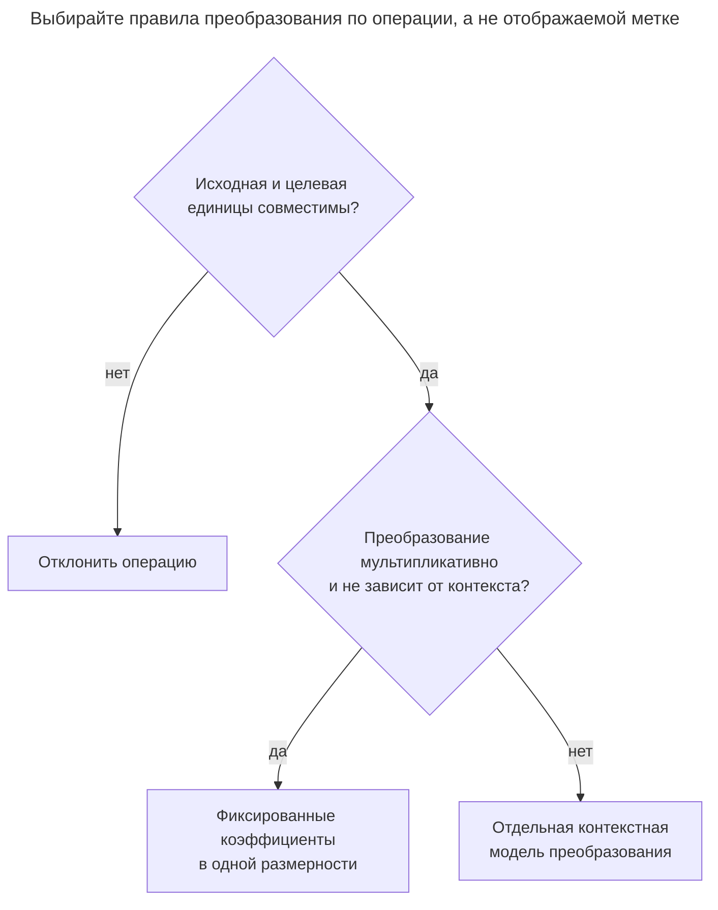
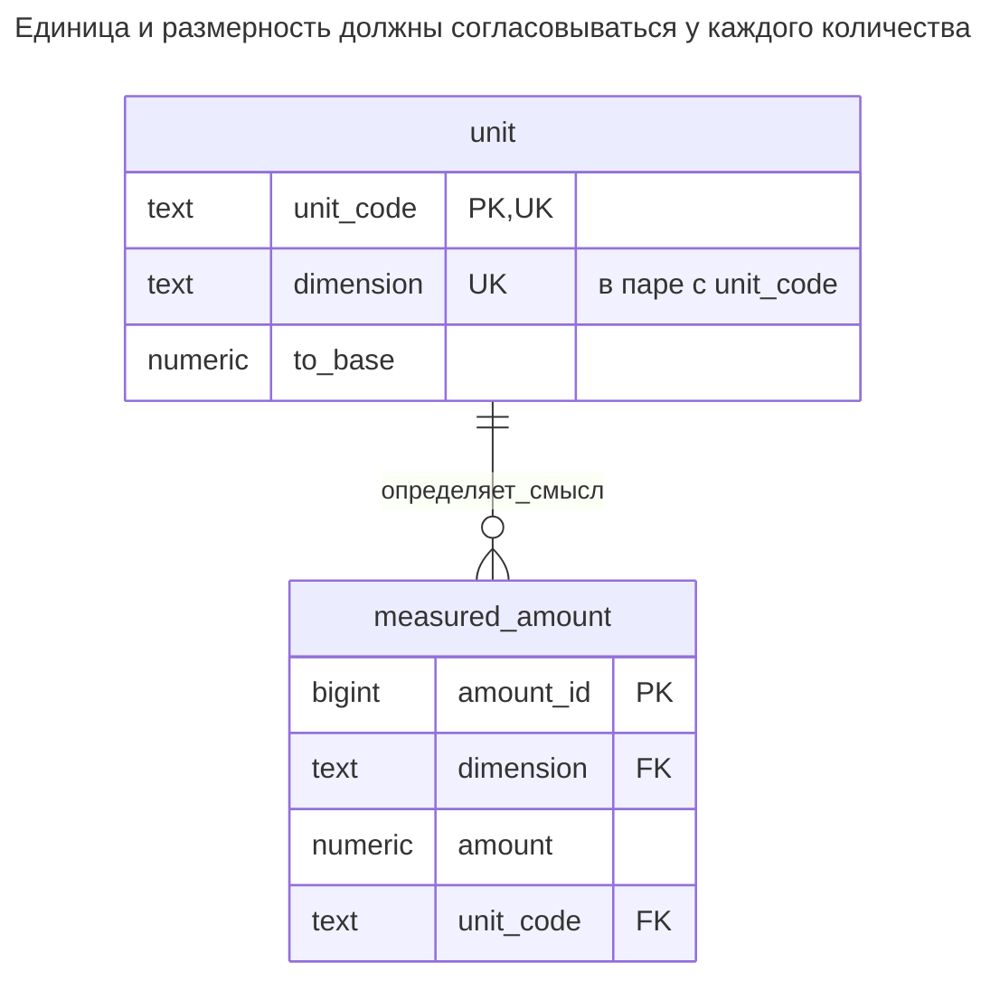
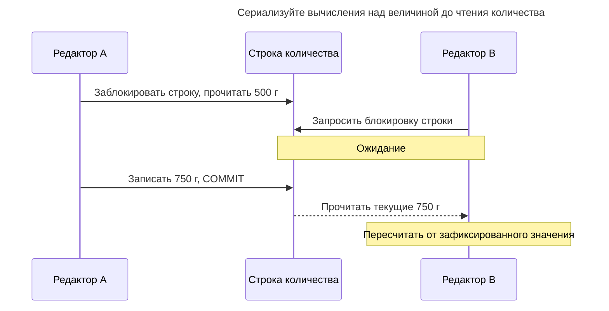
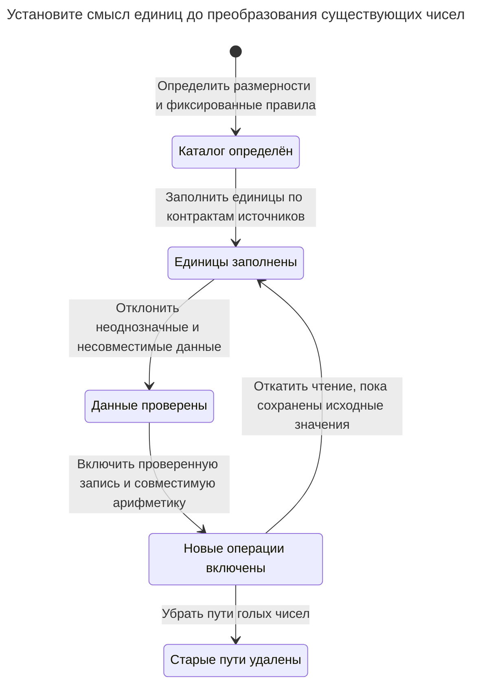

# Величина

## Назначение

Величина хранит число вместе с единицей измерения — килограммами, штуками, часами, евро — вместо голого числа, единица которого существует в названии столбца или голове разработчика. Глава показывает таблицу единиц, ссылку на единицу при каждом количестве, коэффициенты преобразования единиц одной размерности и арифметические функции, отклоняющие несовместимые размерности. Деньги — особый случай, где единицей служит валюта, а точный десятичный тип и правила округления так же важны, как сумма.

## Также известен как

Dimensioned value; amount with unit — значение с размерностью, количество с единицей. [Quantity](https://martinfowler.com/eaaDev/Quantity.html) Фаулера объединяет количество и единицу, требует совместимой арифметики и рассматривает деньги как специализированную величину. Каталог преобразований и ограничения ниже — реляционный проект этой главы.

## Проблема

Один поставщик сообщает массу упаковки как `2`, другой — как `500`. Сложение голых значений даёт `502`, хотя правильная сумма — 2,5 килограмма. Позднейший импорт обозначает объём как массу. Точная десятичная арифметика не исправит ни одну ошибку: числа точны, но операции бессмысленны.

Даже совместимым размерностям нужна политика толкования. Температура — показание или разность температур? Сумма — сумма валюты счёта или пересчитанная отчётная сумма? Ключ единицы должен задавать достаточно смысла для разрешённой операции. Не заставляйте таблицу преобразований обещать то, что требует даты, рыночного курса или плотности конкретного материала.

## Решение

Храните каждое количество с ключом единицы и размерностью. Поддерживайте небольшой управляемый каталог с коэффициентом к одной базовой единице каждой размерности. Составной внешний ключ проверяет принадлежность единицы заявленной размерности. Перед агрегацией нормализуйте совместимые величины; возвращайте результат с выбранной единицей, а не необъяснённым скаляром.

Показанный преобразователь поддерживает только мультипликативные преобразования: `target_amount = source_amount × source_factor / target_factor`. Он запрещает разные размерности. У каждой валюты собственный ключ размерности, поэтому преобразователь единиц не может выдумать обменный курс. Преобразования со смещением, алгебра составных размерностей и датированные валютные котировки требуют отдельных моделей; этот намеренно небольшой каталог их не реализует.

## Альтернативы и выбор

| Соседний паттерн | Связь | Определяющее требование |
| --- | --- | --- |
| Фиксированный столбец `mass_kg` | Замена | Достаточно одной контролируемой разработчиком единицы, вход нормализуется на границе |
| [Наблюдение](observation.md) | Дополнение | Количествам нужны метод, наблюдатель, временные метки и история исправлений |
| [Двойная запись](double-entry-ledger.md) | Дополнение | Величины перемещаются между держателями, и каждое перемещение должно балансировать |
| Целые числа с фиксированным масштабом | Вариант реализации | Фиксированное разрешение и ограниченный целочисленный диапазон отвечают контракту |
| [Неточная арифметика](inexact-arithmetic.md) | Антипаттерн для точных сумм | Двоичное приближение не удовлетворяет точным денежным или счётным правилам |

Полная таблица — в [Атласе решений](decision-atlas.md). Величина даёт смысл и совместимую арифметику, но не происхождение измерения или сохранение количества.



Общая отображаемая метка не доказывает совместимость. Конвертации валют нужна явная котировка; преобразованию объёма в массу — дополнительные предметные данные.

## Структура



Два столбца внешнего ключа образуют одну проверяемую ссылку. Разные единицы могут иметь общую размерность, но `('L', 'mass')` — недопустимая пара. Это самостоятельная таблица примера; в приложении количество и проверяемую ссылку на единицу размещают в позиции заказа, упаковке или другой записи-владельце.

## Таблицы и инварианты

- **`unit`** задаёт одно толкование и положительный конечный коэффициент преобразования. Коэффициенты `kg`, `g`, `L`, `mL` — данные каталога примера. Сохраняйте использованные определения неизменными через управляемого владельца каталога; пример не устанавливает защиту обновлений каталога.
- **`measured_amount`** требует конечного точного десятичного значения и допустимой пары единицы/размерности. Количество может быть отрицательным: общая величина не обязательно обозначает физический запас.
- **`convert_amount` / `add_quantities`** проверяют совместимость на одобренном арифметическом пути. Прямой SQL всё ещё может сложить два столбца `amount` или отбросить единицы; внешний ключ не проверяет типы произвольных выражений.
- **Политика точности** отделена от размерности. Пример использует неограниченный `numeric`, затем округляет на выбранной выходной границе. PostgreSQL описывает [точное числовое хранение, приведение масштаба и округление](https://www.postgresql.org/docs/18/datatype-numeric.html); фиксированный объявленный масштаб может округлить вход до того, как его увидит проверка строки.

## Когда применять

- Вход или выход использует несколько единиц одного вида величины.
- Несовместимые единицы нужно отклонять, а не молча нормализовать неверно помеченное значение.
- Валюта, разрешение и округление входят в контракт хранения.

## Последствия и компромиссы

- ➕ Значения сохраняют смысл при копировании в отчёты и обмене между модулями.
- ➕ Проверяемая ссылка единицы обнаруживает ошибочную размерность при вставке.
- ➖ Общим числовым столбцам нужна дисциплина арифметических API; голый `SUM(amount)` всё ещё теряет смысл.
- ➖ Изменение коэффициента может переинтерпретировать все прежние значения. Исправляйте неверные данные каталога проверенной миграцией или вводите новое версионируемое определение единицы.
- ➖ Точные десятичные числа не делают любое деление конечным. Выбирайте точность результата при периодической десятичной дроби и округляйте намеренно.

## Реализация

[Полный скрипт PostgreSQL 18.6](../assets/quantity/quantity.sql) проверяет совместимое и несовместимое сложение, отказ хранения и запрет конвертации валют. Определите контракт хранения:

```sql
CREATE SCHEMA quantity_example;
SET search_path = quantity_example, public;

CREATE TABLE unit (
    unit_code text PRIMARY KEY,
    dimension text NOT NULL,
    to_base numeric NOT NULL CHECK (to_base > 0 AND to_base < 'Infinity'::numeric),
    UNIQUE (unit_code, dimension)
);
CREATE TABLE measured_amount (
    amount_id bigint PRIMARY KEY,
    dimension text NOT NULL,
    amount numeric NOT NULL CHECK (amount > '-Infinity'::numeric AND amount < 'Infinity'::numeric),
    unit_code text NOT NULL,
    CONSTRAINT amount_unit_dimension_fk FOREIGN KEY (unit_code, dimension)
        REFERENCES unit (unit_code, dimension)
);
```

Отделяйте преобразование от сохранения, чтобы импорт, расчёты и отображение использовали одно правило:

```sql
CREATE FUNCTION convert_amount(value numeric, source_unit text, target_unit text)
RETURNS numeric LANGUAGE plpgsql STABLE STRICT SET search_path = quantity_example, pg_temp AS $$
DECLARE
    source unit%ROWTYPE;
    target unit%ROWTYPE;
BEGIN
    SELECT * INTO STRICT source FROM unit WHERE unit_code = source_unit;
    SELECT * INTO STRICT target FROM unit WHERE unit_code = target_unit;
    IF source.dimension <> target.dimension THEN
        RAISE EXCEPTION 'incompatible quantity dimensions' USING ERRCODE = '22023';
    END IF;
    IF NOT (value > '-Infinity'::numeric AND value < 'Infinity'::numeric) THEN
        RAISE EXCEPTION 'quantity must be finite' USING ERRCODE = '22023';
    END IF;
    RETURN value * source.to_base / target.to_base;
END $$;
CREATE FUNCTION add_quantities(left_value numeric, left_unit text, right_value numeric, right_unit text)
RETURNS numeric LANGUAGE sql STABLE STRICT SET search_path = quantity_example, pg_temp AS $$
    SELECT convert_amount(left_value, left_unit, left_unit)
           + convert_amount(right_value, right_unit, left_unit)
$$;
```

Функции возвращают число в целевой единице, а для сложения — в единице левого операнда. Вызывающая сторона должна сохранить эту единицу в объекте результата. Неизвестная единица вызывает `NO_DATA_FOUND` при поиске, а не трактуется как коэффициент один.

```sql
INSERT INTO unit VALUES
    ('kg', 'mass', 1), ('g', 'mass', 0.001),
    ('L', 'volume', 1), ('mL', 'volume', 0.001),
    ('EUR', 'currency:EUR', 1), ('USD', 'currency:USD', 1);
INSERT INTO measured_amount VALUES (1, 'mass', 2, 'kg'), (2, 'mass', 500, 'g');
SELECT round(add_quantities(2, 'kg', 500, 'g'), 3) AS kilograms;
SELECT a.dimension, sum(a.amount * u.to_base) AS base_amount
FROM measured_amount AS a JOIN unit AS u USING (unit_code, dimension)
GROUP BY a.dimension;
UPDATE measured_amount SET amount = 750 WHERE amount_id = 2;
SELECT round(convert_amount(amount, unit_code, 'kg'), 3)
FROM measured_amount WHERE amount_id = 2;
```

Сложение возвращает `2.500` килограмма; групповая сумма до обновления — `mass, 2.500`. После изменения второго количества на 750 граммов преобразованное значение — `0.750` килограмма. Никогда не объединяйте разные размерности в один скалярный итог.

Схема отклоняет количество с размерностью массы и единицей объёма:

```sql
INSERT INTO measured_amount VALUES (3, 'mass', 2, 'L');
```

PostgreSQL 18.6 возвращает SQLSTATE `23503`: `ERROR: insert or update on table "measured_amount" violates foreign key constraint "amount_unit_dimension_fk"`. Арифметический путь тоже отклоняет несовместимые операнды:

```sql
SELECT add_quantities(2, 'kg', 1, 'L');
```

Он возвращает SQLSTATE `22023`: `ERROR: incompatible quantity dimensions`. Само хранение единиц без проверки арифметики не поймало бы ошибку.

Для денег храните ключ валюты при каждой сумме и выбирайте момент округления: по строке, при вычислении налога или в окончательном итоге. [`numeric` PostgreSQL округляет середины от нуля](https://www.postgresql.org/docs/18/datatype-numeric.html), как здесь:

```sql
SELECT round(1.005::numeric, 2), round(-1.005::numeric, 2);
```

Результат — `(1.01, -1.01)`. Если контракт требует другого правила середины, явно реализуйте и проверьте его. Ключи EUR и USD иллюстративны; пример не задаёт стандарт кодов валют, универсальный масштаб в два десятичных знака или соглашение об обменном курсе.

## Поддержка в движках

- **PostgreSQL 18:** `numeric` поддерживает показанные точные десятичные операции; реализация также отклоняет специальные неконечные числовые значения.
- **MySQL 8.4:** [`DECIMAL` / `NUMERIC`](https://dev.mysql.com/doc/refman/8.4/en/fixed-point-types.html) дают точное хранение с фиксированной точкой и объявленными точностью и масштабом. Выберите границы вместо механического копирования неограниченного `numeric` PostgreSQL.
- **SQL Server 2025 (17.x):** [`decimal` и `numeric`](https://learn.microsoft.com/en-us/sql/t-sql/data-types/decimal-and-numeric-transact-sql?view=sql-server-ver17) имеют максимальную точность 38. Проверяйте типы промежуточных умножений и делений вместе с хранимым количеством.
- **Oracle AI Database 26ai:** при переносе оцените числовое представление [`NUMBER`](https://docs.oracle.com/en/database/oracle/oracle-database/26/sqlrf/Data-Types.html). Выберите точность и масштаб для допустимого диапазона и точности результата.
- **SQLite 3:** [сродство NUMERIC](https://www.sqlite.org/datatype3.html) не даёт точной десятичной семантики PostgreSQL. Используйте целые числа с масштабом для фиксированного разрешения либо намеренно развёртывайте [расширение decimal](https://www.sqlite.org/floatingpoint.html#decext), вычисляющее над десятичным текстом.

## Сбои и конкурентность

Ограничение размерности предотвращает несоответствие единицы, но не потерянное обновление. Если два редактора загрузят 500 граммов и независимо заменят значение, последняя принятая запись может затереть первую. Блокируйте строку-владельца количества до вычисления «прочитать–изменить–записать» либо сравнивайте версию, если устаревшие правки должны отклоняться. [Блокировки строк PostgreSQL](https://www.postgresql.org/docs/18/explicit-locking.html#LOCKING-ROWS) удерживаются до конца транзакции.



Изменения каталога — отдельный риск. Отчёт не должен использовать коэффициенты, меняющиеся посреди преобразования из нескольких операторов. Оставляйте каталог фиксированным для обычных писателей; если коэффициенты действительно меняются во времени, храните с преобразованным результатом версию или ID котировки. Повтор неудачной операции должен сохранять исходное количество и выбранный контекст преобразования.

## Миграция

Для столбцов вроде `weight_kg` заполните явную единицу `kg` из документированного контракта. Для общего `value` восстановите единицы по спецификациям источников и изолируйте неоднозначные записи; порядок величины не является надёжным свидетельством. Сохраняйте исходный ввод и нормализуйте один раз, записывая политику преобразования результата.



Во время развёртывания сравнивайте нормализованные значения, а не исходные числа. Синхронизируйте старые столбцы и контракт единиц в окне отката. Повторное преобразование нормализованных значений применяет коэффициент дважды; сохраняйте отметку миграции либо используйте идемпотентное присваивание от исходного источника.

## Антипаттерны и частые ошибки

- Складывать исходные количества лишь потому, что оба столбца числовые.
- Использовать одну размерность `currency` с постоянными коэффициентами, молча считая её обменом валют.
- Применять мультипликативный преобразователь к абсолютной температуре или зависимым от материала преобразованиям.
- Менять коэффициент или смысл единицы после появления исторических ссылок.
- Считать, что десятичное хранение определяет бизнес-границу округления.

## Известные применения

- [Примеры Quantity Фаулера](https://martinfowler.com/eaaDev/Quantity.html) противопоставляют несовместимое сложение преобразованию совместимых единиц и обсуждают умножение скалярных и составных единиц. Глава реализует меньшее мультипликативное подмножество.
- [Документация числовых типов PostgreSQL](https://www.postgresql.org/docs/18/datatype-numeric.html) рекомендует точную числовую арифметику для денежных сумм; ссылка на единицу и валюту остаётся решением прикладной схемы.

## Связанные паттерны

- [Наблюдение](observation.md) записывает происхождение измеренной величины и то, остаётся ли она принятой.
- [Двойная запись](double-entry-ledger.md) сохраняет количество в пределах валюты или актива.
- [Неточная арифметика](inexact-arithmetic.md) описывает сбой приблизительного хранения точных сумм.
