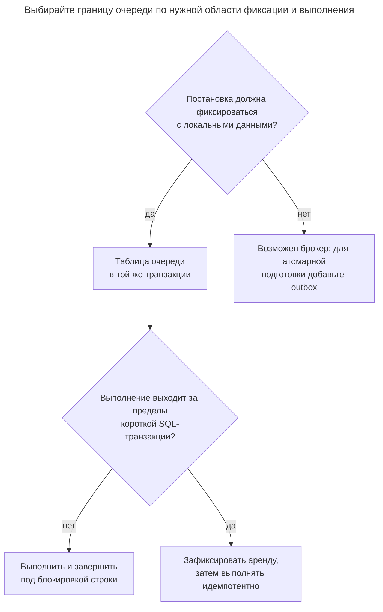
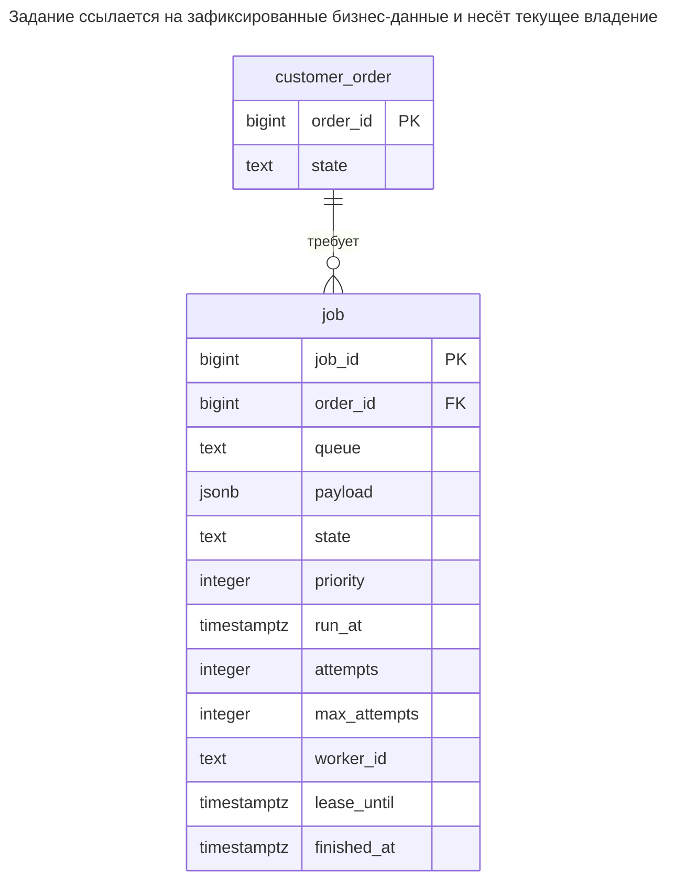
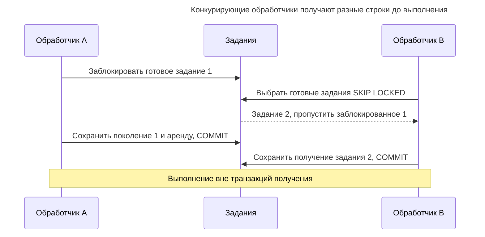
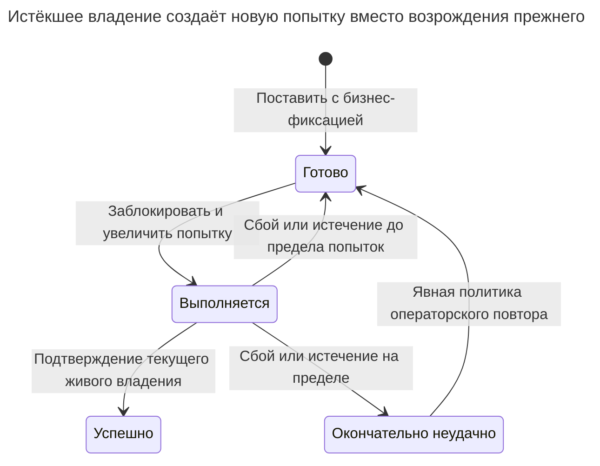

# Таблица очереди

## Назначение

Таблица очереди хранит фоновые задания в обычной таблице; обработчики забирают их через `SELECT ... FOR UPDATE SKIP LOCKED`, пропуская строки, уже заблокированные транзакцией получения. Очередь в той же базе позволяет поставить задание в одну транзакцию с требующим его изменением. Глава рассматривает состояния заданий, повторы с задержкой, тайм-ауты упавших обработчиков, приоритеты, очистку завершённых заданий и нагрузку, при которой лучше отдельный брокер.

## Также известен как

Database-backed job queue; work queue — очередь заданий в базе, рабочая очередь. [Документация `SELECT` PostgreSQL](https://www.postgresql.org/docs/18/sql-select.html#SQL-FOR-UPDATE-SHARE) прямо называет таблицу очереди применением `SKIP LOCKED`, предупреждая о несогласованном представлении при пропуске строк, непригодном обычным запросам.

## Проблема

Фиксация заказа требует позднейшего создания счёта. Отправка задания в другую систему до фиксации позволяет обработчику увидеть незафиксированный заказ; после фиксации — оставляет окно сбоя. Строка задания в той же транзакции закрывает локальный пробел.

Затем несколько обработчиков должны разделить готовые задания. Обычный `SELECT` с последующим безусловным обновлением позволяет двум выбрать одну строку. Открытая во время медленного удалённого вызова транзакция получения удерживает блокировки и соединение до конца вызова. Фиксация получения заранее требует другого восстановления заданий, брошенных упавшими обработчиками.

## Решение

Храните задания со временем запуска, приоритетом, числом попыток, состоянием и сроком аренды. Одной короткой транзакцией блокируйте ограниченное множество подходящих строк через `FOR UPDATE SKIP LOCKED`, переводите в `running`, увеличивайте поколение попытки и назначайте владельца. Фиксируйте до медленной работы. Обработчик завершает или продлевает только полученное поколение, пока аренда действует.

Очиститель возвращает просроченные выполняющиеся задания в готовые с задержкой либо в окончательно неудачные при достижении предела попыток. Следующее получение получает новое поколение. Это не даёт устаревшему обработчику подтвердить чужое получение в базе, но не мешает ему вызвать удалённую систему после истечения аренды. Внешним эффектам нужен стабильный ключ идемпотентности задания и сотрудничество назначения.

## Альтернативы и выбор

| Соседний паттерн или механизм | Связь | Определяющее требование |
| --- | --- | --- |
| [Транзакционный outbox](transactional-outbox.md) | Дополнение; замена назначения локального выполнения | Интеграционные события публикуются брокеру вместо прямого выполнения заданий из базы |
| [Запись идемпотентности](idempotency-record.md) | Дополнение | Обработчик может повторить внешний или локальный эффект после неопределённого результата |
| [Резервирование](reservation.md) | Дополнение | Задание планирует очистку, но ёмкостью и подтверждением владеет предметный резерв |
| Вся работа в транзакции получения | Вариант реализации | Задание — короткая локальная операция базы; эффект и завершение фиксируются вместе без аренды |
| Отдельный брокер | Замена хранения и распределения очереди | Изоляция нагрузки, размножение доставки или транспортные возможности оправдывают другой сервис и протокол |
| Готовая библиотека очереди в базе | Вариант реализации | Нужны поддерживаемые планирование, восстановление и инструменты вместо владения минимальным протоколом |

Полное сравнение — в [Атласе решений](decision-atlas.md). Перенос заданий в другую базу или брокер лишает постановки в той же транзакции без добавления outbox. Таблицы `jobs` на отдельном соединении недостаточно.



Аренда — цена освобождения транзакции базы до завершения работы. Она меняет восстановление после сбоя с отката на сохраняемый цикл повторов.

## Структура



Заказу может требоваться несколько заданий. Типизированный пример сохраняет заказ до удаления ссылающихся заданий. Имена очередей и нагрузки — метаданные выполнения, не заменяющие внешний ключ бизнес-объекта.

## Таблицы и инварианты

- **`customer_order`** вставляется с заданием одной транзакцией. Обработчики полагаются на эту границу видимости.
- **`job`** требует допустимого состояния, неотрицательных попыток и положительного максимума. Проверка получения требует обработчика и срок ровно при выполнении; проверка завершения — метку завершения ровно в конечных состояниях.
- **Поколение получения** — число попыток, возвращённое при получении. Каждое новое получение увеличивает его; завершение, продление и сообщения об ошибке обязаны совпадать с ним.
- **Власть над жизненным циклом** принадлежит протоколу записи. Проверки отклоняют неверные сочетания, но сами не запрещают владельцу сбросить попытки или воскресить завершённое задание.
- **Семантика доставки** допускает повторное выполнение. Уникальный ID задания запрещает дубликат идентичности строки, а не внешних эффектов; добавьте устранение повторов производителя, если повторные постановки должны означать одно логическое задание.

## Когда применять

- Фоновая работа естественно принадлежит той же транзакции базы, что входные данные.
- Конкурирующие обработчики выполняют независимые задания, строгий FIFO не нужен.
- Вы готовы обслуживать опрос, восстановление аренды, ограниченные повторы и хранение рядом с основной нагрузкой.

## Последствия и компромиссы

- ➕ Постановка и бизнес-изменения фиксируются вместе без протокола фиксации другого сервиса.
- ➕ Обработчики пропускают заблокированное получение вместо ожидания одного занятого задания.
- ➖ Приоритет — предпочтение среди подходящих неблокированных строк, а не строгий порядок выполнения или завершения. Поток высокого приоритета может бесконечно отодвигать старые задания.
- ➖ Опрос, обновления владения, очистка и сохранённые ошибки делят ресурсы базы с записью приложения.
- ➖ Срок аренды обменивает скорость восстановления на риск двойного выполнения. Долгая аренда медленно восстанавливается; короткой нужны надёжное продление и большая терпимость к пересечению.
- ➖ Универсального порога заданий в секунду для перехода на брокер нет. Измеряйте задержки постановки/получения, возраст самого старого готового задания, частоту повторов, размер таблицы/индексов и влияние на приложение при своих размерах нагрузок и транзакций.

## Реализация

[Полный скрипт PostgreSQL 18.6](../assets/queue-table/queue-table.sql) проверяет получение, неверные состояния, завершение, повтор, восстановление истечения и устаревшие подтверждения. Начните с индекса выбора ожидающих и отдельного индекса истечения:

```sql
CREATE TABLE customer_order (
    order_id bigint PRIMARY KEY,
    state text NOT NULL
);
CREATE TABLE job (
    job_id bigint PRIMARY KEY,
    order_id bigint NOT NULL REFERENCES customer_order (order_id),
    queue text NOT NULL,
    payload jsonb NOT NULL,
    state text NOT NULL DEFAULT 'ready'
        CHECK (state IN ('ready', 'running', 'succeeded', 'dead')),
    priority integer NOT NULL DEFAULT 0,
    run_at timestamptz NOT NULL DEFAULT clock_timestamp(),
    attempts integer NOT NULL DEFAULT 0 CHECK (attempts >= 0),
    max_attempts integer NOT NULL DEFAULT 3 CHECK (max_attempts > 0),
    worker_id text,
    lease_until timestamptz,
    finished_at timestamptz,
    CONSTRAINT job_claim_shape CHECK (
        (state = 'running' AND worker_id IS NOT NULL AND lease_until IS NOT NULL)
        OR (state <> 'running' AND worker_id IS NULL AND lease_until IS NULL)
    ),
    CONSTRAINT job_finish_shape CHECK (
        (state IN ('succeeded', 'dead')) = (finished_at IS NOT NULL)
    )
);
CREATE INDEX job_ready_idx ON job (queue, priority DESC, run_at, job_id)
WHERE state = 'ready';
CREATE INDEX job_lease_idx ON job (lease_until) WHERE state = 'running';
BEGIN;
INSERT INTO customer_order VALUES (1, 'paid');
INSERT INTO job (job_id, order_id, queue, payload)
VALUES (1, 1, 'invoices', '{"schema_version":1}');
COMMIT;
```

Получение — один [изменяющий данные оператор](https://www.postgresql.org/docs/18/queries-with.html#QUERIES-WITH-MODIFYING); блокировочная часть находится внутри запроса кандидатов. Приложение передаёт идентичность обработчика, очередь и размер пакета параметрами:

```sql
BEGIN;
WITH candidate AS (
    SELECT job_id FROM job
    WHERE queue = 'invoices' AND state = 'ready'
      AND run_at <= statement_timestamp() AND attempts < max_attempts
    ORDER BY priority DESC, run_at, job_id
    LIMIT 1 FOR UPDATE SKIP LOCKED
)
UPDATE job AS j
SET state = 'running', attempts = j.attempts + 1,
    worker_id = 'worker-a', lease_until = clock_timestamp() + interval '1 minute'
FROM candidate AS c WHERE j.job_id = c.job_id
RETURNING j.job_id, j.attempts, j.payload;
COMMIT;
```

Возвращаются задание `1` и поколение `1`. Работа начинается после фиксации; обработчик сохраняет оба значения. Пустое получение означает отсутствие доступной сейчас работы, не обязательно пустую очередь. Выбирайте пакеты так, чтобы последнее задание началось до истечения аренды. Индекс предпочитает порядок приоритета внутри очереди; много высокоприоритетных будущих заданий всё ещё увеличивает сканирование до готового, поэтому изучайте план вместо предположения об ограниченной работе из одного `LIMIT`.

Некорректная выполняющаяся строка недопустима:

```sql
-- Expected SQLSTATE 23514.
UPDATE job SET lease_until = NULL WHERE job_id = 1;
```

PostgreSQL 18.6 возвращает SQLSTATE `23514`: `ERROR: new row for relation "job" violates check constraint "job_claim_shape"`. Для продления долгого выполнения сначала блокируйте задание, затем проверяйте поколение и текущий срок следующим оператором. Так время ожидания блокировки не входит в решение о сроке:

```sql
BEGIN;
SELECT job_id FROM job WHERE job_id = 1 FOR UPDATE;
UPDATE job SET lease_until = clock_timestamp() + interval '1 minute'
WHERE job_id = 1 AND state = 'running' AND attempts = 1 AND worker_id = 'worker-a'
  AND lease_until > clock_timestamp()
RETURNING job_id;
COMMIT;
```

Для успешной работы берите ту же блокировку и подтверждайте только текущее неистёкшее владение:

```sql
BEGIN;
SELECT job_id FROM job WHERE job_id = 1 FOR UPDATE;
UPDATE job SET state = 'succeeded', worker_id = NULL, lease_until = NULL,
               finished_at = clock_timestamp()
WHERE job_id = 1 AND state = 'running' AND attempts = 1 AND worker_id = 'worker-a'
  AND lease_until > clock_timestamp()
RETURNING job_id, state;
COMMIT;
```

Результат — `(1, succeeded)`. Ноль строк означает потерю владения или уже состоявшийся переход; не затирайте новое состояние. Добровольное сообщение о неудаче использует тот же протокол блокировки и проверки для освобождения или завершения. [Блокировки строк PostgreSQL](https://www.postgresql.org/docs/18/explicit-locking.html#LOCKING-ROWS) сериализуют решения с замещающими получениями и восстановлением истечения.

Очиститель истечения блокирует ограниченный набор просроченных заданий и переводит в готовые или окончательно неудачные. Здесь используется постоянная задержка повтора 30 секунд; полный скрипт также показывает явную ошибку обработчика. Для экспоненциального откладывания вычисляйте ограниченную задержку из попыток и добавляйте случайный разброс; это политика планирования, не гарантия уникальности.

```sql
WITH overdue AS (
    SELECT job_id FROM job
    WHERE state = 'running' AND lease_until <= statement_timestamp()
    ORDER BY lease_until, job_id
    LIMIT 100 FOR UPDATE SKIP LOCKED
)
UPDATE job AS j
SET state = CASE WHEN j.attempts >= j.max_attempts THEN 'dead' ELSE 'ready' END,
    run_at = clock_timestamp() + interval '30 seconds',
    worker_id = NULL, lease_until = NULL,
    finished_at = CASE WHEN j.attempts >= j.max_attempts THEN clock_timestamp() END
FROM overdue AS o WHERE j.job_id = o.job_id
RETURNING j.job_id, j.state;
```

После успешного примера строки не меняются: единственное задание в конечном состоянии. После реального тайм-аута новое получение увеличит попытки; поколение старого обработчика больше не совпадёт. Очиститель не должен сбрасывать счётчик. Исключайте конечные задания из получения. Операторскому перезапуску нужен явный дополнительный бюджет попыток или новая постановка с той же идентичностью логического эффекта; до решения выясните прежние побочные эффекты.

## Поддержка в движках

- **PostgreSQL 18:** [`SKIP LOCKED`](https://www.postgresql.org/docs/18/sql-select.html#SQL-FOR-UPDATE-SHARE) пропускает конфликты блокировки строк, не любое ожидание. Делайте транзакции получения Read Committed короткими; табличные блокировки и другие ресурсы базы всё ещё вызывают ожидания.
- **MySQL 8.4 / InnoDB:** [`FOR UPDATE SKIP LOCKED`](https://dev.mysql.com/doc/refman/8.4/en/innodb-locking-reads.html) поддерживает конкурирующих потребителей. Используйте явную транзакцию выбора и обновления, учитывайте предупреждение о репликации операторов.
- **SQL Server 2025 (17.x):** [`READPAST`](https://learn.microsoft.com/en-us/sql/t-sql/queries/hints-transact-sql-table?view=sql-server-ver17) предназначен рабочим очередям, обычно с `UPDLOCK` в протоколе получения. Он пропускает блокировки строк, но не страниц, и ограничен при Read Committed на снимках; перед переносом проверьте настроенную изоляцию.
- **Oracle AI Database 26ai:** [`FOR UPDATE SKIP LOCKED`](https://docs.oracle.com/en/database/oracle/oracle-database/26/sqlrf/SELECT.html) предназначен очередям многих потребителей. Переносите ограниченный выбор с учётом ограничений количества строк этой версии вместо копирования `LIMIT` PostgreSQL.
- **SQLite 3:** используйте короткую транзакцию получения [`BEGIN IMMEDIATE`](https://www.sqlite.org/lang_transaction.html), обрабатывая `SQLITE_BUSY`. Единственный писатель заменяет конкурентную построчную блокировку; рост числа обработчиков не даёт независимой записи строк PostgreSQL.

## Сбои и конкурентность



Блокировка строки защищает переход в выполнение. Сохранённые состояние и аренда защищают период после её освобождения. Без обновления состояния до фиксации другой обработчик сразу получил бы ту же готовую строку.



У каждого нового периода выполнения новое поколение. Операторский повтор должен сохранять стабильную идентичность эффекта, если старая попытка могла успешно выполниться снаружи.

Обработчик может завершить внешнее действие, упасть до подтверждения и потерять аренду. Замещающий обработчик повторяет действие. [Запись идемпотентности](idempotency-record.md) или эквивалент назначения должен задавать эффект стабильным `job_id`, **не** меняющимся поколением попытки. Условие поколения ограждает только запись строки задания; удалённому сервису нужен собственный контракт устранения дубликатов или отсечения устаревших владельцев.

Для чисто локальной работы выполняйте эффект и завершение одной транзакцией под блокировкой задания. Если всё задание неатомарно, фиксируйте идемпотентные контрольные точки и определите, какие переживают повтор. Не держите долгую транзакцию базы только ради ухода от проектирования восстановления.

## Миграция

Добавьте таблицу заданий и путь записи, затем переносите по одному виду работы. Зафиксируйте границу постановки и стабильную идентичность источника, чтобы старые и новые обработчики не выполняли работу независимо. Заполняйте только достоверно незавершённую работу; существование старого заказа не доказывает необходимость создания счёта.

Переключайте обработчиков после проверки совместимости нагрузки, восстановления повторов и возраста самого старого готового задания. Освободите старую очередь и сохраните путь старых версий нагрузки до её вывода через [Расширение и свёртывание](expand-contract.md). При откате прекратите новую постановку, но сохраните или явно передайте принятый остаток; удаление готовых заданий теряет обещанную работу.

Удаляйте завершённое ограниченными пакетами после нужных окон диагностики и устранения дубликатов. Сохраняйте окончательно неудачные задания достаточно долго для разбора оператором. [Документация vacuum PostgreSQL](https://www.postgresql.org/docs/18/routine-vacuuming.html) объясняет обслуживание пространства изменённых и удалённых строк; следите за оборотом строк и прогрессом vacuum при реальной нагрузке. Переходите на другой сервис очередей, когда это оправдано измеренной конкуренцией ресурсов или транспортными требованиями, сохраняя надёжность постановки через outbox.

## Антипаттерны и частые ошибки

- Получать задание обычным чтением и отдельной незащищённой записью.
- Считать единственное исключительное владение доказательством однократного выполнения.
- Продлевать или завершать только по ID задания, позволяя устаревшему обработчику изменить замещающее владение.
- Завершать аренду по локальным часам обработчика без ясной политики часов; пример проверяет сроки в базе.
- Опрашивать пустую очередь непрерывным циклом без пауз или бессрочно хранить каждую завершённую нагрузку.
- Принимать изменение приоритета за строгий FIFO или справедливость.

## Известные применения

- [Руководство River по транзакционной постановке](https://riverqueue.com/docs/transactional-enqueueing) описывает вставку заданий с бизнес-данными, чтобы обработчик получал только зафиксированный ввод. Это обосновывает границу фиксации, а не производительность схемы.
- [Solid Queue Rails](https://github.com/rails/solid_queue) разделяет готовые, запланированные и полученные выполнения в [схеме очереди](https://raw.githubusercontent.com/rails/solid_queue/main/lib/generators/solid_queue/install/templates/db/queue_schema.rb) и использует `SKIP LOCKED` при поддержке. Рекомендуемое развёртывание в отдельной базе означает необходимость выбрать документированную конфигурацию одной базы до расчёта на общую транзакционную атомарность с приложением.

## Связанные паттерны

- [Транзакционный outbox](transactional-outbox.md) подготавливает сообщения отдельному транспорту.
- [Запись идемпотентности](idempotency-record.md) предотвращает повторение логических эффектов при повторах.
- [Резервирование](reservation.md) даёт предметным требованиям на ёмкость собственный жизненный цикл.
- [Отсутствующие внешние ключи](missing-foreign-keys.md) объясняют типизированную ссылку, сохранённую примером.
- [Расширение и свёртывание](expand-contract.md) поэтапно обновляет нагрузки и обработчики, сохраняя принятые задания.
