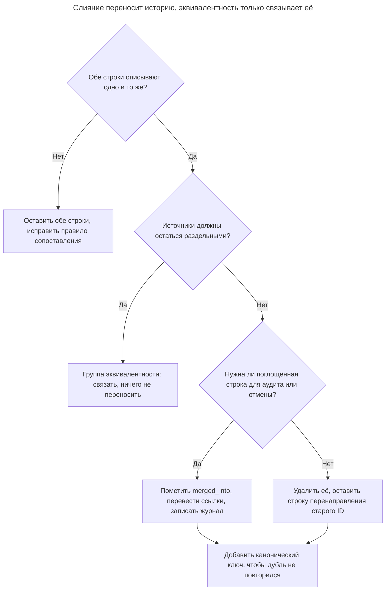
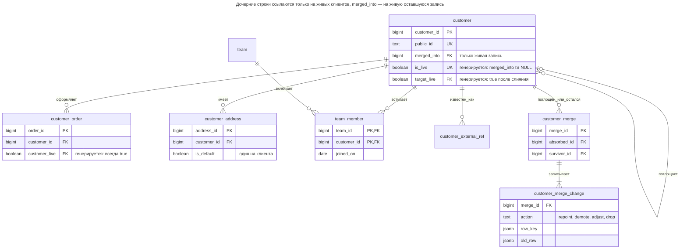
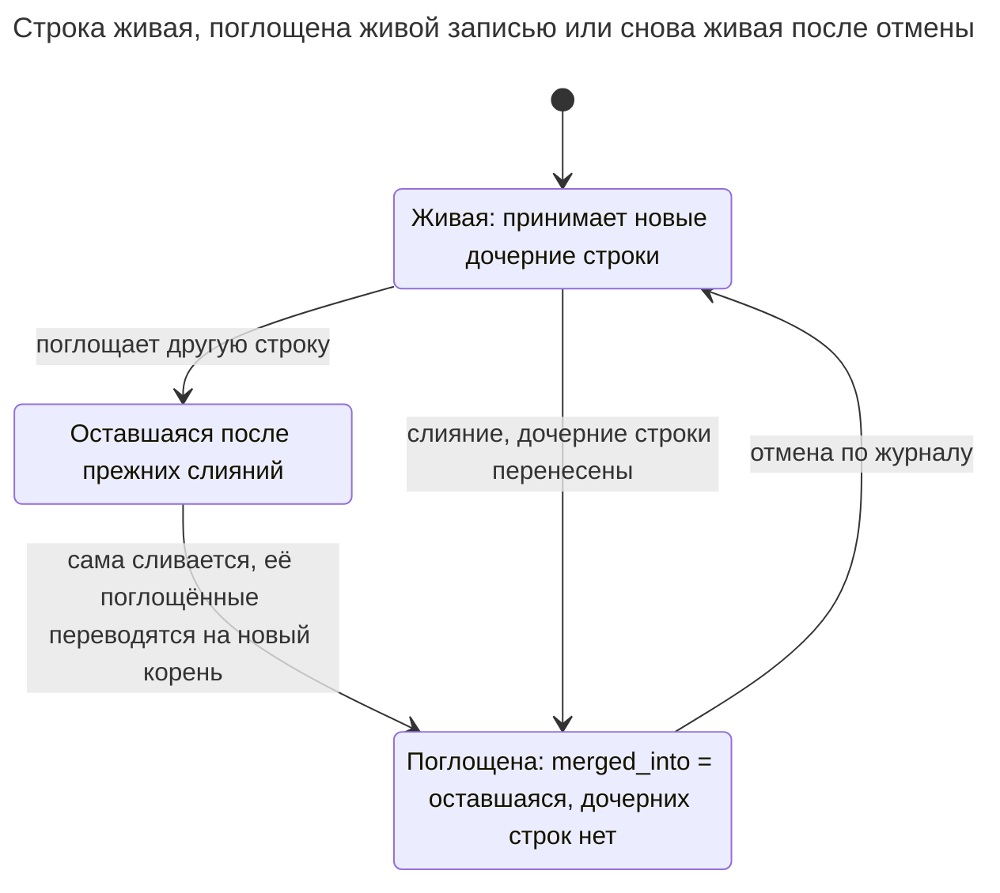
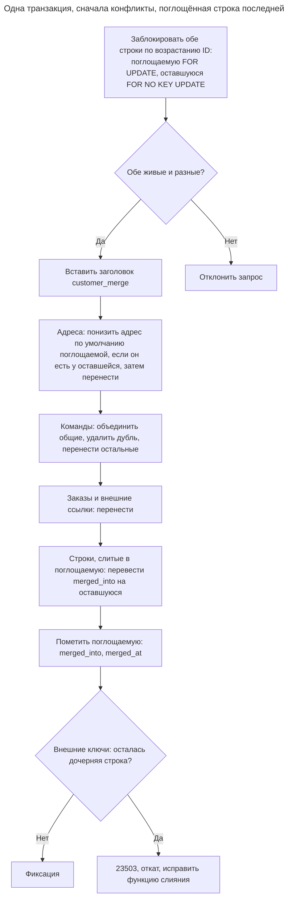
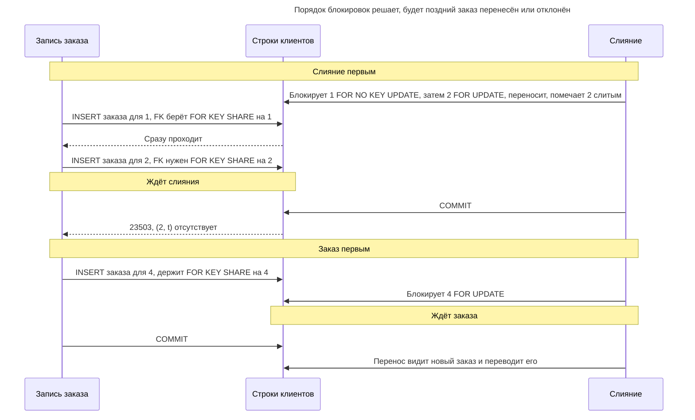

# Слияние записей

## Назначение

Слияние записей превращает две строки, описывающие одно и то же, например две записи клиента для одного человека, в одну. Одна строка остаётся. Другая сохраняется и помечается `merged_into` — ссылкой на оставшуюся; все ссылки на неё в одной транзакции переводятся на оставшуюся, а её старый ID продолжает разрешаться, так что URL, клиенты API и внешние системы, которые его ещё присылают, получают перенаправление, а не «не найдено». Глава показывает, как внешние ключи гарантируют, что ни одна ссылка не останется на старой строке, как разрешать конфликты уникальности между дочерними строками двух записей, как переносить внешние ID, как журнал слияния делает ошибочное слияние обратимым, как не дать новому заказу попасть на поглощаемую строку и когда достаточно связать записи как эквивалентные.

## Также известен как

Дедупликация; merge and purge; survivorship — правило, по которому выбираются уцелевшие значения. В «Analysis Patterns» Фаулера есть паттерны с названиями Object Merge и Object Equivalence. В CRM строки называют главной (master, primary) и объединяемой (merged, secondary) записью.

## Проблема

Анна Ли регистрируется дважды: один раз как `ann@old.example`, второй — с нового адреса после смены работы. Поддержка находит дубликат, когда Анна спрашивает, куда пропала половина её заказов. Задача сопоставления находит и другие пары: тот же телефон, то же имя, тот же адрес доставки. У каждой пары есть заказы, адреса, участие в командах и ID клиента в Stripe, а у каждой записи — публичный ID, который уже лежит в закладках, счетах и системах партнёров.

Очевидное решение — обновить заказы и удалить строку-дубликат. Ломается оно сразу в нескольких местах. Таблица, о которой никто не вспомнил, всё ещё ссылается на удалённый ID — или у неё вообще не было внешнего ключа, и теперь она указывает в никуда. У обоих клиентов был адрес по умолчанию, и перенос второго нарушает индекс «один адрес по умолчанию на клиента»; оба состояли в одной команде, и перенос участия нарушает её первичный ключ. ID дубликата исчезает: вебхук партнёра, который его присылает, падает, а старая ссылка отдаёт 404. Новый заказ из ещё открытой сессии дубликата приходит через миллисекунду после переноса и попадает на строку, которую слияние вот-вот выведет из оборота. А через неделю поддержка узнаёт, что две Анны Ли — разные люди, но никто не записал, какие строки были перенесены, и слияние уже не отменить.

## Решение

Сливайте пометкой и переносом, а не удалением:

- **Выберите оставшуюся запись.** Обычно это более старая строка, строка с более длинной историей или та, которую внешняя система считает главной. Правило — бизнес-решение; запишите его вместе со слиянием.
- **Пометьте поглощённую строку.** Запишите в `merged_into` оставшуюся запись и поставьте `merged_at`. `CHECK` запрещает слияние строки с самой собой. Составной внешний ключ позволяет `merged_into` указывать только на живую строку, поэтому цепочки не образуются; когда сливается строка, которая уже поглотила другие, её поглощённые строки в той же транзакции переводятся на новый корень. Тогда `resolve(id)` — всегда один шаг: `coalesce(merged_into, customer_id)`.
- **Переведите все ссылки в одной транзакции.** Дочерние строки ссылаются на `(customer_id, customer_live)`, где `customer_live` всегда `true`, а родитель предоставляет уникальный ключ `(customer_id, is_live)`. Пометка строки как слитой меняет её `is_live` на `false`, поэтому внешние ключи отклоняют слияние, пока на неё указывает хотя бы одна дочерняя строка: забытая таблица — это ошибка, а не сирота. Тот же ключ отклоняет новые дочерние строки для слитой записи.
- **Ведите журнал слияния.** Запишите заголовок `(merge_id, absorbed_id, survivor_id, reason)` и по строке на каждую изменённую дочернюю строку: таблицу, ключ, действие и, если строка изменилась или удалена, её прежние значения. Без журнала слияние не отменить.
- **Сохраните разрешимость поглощённого ID.** Поглощённая строка остаётся со своим публичным ID и прежними значениями атрибутов. Поиск по старому ID приводит к оставшейся записи; API отвечает [`308 Permanent Redirect`](https://www.rfc-editor.org/rfc/rfc9110.html#name-308-permanent-redirect) на URL оставшейся записи или возвращает её с каноническим ID.

Перенос может столкнуться с ограничениями. Уникальное ограничение дочерней таблицы, включающее клиента, срабатывает, когда у обеих записей есть дочерняя строка с одинаковым ключом, поэтому каждой такой таблице нужно своё правило, принятое один раз и закодированное в слиянии:

| Дочерняя таблица | Конфликт | Правило в примере |
| --- | --- | --- |
| `customer_address` | У обоих есть адрес по умолчанию; по умолчанию — один на клиента | Оставить адрес по умолчанию оставшейся записи, другой понизить |
| `team_member` | Оба в одной команде; ключ `(team_id, customer_id)` | Объединить: одно участие с более ранней датой вступления |
| `customer_order` | Нет | Перенести |
| `customer_external_ref` | Нет: в ключе `(system, scope, external_id)` нет клиента | Перенести; у оставшейся записи может стать два ID в одной системе |

Другим таблицам нужны другие правила: оставить самую новую строку настроек, сложить бонусные баллы, сохранить обе заметки.

## Альтернативы и выбор

| Выбор | Отношение | Решающее требование |
| --- | --- | --- |
| Слияние с `merged_into` (эта глава) | По умолчанию | История должна принадлежать одной записи; старые ID должны работать; ошибочное слияние должно быть обратимым |
| Таблица перенаправлений, поглощённая строка удаляется | Вариант реализации | Старые ID должны разрешаться, а больше ничего от поглощённой строки хранить не нужно; такие таблицы перенаправлений есть у MusicBrainz |
| Группа эквивалентности (связи «то же самое») | Более лёгкая замена | Источники должны остаться раздельными: разные юрлица, разные исходные системы, записи, которые вам нельзя менять, или совпадение, в котором вы не уверены |
| Слияние только в копии для отчётов | Замена | Одна строка на человека нужна только отчётам; рабочая система хранит обе |
| [Внешняя ссылка](external-reference.md) | Дополнение | Внешние ID переходят к оставшейся записи; ключ соответствия остаётся уникальным |
| [Зависимая таблица](dependent-table.md) | Дополнение | Определяет действия при удалении и изменении; слияние — это изменение каждой ссылки |
| [Каноническое значение](canonical-value.md) | Профилактика | Дубликаты возникают из вариантов написания, которые поймало бы одно правило сравнения |
| [Мягкое удаление](soft-delete.md) | Родственный жизненный цикл | У удалённой строки нет преемника; у слитой он ровно один |

Семейство идентификаторов сравнивается в [Атласе решений](decision-atlas.md).



Ветка эквивалентности оставляет все ссылки на месте и отвечает на вопрос «всё об этом человеке», читая группу. Выбирайте её, когда историю нельзя или не нужно переносить, например между клиентскими счетами двух дочерних компаний, которые выставляют счета отдельно.

## Структура



Каждая бизнесовая дочерняя таблица ссылается на пару `(customer_id, true)`, поэтому её строка может существовать только рядом с живым клиентом. Таблицы журнала намеренно ссылаются на обычный первичный ключ: им нужно указывать на поглощённые строки.

## Таблицы и инварианты

- **`customer`** хранит поглощённые строки. `customer_not_self` запрещает `merged_into = customer_id`; `customer_merged_at_set` требует, чтобы `merged_at` и `merged_into` были заданы вместе. `is_live` и `target_live` — хранимые генерируемые столбцы, поэтому никакой писатель не может рассогласовать их с `merged_into`. `customer_merged_into_fkey` по `(merged_into, target_live)` ссылается на `(customer_id, is_live)`, так что оставшаяся запись обязана быть живой, а это исключает цепочки и циклы. `customer_live_email_key` — частичный уникальный индекс только по живым строкам: поглощённая строка сохраняет свой e-mail и не блокирует его; тот же приём [Мягкое удаление](soft-delete.md) применяет к удалённым строкам.
- **`customer_order`**, **`customer_address`**, **`team_member`**, **`customer_external_ref`** несут `customer_live boolean GENERATED ALWAYS AS (true) STORED` и внешний ключ по `(customer_id, customer_live)`. Их собственные ключи и уникальные индексы (`customer_address_one_default`, `team_member_pkey`, `customer_external_ref_pkey`) — то, с чем должны считаться правила разрешения конфликтов.
- **`customer_merge`** — заголовок слияния. Частичный уникальный индекс допускает одно действующее слияние на поглощённую строку; `unmerged_at` отмечает отменённое слияние.
- **`customer_merge_change`** содержит по строке на каждую изменённую дочернюю строку: `table_name`, `action` (`repoint`, `demote`, `adjust`, `drop`), `row_key` и для `adjust` и `drop` — `old_row`. Имя таблицы вместе с JSON-ключом — описательная ссылка, а не внешний ключ, как объясняет [Журнал аудита](audit-log.md) для универсальных журналов; пишут и читают её только функции слияния и отмены.



Поглощённая строка никогда не принимает дочерние строки и не становится оставшейся. Выйти из этого состояния она может только через отмену собственного слияния.

## Когда применять

- Люди или импорты создают записи-дубликаты, которые позже оказываются одним клиентом, поставщиком, пациентом или товаром.
- На оба дубликата уже ссылаются другие строки, другие системы или опубликованные URL.
- Поддержка должна иметь возможность отменить слияние, сделанное по ошибочным данным.
- Вместе с паттерном [Участник](party.md), когда один человек или организация может прийти через несколько процессов.

## Последствия и компромиссы

- ➕ Внешние ключи превращают вопрос «перенесли ли мы все ссылки?» в проверку, которую база выполняет на последнем `UPDATE`.
- ➕ Старые ID продолжают работать; внешние системы переходят в своём темпе.
- ➕ Журнал делает слияние обратимым и объясняет его аудитору.
- ➖ Каждая дочерняя таблица несёт постоянный генерируемый столбец и составной ключ, а родитель — лишний уникальный индекс. Новая дочерняя таблица, ссылающаяся на обычный первичный ключ, ускользает от проверки.
- ➖ Каждое чтение, выводящее список клиентов, должно фильтровать `merged_into IS NULL`, а каждый поиск по ID — сначала разрешать его.
- ➖ Слияние блокирует поглощаемую строку и переписывает все её дочерние строки в одной транзакции; клиенту с миллионами строк нужен план с пакетами.
- ➖ Отмена слияния восстанавливает ссылки, но не решения, принятые после него: заказы, оформленные на оставшуюся запись, значения атрибутов, скопированные из поглощённой, сообщения, отправленные в другие системы.

## Реализация

[Полный скрипт для PostgreSQL 18.7](../assets/record-merge/record-merge.sql) проверяет ограничения, оба слияния, выпрямление цепочки, правила разрешения конфликтов, журнал, перенаправления, отмену слияния со сравнением каждой дочерней таблицы до и после, миграцию обычного ключа, группу эквивалентности и четыре конкурентные гонки. Главные части схемы:

```sql
CREATE TABLE customer (
    customer_id bigint GENERATED ALWAYS AS IDENTITY PRIMARY KEY,
    public_id text NOT NULL UNIQUE,
    display_name text NOT NULL,
    email text,
    merged_into bigint,
    merged_at timestamptz,
    is_live boolean GENERATED ALWAYS AS (merged_into IS NULL) STORED,
    target_live boolean
        GENERATED ALWAYS AS (CASE WHEN merged_into IS NOT NULL THEN true END) STORED,
    CONSTRAINT customer_live_key UNIQUE (customer_id, is_live),
    CONSTRAINT customer_not_self CHECK (merged_into <> customer_id),
    CONSTRAINT customer_merged_at_set CHECK ((merged_into IS NULL) = (merged_at IS NULL)),
    CONSTRAINT customer_merged_into_fkey FOREIGN KEY (merged_into, target_live)
        REFERENCES customer (customer_id, is_live)
);
CREATE UNIQUE INDEX customer_live_email_key ON customer (email) WHERE merged_into IS NULL;

CREATE TABLE customer_order (
    order_id bigint PRIMARY KEY,
    customer_id bigint NOT NULL,
    customer_live boolean GENERATED ALWAYS AS (true) STORED,
    placed_at timestamptz NOT NULL DEFAULT now(),
    CONSTRAINT customer_order_customer_fkey FOREIGN KEY (customer_id, customer_live)
        REFERENCES customer (customer_id, is_live)
);
CREATE INDEX customer_order_customer_idx ON customer_order (customer_id);

CREATE FUNCTION resolve_customer(p_customer_id bigint) RETURNS bigint
LANGUAGE sql STABLE
RETURN (SELECT coalesce(merged_into, customer_id) FROM customer
        WHERE customer_id = p_customer_id);
```

У живой строки `target_live` равен `NULL`, поэтому при умолчательном `MATCH SIMPLE` её ссылка на саму таблицу не проверяется. Пишите `STORED`: в PostgreSQL 18 [генерируемые столбцы по умолчанию виртуальные](https://www.postgresql.org/docs/18/ddl-generated-columns.html), и скрипт показывает, что виртуальный `customer_live` отклоняется с SQLSTATE `0A000`: `ERROR: foreign key constraints on virtual generated columns are not supported`.

Слияние, забывшее таблицу, не может завершиться. Пометим клиента `2` слитым, пока на него ещё указывают заказы:

```sql
UPDATE customer SET merged_into = 1, merged_at = now() WHERE customer_id = 2;
```

PostgreSQL 18.7 выдаёт SQLSTATE `23503`: `ERROR: update or delete on table "customer" violates foreign key constraint "customer_order_customer_fkey" on table "customer_order"` с `DETAIL: Key (customer_id, is_live)=(2, t) is still referenced from table "customer_order".` Слияние клиента `3` с самим собой нарушает `customer_not_self` с кодом `23514`; поглощённая строка в роли оставшейся нарушает `customer_merged_into_fkey` с кодом `23503` и `DETAIL: Key (merged_into, target_live)=(6, t) is not present in table "customer".`

Само слияние — одна функция, выполняемая в одной транзакции. Её шаги следуют диаграмме ниже; шаг с адресами показывает приём, которым пользуется каждый шаг: изменяющий данные `WITH` меняет строки и записывает их в журнал одной командой:

```sql
WITH changed AS (
    UPDATE customer_address SET is_default = false
    WHERE customer_id = p_absorbed AND is_default
      AND EXISTS (SELECT FROM customer_address
                  WHERE customer_id = p_survivor AND is_default)
    RETURNING address_id)
INSERT INTO customer_merge_change (merge_id, table_name, action, row_key)
SELECT v_merge, 'customer_address', 'demote', jsonb_build_object('address_id', address_id)
FROM changed;
```

Шаг с командами объединяет дубликаты: переносит более ранний `joined_on` в участие оставшейся записи и записывает прежнее значение через появившийся в PostgreSQL 18 [`RETURNING old.joined_on`](https://www.postgresql.org/docs/18/dml-returning.html), затем удаляет участие поглощённой записи и сохраняет в журнале всю строку.



Каждый шаг пишет свои строки журнала по ходу дела. Последний `UPDATE` — единственный шаг, который может упасть на забытой ссылке, и вместе с ним откатывается вся транзакция.

Скрипт сначала сливает клиента `6` в `2`, затем `2` в `1`. После второго слияния `resolve_customer(2)` и `resolve_customer(6)` оба возвращают `1`: строку первого слияния перевели с `2` на `1`, поэтому цепочка не образуется. Заказы со `100` по `103` принадлежат клиенту `1`; из четырёх адресов по умолчанию только `11`; в команде `10` одно участие с датой `2024-06-01` — более ранней из двух; ID Stripe `cus_Q8sZa` теперь находит клиента `1`. В журнале: `customer/repoint=1, customer_address/demote=1, customer_address/repoint=3, customer_external_ref/repoint=2, customer_order/repoint=3, team_member/adjust=1, team_member/drop=1, team_member/repoint=1`. Старый публичный ID разрешается одним соединением:

```sql
SELECT s.public_id, c.merged_into IS NOT NULL AS moved
FROM customer AS c
JOIN customer AS s ON s.customer_id = coalesce(c.merged_into, c.customer_id)
WHERE c.public_id = 'cus_ann2';
```

Запрос возвращает `cus_ann1` и `true`: ответьте перенаправлением на `cus_ann1`. Новый заказ для поглощённого клиента отклоняется с `23503` и `DETAIL: Key (customer_id, customer_live)=(2, t) is not present in table "customer".` Разрешите ID и повторите запрос для оставшейся записи или поручите это API.

### Внешние ID

Соответствия внешних ID из главы [Внешняя ссылка](external-reference.md) переносятся как любые другие дочерние строки. Их ключ `(system, scope, external_id)` не содержит клиента, поэтому перенос никогда не конфликтует и каждый внешний ID по-прежнему указывает ровно на одного клиента. У оставшейся записи теперь может быть два ID клиента Stripe в одной области. У провайдера по-прежнему два объекта; решите, с какого из них списывать деньги (флаг основного или самый новый), и слейте их на стороне провайдера, если он это умеет. У HubSpot, например, есть [метод слияния](https://developers.hubspot.com/docs/api-reference/latest/crm/objects/contacts/merge-contacts), принимающий `primaryObjectId` и `objectIdToMerge`.

### Отмена слияния

`unmerge_customer(merge_id)` блокирует обе строки, отказывает, если слияние уже отменено или если оставшуюся запись с тех пор саму слили (сначала отмените более позднее слияние), очищает `merged_into` и проигрывает журнал в обратную сторону: переводит обратно строки, которые всё ещё указывают на оставшуюся запись, возвращает пониженные адреса по умолчанию, восстанавливает изменённые значения и заново вставляет удалённые строки. Каждое восстановление несёт одно и то же условие; для заказов оно выглядит так:

```sql
UPDATE customer_order AS o SET customer_id = m.absorbed_id
FROM customer_merge_change AS j
WHERE j.merge_id = p_merge_id AND j.table_name = 'customer_order'
  AND o.order_id = (j.row_key ->> 'order_id')::bigint
  AND o.customer_id = m.survivor_id;
```

Скрипт снимает копию каждой дочерней таблицы перед вторым слиянием, а после него оформляет заказ `105` на оставшуюся запись, и поддержка переводит заказ `101` на клиента `3`. Затем скрипт отменяет слияние и сравнивает данные через `EXCEPT` в обе стороны: все остальные строки на месте, заказ `105` остаётся у клиента `1`, а заказ `101` — у клиента `3`, потому что последнее условие для него уже не выполняется.

Чего этот журнал отменить не может:

- Строк, созданных для оставшейся записи после слияния. Ничто не говорит, какому человеку они принадлежат; выведите заказы с `placed_at > merged_at` на проверку.
- Изменений, которые слияние не записало. Скрипт после слияния копирует e-mail поглощённой записи в оставшуюся и пытается отменить слияние: поглощённая строка снова становится живой с тем же e-mail и падает с `23505`, `ERROR: duplicate key value violates unique constraint "customer_live_email_key"`, `DETAIL: Key (email)=(ann@new.example) already exists.` Записывайте выбор атрибутов в журнал или в [Журнал аудита](audit-log.md) либо откатывайте его вручную до отмены.
- Строк, удалённых после слияния, и всего, что уже ушло в другие системы: писем, вебхуков, слияния на стороне провайдера.

Журнал аудита, который записывает каждый переносящий `UPDATE` с идентификатором корреляции слияния, содержит ту же информацию; отдельный журнал слияний меньше, типизирован по действиям и читается одной функцией.

### Эквивалентность вместо слияния

Когда записи должны остаться раздельными, свяжите их: `customer_equivalence (customer_id PRIMARY KEY, group_id)` ссылается на `customer` и на таблицу `equivalence_group`, где хранится причина. Первичный ключ помещает клиента не более чем в одну группу; вторая группа для клиента `5` отклоняется с `23505`. Отчёты читают данные через группу (заказы клиентов `4` и `5` вместе), а каждый заказ по-прежнему принадлежит своему клиенту. Связать две группы — значит слить группы, и это затрагивает только эту таблицу.

## Поддержка в движках

- **PostgreSQL 18:** хранимые генерируемые столбцы могут входить в уникальные и внешние ключи, виртуальные (по умолчанию) — нет. `RETURNING old.*` и `new.*` появились в 18. `FOR NO KEY UPDATE` позволяет оставшейся записи принимать дочерние строки во время слияния, потому что проверка внешнего ключа берёт `FOR KEY SHARE`; см. [блокировки строк](https://www.postgresql.org/docs/18/explicit-locking.html#LOCKING-ROWS).
- **MySQL 8.4:** есть составные внешние ключи и ограничения `CHECK`. Проверка внешнего ключа [ставит разделяемые блокировки записей](https://dev.mysql.com/doc/refman/8.4/en/innodb-locks-set.html) на прочитанные родительские записи, а у InnoDB два вида [блокирующих чтений](https://dev.mysql.com/doc/refman/8.4/en/innodb-locking-reads.html) — `FOR SHARE` и `FOR UPDATE`; аналога `FOR NO KEY UPDATE` нет. Поэтому блокировка оставшейся записи `FOR UPDATE` задерживает и новые заказы для неё до фиксации слияния; разделяемая блокировка оставшейся записи с этими проверками не конфликтует. `RETURNING` нет, так что журнал пишите из `SELECT` перед каждым изменением.
- **SQL Server 2025 (17.x):** заблокируйте две строки табличной подсказкой [`UPDLOCK`](https://learn.microsoft.com/en-us/sql/t-sql/queries/hints-transact-sql-table?view=sql-server-ver17), которая держит блокировки обновления до конца транзакции. [Предложение `OUTPUT`](https://learn.microsoft.com/en-us/sql/t-sql/queries/output-clause-transact-sql?view=sql-server-ver17) возвращает `deleted.*` и `inserted.*` — старые и новые значения, нужные журналу.
- **Oracle AI Database 26ai:** [`SELECT ... FOR UPDATE`](https://docs.oracle.com/en/database/oracle/oracle-database/26/sqlrf/SELECT.html) блокирует две строки.
- **SQLite 3:** составные [внешние ключи](https://www.sqlite.org/foreignkeys.html) работают после `PRAGMA foreign_keys = ON`. В базе [один писатель в каждый момент](https://www.sqlite.org/lockingv3.html), поэтому гонка ниже не может чередоваться.
- **Везде:** где генерируемый столбец не может входить в ключ, используйте обычные столбцы: `customer_live boolean NOT NULL DEFAULT true CHECK (customer_live)` в дочерних таблицах и `is_live`, который поддерживает слияние, с `CHECK ((merged_into IS NULL) = is_live)` в родительской. Гарантию несут ограничения, а не вид столбца.

## Сбои и конкурентность

Опасный момент — новый заказ для поглощаемого клиента, пришедший во время слияния. Скрипт прогоняет четыре порядка событий через два дополнительных сеанса `dblink`, первые три — на уровне Read Committed:



Если слияние блокирует первым, поздний заказ ждёт, а затем падает с `23503`, `Key (customer_id, customer_live)=(2, t) is not present in table "customer"`; заказ для оставшейся записи не блокируется вовсе. Если первым приходит заказ, слияние ждёт его блокировки, а команда переноса, которая начинается после получения блокировки и поэтому видит зафиксированный заказ, переводит его. Блокировка обеих строк по возрастанию ID не даёт двум слияниям с общим клиентом попасть во взаимоблокировку.

Без явной блокировки схема всё равно защищает данные, но падает уже слияние. Третий прогон переносит заказы, пока существует незафиксированный заказ клиента `6`, а затем помечает `6` слитым. Этот `UPDATE` меняет `is_live`, ключевой столбец, поэтому ему нужна блокировка строки `FOR UPDATE`, и он ждёт `FOR KEY SHARE` заказа; после фиксации заказа он падает с `23503`, `Key (customer_id, is_live)=(6, t) is still referenced from table "customer_order"`. Повторите слияние целиком.

Четвёртый прогон повторяет случай «заказ первым», но слияние идёт на уровне Repeatable Read. Его снимок берётся в начале команды слияния, ещё до ожидания блокировки, поэтому перенос не видит заказ, зафиксированный за это время. Пометка строки слитой падает с той же ошибкой `23503`, `Key (customer_id, is_live)=(8, t) is still referenced from table "customer_order"`, а заказ остаётся у клиента `8`. На этом уровне внешний ключ по-прежнему сохраняет данные корректными, но слияние приходится повторять; выполняйте слияния на уровне Read Committed, где команда переноса получает свежий снимок уже после блокировки.

Последний `UPDATE` не может оставить слияние наполовину выполненным: если падает любой шаг, строки журнала откатываются вместе с переносами. Не разбивайте слияние на несколько транзакций, если только не переносите огромную дочернюю таблицу пакетами; тогда сначала перенесите дочерние строки пакетами, пока поглощаемая строка ещё живая, и пометьте её слитой последней, чтобы внешние ключи подтвердили, что ничего не пропущено. Дочерние строки, пришедшие между пакетами, роняют этот последний шаг; перенесите их и повторите его.

## Миграция

От схемы с обычными внешними ключами по `customer_id`:

1. Добавьте в `customer` столбцы `merged_into`, `merged_at` и два генерируемых столбца, затем уникальное ограничение `customer_live_key`. Хранимые генерируемые столбцы переписывают `customer`, как описано в следующем шаге.
2. В каждую дочернюю таблицу добавьте `customer_live`, затем составной внешний ключ как `NOT VALID`, проверьте его отдельным `VALIDATE`, как показано в главе [Отсутствующие внешние ключи](missing-foreign-keys.md), и удалите старый одностолбцовый ключ. Скрипт проделывает это с таблицей `legacy_invoice` и видит новый `pg_relation_filenode` после `ADD COLUMN`: хранимый генерируемый столбец переписывает таблицу под блокировкой `ACCESS EXCLUSIVE`. Для большой таблицы запланируйте окно или добавьте вместо него обычный столбец со значением по умолчанию и `CHECK` — PostgreSQL добавляет его без перезаписи.
3. Добавьте таблицы журнала и функции слияния и отмены. Переведите читателей на фильтр `merged_into IS NULL` и разрешение ID перед поиском через [Расширение и свёртывание](expand-contract.md).
4. Только после этого начинайте сливать. Дубликаты, удалённые вручную до миграции, через эту схему не разрешить: их старые ID потеряны.

Откат — прекратить слияния и отменить записанные; составные ключи можно оставить, живые строки им удовлетворяют.

## Антипаттерны и частые ошибки

- Удалять поглощённую строку. Старые ID перестают разрешаться, журналу не на что указывать, отмена невозможна.
- Переносить дочерние строки кодом приложения по списку таблиц, когда часть ссылок не объявлена внешними ключами. Забытую таблицу находит клиент, а не база; см. [Отсутствующие внешние ключи](missing-foreign-keys.md).
- `ON UPDATE CASCADE` с ключа поглощённой записи на ключ оставшейся. Слияние меняет то, на какую строку ссылаются дочерние строки, а не значение ключа; для чего нужны каскады, объясняет [Зависимая таблица](dependent-table.md).
- Разрешать `merged_into` указывать на слитую строку и разрешать ID неограниченным циклом. Цепочки растут, появляются циклы, поиск замедляется.
- Одно глобальное правило для конфликтов («оставшаяся всегда побеждает»). Участию в командах, адресам по умолчанию и счётчикам нужны разные правила.
- Автоматическое слияние по слабому совпадению, например по одинаковому имени. Сливайте по доказательствам и оставляйте возможность отмены.
- Забытые списки. Результаты поиска, выгрузки и счётчики без фильтра `merged_into IS NULL` показывают дубликат вечно.

## Известные применения

- [Слияние записей в HubSpot](https://knowledge.hubspot.com/records/merge-records) по умолчанию создаёт для объединённой записи новый ID и хранит ID всех влитых в неё записей в свойстве «Merged [record] IDs», чтобы по старым ID можно было искать. Значения свойств основной записи имеют приоритет, а статья прямо говорит, что разъединить записи невозможно.
- [Идентификаторы MusicBrainz](https://musicbrainz.org/doc/MusicBrainz_Identifier): «When an entity is merged into another, its MBIDs redirect to the other entity». [Схема сервера](https://github.com/metabrainz/musicbrainz-server/blob/master/admin/sql/CreateTables.sql) хранит их в таблицах вроде `artist_gid_redirect (gid, new_id)` — это вариант с таблицей перенаправлений.

## Связанные паттерны

- [Участник](party.md) — обычный предмет слияния: один человек или организация, записанные дважды.
- [Внешняя ссылка](external-reference.md) поставляет соответствия внешних ID, которые переносит слияние.
- [Зависимая таблица](dependent-table.md) выбирает действия при удалении и изменении для ключей, на которые опирается слияние.
- [Суррогатный ключ](surrogate-key.md) объясняет, почему два сгенерированных ID не доказывают, что клиентов двое.
- [Публичный идентификатор](public-identifier.md) — опубликованный ID, который должен разрешаться и после слияния.
- [Журнал аудита](audit-log.md) записывает, кто, что и почему слил, и может хранить данные для отмены.
- [Мягкое удаление](soft-delete.md) использует те же частичные уникальные индексы для строк, покидающих множество живых.
- [Каноническое значение](canonical-value.md) предотвращает дубликаты, которые порождают варианты написания.
