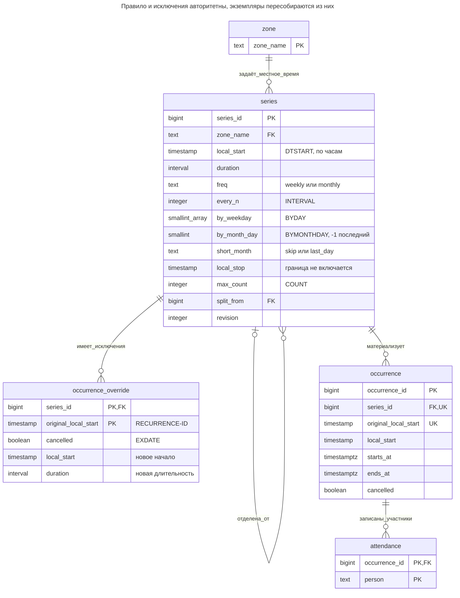
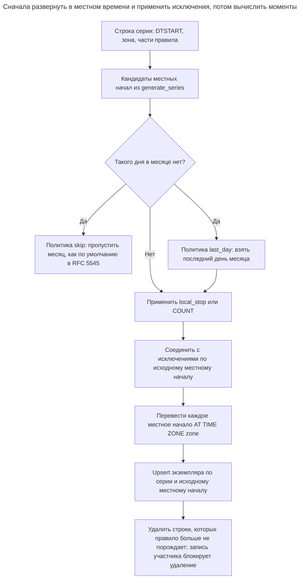
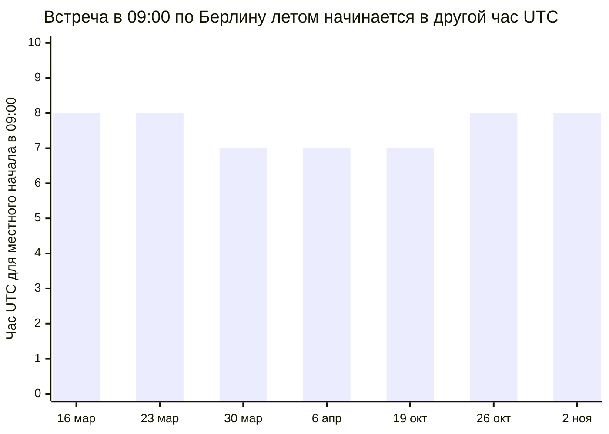
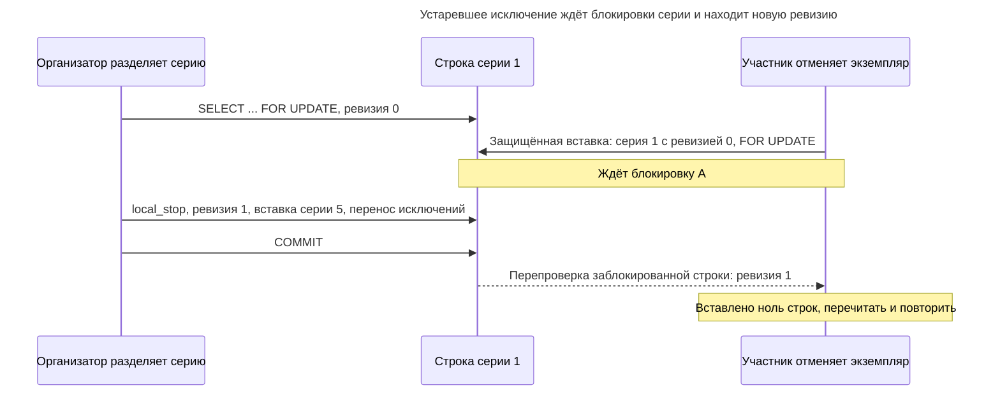

# Правило повторения

## Назначение

Правило повторения хранит повторяющееся событие одной строкой серии вместо множества строк событий. В строке лежат правило, первое местное время начала и зона IANA. Отдельная строка фиксирует каждый отменённый или перенесённый экземпляр, а необязательная таблица хранит экземпляры, материализованные на горизонт. Примеры — еженедельная встреча в 09:00 по берлинскому времени, счёт 31-го числа каждого месяца и занятие по вторникам и четвергам до июня. Глава разворачивает правило через `generate_series` в местном времени, решает, что означает 31-е число в феврале, и разделяет серию при правке «это и последующие». Она же пересобирает материализованные экземпляры после правки правила или обновления tzdata, не теряя исключений и записей участников. Словарь взят из [RFC 5545](https://www.rfc-editor.org/rfc/rfc5545) (iCalendar). Как местное время и имя зоны превращаются в момент, разобрано в главе [Момент времени](time-point.md).

## Также известен как

Повторяющееся событие; recurrence set — так RFC 5545 называет полный набор экземпляров. RFC 5545 даёт имена частям, которые хранит эта глава: [`RRULE`](https://www.rfc-editor.org/rfc/rfc5545#section-3.8.5.3) для правила, [`EXDATE`](https://www.rfc-editor.org/rfc/rfc5545#section-3.8.5.1) для исключённых экземпляров и [`RECURRENCE-ID`](https://www.rfc-editor.org/rfc/rfc5545#section-3.8.4.4) для исходного начала экземпляра, который переопределяет отдельный компонент. В статье Мартина Фаулера [Recurring Events for Calendars](https://martinfowler.com/apsupp/recurring.pdf) объект, который отвечает, в какие дни происходит событие, называется **Schedule**. Каждый **Schedule Element** в нём связывает событие с временным выражением, а выражения вроде «второй понедельник месяца» комбинируются объединением, пересечением и разностью. Статья работает с точностью до дня и называет отмену из-за праздников и перенос на другую дату паттернами, которые ещё предстоит описать.

## Проблема

Создавать по строке на каждую встречу заранее кажется простым, пока ничего не меняется. У еженедельной встречи нет естественной последней строки, поэтому кто-то выбирает дату отсечения. Перенос встречи с 09:00 на 10:00 означает обновление сотен строк, и ничто не отличает строки, которые человек правил вручную, от строк, записанных генератором. Если строки хранят моменты UTC, полученные как «первый момент плюс семь дней», встреча в 09:00 по Берлину в первый понедельник летнего времени становится встречей в 10:00. Обновление tzdata, которое меняет будущий переход, делает неверными все сохранённые моменты.

Хранение одного только правила ломается с другой стороны. Вопрос «что во вторник?» требует развернуть каждую серию. Записи на встречу или отметке о посещении не на что ссылаться, а отмене одной встречи негде жить. Это место должно пережить следующее развёртывание, чтобы правка правила или пересборка не вернули отменённую встречу.

Календарная арифметика добавляет свою ловушку. У правила «ежемесячно 31-го» нет ответа для февраля: RFC 5545 [игнорирует несуществующие даты](https://www.rfc-editor.org/rfc/rfc5545#section-3.3.10) и пропускает такой месяц целиком, а бухгалтерия обычно ждёт последний день месяца. Многократное прибавление `interval '1 month'` даёт третий ответ, который не нужен никому: 31-е съезжает на 28-е и там остаётся.

## Решение

Разделите данные по тому, что в них главное:

- **Серия** — правило. Первый экземпляр (`DTSTART`) как местный `timestamp`, имя зоны, длительность и части правила: частота, интервал, дни недели или день месяца, политика для коротких месяцев и либо граница окончания, либо число повторений. Серия авторитетна и меняется только через писателя, который берёт блокировку.
- **Исключение** — по строке на изменённый экземпляр, ключ — серия и **исходное местное начало** экземпляра, то есть `RECURRENCE-ID` из RFC 5545. Строка либо отменяет экземпляр (`EXDATE`), либо переносит его и меняет длительность. Исключения тоже авторитетны.
- **Экземпляр** — необязательная производная проекция на горизонт: правило, развёрнутое в местном времени, с применёнными исключениями, где каждое местное начало переведено в момент через `AT TIME ZONE`. Строки вставляются через upsert по `(series_id, original_local_start)`, поэтому экземпляр сохраняет свой ID при пересборке, и записи участников ссылаются на него обычным внешним ключом.

Разворачивайте в местном времени и переводите каждое местное начало отдельно; никогда не шагайте моментом. Опознавайте экземпляр по исходному местному началу, а не по вычисленному моменту и не по номеру в последовательности: правка правила перенумеровывает позиции, а обновление tzdata меняет моменты. Правку «это и последующие» моделируйте как окончание одной серии и начало её преемницы. Каждый писатель блокирует строку серии: правка правила, запись исключения и материализатор.

## Альтернативы и выбор

| Вариант | Отношение | Решающее требование |
| --- | --- | --- |
| Только явные строки экземпляров | Замена | Экземпляров мало, даты нерегулярны или каждый экземпляр планируется и правится сам по себе; правила, которое нужно хранить, нет |
| Правило и исключения, развёртывание при чтении | Вариант реализации | Ничто не ссылается на конкретный экземпляр, а чтения охватывают короткие окна немногих серий |
| Правило, исключения и материализованные экземпляры | Вариант реализации, полная форма из этой главы | Записям участников нужны внешние ключи, или вопрос «что во вторник» по многим сериям должен идти по индексу |
| Столбец с текстом `RRULE` | Вариант реализации | Вы обмениваетесь событиями с клиентами iCalendar и разворачиваете их библиотекой; база не может проверить части правила |
| [Период действия](effective-dating.md) | Дополнение | Версии правила действуют в бизнес-периодах; разделение серии — это период действия правила |
| [Резервирование](reservation.md) | Дополнение | Каждый материализованный экземпляр занимает ограниченный ресурс, например комнату, и заявкам нужно правило пересечения или количества |
| [История статусов](status-history.md) | Дополнение | Нужно хранить, кто отменил или перенёс экземпляр, когда и почему |
| [Таблица итогов](summary-table.md) | Дополнение с тем же контрактом | Относитесь к материализованным экземплярам как к проекции с заданной свежестью и путём полной пересборки |

Полное сравнение — в [Атласе решений](decision-atlas.md). Структурированные столбцы и текст `RRULE` могут жить вместе: храните импортированный текст как запись того, что прислал клиент, а генерируйте из столбцов, которые проверяет база.

## Структура



У исключения нет внешнего ключа на `occurrence`: оно должно существовать до материализованного горизонта и за ним и переживает каждую пересборку. `attendance` ссылается на стабильный `occurrence_id`, который upsert сохраняет для той же пары `(series_id, original_local_start)`. `split_from` запоминает, какую серию заменила правка «это и последующие».

## Таблицы и инварианты

- **`zone`** перечисляет имена зон из tzdata сервера, как в главе [Момент времени](time-point.md); опечатка в зоне отклоняется при записи.
- **`series`** хранит правило в типизированных столбцах. `series_weekly_shape` и `series_monthly_shape` разрешают только те части, которые относятся к частоте. `series_until_or_count` отклоняет границу окончания вместе с числом повторений, что RFC 5545 запрещает. `series_start_matches_rule` требует, чтобы `local_start` был экземпляром правила: попадал на указанный день недели, на заданный день месяца или на последний день при `-1`. RFC 5545 оставляет результат неопределённым, если `DTSTART` не соответствует правилу. `local_stop` не включается в серию, поэтому при разделении одна серия заканчивается ровно там, где начинается преемница. `revision` меняется при каждой правке правила.
- **`occurrence_override`** имеет первичный ключ `(series_id, original_local_start)`, поэтому у экземпляра не больше одного исключения, а `override_cancel_or_move` делает исключение либо отменой, либо переносом. Схема не проверяет, что правило порождает `original_local_start`. Это проверяет защищённый писатель ниже, а материализатор игнорирует исключение, чьё исходное начало правило больше не порождает.
- **`occurrence`** — производная таблица. `occurrence_natural_key` по `(series_id, original_local_start)` делает материализацию идемпотентной; `starts_at` и `ends_at` — кэшированные моменты, которые пересчитывает пересборка.
- **`attendance`** ссылается на конкретный экземпляр. Её внешний ключ не даёт пересборке удалить экземпляр, на который кто-то записался.

## Когда применять

- Люди воспринимают события как одно целое с правилом: «встреча по понедельникам», «ежемесячный выпуск счетов».
- Правки чаще касаются всей серии или всего после некоторой даты, чем отдельных экземпляров.
- Экземпляры обещаны в местном времени в зоне с переходами на летнее время.
- Вы обмениваетесь событиями с клиентами iCalendar, которые всё равно присылают `RRULE`, `EXDATE` и `RECURRENCE-ID`.

## Последствия и компромиссы

- ➕ Изменение одной строки правит будущее серии, а правило хранит то, о чём просил организатор.
- ➕ Исключения — явные строки, поэтому пересборка не может потерять отмену или перенос.
- ➕ Материализованные экземпляры дают обычные индексы и внешние ключи и при этом пересобираются из авторитетных данных.
- ➖ Генератор — ваш собственный код. Эта глава поддерживает еженедельные и ежемесячные правила с одним днём месяца; полный RFC 5545 (`BYSETPOS`, ежегодные правила, `RDATE`) — задача библиотеки или гораздо большей функции.
- ➖ Чтения за материализованным горизонтом ничего не возвращают, и это выглядит так же, как «ничего не запланировано». Расширяйте горизонт фоновой задачей и записывайте, докуда материализована каждая серия.
- ➖ Правка правила должна разобраться с исключениями и записями участников, которые ссылаются на экземпляры, больше не порождаемые новым правилом.
- ➖ Кэшированные моменты устаревают после обновления tzdata, пока материализатор не отработает снова.

## Реализация

[Полный скрипт для PostgreSQL 18.7](../assets/recurrence-rule/recurrence-rule.sql) проверяет поведение при переходе на летнее время, обе политики конца месяца, сползание ежемесячного шага, `COUNT` с отменённым экземпляром, проверки формы и выравнивания, исключения, идемпотентную материализацию, пересборку после tzdata, отклонённую правку правила, разделение серии и защищённую запись исключения. Скрипт задаёт `search_path` на свою схему, поэтому имена ниже без префикса. Таблица серий в сокращённом виде:

```sql
CREATE TABLE series (
    series_id bigint PRIMARY KEY,
    zone_name text NOT NULL REFERENCES zone (zone_name),
    local_start timestamp(0) NOT NULL,       -- DTSTART, wall clock
    duration interval NOT NULL CHECK (duration > interval '0'),
    freq text NOT NULL CHECK (freq IN ('weekly', 'monthly')),
    every_n integer NOT NULL DEFAULT 1,      -- INTERVAL
    by_weekday smallint[],                   -- BYDAY, ISO 1 = Monday
    by_month_day smallint,                   -- BYMONTHDAY, -1 = last day
    short_month text CHECK (short_month IN ('skip', 'last_day')),
    local_stop timestamp(0),                 -- exclusive, unlike UNTIL
    max_count integer CHECK (max_count > 0), -- COUNT
    split_from bigint REFERENCES series (series_id),
    revision integer NOT NULL DEFAULT 0,
    CONSTRAINT series_until_or_count CHECK (local_stop IS NULL OR max_count IS NULL),
    CONSTRAINT series_start_matches_rule CHECK (CASE freq
        WHEN 'weekly' THEN extract(isodow FROM local_start)::smallint = ANY (by_weekday)
        WHEN 'monthly' THEN CASE WHEN by_month_day = -1
            THEN local_start::date = (date_trunc('month', local_start)
                                      + interval '1 month' - interval '1 day')::date
            ELSE extract(day FROM local_start) = by_month_day END
        END)
);
```

`expand_series(series_id, until)` возвращает исходные местные начала. Для еженедельного правила функция перебирает дни через [`generate_series`](https://www.postgresql.org/docs/18/functions-srf.html) по `timestamp` с понедельника первой недели, оставляет указанные дни недели в каждой `every_n`-й неделе и добавляет время суток из начала серии. Для ежемесячного правила она шагает по первым числам месяцев, которые существуют всегда, и только потом выбирает день:

```sql
SELECT m + make_interval(days => picked.day_no - 1) + s.local_start::time
FROM s,
     generate_series(date_trunc('month', s.local_start), p_until,
                     make_interval(months => s.every_n)) AS m,
     LATERAL (SELECT extract(day FROM m + interval '1 month' - interval '1 day')::int
              AS month_days) AS len,
     LATERAL (SELECT CASE
                  WHEN s.by_month_day = -1 THEN len.month_days
                  WHEN s.by_month_day <= len.month_days THEN s.by_month_day
                  WHEN s.short_month = 'last_day' THEN len.month_days
              END AS day_no) AS picked
WHERE s.freq = 'monthly' AND picked.day_no IS NOT NULL
```

Затем функция отбрасывает кандидатов раньше `local_start` или начиная с `local_stop`, нумерует остальных и оставляет первые `max_count`. Исключения здесь не применяются. RFC 5545 строит набор экземпляров из правила и затем [исключает значения `EXDATE`](https://www.rfc-editor.org/rfc/rfc5545#section-3.8.5.1), поэтому отменённый экземпляр всё равно расходует одно из `COUNT`. Скрипт отменяет 31 марта в серии на 31-е число с `COUNT=3` и проверяет, что серия по-прежнему заканчивается 31 мая.



Часовой пояс появляется только в конце, по одному разу на экземпляр. Всё до этого шага работает со значениями по часам, поэтому встреча в 09:00 остаётся в 09:00 каждую неделю.

Встреча команды проходит еженедельно по понедельникам в 09:00 в зоне `Europe/Berlin` начиная с 16 марта 2026 года:

```sql
INSERT INTO series (series_id, title, zone_name, local_start, duration, freq, by_weekday)
VALUES (1, 'Team meeting', 'Europe/Berlin', '2026-03-16 09:00', '30 minutes',
        'weekly', '{1}');
SELECT e.original_local_start, e.original_local_start AT TIME ZONE s.zone_name AS starts_at
FROM series AS s, expand_series(s.series_id, TIMESTAMP '2026-04-07') AS e
WHERE s.series_id = 1;
```

У каждой строки местное время 09:00, а `starts_at` равен `08:00+00` 16 и 23 марта и `07:00+00` начиная с 30 марта, после перехода Берлина на летнее время. Скрипт проверяет и осенний переход: 26 октября момент возвращается к `08:00+00`.



Местное значение не меняется никогда, меняется только его момент. Генератор, который шагает моментом, держал бы столбцы на одном уровне и всё лето переносил бы встречу на 10:00 по местному времени. Именно это делает `generate_series(TIMESTAMPTZ '2026-03-23 08:00+00', ..., interval '7 days')` в сеансе с зоной UTC: он возвращает `2026-03-30 08:00+00`, то есть 10:00 в Берлине. Начиная с PostgreSQL 16 форма для `timestamptz` принимает аргумент зоны, и `generate_series(..., interval '7 days', 'Europe/Berlin')` возвращает `07:00+00`. Но в ней нет места для дней недели, политики конца месяца и исключений, поэтому серия хранит местные значения.

Местное начало может попасть в пропущенный час весеннего перехода. У еженедельной задачи в 02:30 по воскресеньям есть экземпляр в 02:30 29 марта 2026 года, а такого времени в Берлине нет. Эта схема сохраняет экземпляр и позволяет `AT TIME ZONE` перевести его в 03:30 летнего времени по правилу из главы [Момент времени](time-point.md). RFC 5545 требует такой экземпляр [игнорировать](https://www.rfc-editor.org/rfc/rfc5545#section-3.3.10), поэтому клиент iCalendar его не покажет. Выберите одно поведение и зафиксируйте его. Проверка туда и обратно `(local AT TIME ZONE zone) AT TIME ZONE zone <> local` находит затронутые экземпляры, и скрипт проверяет, что она возвращает ровно 29 марта.

Для 31-го числа две политики дают разные наборы с января по июнь 2026 года:

| Серия | Экземпляры |
| --- | --- |
| `by_month_day = 31`, `short_month = 'skip'` | 31 янв, 31 мар, 31 мая |
| `by_month_day = 31`, `short_month = 'last_day'` | 31 янв, 28 фев, 31 мар, 30 апр, 31 мая, 30 июн |
| `generate_series(TIMESTAMP '2026-01-31', ..., interval '1 month')` | 31 янв, 28 фев, 28 мар, 28 апр |
| `TIMESTAMP '2026-01-31' + n * interval '1 month'` | 31 янв, 28 фев, 31 мар, 30 апр |

`generate_series` прибавляет шаг к предыдущему значению, поэтому после того как февраль обрезал 31-е до 28-го, все следующие месяцы остаются на 28-м. Умножение шага от опорной даты обрезает каждый месяц независимо. [RFC 7529](https://www.rfc-editor.org/rfc/rfc7529) стандартизирует этот выбор как `SKIP=OMIT`, `BACKWARD` или `FORWARD`, но только вместе со своим элементом `RSCALE`; обычный RFC 5545 всегда пропускает месяц.

Исключения — строки с ключом по исходному местному началу. Встреча в Пасхальный понедельник переносится на вторник в 11:00, а вечернее занятие в День Вознесения отменяется:

```sql
INSERT INTO occurrence_override (series_id, original_local_start, local_start)
VALUES (1, '2026-04-06 09:00', '2026-04-07 11:00');
INSERT INTO occurrence_override (series_id, original_local_start, cancelled)
VALUES (2, '2026-05-14 18:00', true);
```

`materialize(series_id, from, to)` блокирует строку серии, выполняет upsert экземпляров в окне и удаляет те, которых правило больше не порождает. Upsert использует [`ON CONFLICT`](https://www.postgresql.org/docs/18/sql-insert.html) по естественному ключу и меняет строку, только если её значения отличаются:

```sql
INSERT INTO occurrence AS oc
    (series_id, original_local_start, local_start, starts_at, ends_at, cancelled)
SELECT s.series_id, e.original_local_start, x.local_start,
       x.local_start AT TIME ZONE s.zone_name,
       (x.local_start + coalesce(o.duration, s.duration)) AT TIME ZONE s.zone_name,
       coalesce(o.cancelled, false)
FROM series AS s
CROSS JOIN LATERAL expand_series(s.series_id, p_to) AS e
LEFT JOIN occurrence_override AS o
       ON o.series_id = s.series_id AND o.original_local_start = e.original_local_start
CROSS JOIN LATERAL (SELECT coalesce(o.local_start, e.original_local_start)
                    AS local_start) AS x
WHERE s.series_id = p_series_id AND e.original_local_start >= p_from
ON CONFLICT (series_id, original_local_start) DO UPDATE
SET local_start = EXCLUDED.local_start, starts_at = EXCLUDED.starts_at,
    ends_at = EXCLUDED.ends_at, cancelled = EXCLUDED.cancelled
WHERE (oc.local_start, oc.starts_at, oc.ends_at, oc.cancelled)
      IS DISTINCT FROM
      (EXCLUDED.local_start, EXCLUDED.starts_at, EXCLUDED.ends_at, EXCLUDED.cancelled);
```

Отменённые экземпляры остаются строками с `cancelled = true`, поэтому записи на них остаются корректными, а календарь может показать отмену. Вопрос «что во вторник, 7 апреля, в Берлине?» теперь превращается в диапазон по индексу за местные сутки, как в главе [Момент времени](time-point.md):

```sql
SELECT s.title, o.local_start
FROM occurrence AS o JOIN series AS s USING (series_id)
WHERE NOT o.cancelled
  AND o.starts_at >= TIMESTAMP '2026-04-07 00:00' AT TIME ZONE 'Europe/Berlin'
  AND o.starts_at <  TIMESTAMP '2026-04-08 00:00' AT TIME ZONE 'Europe/Berlin';
```

Запрос возвращает перенесённую встречу в 11:00 и занятие в 18:00. Повторный запуск материализатора для того же окна ничего не меняет. Обычная вставка уже существующего экземпляра отклоняется с SQLSTATE `23505`: `ERROR: duplicate key value violates unique constraint "occurrence_natural_key"`, `DETAIL: Key (series_id, original_local_start)=(1, 2026-03-16 09:00:00) already exists.`

Чтобы изобразить обновление tzdata, скрипт сдвигает все кэшированные моменты встречи на час и снова запускает материализатор. Моменты исправляются, перенесённый экземпляр остаётся во вторник в 11:00 и сохраняет свой `occurrence_id` и запись участника. Настоящее обновление требует того же шага: запускайте материализатор на весь горизонт после каждого обновления сервера, которое меняет tzdata.

Правка правила, которая убирает экземпляр с записью участника, отклоняется. Если занятие переводят со вторника и четверга только на вторник, а на один из четвергов в мае уже есть запись, удаление в материализаторе падает с SQLSTATE `23503`: `ERROR: update or delete on table "occurrence" violates foreign key constraint "attendance_occurrence_id_fkey" on table "attendance"`, `DETAIL: Key (occurrence_id)=(26) is still referenced from table "attendance".` Тогда правке нужно решение о таких записях: перенести их, отменить экземпляр вместо удаления или уведомить людей.

Схема отклоняет и некорректные правила. Занятие по вторникам и четвергам, которое начинается в среду, или серия на 31-е число, которая начинается 15-го, падает с SQLSTATE `23514`: `ERROR: new row for relation "series" violates check constraint "series_start_matches_rule"`. Установка `local_stop` для серии с `max_count` нарушает `series_until_or_count` с тем же SQLSTATE.

Правка «это и последующие» переносит встречу на 10:00 начиная с 20 апреля. В одной транзакции писатель:

1. Блокирует серию 1 и ставит ей `local_stop` в `2026-04-20 09:00`.
2. Вставляет серию 5 с тем же правилом, `local_start = '2026-04-20 10:00'` и `split_from = 1`.
3. Переносит исключения начиная с границы в серию 5, сдвигая их исходное начало на тот же час. Так устроен `RANGE=THISANDFUTURE` в RFC 5545: последующие экземпляры переносятся на ту же разницу во времени.
4. Материализует серию 5 и перенаправляет записи участников со старых экземпляров на новые с соответствующим сдвинутым исходным началом.
5. Материализует серию 1 начиная с границы; это удаляет старые будущие экземпляры, на которые больше ничто не ссылается.

```mermaid
---
title: Разделение заканчивает старую серию на границе и переносит исключения и записи вперёд
config:
  gantt:
    useWidth: 900
    fontSize: 16
    sectionFontSize: 16
---
gantt
    dateFormat YYYY-MM-DD
    axisFormat %d.%m
    section Серия 1
    Понедельники 09:00 до границы :done, s1, 2026-03-16, 2026-04-20
    section Серия 5
    Понедельники 10:00 от границы :active, s5, 2026-04-20, 2026-06-30
    Запись перенесена на 27.04 10:00 :milestone, bk, 2026-04-27, 0d
    Отмена перенесена на 04.05 10:00 :crit, ov, 2026-05-04, 1d
```

Прошлая часть серии 1 не меняется, поэтому посещения 6 и 13 апреля по-прежнему ссылаются на экземпляры в 09:00. Если старая серия была ограничена `COUNT`, дайте преемнице остаток: старое число минус экземпляры до границы. Исключения, чьё исходное начало новое правило не порождает, например после смены дня недели, механически не сдвинуть; покажите их организатору списком, а не удаляйте молча.

## Поддержка в движках

- **PostgreSQL 18:** `generate_series` по `timestamp` порождает местных кандидатов; [форма для `timestamptz`](https://www.postgresql.org/docs/18/functions-srf.html) принимает необязательную зону и вычисляет в ней сутки и переходы на летнее время. `timestamp + n * interval '1 month'` обрезает день до последнего дня короткого месяца, что проверяет скрипт. Уникальный ключ и `ON CONFLICT` делают материализацию идемпотентной.
- **MySQL 8.4:** `generate_series` нет; используйте [рекурсивное CTE](https://dev.mysql.com/doc/refman/8.4/en/with.html), глубину которого ограничивает `cte_max_recursion_depth`, по умолчанию 1000. [`DATE_ADD` с `MONTH`](https://dev.mysql.com/doc/refman/8.4/en/date-and-time-functions.html) заменяет несуществующий день последним днём месяца, поэтому прибавляйте месяцы к опорной дате, а не к предыдущему результату. `CONVERT_TZ` с именами зон требует загруженных таблиц часовых поясов.
- **SQL Server 2025 (17.x):** [`GENERATE_SERIES`](https://learn.microsoft.com/en-us/sql/t-sql/functions/generate-series-transact-sql?view=sql-server-ver17) порождает только числа и требует уровня совместимости 160; прибавляйте их к опорной дате через `DATEADD`. [`DATEADD(month, ...)`](https://learn.microsoft.com/en-us/sql/t-sql/functions/dateadd-transact-sql?view=sql-server-ver17) возвращает последний день месяца, если нужного дня в нём нет. Перевод зон использует имена зон Windows, как описано в главе [Момент времени](time-point.md).
- **Oracle AI Database 26ai:** [`ADD_MONTHS`](https://docs.oracle.com/en/database/oracle/oracle-database/26/sqlrf/ADD_MONTHS.html) возвращает последний день результирующего месяца, если на входе последний день месяца. Цепочка от 28 февраля поэтому прыгает на 31 марта; прибавляйте месяцы к опорной дате.
- **SQLite 3:** сдвиг даты на месяцы [неоднозначен по определению](https://www.sqlite.org/lang_datefunc.html): модификатор по умолчанию `ceiling` переносит несуществующий день в следующий месяц, а `floor` даёт последний день месяца. Имён зон SQLite не знает, поэтому разворачивайте правила в приложении и храните местные значения вместе с зоной.

## Сбои и конкурентность

Типичная гонка — исключение, записанное против старой версии правила. Организатор разделяет серию, а клиент участника в это время отменяет экземпляр, который он показывал до разделения:



Писатель исключения выбирает строку серии с [`FOR UPDATE`](https://www.postgresql.org/docs/18/explicit-locking.html#LOCKING-ROWS), с ревизией, которую прочитал его клиент, и с проверкой, что исходное начало — экземпляр текущего правила, и вставляет строку, только если этот выбор что-то вернул. После ожидания PostgreSQL перепроверяет условие на `revision` по зафиксированной строке, поэтому устаревший писатель ничего не вставляет. Без `FOR UPDATE` писатель читает ревизию 0 из своего снимка, ждёт только проверку внешнего ключа и вставляет исключение, которое разделение уже перенесло дальше. Лабораторный скрипт проверяет защиту в одном сеансе; гонка двух сеансов проверена отдельно на PostgreSQL 18.7 с блокировкой и без неё. Это паттерн [Столбец версии](version-column.md), применённый к серии.

Материализатор берёт ту же блокировку, поэтому никогда не соединяет новое правило с наполовину перенесёнными исключениями. Два задания материализации одной серии выстраиваются в очередь на этой блокировке, а уникальный ключ `(series_id, original_local_start)` страхует от писателя, который о ней забыл: повторная вставка падает, а upsert превращает второй запуск в пустую операцию. Обрабатывайте каждую серию в своей транзакции, чтобы после сбоя серия была либо пересобрана целиком, либо не тронута, и записывайте достигнутый горизонт для каждой серии, чтобы перезапущенное задание знало, откуда продолжать.

Читатели `occurrence` видят только зафиксированные проекции. Пока транзакция правки правила не завершилась, они видят старые экземпляры; это правильно, потому что правка фиксирует правило, исключения, записи участников и проекцию вместе.

## Миграция

От строки на каждый экземпляр сгруппируйте строки в кандидатов на серии по названию, дню недели или дню месяца, местному времени суток и зоне. Для каждого кандидата разверните предлагаемое правило и сравните с существующими строками. Сгенерированное начало без строки становится исключением-отменой, строка в другое время — исключением-переносом, а строка, не подходящая ни под одно правило, остаётся отдельным событием. Вставьте существующие строки в `occurrence` с ключом `(series_id, original_local_start)` и сохраните их ID, чтобы записи участников не сдвинулись. Переключите писателей на таблицы серий и исключений, затем выключите старый генератор через [Расширение и свёртывание](expand-contract.md).

От моментов UTC сначала восстановите местное начало и зону каждого события, как описано в главе [Момент времени](time-point.md); без зоны правило не восстановить. Из импортированного текста `RRULE` разберите в столбцы части, которые поддерживает ваш генератор, сохраните текст, а правила с неподдерживаемыми частями оставьте библиотеке, пока не расширите генератор. Чтобы откатиться, продолжайте материализовать длинный горизонт и обслуживайте чтения только из `occurrence`: эти строки остаются обычными строками событий.

## Антипаттерны и частые ошибки

- Шагать моментом на `interval '7 days'` в UTC: местная встреча дважды в год сдвигается на час.
- Опознавать экземпляр по вычисленному моменту или порядковому номеру, которые меняются при обновлении tzdata или правке правила.
- Править материализованную строку, чтобы отменить или перенести экземпляр: следующая пересборка вернёт значение из правила.
- Многократно прибавлять `+ interval '1 month'` или шагать `generate_series` по месяцу от 31-го числа: дата съезжает на 28-е.
- Править правило на месте при изменении «это и последующие»: так переписываются и прошлые экземпляры вместе с их посещениями.
- Считать пустой результат за материализованным горизонтом ответом «ничего не запланировано».
- Выгружать невключаемую границу `local_stop` как `UNTIL` без изменений: [`UNTIL`](https://www.rfc-editor.org/rfc/rfc5545#section-3.3.10) в RFC 5545 включается в серию и для `DTSTART` с зоной должен быть записан в UTC, а это зависит от tzdata в момент выгрузки.
- Хранить строку `RRULE` без её `DTSTART` и зоны: само правило не говорит, когда и где.

## Известные применения

- [Ресурс Events](https://developers.google.com/workspace/calendar/api/v3/reference/events) в Google Calendar API хранит `recurrence` как список строк `RRULE`, `EXRULE`, `RDATE` и `EXDATE` по RFC 5545. Экземпляр несёт `recurringEventId` и `originalStartTime`, который опознаёт его внутри серии даже после переноса: это тот же ключ, что `original_local_start` в этой главе.
- [`rrule` из dateutil](https://dateutil.readthedocs.io/en/stable/rrule.html) для Python реализует правила повторения iCalendar, а `rruleset` — даты исключений; это библиотека того рода, который нужен, когда генератор должен покрыть весь RFC.
- [RFC 7529](https://www.rfc-editor.org/rfc/rfc7529) добавляет элемент `SKIP`, потому что пропуск несуществующих дат удивляет пользователей, например день рождения 29 февраля, который появляется в календаре раз в четыре года.

## Связанные паттерны

- [Момент времени](time-point.md) объясняет местное время с зоной IANA и разрешение пропущенных и повторённых часов.
- [Период действия](effective-dating.md) моделирует версии правила в бизнес-периодах; разделение серии — одна такая граница.
- [Резервирование](reservation.md) добавляет правила ёмкости, когда экземпляр занимает комнату или место.
- [История статусов](status-history.md) хранит, кто отменил или перенёс экземпляр и почему.
- [Столбец версии](version-column.md) даёт проверку ревизии, которая отклоняет устаревшие исключения.
- [Таблица итогов](summary-table.md) описывает производную проекцию с тем же контрактом пересборки и свежести.
- [Расширение и свёртывание](expand-contract.md) переводит писателей от сгенерированных строк к сериям без простоя.
