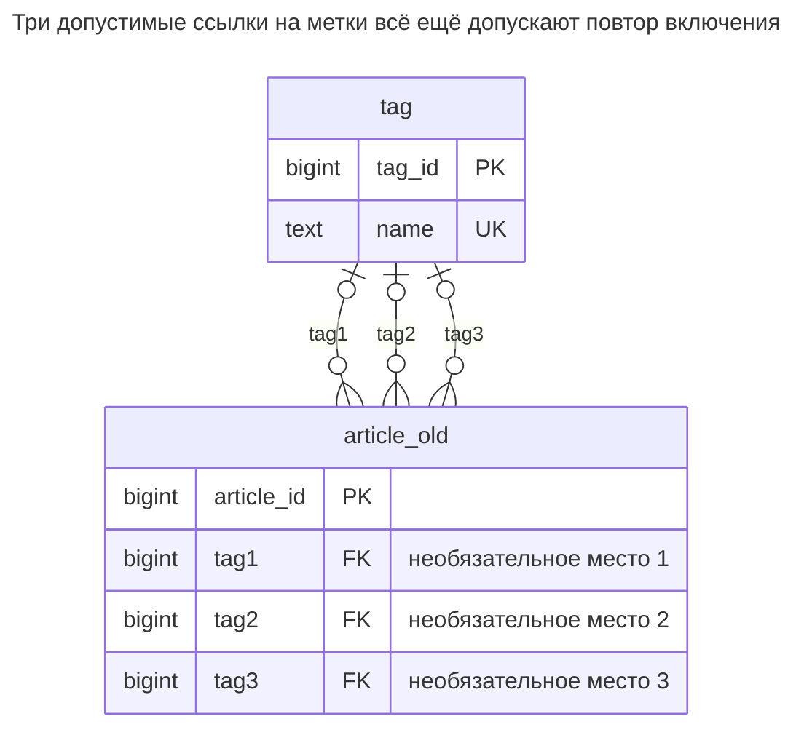
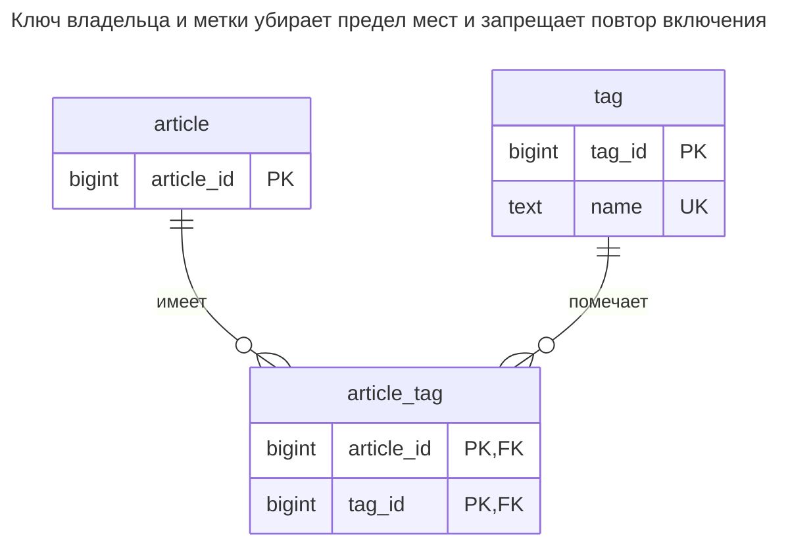
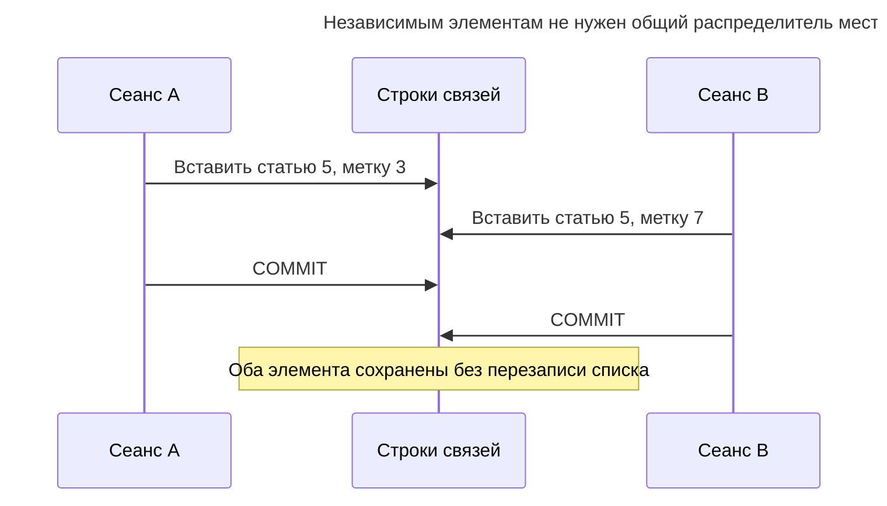
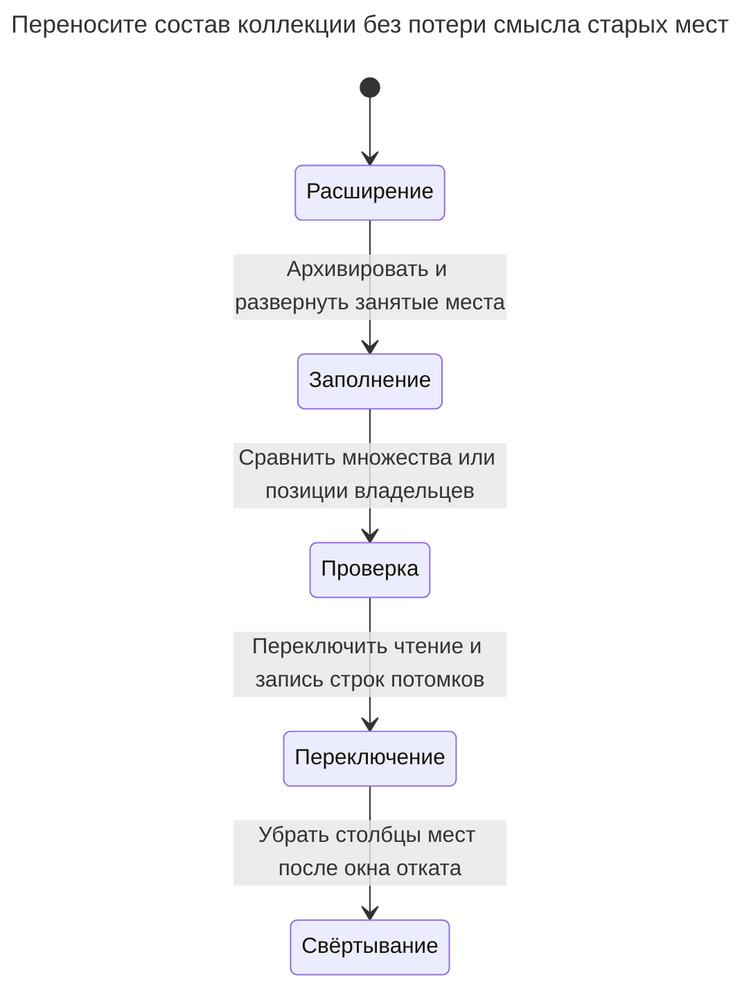

# Повторяющиеся столбцы

Повторяющиеся столбцы моделируют несколько значений одного атрибута нумерованными столбцами: `tag1`, `tag2`, `tag3` или `phone_home`, `phone_work`, `phone_mobile`. Поиск проверяет каждый столбец, уникальность между ними требует явного межстолбцового ограничения, а четвёртое значение — миграции. Глава показывает ломающиеся запросы и переход к дочерней таблице, отличая это от действительно разных атрибутов. Билл Карвин называет это Multicolumn Attributes.

## Также известен как

Multicolumn Attributes в [оглавлении SQL Antipatterns Билла Карвина](https://pragprog.com/titles/bksap1/sql-antipatterns-volume-1/). Здесь проблема — расширяемая коллекция, замаскированная под фиксированный кортеж полей.

## Контекст

Вы разрешаете статье несколько меток, сначала не более трёх. Добавляете `tag1`, `tag2` и `tag3`, возможно с внешним ключом у каждого. Каждое место легко показать в форме. Позже пользователи хотят ещё одну метку, поиск по любой метке или временную метку у одного включения.

## Проблема

Вы встраиваете число элементов коллекции в определение таблицы. Четвёртая метка требует изменения хранения и всех читателей, перечисляющих места. Метка повторяется в двух столбцах, даже если каждый отдельно ссылается на существующую метку. Уникальность `(tag1, tag2, tag3)` сравнивала бы полные строки, а не требовала разных значений внутри строки; PostgreSQL описывает различие в [правилах уникальных ограничений](https://www.postgresql.org/docs/18/ddl-constraints.html#DDL-CONSTRAINTS-UNIQUE-CONSTRAINTS).

Межстолбцовые проверки отклоняют повторные значения без `NULL`. Для действительно фиксированного кортежа это корректное исправление, но оно растёт вместе с числом мест и не убирает произвольную вместимость. Не называйте разные атрибуты повторяющейся группой лишь из-за одного типа: `starts_at` и `ends_at` выполняют разные роли. Отдельные домашний и рабочий телефоны также оправданы, если каждый представляет одну стабильную бизнес-роль; они не заменяют произвольные подписанные телефонные записи.

## Почему так делают

Первая форма содержит три поля, а три столбца избавляют от вставок потомков и соединения. Фиксированная координата из двух компонентов, ограниченный рейтинг или явный кортеж ролей могут заслуживать такой формы. Соблазн становится вредным, когда текущий предел интерфейса принимают за постоянный предел предметной области.

## Последствия

- ➖ Поиск и агрегация перечисляют все места.
- ➖ Увеличение вместимости меняет DDL, SQL приложения и форматы экспорта.
- ➖ Повторные включения занимают разные места без нарушения показанных внешних ключей.
- ➖ Метаданные включения размножаются в `tag1_added_at`, `tag2_added_at` и подобные поля.
- ➖ Порядок мест получает случайный смысл, если значимость позиций не определена.

## Признаки

- Новые требования регулярно добавляют следующий нумерованный столбец.
- Каждый поиск использует длинный `OR` по взаимозаменяемым полям.
- Вы считаете занятые места, хотя вопрос касается разных элементов.
- Атрибуты значения наследуют тот же числовой суффикс, что его столбец.

## Как лучше

Используйте строку потомка на значение с ID владельца в ключе. Для общих меток это [Таблица связей](association-table.md). Первичный ключ владельца и метки делает состав множеством; необязательная позиция — отдельное требование упорядочивания. До выяснения смысла исходных мест сохраняйте их отображение при миграции.

### Альтернативы и выбор

| Выбор | Связь | Когда выбирать |
| --- | --- | --- |
| [Таблица связей](association-table.md) | Замена | Элементы ссылаются на общий набор, например метки |
| Собственная дочерняя таблица | Замена | Контактные способы и подобные значения принадлежат одному владельцу, имеют подпись и жизненный цикл |
| Столбцы фиксированных ролей | Вариант реализации | У каждого столбца своя постоянная роль с не более чем одним значением |
| [Списки с разделителями](delimited-lists.md) | Другой вид ошибки | Упаковка коллекции в текст теряет уже имеющиеся внешние ключи отдельных элементов |

Полная таблица — в [Атласе решений](decision-atlas.md). Не заменяйте осмысленный фиксированный кортеж нетипизированной таблицей ключей и значений лишь ради отказа от любых столбцов с `NULL`.

## Пример

### Структура

**Было:** у каждого места есть внешний ключ, но места конкурируют за представление одного вида фактов.



Три линии — отдельные необязательные ссылки. Ни один внешний ключ не сравнивает своё значение с другими местами.

```sql
CREATE TABLE tag (tag_id bigint PRIMARY KEY, name text NOT NULL UNIQUE);
CREATE TABLE article_old (
    article_id bigint PRIMARY KEY,
    tag1 bigint REFERENCES tag (tag_id),
    tag2 bigint REFERENCES tag (tag_id),
    tag3 bigint REFERENCES tag (tag_id)
);
INSERT INTO tag VALUES (3, 'sql'), (7, 'schema'), (12, 'keys'), (15, 'queries');
INSERT INTO article_old VALUES (1, 3, 7, 3), (2, NULL, 12, NULL);
SELECT article_id FROM article_old
WHERE tag1 = 12 OR tag2 = 12 OR tag3 = 12;
SELECT article_id, tag1, tag2, tag3 FROM article_old WHERE article_id = 1;
```

Поиск находит статью `2`. Статья `1` хранит `(3, 7, 3)`, поэтому подсчёт занятых мест дал бы три метки вместо двух в предполагаемом множестве.

**Стало:** добавляем элементы строками, не изменениями схемы.



Два внешних ключа сохраняют существование целей. Ключ пары добавляет недостающую между местами уникальность.

```sql
CREATE TABLE article (article_id bigint PRIMARY KEY);
CREATE TABLE article_tag (
    article_id bigint NOT NULL REFERENCES article (article_id),
    tag_id bigint NOT NULL REFERENCES tag (tag_id),
    CONSTRAINT article_tag_pkey PRIMARY KEY (article_id, tag_id)
);
CREATE INDEX article_tag_tag_idx ON article_tag (tag_id, article_id);
CREATE TABLE tag_slot_archive (
    article_id bigint NOT NULL,
    slot integer NOT NULL,
    tag_id bigint NOT NULL,
    PRIMARY KEY (article_id, slot)
);
BEGIN;
LOCK TABLE article_old IN SHARE ROW EXCLUSIVE MODE;
INSERT INTO article SELECT article_id FROM article_old;
INSERT INTO tag_slot_archive
SELECT a.article_id, v.slot, v.tag_id FROM article_old AS a
CROSS JOIN LATERAL (VALUES (1, a.tag1), (2, a.tag2), (3, a.tag3)) AS v(slot, tag_id)
WHERE v.tag_id IS NOT NULL;
INSERT INTO article_tag SELECT DISTINCT article_id, tag_id FROM tag_slot_archive;
COMMIT;
INSERT INTO article_tag VALUES (1, 12), (1, 15);
SELECT tag_id FROM article_tag WHERE article_id = 1 ORDER BY tag_id;
SELECT article_id FROM article_tag WHERE tag_id = 12 ORDER BY article_id;
```

Теперь у статьи `1` метки `3, 7, 12, 15`: четыре элемента без дополнительного столбца. Обратный поиск `12` возвращает статьи `1, 2`. Архив сохраняет все четыре исходных занятых места, включая повтор `3`, поэтому преобразование в множество проверяемо.

```sql
INSERT INTO article_tag VALUES (1, 3);
```

PostgreSQL 18.6 возвращает SQLSTATE `23505`: `ERROR: duplicate key value violates unique constraint "article_tag_pkey"`. Уточнение называет `(article_id, tag_id)=(1, 3)`. [Полный скрипт](../assets/repeated-columns/repeated-columns.sql) проверяет данные до и после и эту ошибку.

### Поддержка в движках

- **PostgreSQL 18:** практикум использует [`LATERAL` с таблицей `VALUES`](https://www.postgresql.org/docs/18/queries-table-expressions.html#QUERIES-LATERAL) для разворачивания мест в строки. Это логика миграции; новому чтению разворачивание не нужно.
- **MySQL 8.4 / InnoDB:** [столбцам внешнего ключа нужны индексы](https://dev.mysql.com/doc/refman/8.4/en/create-table-foreign-keys.html). Переносите разворачивание синтаксисом движка, сохраняя обе ссылки и уникальность пары.
- **SQLite:** [включайте проверку внешних ключей для каждого соединения](https://www.sqlite.org/foreignkeys.html#fk_enable). Оставляйте компоненты пары явно обязательными.

### Сбои и конкурентность

Добавление отдельных строк связи не заменяет весь кортеж мест. Две конкурентные попытки добавления одного элемента всё ещё разрешаются уникальностью пары. [Обработка конфликтов уникальных индексов PostgreSQL](https://www.postgresql.org/docs/18/index-unique-checks.html) ждёт и повторно проверяет, не доверяя двум независимым предварительным проверкам приложения.



Если бизнес действительно ограничивает статью тремя метками, одна дочерняя таблица не обеспечивает совокупный предел. Сериализуйте добавления по владельцу до подсчёта либо спроектируйте иное явное правило ёмкости. Устранение физического предела мест не должно молча убирать настоящий бизнес-предел.

### Миграция

Определите, являются места позициями, ролями или взаимозаменяемыми ячейками. Разверните каждое занятое место и сохраните исходные позиции. Устраняйте повторы согласно решению: практикум объединяет их лишь потому, что метки — множество. Если у повторных мест противоречивые метаданные, сохраните и рассмотрите обе записи.



Пример приостанавливает запись источника. При миграции работающей системы поддерживайте обе формы под блокировкой владельца и заполняйте под ней же. Не принимайте четвёртый элемент, пока старые писатели не выведены или не способны его представить: откат к трём местам не сохранит четыре метки. Сохраняйте архив и исходные столбцы на время сверки; см. [Расширение и свёртывание](expand-contract.md).

## Связанные паттерны и антипаттерны

- [Таблица связей](association-table.md) моделирует принадлежность общему множеству.
- [Списки с разделителями](delimited-lists.md) подставляют другую кодировку той же проблемы коллекций.
- [Обязательные суррогаты](mandatory-surrogates.md) объясняют, почему одного ID потомка недостаточно вместо уникальности пары.
