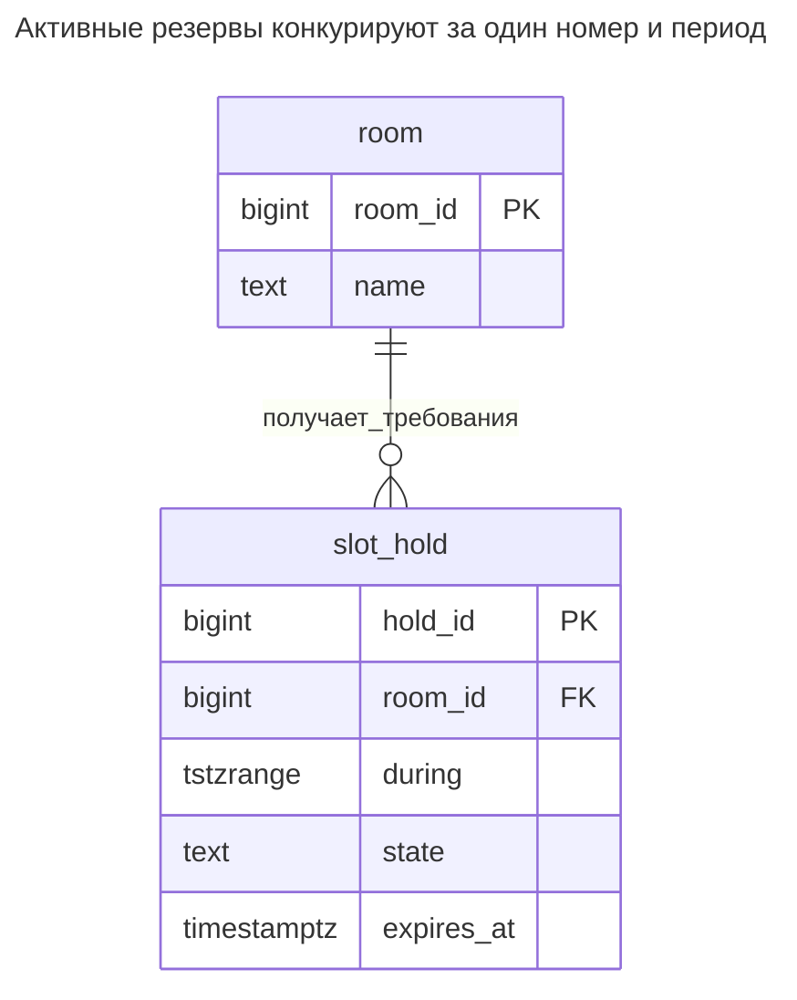
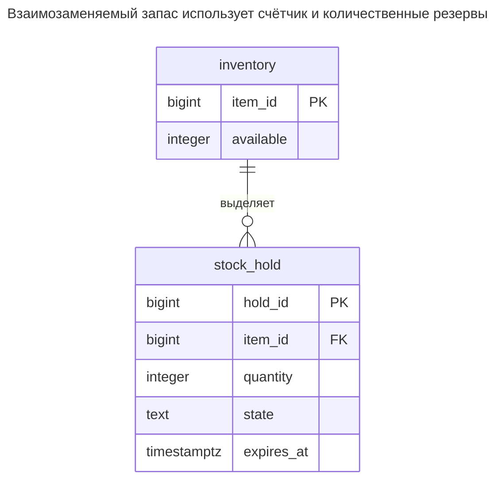
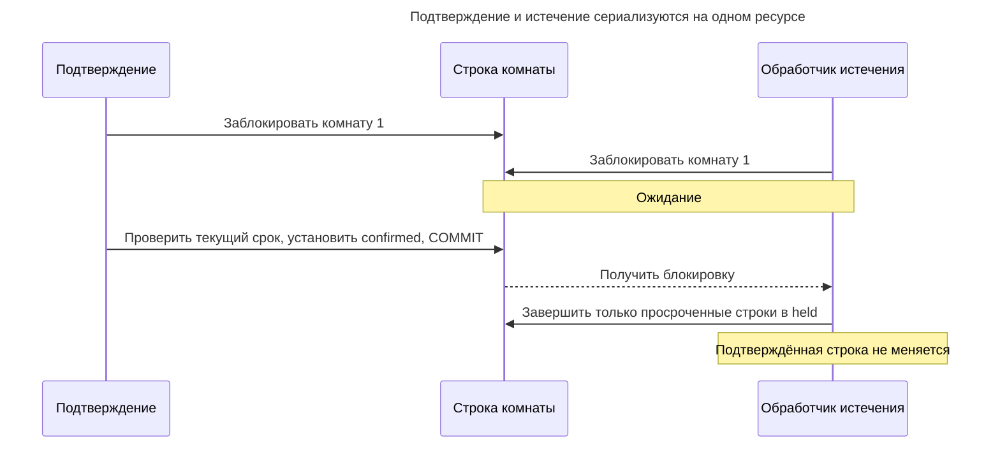
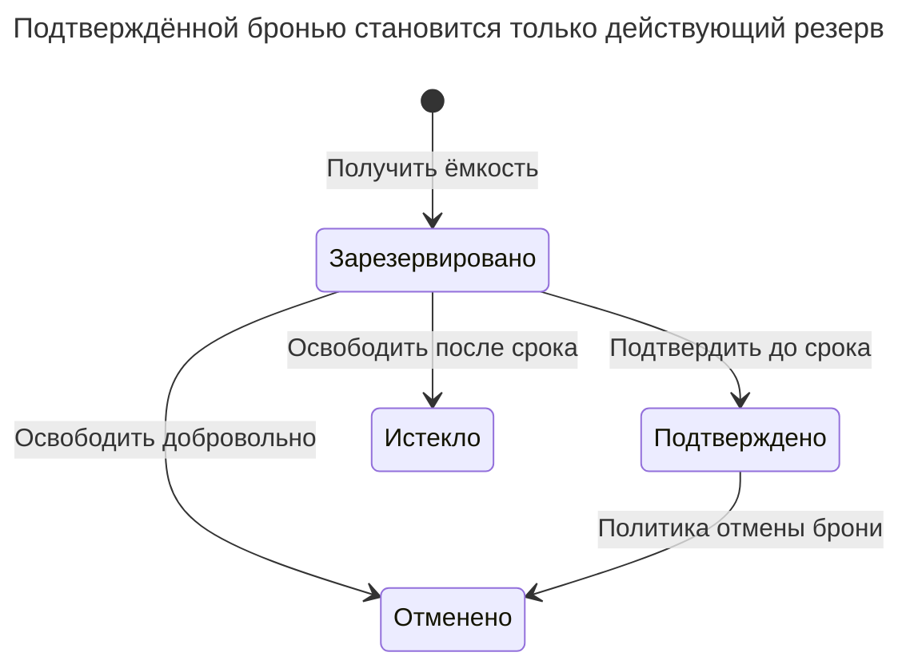

# Резервирование

## Назначение

Резервирование — временное требование на ограниченную ёмкость: гостиничный номер на определённые ночи, место в самолёте, товар в корзине. Без подтверждения оно истекает. Схема должна гарантировать, что требования не превышают ёмкость даже при конкурентных запросах: исключающими ограничениями временных диапазонов для интервалов и счётчиками с блокировками строк для количеств. Глава рассматривает резервы со сроком действия, подтверждение, отмену, очистку истёкших резервов и различия структуры временных интервалов и запасов.

## Также известен как

Inventory hold; booking hold; pending claim — резерв запаса, предварительная бронь, ожидающее требование. Названия описывают жизненный цикл этой главы. [Пример ограничения диапазонов PostgreSQL](https://www.postgresql.org/docs/18/rangetypes.html#RANGETYPES-CONSTRAINT) называет требования на комнаты reservations; истечение и количественный учёт ниже — дополнительные политики приложения.

## Проблема

Комната свободна, когда два клиента открывают страницу бронирования. Оба могут пройти проверку «пересекающейся брони нет» до первой вставки. Для запаса две корзины могут увидеть последние три единицы и потребовать по две. Транзакция вокруг запроса доступности без блокировки не устанавливает исключительное владение прочитанным.

Резерв также живёт дольше создающей его транзакции. Нужно освобождать брошенные требования, не позволяя просроченному подтверждению успешно конкурировать с новым клиентом. Доступность, срок резерва и бизнес-состояние должны согласовываться в точке фиксации решения.

## Решение

Представляйте резерв строкой с ресурсом-владельцем, периодом или количеством, сроком и явным состоянием. Для одного номера запрещайте пересечение активных периодов частичным исключающим ограничением равенства номера и пересечения диапазонов. Для взаимозаменяемого запаса атомарно уменьшайте неотрицательный счётчик доступного количества и вставляйте количественный резерв в той же транзакции.

Сделайте истечение записью из `held` в `expired`, а не фильтром запроса, молча меняющим смысл хранимых строк. Сериализуйте получение, подтверждение, отмену и истечение резервов номера на его стабильной строке. Для запаса используйте строку наличия как общую цель блокировки. Фоновый очиститель выполняет ту же операцию освобождения, что интерактивный запрос, без особого обходного пути.

## Альтернативы и выбор

| Соседний паттерн или представление | Связь | Определяющее требование |
| --- | --- | --- |
| [Период действия](effective-dating.md) | Дополнение; замена для постоянного расписания | Нужны периоды действия без временного требования и истечения |
| [Столбец версии](version-column.md) | Дополнение | Нужно отклонить устаревшую команду клиента; ёмкости всё равно нужно своё ограничение или согласованный счётчик |
| [Таблица очереди](queue-table.md) | Дополнение | Планируются попытки очистки, а истинное состояние активности хранит резерв |
| [Запись идемпотентности](idempotency-record.md) | Дополнение | Повтор получения возвращает тот же резерв вместо выделения нового |
| Строка на отдельное место или единицу | Вариант реализации | Важны индивидуальные единицы; обеспечьте одно активное требование на единицу вместо общего количества |
| [Двойная запись](double-entry-ledger.md) | Дополнение; замена хранения только балансов движений | Помимо временной доступности нужны сохраняющие количество движения с долговечным объяснением |

Полное сравнение — в [Атласе решений](decision-atlas.md). У одной комнаты ёмкость один **в каждый момент**, у счётчика запаса — ёмкость пула. Не применяйте запрет пересечений к пулу с допустимыми одновременными требованиями.

## Структура



Исключающее правило относится к строкам `held` и `confirmed`. Истёкшие и отменённые строки сохраняются для объяснения, но больше не занимают период. У комнаты может быть много смежных или непересекающихся активных броней.

## Таблицы и инварианты

- **`room`** идентифицирует одну бронируемую единицу и даёт цель блокировки даже без резервов.
- **`slot_hold`** требует непустого ограниченного полуоткрытого диапазона, допустимого состояния и срока. `slot_hold_no_overlap` отклоняет пересекающиеся активные диапазоны одной комнаты.
- **Истечение** обеспечивается переходом состояния под блокировкой комнаты. Подтверждайте только строку в `held`, чей срок строго позже текущего времени решения; сама граница срока уже означает истечение.
- **Количественная доступность** принадлежит отдельному варианту запасов ниже. Неотрицательность доступного — строчная проверка; согласованность счётчика с резервами — инвариант транзакционного протокола записи.

## Когда применять

- Оформлению покупки, бронированию или одобрению нужен короткий период гарантированной ёмкости до подтверждения.
- Можно определить ресурс, единицу, срок и политику запоздалого подтверждения.
- Нужно освобождать брошенную ёмкость, сохраняя старое требование для объяснения.

## Последствия и компромиссы

- ➕ Ограничение интервала отклоняет перебронирование даже при гонке предварительных проверок.
- ➕ Явные конечные состояния различают отмену и тайм-аут.
- ➖ Ёмкость недоступна до перехода истёкших строк. Если важно быстрое повторное использование, запускайте очистку при получении резерва и в фоне.
- ➖ Популярный ресурс или пул запаса становится точкой сериализации.
- ➖ Локальный срок не отменяет уже завершённый внешний платёж. Определите возврат или сверку для успеха платежа после истечения резерва.

## Реализация

[Полный скрипт PostgreSQL 18.6](../assets/reservation/reservation.sql) включает оба варианта, отказ пересечения, подтверждение, отмену и истечение. PostgreSQL описывает [исключение GiST по скалярному равенству и диапазонам](https://www.postgresql.org/docs/18/rangetypes.html#RANGETYPES-CONSTRAINT) с `btree_gist` для скалярной части:

```sql
CREATE EXTENSION IF NOT EXISTS btree_gist WITH SCHEMA public;
CREATE TABLE room (
    room_id bigint PRIMARY KEY,
    name text NOT NULL
);
CREATE TABLE slot_hold (
    hold_id bigint PRIMARY KEY,
    room_id bigint NOT NULL REFERENCES room (room_id),
    during tstzrange NOT NULL,
    state text NOT NULL CHECK (state IN ('held', 'confirmed', 'cancelled', 'expired')),
    expires_at timestamptz NOT NULL,
    CONSTRAINT slot_hold_period CHECK (
        NOT isempty(during) AND NOT lower_inf(during) AND NOT upper_inf(during)
        AND lower_inc(during) AND NOT upper_inc(during)
    ),
    CONSTRAINT slot_hold_no_overlap EXCLUDE USING gist (
        room_id WITH =, during WITH &&
    ) WHERE (state IN ('held', 'confirmed'))
);
CREATE INDEX slot_hold_expiry_idx ON slot_hold (room_id, expires_at)
WHERE state = 'held';
INSERT INTO room VALUES (1, 'Blue room');
BEGIN;
SELECT room_id FROM room WHERE room_id = 1 FOR UPDATE;
UPDATE slot_hold SET state = 'expired'
WHERE room_id = 1 AND state = 'held' AND expires_at <= clock_timestamp();
INSERT INTO slot_hold VALUES
    (1, 1, tstzrange('2027-01-01 10:00+00', '2027-01-01 11:00+00', '[)'),
     'held', clock_timestamp() + interval '10 minutes');
COMMIT;
```

Первый оператор после получения блокировки освобождает истёкшие резервы до вставки. Удерживайте блокировку до фиксации. [`clock_timestamp()`](https://www.postgresql.org/docs/18/functions-datetime.html#FUNCTIONS-DATETIME-CURRENT) PostgreSQL читает время исполнения; `CURRENT_TIMESTAMP` фиксирован на начале транзакции и после ожидания блокировки может устареть. Срок относится к резерву оформления независимо от забронированного периода услуги.

Подтверждайте под той же блокировкой и требуйте ровно одну обновлённую строку. Ноль строк означает, что резерв больше нельзя подтвердить; откатите или верните его существующий конечный исход по контракту API:

```sql
BEGIN;
SELECT room_id FROM room WHERE room_id = 1 FOR UPDATE;
UPDATE slot_hold SET state = 'confirmed'
WHERE room_id = 1 AND hold_id = 1 AND state = 'held'
  AND expires_at > clock_timestamp()
RETURNING hold_id, state;
COMMIT;
```

Результат — `(1, confirmed)`. Следующее конкурентное требование недопустимо даже с новым сроком:

```sql
-- Expected SQLSTATE 23P01.
INSERT INTO slot_hold VALUES
    (2, 1, tstzrange('2027-01-01 10:30+00', '2027-01-01 11:30+00', '[)'),
     'held', clock_timestamp() + interval '10 minutes');
```

PostgreSQL 18.6 возвращает SQLSTATE `23P01`: `ERROR: conflicting key value violates exclusion constraint "slot_hold_no_overlap"`. Требование `[11:00,12:00)` не пересекло бы существующее `[10:00,11:00)`. Скрипт отменяет подтверждённую бронь под блокировкой комнаты, затем показывает освобождение брошенного, уже истёкшего резерва.

Не помещайте `expires_at > now()` в условие частичного ограничения. PostgreSQL требует [неизменяемых функций в выражениях и условиях индексов](https://www.postgresql.org/docs/18/sql-createindex.html); запись индекса не удаляется сама по мере времени. Поэтому условие использует сохранённое состояние.

Для запаса храните количество вместо временного диапазона:



`available` исключает и незавершённые резервы, и подтверждённые продажи. Подтверждение его не меняет; отмена или истечение возвращают единицы только при переходе из `held`. Отмена подтверждённой продажи требует отдельной политики возвратов, которой здесь намеренно нет.

```sql
CREATE TABLE inventory (
    item_id bigint PRIMARY KEY,
    available integer NOT NULL CHECK (available >= 0)
);
CREATE TABLE stock_hold (
    hold_id bigint PRIMARY KEY,
    item_id bigint NOT NULL REFERENCES inventory (item_id),
    quantity integer NOT NULL CHECK (quantity > 0),
    state text NOT NULL CHECK (state IN ('held', 'confirmed', 'cancelled', 'expired')),
    expires_at timestamptz NOT NULL
);
INSERT INTO inventory VALUES (1, 3);
BEGIN;
WITH taken AS (
    UPDATE inventory SET available = available - 2
    WHERE item_id = 1 AND available >= 2
    RETURNING item_id
)
INSERT INTO stock_hold
SELECT 10, item_id, 2, 'held', clock_timestamp() + interval '10 minutes'
FROM taken
RETURNING hold_id;
COMMIT;
```

Возвращается резерв `10`, доступна одна единица. Если условное обновление не находит достаточного запаса, резерв не вставляется: до сообщения об успехе требуйте один возвращённый резерв. В реальной операции проверяйте положительное переданное количество и срок; сбой вставки обязан откатить и уменьшение. Для отмены сначала блокируйте наличие и возвращайте только количество, выданное выигравшим переходом:

```sql
BEGIN;
SELECT item_id FROM inventory WHERE item_id = 1 FOR UPDATE;
WITH released AS (
    UPDATE stock_hold SET state = 'cancelled'
    WHERE item_id = 1 AND hold_id = 10 AND state = 'held'
    RETURNING item_id, quantity
)
UPDATE inventory AS i SET available = i.available + r.quantity
FROM released AS r WHERE i.item_id = r.item_id
RETURNING i.available;
COMMIT;
```

Результат — `3`. Повтор перехода ничего не меняет и не возвращает единицы дважды. Истечение использует ту же операцию с целевым `expired` и дополнительным условием срока; подтверждение проверяет действующий срок и меняет лишь состояние резерва. До решения о недостаточности освобождайте истёкшие резервы под блокировкой наличия. Не суммируйте независимо неблокированные резервы с последующим уменьшением счётчика.

## Поддержка в движках

- **PostgreSQL 18:** частичное исключающее правило моделирует активные интервалы. [`WITHOUT OVERLAPS`](https://www.postgresql.org/docs/18/sql-createtable.html) полезен безусловным временным ключам; жизненному циклу нужно условное правило.
- **MySQL 8.4 / InnoDB:** при переносе храните начало/конец и сериализуйте проверку пересечений ресурса через [`SELECT ... FOR UPDATE`](https://dev.mysql.com/doc/refman/8.4/en/innodb-locking-reads.html). Все писатели обязаны участвовать; прикладная проверка заменяет декларативную защиту исключения примера.
- **SQL Server 2025 (17.x):** для согласованных проверок используйте транзакцию ресурса с [`UPDLOCK`](https://learn.microsoft.com/en-us/sql/t-sql/queries/hints-transact-sql-table?view=sql-server-ver17). Не определяйте доступность через `READPAST`: пропуск требования не доказывает свободную ёмкость.
- **Oracle AI Database 26ai:** [`FOR UPDATE`](https://docs.oracle.com/en/database/oracle/oracle-database/26/sqlrf/SELECT.html) даёт блокировку ресурса для реализации на столбцах начала/конца. Пропуск занятого ресурса допустим, только если API трактует его как недоступный, никогда как свободный.
- **SQLite 3:** используйте [`BEGIN IMMEDIATE`](https://www.sqlite.org/lang_transaction.html) до проверки и изменения доступности; обрабатывайте `SQLITE_BUSY`. Писатели сериализуются на уровне базы, а не ресурса.

## Сбои и конкурентность



При Read Committed блокируйте ресурс до отдельного оператора чтения или перехода его резервов. Все писатели соблюдают порядок, включая административную отмену. Если первым прошло истечение, подтверждение обновляет ноль строк; не воскрешайте резерв. Если подтверждение получило блокировку до срока, но проверило после него, проверка срока всё равно должна отказать.



Ребра из истёкшего в подтверждённое нет. Вариант интервалов разрешает отмену подтверждённого; вариант запаса намеренно оставляет её отдельному процессу возвратов.

Сбой до фиксации не оставляет ни выделения, ни резерва. Сбой после неё оставляет долговечный резерв, освобождаемый очистителем. Для запроса нескольких ресурсов блокируйте их в едином порядке ID и фиксируйте выделения вместе; иначе получите половину маршрута. Держите платёжные вызовы вне транзакций блокировки базы и явно сверяйте поздние результаты.

## Миграция

Создайте хранилище резервов рядом с бронями, импортируйте подтверждённые брони и устраните пересечения или отрицательные запасы до нового пути записи. Выведите начальную доступность на одной согласованной границе, исключив существующие зафиксированные выделения; не вычитайте импортированные резервы снова. При создании отправной точки согласуйте или ненадолго остановите старых писателей.

До предоставления временных резервов переведите все пути получения и освобождения на общий ресурсный протокол. Сравните доступность и задержку истечения, затем уберите старую проверку перед вставкой через [Расширение и свёртывание](expand-contract.md). При откате прекратите новые резервы и продолжайте соблюдать или освобождать принятые до исчерпания. Удаление таблицы резервов, пока клиентам принадлежит ёмкость, не является обратимым откатом интерфейса.

## Антипаттерны и частые ошибки

- Исключать истёкшие строки фильтром чтения, сохраняя их активными в исключающем ограничении.
- Подтверждать по времени поступления запроса вместо текущей проверки после блокировки ресурса.
- Возвращать количество дважды, когда очистка и отмена меняют счётчик без условного перехода резерва.
- Считать положительную доступность доказательством согласия со всеми историческими движениями запаса; сверяйте с основными записями наличия.
- Использовать приближённую арифметику точных количеств; см. [Неточная арифметика](inexact-arithmetic.md).

## Известные применения

- [Документация диапазонов PostgreSQL](https://www.postgresql.org/docs/18/rangetypes.html#RANGETYPES-CONSTRAINT) показывает брони комнат, отклоняемые исключающими ограничениями. Она даёт механизм пересечения, а не сервис тайм-аутов.
- [Двухфазные переводы TigerBeetle](https://docs.tigerbeetle.com/coding/two-phase-transfers/) резервируют средства ожидающими переводами, которые проводятся, отменяются или истекают. Это специализированная реализация сохраняемых количеств, а не реляционная схема интервалов выше.

## Связанные паттерны

- [Период действия](effective-dating.md) объясняет границы периодов независимо от резервов.
- [Столбец версии](version-column.md) обнаруживает устаревшие команды резерва.
- [Запись идемпотентности](idempotency-record.md) возвращает исходный резерв при повторном получении.
- [Таблица очереди](queue-table.md) планирует очистку, не владея решениями о ёмкости.
- [Двойная запись](double-entry-ledger.md) регистрирует сохраняющие количество движения запасов или денег.
- [Неточная арифметика](inexact-arithmetic.md) объясняет, почему точным количествам нужно точное представление.
