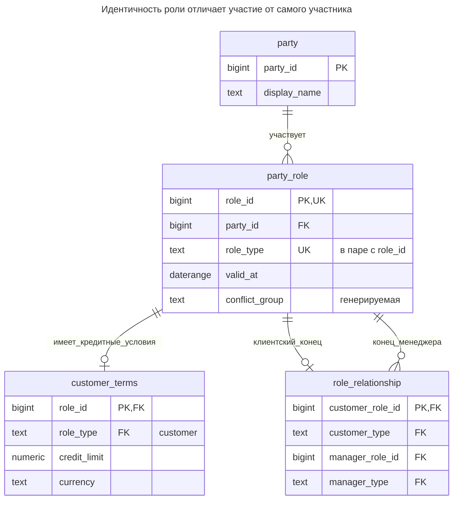
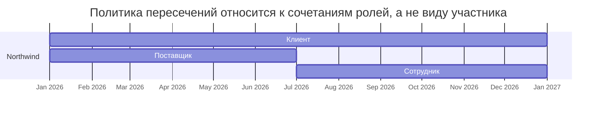
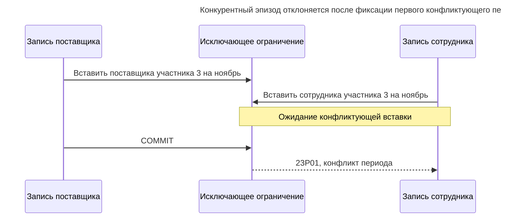
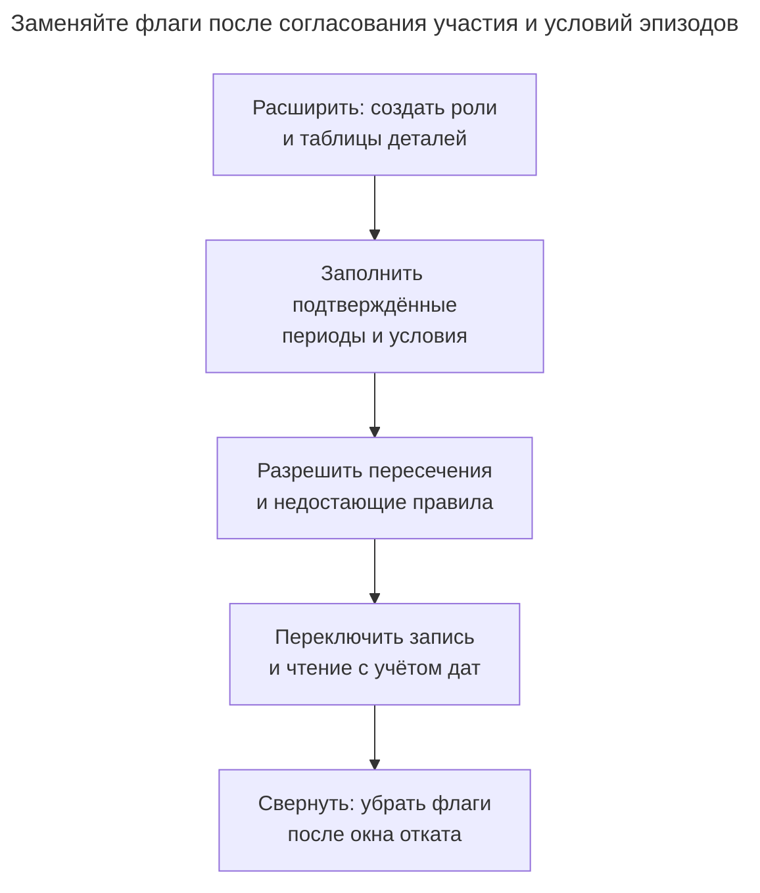

# Объект роли

## Назначение

Объект роли хранит каждую роль участника — клиента, поставщика, сотрудника, менеджера клиента — отдельной строкой со своими атрибутами и периодом действия вместо логических флагов или жёстких подтипов. Человек может одновременно иметь несколько ролей, приобретать и терять их со временем; каждая роль содержит принадлежащие ей данные, например кредитный лимит клиента. Глава рассматривает таблицу ролей, таблицы деталей отдельных ролей, ограничения сочетаний и связи участников, выраженные через их роли.

## Также известен как

Role instance; party role — экземпляр роли, роль участника. [Dealing with Roles](https://martinfowler.com/apsupp/roles.pdf) Фаулера, страницы 14–16, помещает общие свойства на носитель, предоставляя отдельные объекты его ролей. Эта глава переводит концепцию в датированные реляционные записи; SQL и политика конкурентности не взяты из статьи.

## Проблема

Northwind покупает у вас и снабжает вас в одном году. `party.kind = 'customer'` не представляет обе роли, а `is_customer` вместе с `is_supplier` не записывает разные даты подключения, кредитные лимиты или конец отношений с поставщиком. Использование ID участника как ID клиентского соглашения также смешивает новые условия вернувшегося клиента с прежним соглашением.

Одни сочетания допустимы, другие запрещены бизнесом. В этом примере роли клиента и поставщика могут пересекаться, а сотрудника и поставщика для одного участника — нет. Это иллюстративная политика закупок, не универсальное правило. До выбора ограничений точно сформулируйте правило сочетаний и времени.

## Решение

Сохраняйте стабильную идентичность [Участника](party.md) и создавайте строку `party_role` для каждого эпизода участия. Назначьте эпизоду собственный `role_id`, тип роли и полуоткрытый период действия. Кредитные условия поместите в клиентский эпизод. Связь с менеджером клиента ссылается на соответствующие ID ролей, явно задавая смысл концов.

Исключающим ограничением запрещайте пересекающиеся эпизоды одной конфликтной группы. Генерируемая группа объединяет поставщика и сотрудника; клиент и менеджер имеют отдельные группы. Поэтому один механизм запрещает повторные пересекающиеся эпизоды одного типа и запрещённое в примере пересечение разных типов. [Исключающие ограничения диапазонов PostgreSQL](https://www.postgresql.org/docs/18/rangetypes.html#RANGETYPES-CONSTRAINT) сочетают скалярное равенство с пересечением периодов; [`btree_gist`](https://www.postgresql.org/docs/18/btree-gist.html) даёт скалярные классы операторов.

## Альтернативы и выбор

| Соседний паттерн | Связь | Определяющее требование |
| --- | --- | --- |
| [Участник](party.md) | Дополнение | Несколько ролей принадлежат одному постоянному человеку или организации |
| [Таблицы классов](class-table-inheritance.md) | Вариант деталей ролей; замена для фиксированной классификации | Подтип подходит внутренней исключающей классификации; эпизоды — пересекающемуся или повторному участию |
| [Период действия](effective-dating.md) | Дополнение | Роль действует в бизнес-периодах, а не задаётся текущим флагом |
| Фиксированный логический флаг или столбец | Замена | Есть одна простая роль без атрибутов и истории эпизодов |

Полное сравнение — в [Атласе решений](decision-atlas.md). Связь ролей дополняет модель, когда ответственность относится к другому участнику: «менеджер этого клиента» конкретнее, чем «является менеджером».

## Структура



У участника много эпизодов, включая несколько разных типов одновременно. Составные ссылки ролей проверяют типы концов. Клиентские условия здесь необязательны: отсутствие означает отсутствие одобренной кредитной политики, а не нулевой или безлимитный кредит. Схема не требует условий у каждой клиентской роли.

## Таблицы и инварианты

- **`party_role`** имеет стабильный ID эпизода, ограниченное начало и непустой диапазон дат. `role_no_conflict` запрещает пересечение в пределах `(party_id, conflict_group)`.
- **`customer_terms`** ссылается только на клиентский эпизод; сумма кредита неотрицательна. Валюта обязательна; политика точной суммы обсуждается в [Величине](quantity.md).
- **`role_relationship`** допускает одного менеджера на клиентский эпизод с проверенными типами клиентского и менеджерского концов. Её применимость — пересечение двух периодов ролей; она не обещает покрытия всего клиентского периода или независимой истории назначений.
- **Политика метаданных** сохраняет ID участников и типы ролей после создания эпизода. Пример показывает правки периодов, но не устанавливает общий слой авторизации или неизменяемую историю эпизодов.

## Когда применять

- Участник приобретает, теряет или одновременно имеет бизнес-роли.
- У каждой роли есть атрибуты и ссылки конкретного эпизода.
- Запрещённые сочетания зависят от пересечения бизнес-периодов.

## Последствия и компромиссы

- ➕ Клиентские условия и участие поставщика перестают конкурировать за поля идентичности участника.
- ➕ Возвращение создаёт новый эпизод без стирания прежнего.
- ➖ Каждому запросу текущей роли нужна явная бизнес-дата.
- ➖ Общая конфликтная группа выражает взаимное исключение внутри множества, но не произвольную матрицу совместимости: если A конфликтует с B, а B с C, объединение всех трёх запретит также A с C.
- ➖ Действительность роли автоматически не задаёт покрытие и историю назначений между ролями.

## Реализация

[Полный скрипт](../assets/role-object/role-object.sql), проверенный на PostgreSQL 18.6, включает связь менеджера и продление эпизода. Таблицы:

```sql
CREATE EXTENSION IF NOT EXISTS btree_gist;
CREATE SCHEMA role_example;
SET search_path = role_example, public;

CREATE TABLE party (
    party_id bigint PRIMARY KEY,
    display_name text NOT NULL
);
CREATE TABLE party_role (
    role_id bigint PRIMARY KEY,
    party_id bigint NOT NULL REFERENCES party (party_id),
    role_type text NOT NULL CHECK (role_type IN ('customer', 'supplier', 'employee', 'account_manager')),
    valid_at daterange NOT NULL CHECK (NOT isempty(valid_at) AND NOT lower_inf(valid_at)),
    conflict_group text GENERATED ALWAYS AS
        (CASE WHEN role_type IN ('supplier', 'employee') THEN 'procurement' ELSE role_type END) STORED,
    UNIQUE (role_id, role_type),
    CONSTRAINT role_no_conflict EXCLUDE USING gist
        (party_id WITH =, conflict_group WITH =, valid_at WITH &&)
);
CREATE TABLE customer_terms (
    role_id bigint PRIMARY KEY,
    role_type text NOT NULL DEFAULT 'customer' CHECK (role_type = 'customer'),
    credit_limit numeric(14,2) NOT NULL CHECK (credit_limit >= 0 AND credit_limit < 'Infinity'::numeric),
    currency text NOT NULL,
    FOREIGN KEY (role_id, role_type) REFERENCES party_role (role_id, role_type)
);
CREATE TABLE role_relationship (
    customer_role_id bigint PRIMARY KEY,
    customer_type text NOT NULL DEFAULT 'customer' CHECK (customer_type = 'customer'),
    manager_role_id bigint NOT NULL,
    manager_type text NOT NULL DEFAULT 'account_manager' CHECK (manager_type = 'account_manager'),
    FOREIGN KEY (customer_role_id, customer_type) REFERENCES party_role (role_id, role_type),
    FOREIGN KEY (manager_role_id, manager_type) REFERENCES party_role (role_id, role_type)
);
CREATE INDEX role_relationship_manager_idx ON role_relationship (manager_role_id);
```

Используйте периоды `[start, end)`, чтобы эпизод поставщика мог закончиться 1 июля, а эпизод сотрудника — начаться в тот же день. Временная шкала ниже намеренно показывает клиентский эпизод, охватывающий оба.



Полосы поставщика и сотрудника встречаются без пересечения. Клиентская полоса пересекается с каждой, что разрешено политикой примера.

```sql
INSERT INTO party VALUES (1, 'Northwind'), (2, 'Ada');
INSERT INTO party_role (role_id, party_id, role_type, valid_at) VALUES
    (10, 1, 'customer', '[2026-01-01,)'),
    (11, 1, 'supplier', '[2026-01-01,2026-07-01)'),
    (12, 1, 'employee', '[2026-07-01,)'),
    (20, 2, 'account_manager', '[2026-01-01,)');
INSERT INTO customer_terms (role_id, credit_limit, currency) VALUES (10, 5000, 'EUR');
INSERT INTO role_relationship (customer_role_id, manager_role_id) VALUES (10, 20);
SELECT role_type FROM party_role
WHERE party_id = 1 AND valid_at @> DATE '2026-08-01' ORDER BY role_type;
SELECT c.party_id AS customer, m.party_id AS manager
FROM role_relationship AS r
JOIN party_role AS c ON c.role_id = r.customer_role_id
JOIN party_role AS m ON m.role_id = r.manager_role_id
WHERE c.valid_at @> DATE '2026-08-01' AND m.valid_at @> DATE '2026-08-01';
```

На 1 августа первый запрос возвращает `customer` и `employee`; запрос связи — участника-клиента `1` и участника-менеджера `2`. Нужно фильтровать оба периода: существующая ссылка на менеджера не означает, что он всё ещё участвует.

Продлевайте клиентские условия, атомарно завершая старый эпизод и создавая новый:

```sql
BEGIN;
SELECT party_id FROM party WHERE party_id = 1 FOR UPDATE;
UPDATE party_role SET valid_at = '[2026-01-01,2027-01-01)' WHERE role_id = 10;
INSERT INTO party_role (role_id, party_id, role_type, valid_at)
VALUES (13, 1, 'customer', '[2027-01-01,)');
INSERT INTO customer_terms (role_id, credit_limit, currency) VALUES (13, 6000, 'EUR');
COMMIT;
```

Кредитный лимит нового эпизода — 6000 EUR; прежний сохраняет условия 5000 EUR. Назначение менеджера остаётся на роли `10`; при необходимости его нужно явно скопировать или переназначить для продления. Период поставщика, заходящий в участие сотрудника, недопустим:

```sql
INSERT INTO party_role (role_id, party_id, role_type, valid_at)
VALUES (14, 1, 'supplier', '[2026-06-01,2026-08-01)');
```

PostgreSQL 18.6 возвращает SQLSTATE `23P01`: `ERROR: conflicting key value violates exclusion constraint "role_no_conflict"`. Пример пересекает и прежний эпизод поставщика, и последующий эпизод сотрудника; любого конфликта достаточно для отказа.

## Поддержка в движках

- **PostgreSQL 18:** исключающее ограничение прямо защищает от пересечений. Разбиению периодов всё равно нужна атомарная операция из нескольких операторов.
- **MySQL 8.4 / InnoDB:** реализуйте столбцы начала/конца и сериализуйте проверку пересечений блокировкой участника через [`FOR UPDATE`](https://dev.mysql.com/doc/refman/8.4/en/innodb-locking-reads.html) внутри транзакции. [Строчный `CHECK` не может запрашивать другие эпизоды](https://dev.mysql.com/doc/refman/8.4/en/create-table-check-constraints.html).
- **SQL Server 2025 (17.x):** при переносе на триггер проверяйте все затронутые эпизоды, поскольку [DML-триггеры видят множества строк](https://learn.microsoft.com/en-us/sql/relational-databases/triggers/create-dml-triggers-to-handle-multiple-rows-of-data?view=sql-server-ver17). Согласуйте конкурирующих писателей; изолированной проверки каждого множества недостаточно.
- **Oracle AI Database 26ai:** [проверочные ограничения не допускают подзапросов](https://docs.oracle.com/en/database/oracle/oracle-database/26/sqlrf/constraint.html). Для межстрочной политики пересечений используйте согласованный путь записи вместо скалярной проверки.
- **SQLite 3:** писатель может проверять явные границы под [`BEGIN IMMEDIATE`](https://www.sqlite.org/lang_transaction.html), обрабатывая `SQLITE_BUSY`. Включайте [внешние ключи](https://www.sqlite.org/foreignkeys.html) для типизированных концов.

## Сбои и конкурентность

При правке периода блокируйте участника до чтения эпизодов при Read Committed и требуйте протокол от каждого многошагового редактора. Исключающее ограничение остаётся последней инстанцией при несовместимых вставках двух писателей. [Реализация проверки исключения PostgreSQL ожидает потенциальные конфликты](https://github.com/postgres/postgres/blob/REL_18_STABLE/src/backend/executor/execIndexing.c); после конфликта пересмотрите весь запрос эпизода вместо бесконечного повторения без изменений.



При сокращении периода менеджера до фиксации решите, допустима ли потеря покрытия назначения. Семантика пересечения примера допускает её. Более сильное правило требует проверять зависимые назначения под теми же блокировками. Отделяйте идентичность повторного запроса от идентичности роли: новый ID эпизода после неопределённой фиксации может продублировать непересекающийся запрос.

## Миграция

Создайте эпизоды ролей рядом с флагами. Назначайте лишь подтверждённые даты начала; `is_customer = true` не раскрывает начало отношений. Перенесите ролевые столбцы в детали, затем сравните участие на конкретные даты со старым чтением. Разрешите запрещённые пересечения до включения исключающего правила.



Во время развёртывания синхронизируйте старые флаги как проекцию ролей на согласованную текущую бизнес-дату. До отката проверьте, представимы ли новые будущие или повторные эпизоды старым приложением. Возврат к флагам может потребовать сохранения новых таблиц даже при временном возврате старых читателей.

## Антипаттерны и частые ошибки

- Использовать подтипы человека/организации как роли клиента/поставщика, делая одновременное участие невозможным.
- Делать `(party_id, role_type)` уникальным навсегда и запрещать последующий эпизод.
- Читать максимальную дату начала без проверки конца и запрошенной даты.
- Считать ссылку на роль доказательством непрерывного покрытия назначения.
- Реализовывать нетранзитивную матрицу совместимости одной общей конфликтной группой.

## Известные применения

- [Примеры Role Object Фаулера](https://martinfowler.com/apsupp/roles.pdf) позволяют человеку предоставлять отдельные объекты ролей и обсуждают ограничения между ролями. Вариант Role Relationship задаёт роль относительно другого объекта. Они обосновывают концептуальные альтернативы, а не обеспечение периодов этой схемы.

## Связанные паттерны

- [Участник](party.md) предоставляет общую идентичность носителя.
- [Период действия](effective-dating.md) объясняет границы периодов и покрытие.
- [Величина](quantity.md) явно задаёт валюту и контракт округления кредитных лимитов.
- [Таблицы классов](class-table-inheritance.md) отделяют фиксированную принадлежность подтипу от меняющегося участия.
