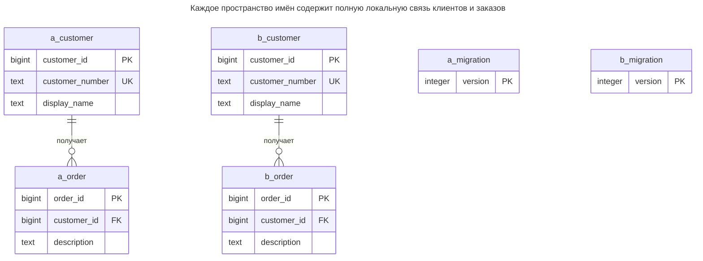
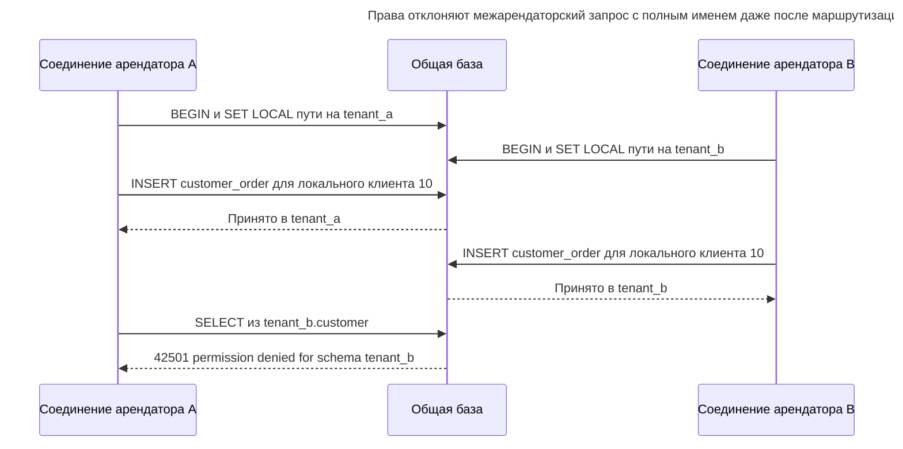
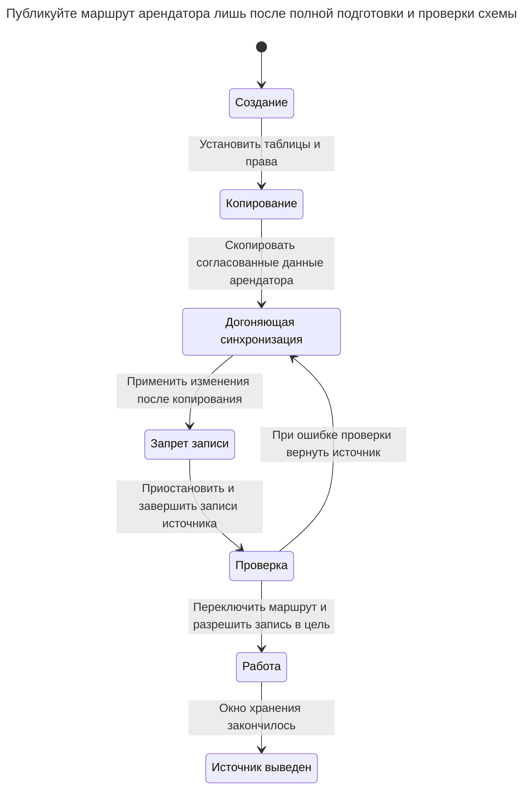

# Схема арендатора

## Назначение

Каждый арендатор получает собственную схему с одинаковым набором таблиц внутри одной базы. При отдельных правах изоляция больше не зависит от фильтров строк; самодостаточную схему можно отдельно экспортировать, восстановить или перенести, появляется возможность индивидуальных изменений. Глава показывает маршрутизацию соединений к нужной схеме, причины выполнения миграций для каждого арендатора и влияние числа схем на системный каталог, пулы соединений и инструменты. PostgreSQL различает [права доступа к схеме](https://www.postgresql.org/docs/18/sql-grant.html) и выбор пространства имён и описывает [зависимости экспорта схемы](https://www.postgresql.org/docs/18/app-pgdump.html).

## Также известен как

Separate schemas; namespace per tenant. Citus называет распределённую реализацию [шардированием по схемам](https://docs.citusdata.com/en/stable/get_started/concepts.html). Исторический документ AWS [SaaS Storage Strategies](https://docs.aws.amazon.com/pdfs/whitepapers/latest/multi-tenant-saas-storage-strategies/multi-tenant-saas-storage-strategies.pdf) относит отдельные представления внутри общего экземпляра к семейству bridge; оно шире схем PostgreSQL.

## Проблема

Вы адаптируете приложение, написанное для одной компании. Все запросы обращаются к `customer` и `customer_order`, а связи используют обычный локальный ID клиента. Добавить повсюду предикаты арендатора и составные ключи возможно, но вам также нужно развернуть новый столбец у пилотного арендатора раньше остальных.

Дублирование таблиц как `customer_acme` и `customer_birch` встраивает идентичность арендатора в каждое имя таблицы. Вам нужны полное пространство имён для каждого арендатора, воспроизводимое определение схемы и авторизация доступа к этому пространству. Без прав пространство имён меняет лишь способ поиска данных, а не определяет, кому разрешено их читать.

## Решение

Создайте схему для каждого арендатора и разместите в ней полный набор принадлежащих ему таблиц. Внешние ключи оставьте внутри схемы. Доверенный каталог должен сопоставлять аутентифицированного арендатора с именем схемы и рабочими учётными данными. Владение схемой и миграции закрепите за отдельной ролью; рабочие роли получают доступ к объектам без возможности создавать и изменять их структуру.

Явно выберите один из двух контрактов доступа. Общие учётные данные приложения с доступом ко всем схемам делают маршрутизатор приложения границей арендатора. Отдельные учётные данные с доступом к одной схеме отклоняют ошибочно направленный запрос с полным именем ещё и на границе базы. Глава реализует второй контракт. Роль, способная переключаться на любую роль арендатора, остаётся доверенным маршрутизатором, а не недоверенной учётной записью арендатора.

Используйте полные имена либо устанавливайте контролируемый `search_path` на время транзакции. PostgreSQL разрешает неполное имя в [первый подходящий объект этого пути](https://www.postgresql.org/docs/18/ddl-schemas.html#DDL-SCHEMAS-PATH). Исключите недоверенные пространства имён, доступные для записи. Путь выбирает объекты, а права на схемы и таблицы разрешают их использование.

## Альтернативы и выбор

| Соседний паттерн или механизм | Связь | Определяющее требование |
| --- | --- | --- |
| [Общая схема](shared-schema.md) | Замена | Число арендаторов и единые выпуски склоняют к одному набору таблиц с ключами в области арендатора |
| [База арендатора](database-per-tenant.md) | Замена | Граница жизненного цикла должна включать базу либо нужно отдельное размещение |
| Полные имена таблиц | Вариант реализации | Каждый запрос должен явно показывать назначение |
| Локальный `search_path` транзакции | Вариант реализации | Существующий SQL должен сохранить неполные имена таблиц |
| [Расширение и свёртывание](expand-contract.md) | Дополнение | Разные схемы арендаторов временно работают на разных версиях миграций |

Полная таблица — в [Атласе решений](decision-atlas.md). Не выбирайте паттерн только ради небольших таблиц: он даёт границу пространства имён и прав ценой повторения объектов и миграций.

## Структура



`a_customer`, `a_order` и `a_migration` обозначают `tenant_a.customer`, `tenant_a.customer_order` и `tenant_a.schema_migration`; сущности `b_` — их аналоги в `tenant_b`. Одинаковые ID и номера клиентов могут существовать в обоих пространствах. Внешние ключи не пересекают их границы, а каждая схема хранит собственные применённые версии миграций.

## Таблицы и инварианты

- **`tenant_a.customer` и `tenant_b.customer`** независимо обеспечивают локальную идентичность строк и уникальность номера клиента. Глобальная уникальность клиента `10` не заявляется.
- **Каждая `customer_order`** ссылается на клиентов своей схемы через внешний ключ с полным именем. Клиент другой схемы не может удовлетворить отсутствующую локальную ссылку.
- **Каждая `schema_migration`** хранит положительные уникальные номера версий. Первичный ключ запрещает повтор версии; применение по порядку и проверка содержимого остаются обязанностью исполнителя миграций.
- **Рабочие права** дают `st_app_a` доступ только к арендатору A, а `st_app_b` — к B. PostgreSQL различает [`USAGE` схемы и права таблиц](https://www.postgresql.org/docs/18/sql-grant.html); одно не даёт другого.
- **Полнота создания** — инвариант процесса: не публикуйте маршрут арендатора до установки всех таблиц, ограничений, прав и отметок версий.

## Когда применять

- Приложение уже содержит значительный объём SQL, рассчитанного на одного арендатора за раз.
- Нужны отдельные права на объекты при общей базе.
- Пилотные миграции или небольшой набор управляемых вариантов схем достаточно полезны, чтобы оправдать множество независимо обновляемых схем.
- Вы можете измерять и обслуживать фактическое число создаваемых объектов схем.

## Последствия и компромиссы

- ➕ Запросы в правильно выбранной схеме используют обычные локальные ID и внешние ключи.
- ➕ Совместимую миграцию можно сначала применить к одному арендатору и проверить результат.
- ➖ Каждый арендатор добавляет таблицы, индексы и ограничения. [Каталог `pg_class`](https://www.postgresql.org/docs/18/catalog-pg-class.html) PostgreSQL хранит, среди прочих отношений, таблицы и индексы; работа каталога и инструментов растёт с копируемой структурой. Универсального безопасного порога числа арендаторов нет.
- ➖ Пулы отдельных рабочих учётных записей требуют бюджета соединений. Общая учётная запись с широким доступом позволяет уменьшить число пулов, но повышает ответственность маршрутизатора за изоляцию.
- ➖ Схема не выделяет отдельные CPU, память или ресурсы восстановления. [Настройки ресурсов сервера PostgreSQL](https://www.postgresql.org/docs/18/runtime-config-resource.html) включают общие буферы; пространства имён не резервируют их арендаторам.
- ➖ Межарендаторские отчёты должны явно обходить разрешённые схемы или читать отчётную копию. Таблица одного арендатора не представляет всё приложение.

## Реализация

[Полный скрипт PostgreSQL 18.6](../assets/schema-per-tenant/schema-per-tenant.sql) создаёт две схемы, проверяет ограниченные роли и применяет миграцию к каждой схеме. У ролей входа нет паролей, поскольку одноразовый практикум использует локальную доверенную аутентификацию; производственную аутентификацию настройте отдельно. Начните с владельца без входа и рабочих ролей арендаторов:

```sql
CREATE ROLE st_owner NOLOGIN;
CREATE ROLE st_app_a LOGIN NOSUPERUSER NOBYPASSRLS;
CREATE ROLE st_app_b LOGIN NOSUPERUSER NOBYPASSRLS;
REVOKE CREATE ON SCHEMA public FROM PUBLIC;
CREATE SCHEMA tenant_a AUTHORIZATION st_owner;
CREATE SCHEMA tenant_b AUTHORIZATION st_owner;
SET ROLE st_owner;
CREATE TABLE tenant_a.customer (
    customer_id bigint PRIMARY KEY,
    customer_number text NOT NULL UNIQUE,
    display_name text NOT NULL
);
CREATE TABLE tenant_a.customer_order (
    order_id bigint PRIMARY KEY,
    customer_id bigint NOT NULL,
    description text NOT NULL,
    CONSTRAINT order_customer_fk FOREIGN KEY (customer_id)
        REFERENCES tenant_a.customer (customer_id)
);
CREATE INDEX order_customer_idx ON tenant_a.customer_order (customer_id);
CREATE TABLE tenant_a.schema_migration (
    version integer PRIMARY KEY CHECK (version > 0)
);
INSERT INTO tenant_a.schema_migration VALUES (1);
```

Скрипт повторяет определения в `tenant_b`, с внешним ключом на `tenant_b.customer`. [`CREATE SCHEMA ... AUTHORIZATION`](https://www.postgresql.org/docs/18/sql-createschema.html) PostgreSQL назначает владельца схемы; выполнение DDL таблиц от его имени также оставляет таблицы у роли миграций. Не включайте рабочие роли в `st_owner`.

Выдайте ровно операции приложения над таблицами и чтение отметки миграции:

```sql
GRANT USAGE ON SCHEMA tenant_a TO st_app_a;
GRANT SELECT, INSERT, UPDATE, DELETE
    ON tenant_a.customer, tenant_a.customer_order TO st_app_a;
GRANT SELECT ON tenant_a.schema_migration TO st_app_a;
RESET ROLE;
SET ROLE st_app_a;
BEGIN;
SET LOCAL search_path = pg_catalog, tenant_a;
INSERT INTO customer VALUES (10, 'C-10', 'Acme customer');
INSERT INTO customer_order VALUES (100, 10, 'First order');
UPDATE customer SET display_name = 'Acme renamed' WHERE customer_id = 10;
SELECT o.order_id, c.display_name
FROM customer_order AS o JOIN customer AS c USING (customer_id);
COMMIT;
```

Соединение возвращает `(100, Acme renamed)`. Аналогичная транзакция другой роли вставляет `(10, C-10, Birch customer)` и собственный заказ `100` без конфликта. Администраторский `SET ROLE` проверяет права; настоящие соединения арендаторов входят непосредственно под рабочей ролью.

Перед неполным SQL устанавливайте путь на том же соединении и в той же транзакции. [`SET LOCAL`](https://www.postgresql.org/docs/18/sql-set.html) заканчивается при фиксации или откате. Явно ставьте `pg_catalog` первым, исключайте `public` и запрещайте рабочей роли создание объектов, включая временные, если права базы иначе это разрешают. Скрипт отзывает общую привилегию базы `TEMPORARY`; PostgreSQL [по умолчанию выдаёт её `PUBLIC`](https://www.postgresql.org/docs/18/ddl-priv.html). DDL создания объектов записывайте с полными именами: путь предназначен для рабочего поиска, а не создания по неполному имени.

Имена схем — доверенные идентификаторы из каталога, а не сырые имена хостов или отображаемые имена арендаторов, склеенные с SQL. Если исполнитель миграций генерирует DDL, используйте экранирование идентификаторов драйвера. Новым объектам тоже нужны права: [`ALTER DEFAULT PRIVILEGES`](https://www.postgresql.org/docs/18/sql-alterdefaultprivileges.html) PostgreSQL влияет на будущие объекты указанной роли, а не на существующие объекты или объекты другой роли.

Под `st_app_a` попытка обойти маршрут полным именем завершается ошибкой:

```sql
SELECT count(*) FROM tenant_b.customer;
```

PostgreSQL 18.6 возвращает SQLSTATE `42501`: `ERROR: permission denied for schema tenant_b`. Причина отказа — отсутствие права на схему; защищает не `search_path`. При пути арендатора A ограничение связи также отклоняет:

```sql
INSERT INTO customer_order VALUES (101, 20, 'Missing customer');
```

Ошибка — SQLSTATE `23503`: `ERROR: insert or update on table "customer_order" violates foreign key constraint "order_customer_fk"`. В полном скрипте каждый недопустимый оператор выполняется в своём блоке исключения, чтобы практикум подтвердил оба отказа и продолжился.

## Поддержка в движках

- **PostgreSQL 18:** схемы сосуществуют в одной базе, а ссылки с полными именами могут пересекать их при наличии прав. [Рекомендации по безопасности схем](https://www.postgresql.org/docs/18/ddl-schemas.html#DDL-SCHEMAS-PATTERNS) предупреждают: доверие к доступным для записи схемам в пути поиска позволяет подменять объекты. Отделяйте рабочие роли от владельцев.
- **MySQL 8.4:** [`CREATE SCHEMA` — синоним `CREATE DATABASE`](https://dev.mysql.com/doc/refman/8.4/en/create-database.html). Дополнительного слоя схем, как в PostgreSQL, внутри базы MySQL нет; переносите границу изоляции, а не название.
- **SQL Server 2025 (17.x):** [`CREATE SCHEMA ... AUTHORIZATION`](https://learn.microsoft.com/en-us/sql/t-sql/statements/create-schema-transact-sql?view=sql-server-ver17) создаёт принадлежащее владельцу пространство имён внутри базы. Используйте полные имена и права SQL Server; `search_path` PostgreSQL непереносим.
- **Oracle AI Database 26ai:** [`ALTER SESSION SET CURRENT_SCHEMA`](https://docs.oracle.com/en/database/oracle/oracle-database/26/sqlrf/ALTER-SESSION.html) меняет разрешение неполных имён, не меняя пользователя и не выдавая прав. Сохраняйте это различие между маршрутизацией и авторизацией.
- **SQLite 3:** [`ATTACH DATABASE`](https://www.sqlite.org/lang_attach.html) именует другой файл базы в соединении. Это файловая организация, а не пространство имён с независимыми ролями; [права доступа SQLite — права файловой системы](https://www.sqlite.org/omitted.html).

## Сбои и конкурентность



Локальные ID заказов не конфликтуют, поскольку принадлежат разным таблицам. Конкурентным записям одного арендатора по-прежнему нужны обычные локальные ограничения; изоляция пространств имён не разрешает конфликт двух правок строки. При общей учётной записи с доступом ко всем схемам ошибочная маршрутизация была бы успешной — поэтому контракт учётных данных важен.

Сериализуйте исполнителей миграций для каждого арендатора и фиксируйте транзакционный DDL вместе с отметкой версии. Скрипт использует [`pg_advisory_xact_lock`](https://www.postgresql.org/docs/18/explicit-locking.html#ADVISORY-LOCKS) с назначенным ключом каждого арендатора. Все исполнители должны соблюдать одинаковое сопоставление и повторно проверять версию после блокировки. Рекомендательная блокировка координирует согласованные процессы, но не блокирует произвольный рабочий SQL. DDL берёт собственные блокировки: используйте короткий [`lock_timeout`](https://www.postgresql.org/docs/18/runtime-config-client.html#GUC-LOCK-TIMEOUT) в эксплуатации и повторяйте отдельного арендатора позже вместо остановки всего набора схем.

Сбой исполнителя между миграциями арендаторов оставляет набор схем частично обновлённым. Записывайте завершение для каждого арендатора и возобновляйте лишь недостающие версии. Приложение должно поддерживать смешанное состояние. Перед повтором выясняйте, зафиксировалась ли предыдущая транзакция арендатора; потеря соединения не равна провалу миграции.

## Миграция

В существующей базе одного арендатора сначала отделите его объекты от общих управляющих данных и справочников. При исходной общей схеме копируйте строки клиентов и заказов каждого арендатора в полное целевое пространство имён, сохраняя локальные связи. Не создавайте межсхемные внешние ключи лишь ради отказа от копирования дочерних данных арендатора: тогда дальнейший перенос будет зависеть от чужого пространства имён.



Переключению нужен запрет записи, а не только новое имя схемы в кеше. Дождитесь завершения транзакций источника, примените остаток изменений, проверьте количества и ссылки, затем сбросьте старые маршруты и состояние соединений. До начала целевой записи можно вновь открыть источник; после неё откат требует обратного копирования или захвата изменений. Храните источник в течение окна восстановления, не позволяя обеим копиям принимать записи.

Для обычных обновлений применяйте [Расширение и свёртывание](expand-contract.md) по арендаторам. Сначала добавляйте совместимые столбцы, переводите все версии приложения, затем удаляйте устаревшие объекты. Пример обновления в практикуме выполняет `ADD COLUMN billing_note text` и записывает версию `2` одной транзакцией на арендатора; он демонстрирует границы возобновления, а не полноценный сервис развёртывания.

Экспорт схемы упрощает перенос, но не гарантирует самодостаточности. [`pg_dump --schema`](https://www.postgresql.org/docs/18/app-pgdump.html) PostgreSQL не включает автоматически объекты вне выбранной схемы, от которых она зависит. Учтите общие типы, функции, расширения, роли и справочники и отрепетируйте восстановление. Физическое [восстановление на момент времени восстанавливает весь кластер](https://www.postgresql.org/docs/18/continuous-archiving.html), поэтому для прежней версии одной схемы восстановите временный кластер и извлеките арендатора.

## Антипаттерны и частые ошибки

- Считать `SET search_path` авторизацией, когда все запросы используют учётные данные владельца всех схем.
- Оставлять доступные арендатору для записи схемы в пути поиска другого арендатора.
- Применять миграцию один раз и считать изменёнными все схемы либо хранить одну глобальную версию для частично обновлённого набора.
- Разрешать произвольные изменения схем арендаторами без учёта поддерживаемых вариантов и путей обновления.
- Называть набор таблиц с суффиксами стратегией схем; см. [Клонированные таблицы](cloned-tables.md). Сохраняйте полное пространство имён, контракт создания и историю миграций.
- Предполагать, что экспорт схемы включает внешние зависимости или даёт физическое восстановление отдельного арендатора.

## Известные применения

- [Шардирование по схемам Citus](https://docs.citusdata.com/en/stable/get_started/concepts.html#schema-based-sharding), доступное с Citus 12.0, использует схему как логический шард и разрешает неодинаковые схемы арендаторов. Ограничения и плотность арендаторов относятся к расширению, а не обещаны обычными схемами PostgreSQL.
- Историческая [модель RDS bridge AWS](https://docs.aws.amazon.com/pdfs/whitepapers/latest/multi-tenant-saas-storage-strategies/multi-tenant-saas-storage-strategies.pdf) описывает отдельные представления арендаторов внутри экземпляра и постепенный переход между версиями схем. Её терминология охватывает несколько контейнерных механизмов разных движков.

## Связанные паттерны

- [Общая схема](shared-schema.md) меняет отдельные наборы объектов на строки с указанием арендатора.
- [База арендатора](database-per-tenant.md) переносит границу маршрутизации на установление соединения.
- [Расширение и свёртывание](expand-contract.md) сохраняет работоспособность смешанных версий схем при поэтапном обновлении.
- [Клонированные таблицы](cloned-tables.md) объясняют, почему повторяющиеся имена без контракта жизненного цикла усложняют сопровождение.
