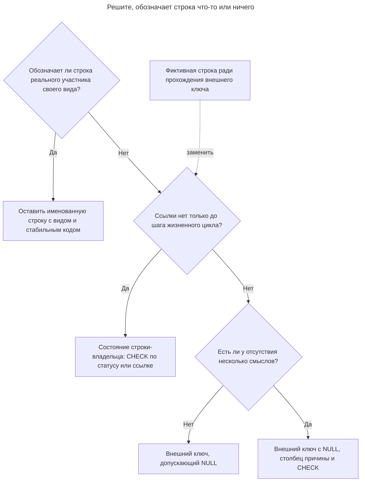
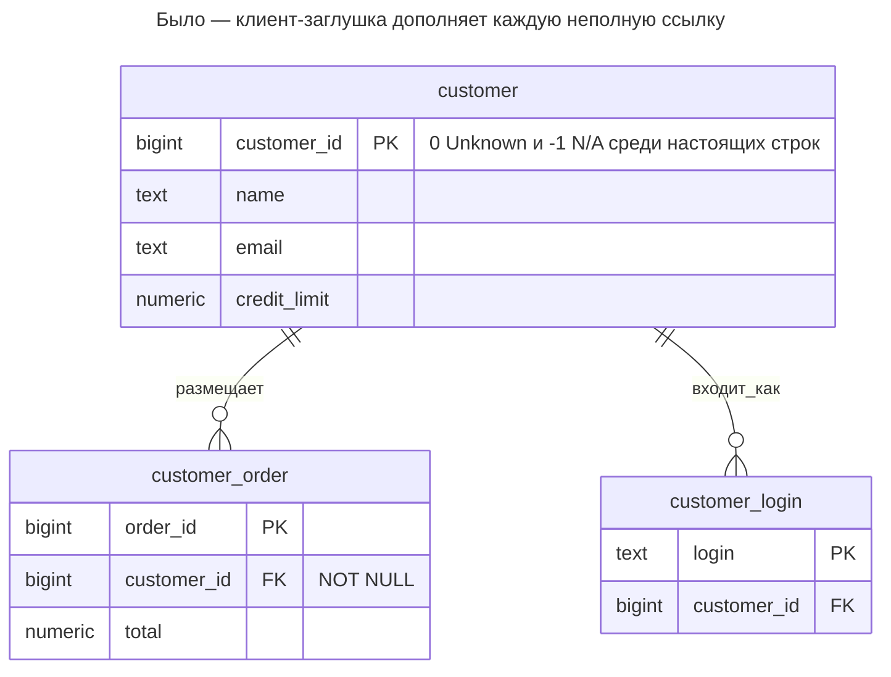
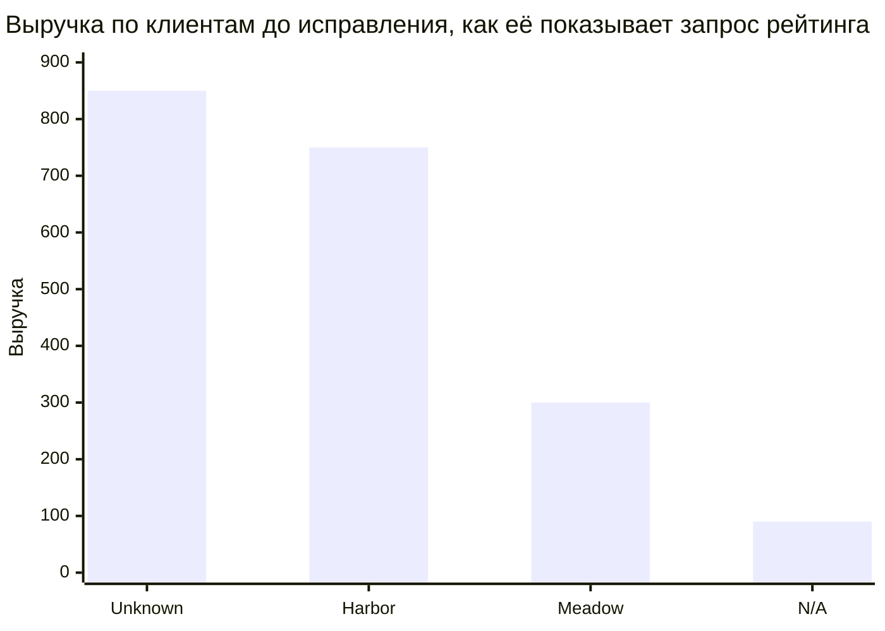
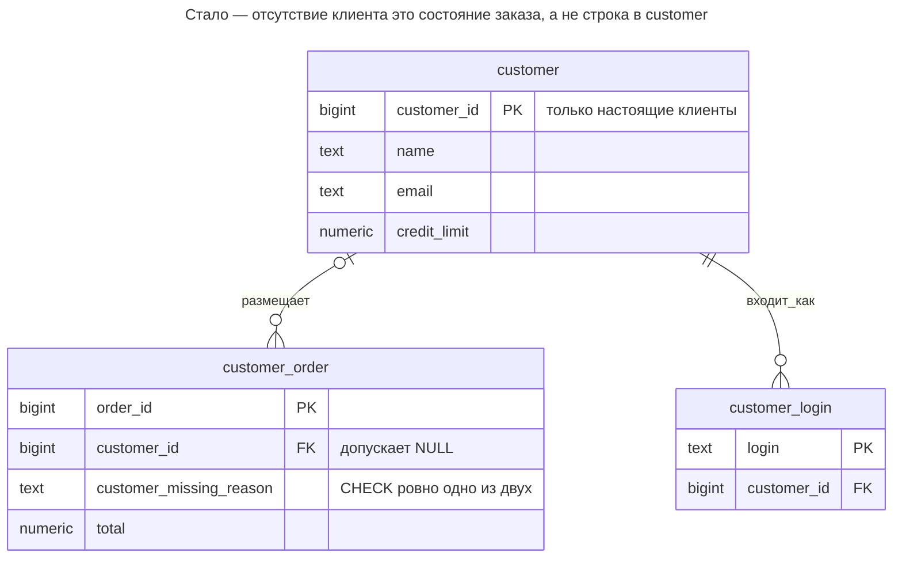
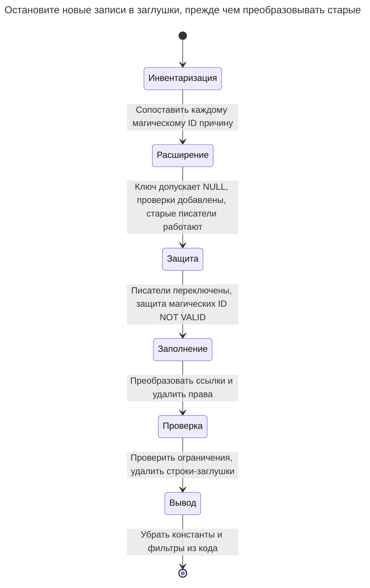

# Строки-заглушки

Строка-заглушка — это фиктивная запись, например `customer_id = 0` с именем `Unknown`, `N/A` или `-`, на которую ссылаются другие строки, когда настоящей ссылки нет. С ней проходит внешний ключ `NOT NULL`, и схема сообщает о полных данных там, где их нет. Отчёты затем считают фиктивную строку клиентом, права, привязанные к ней, открывают чужие данные, а каждая команда, столкнувшись с той же проблемой, добавляет свою заглушку. Глава показывает, как возникает ущерб, когда постоянная именованная строка законно участвует в предметной области и как заменить заглушки ссылкой, допускающей `NULL`, с явной причиной или состоянием строки-владельца.

## Также известен как

Строка-заполнитель, фиктивная запись, магический ID. В объектном коде та же идея — уважаемый паттерн: [Special Case](https://martinfowler.com/eaaCatalog/specialCase.html) Фаулера возвращает вместо null объект с ожидаемым вызывающим кодом интерфейсом, а на его странице упомянут клиент коммунальной компании, о котором знали не всё и которого называли «occupant» («жилец»). Этот объект живёт в коде и обладает поведением. Строка-заглушка копирует его в таблицу, где поведения нет, а есть только данные, которые каждый запрос считает настоящим клиентом.

## Контекст

Заказы ссылаются на клиентов через обязательный внешний ключ. Затем появляется оформление заказа без регистрации, устаревший импорт приносит заказы, покупатель которых никогда не записывался, а внутренняя отгрузка на замену вообще не имеет клиента. Столбец объявлен `NOT NULL`, ORM отображает связь как обязательную, и изменение любого из них выглядит как проект по смене схемы. Вставить одного клиента по имени `Unknown` — минутное дело.

## Проблема

Вы вставляете в таблицу, на которую ссылаются, строку, не описывающую ничего в предметной области, и направляете на неё все неполные ссылки. Ограничение `NOT NULL` и внешний ключ выполнены, поэтому база подтверждает ложный факт: у каждого заказа есть клиент. Отсутствующие данные не исчезли; они стали неотличимы от настоящих, кроме как по магическому ID или подписи, которую должен знать код.

Фиктивная строка — полноправный член своей таблицы. У неё есть имя, адрес электронной почты, кредитный лимит и все столбцы, которые таблица получит позже. На неё могут ссылаться логины, адреса и скидки. Агрегаты, соединения и правила уникальности обращаются с ней как с ещё одним клиентом, потому что для базы она им и является.

## Почему так делают

- Внешний ключ `NOT NULL` уже существует, и разрешить `NULL` кажется ослаблением схемы, а не её точным описанием.
- Внутренние соединения теряют строки со ссылкой `NULL`, поэтому кто-то добавляет строку, которую находит любое соединение.
- Отчёту нужна подпись в столбце клиента, и `Unknown` читается лучше пустоты.
- В команде действует правило «никаких NULL», часто принятое, чтобы избежать трёхзначной логики в запросах.
- Привычка пришла из многомерного моделирования, где строка «unknown member» — документированный приём, или из объектного Special Case.

Каждая из этих причин реальна. Ни одна не требует фиктивного клиента: ссылка, допускающая `NULL`, с объявленной причиной сохраняет и правило, и соединение, и подпись, как показано ниже.

## Последствия

- ➖ Ограничение `NOT NULL` и внешний ключ сообщают об успехе, когда данных нет. Отличить неизвестного покупателя от настоящего может только проверка, которая уже знает магический ID; общие ограничения, запросы к каталогу и отчёты о полноте данных этого не могут.
- ➖ Подсчёты, соединения и агрегаты включают фиктивную строку. В примере `Unknown` становится крупнейшим клиентом, а `count(DISTINCT customer_id)` учитывает двух несуществующих клиентов.
- ➖ Фиктивная строка обрастает атрибутами и правами. Она получает кредитный лимит, почтовый адрес или скидку по умолчанию, которые затем применяются к каждому гостевому заказу; логин, связанный с ней, видит все заказы, ссылающиеся на неё.
- ➖ Заглушки размножаются. Следующая команда добавляет `-1 'N/A'` или `99 'Unknown customer'`, а фильтры вида `customer_id <> 0` молча пропускают новые.
- ➖ Удалить строку нельзя, пока на неё есть ссылки, а если внешний ключ каскадный, удаление пройдёт по ним. Переименование ломает код, который ищет её по подписи, а смена номера — код с зашитым ID.
- ➖ Разные виды отсутствия сливаются в одно значение. «Клиент не указал учётную запись», «у этого заказа клиента не бывает» и «личность скрыта» становятся одним `0`.

## Признаки

- Строки с ID `0` или отрицательными ID либо с именами `Unknown`, `N/A`, `-`, `None`, `TBD` или `Default` в таблице сущностей.
- Константы вроде `UNKNOWN_CUSTOMER_ID` в коде приложения и фильтры `customer_id <> 0` или `name <> 'Unknown'`, повторяющиеся в запросах.
- Миграции начальных данных, вставляющие строки с фиксированными ID в таблицу, которая иначе растёт только от действий пользователей.
- Отчёт, первая строка которого — `Unknown`, или доля недоставленных писем, которую дают адреса вида `noreply@...`, записанные у клиента.
- Удаление устаревшей записи падает, потому что на неё ссылаются десятки тысяч строк.

## Как лучше

Скажите в схеме, что ссылки может не быть, и скажите почему. Разрешите `NULL` во внешнем ключе там, где «отсутствует» — допустимое состояние. Если у отсутствия несколько смыслов, добавьте на ссылающуюся строку столбец причины и свяжите их через `CHECK`: заполнен ровно один из двух. Словарь причин мал и принадлежит разработчикам, поэтому ему подходит список в `CHECK`. Перенесите его в [Таблицу значений](lookup-table.md), если причинам нужны подписи или вывод из обращения.

Код причины — не заглушка. Он стоит на строке, у которой нет данных, не притворяется клиентом, и ни одно соединение с `customer` его не находит. Отчёты, ранжирующие клиентов, используют внутреннее соединение и видят только клиентов; отчёты, сверяющие выручку, показывают неатрибутированную долю отдельной строкой с разбивкой по причинам.

Если отсутствие допустимо только на части жизненного цикла, сделайте его состоянием строки-владельца. У черновика коммерческого предложения может не быть клиента, а у выставленного клиент обязателен. Правило `CHECK (status = 'draft' OR customer_id IS NOT NULL)` говорит ровно это, и столбец причины не нужен.

У `NULL` есть своя ловушка. `WHERE customer_id <> 1` для ссылки `NULL` даёт «неизвестно» и отбрасывает строку; пишите `IS DISTINCT FROM`, когда строки без ссылки должны остаться в результате. `CHECK` проходит, если его выражение равно `NULL`, о чём PostgreSQL прямо [пишет в документации](https://www.postgresql.org/docs/18/ddl-constraints.html), поэтому стройте правило присутствия из проверок `IS NULL`, которые никогда не возвращают `NULL`.

### Когда постоянная строка оправдана

Постоянная именованная строка — не заглушка, если она описывает то, что существует в предметной области и участвует в ней. Плановое задание переоценки меняет цены; запись о нём как об акторе вида `service` с кодом `system.repricer` говорит, кто действовал, а отчёт об изменениях, сделанных людьми, исключает его по `kind`, а не по магическому ID. Клиринговый счёт или счёт начального капитала в бухгалтерской книге — настоящий счёт, у которого есть остаток и который получает проводки; [Двойной записи](double-entry-ledger.md) такие счета-корреспонденты нужны для сохранения сумм. Задайте два вопроса: обозначает ли строка реального участника своего вида и должны ли запросы, считающие этот вид, её учитывать? Если оба ответа «да», оставьте строку, дайте ей стабильный код и вид и ссылайтесь на неё, как на любую другую. Кто действовал, записывает [Журнал аудита](audit-log.md), а человек или организация — это [Участник](party.md); ни тому, ни другому не нужна заглушка для «никого».

Хранилища данных используют осознанный вариант. Многомерная техника Кимбалла избегает `NULL` во внешних ключах таблиц фактов и держит в измерении [строку по умолчанию для неизвестного или неприменимого случая](https://www.kimballgroup.com/data-warehouse-business-intelligence-resources/kimball-techniques/dimensional-modeling-techniques/fact-table-null/). Это соглашение слоя отчётности со своим процессом загрузки, и в OLTP-схему оно не входит. Если вы загружаете данные в хранилище, столбец причины даёт загрузчику ровно то различие, которое нужно этим строкам по умолчанию.

### Альтернативы и выбор

| Выбор | Связь | Когда выбирать |
| --- | --- | --- |
| Внешний ключ, допускающий `NULL` | Замена | У отсутствия один смысл, и читатели осознанно обрабатывают `NULL` |
| Внешний ключ с `NULL` и столбец причины | Замена | У отсутствия несколько смыслов, которые отчёты или правила должны различать |
| Состояние строки-владельца | Замена | Ссылка становится обязательной на шаге жизненного цикла, например при выставлении черновика |
| [Разделение таблицы](table-split.md) | Вариант реализации | Ссылка и её атрибуты необязательны вместе, и отдельная строка предпочтительнее столбцов с `NULL` |
| Настоящая именованная строка с видом | Оправданный случай | Строка — реальный участник своего вида, например служебный актор или клиринговый счёт |
| [Таблица значений](lookup-table.md) | Дополнение | Причинам нужны подписи, переводы или вывод из обращения |

Полная карта исправлений — в [Атласе решений](decision-atlas.md).



Первый вопрос отделяет оправданный случай от антипаттерна. Все остальные пути ведут к схеме, которая говорит, что данных нет, а не делает вид, что они есть.

## Пример

### Структура

**Было:** фиктивный клиент закрывает обязательную ссылку из заказов и логинов.



Диаграмма показывает обязательную связь. Ничто в ней не выдаёт, что два клиента — не клиенты.

[Полный скрипт для PostgreSQL 18.7](../assets/sentinel-rows/sentinel-rows.sql) работает в собственной схеме `sentinel_example` и проверяет каждый результат ниже:

```sql
CREATE TABLE customer (
    customer_id bigint PRIMARY KEY,
    name text NOT NULL,
    email text NOT NULL,
    credit_limit numeric(12,2) NOT NULL DEFAULT 0
);
CREATE TABLE customer_order (
    order_id bigint PRIMARY KEY,
    customer_id bigint NOT NULL REFERENCES customer (customer_id),
    total numeric(12,2) NOT NULL CHECK (total > 0)
);
CREATE TABLE customer_login (
    login text PRIMARY KEY,
    customer_id bigint NOT NULL REFERENCES customer (customer_id)
);
INSERT INTO customer VALUES
    (0, 'Unknown', 'noreply@shop.example', 1000.00),
    (1, 'Harbor', 'buyer@harbor.example', 5000.00),
    (2, 'Meadow', 'orders@meadow.example', 2000.00);
INSERT INTO customer_order VALUES
    (101, 1, 400.00), (102, 1, 350.00), (103, 2, 300.00),
    (104, 0, 200.00), (105, 0, 250.00), (106, 0, 180.00), (107, 0, 220.00);
INSERT INTO customer_login VALUES ('kiosk', 0), ('harbor-buyer', 1);
```

У заказа `107` нет покупателя, и оба ограничения его принимают. Четыре гостевых заказа теперь несут кредитный лимит `1000.00`, который кто-то выдал `Unknown`, а общий логин `kiosk` видит все четыре, хотя их оформили посторонние гости. Рейтинг клиентов неверен:

```sql
SELECT c.name, sum(o.total) AS revenue
FROM customer_order AS o JOIN customer AS c USING (customer_id)
GROUP BY c.name ORDER BY revenue DESC;
```

Он возвращает `Unknown 850.00`, `Harbor 750.00`, `Meadow 300.00`. Позже другая команда вставляет `(-1, 'N/A', ...)` для внутренних отгрузок на замену и заказ `108` на `90.00`. `count(DISTINCT customer_id)` по заказам возвращает `4` при двух существующих клиентах, а фильтр `customer_id <> 0`, который все скопировали, по-прежнему возвращает `3`, потому что знает только первую заглушку.



Самый высокий столбец — не клиент, и самый низкий тоже. Панель продаж на этом запросе отправила бы предложение для лучшего клиента на `noreply@shop.example`.

Переименование строки в `Guest` приводит к тому, что код, ищущий её по имени, ничего не находит; скрипт проверяет это внутри точки сохранения. Удаление не проходит:

```sql
DELETE FROM customer WHERE customer_id = 0;
```

PostgreSQL 18.7 выдаёт SQLSTATE `23503`: `ERROR: update or delete on table "customer" violates foreign key constraint "customer_order_customer_id_fkey" on table "customer_order"` с `DETAIL: Key (customer_id)=(0) is still referenced from table "customer_order".`

**Стало:** заказ сообщает, что клиента нет и почему.



Связь со стороны `customer` теперь «ноль или один». Логин `kiosk` потерял привязку: у общего устройства нет клиента, чьи заказы ему можно видеть.

```sql
ALTER TABLE customer_order
    ALTER COLUMN customer_id DROP NOT NULL,
    ADD COLUMN customer_missing_reason text,
    ADD CONSTRAINT customer_order_missing_reason_check
        CHECK (customer_missing_reason IN ('not_provided', 'not_applicable', 'withheld')) NOT VALID,
    ADD CONSTRAINT customer_order_customer_presence
        CHECK ((customer_id IS NULL) <> (customer_missing_reason IS NULL)) NOT VALID;
```

`not_provided` покрывает заказы без регистрации и устаревшие заказы, покупатель которых не записан; `not_applicable` — внутренние отгрузки, у которых клиента не бывает; `withheld` — покупателя, личность которого этой системе не раскрывают. Этот шаг только расширяет схему: старый писатель, который по-прежнему вставляет клиента `0` без причины, проходит все новые проверки, а новый уже может сохранять `NULL` и причину. Скрипт вставляет по заказу каждого вида и откатывает их. Когда все писатели перейдут на новую форму, защита закрывает магические ID, и ссылки преобразуются:

```sql
ALTER TABLE customer_order
    ADD CONSTRAINT customer_order_no_sentinel CHECK (customer_id NOT IN (0, -1)) NOT VALID;
CREATE TABLE sentinel_map (
    customer_id bigint PRIMARY KEY,
    missing_reason text NOT NULL
);
INSERT INTO sentinel_map VALUES (0, 'not_provided'), (-1, 'not_applicable');
UPDATE customer_order AS o
SET customer_id = NULL, customer_missing_reason = m.missing_reason
FROM sentinel_map AS m
WHERE o.customer_id = m.customer_id;
DELETE FROM customer_login AS l USING sentinel_map AS m
WHERE l.customer_id = m.customer_id;
ALTER TABLE customer_order VALIDATE CONSTRAINT customer_order_missing_reason_check;
ALTER TABLE customer_order VALIDATE CONSTRAINT customer_order_customer_presence;
ALTER TABLE customer_order VALIDATE CONSTRAINT customer_order_no_sentinel;
DELETE FROM customer AS c USING sentinel_map AS m WHERE c.customer_id = m.customer_id;
```

Последнее удаление проходит, а значит, ни один заказ и ни один логин больше не ссылаются на заглушку. Запрос рейтинга не меняется и теперь возвращает `Harbor 750.00`, `Meadow 300.00`, а `count(DISTINCT customer_id)` равен `2`. Неатрибутированная доля получает собственный отчёт:

```sql
SELECT customer_missing_reason, count(*) AS orders, sum(total) AS revenue
FROM customer_order WHERE customer_id IS NULL
GROUP BY customer_missing_reason ORDER BY customer_missing_reason;
```

Он возвращает `not_applicable 1 90.00` и `not_provided 4 850.00`. Атрибутированные `1050.00` плюс неатрибутированные `940.00` дают общие `1990.00`, значит, ничего не потеряно; скрипт проверяет все четыре суммы. Каждая недопустимая комбинация отклоняется с SQLSTATE `23514`:

- нет ни клиента, ни причины: `ERROR: new row for relation "customer_order" violates check constraint "customer_order_customer_presence"`;
- клиент и причина вместе: то же ограничение;
- причина `unknown`: `violates check constraint "customer_order_missing_reason_check"`;
- клиент `0`: `violates check constraint "customer_order_no_sentinel"`.

Альтернатива с состоянием строки-владельца обходится без столбца причины:

```sql
CREATE TABLE quote (
    quote_id bigint PRIMARY KEY,
    status text NOT NULL CHECK (status IN ('draft', 'issued')),
    customer_id bigint REFERENCES customer (customer_id),
    CONSTRAINT quote_issued_has_customer CHECK (status = 'draft' OR customer_id IS NOT NULL)
);
INSERT INTO quote VALUES (1, 'draft', NULL);
UPDATE quote SET status = 'issued' WHERE quote_id = 1;
```

Обновление выдаёт SQLSTATE `23514`: `ERROR: new row for relation "quote" violates check constraint "quote_issued_has_customer"`. Если в том же обновлении задать клиента, оно проходит.

### Поддержка в движках

- **PostgreSQL 18:** внешний ключ из одного столбца со значением `NULL` не проверяется. Для составного ключа режим по умолчанию [`MATCH SIMPLE`](https://www.postgresql.org/docs/18/sql-createtable.html) пропускает проверку, если любой ссылающийся столбец равен `NULL`, поэтому ссылка в пределах арендатора с клиентом `NULL` тоже принимается.
- **SQL Server 2025 (17.x):** документация об [ограничениях CHECK](https://learn.microsoft.com/en-us/sql/relational-databases/tables/unique-constraints-and-check-constraints?view=sql-server-ver17) предупреждает, что выражение со значением UNKNOWN не отклоняет строку, и утверждает, что ограничение UNIQUE допускает только один `NULL` в столбце. Если ссылка ещё и уникальна, используйте [фильтрованный уникальный индекс](https://learn.microsoft.com/en-us/sql/relational-databases/tables/create-unique-constraints?view=sql-server-ver17) по значениям, отличным от `NULL`.

### Миграция

Вывод заглушек — это миграция данных с окном совместимости; [Расширение и свёртывание](expand-contract.md) задаёт дисциплину развёртывания, а [Отсутствующие внешние ключи](missing-foreign-keys.md) — механику `NOT VALID`.

1. **Найдите магические строки.** Поищите в таблицах сущностей нулевые и отрицательные ID и подписи-заглушки, а в коде — константы и фильтры, которые их называют. Перечислите все внешние ключи, указывающие на таблицу, через `pg_constraint`; пример находит `customer_order` и `customer_login`.
2. **Назовите, что означала каждая строка.** Запишите соответствие в таблицу, здесь `sentinel_map (customer_id, missing_reason)` с `0 → not_provided` и `-1 → not_applicable`. Если одна заглушка скрывала несколько смыслов, разделите её по другим признакам, например каналу заказа или партии импорта, до сопоставления.
3. **Расширьте.** Снимите `NOT NULL`, добавьте столбец причины, проверки словаря и присутствия как `NOT VALID`. Старые писатели, которые сохраняют `0`, продолжают работать. Решите, что означал каждый атрибут фиктивной строки, например кредитный лимит гостей, и превратите его в явное правило.
4. **Переключите писателей и поставьте защиту.** Разверните писателей, которые сохраняют `NULL` и причину. Затем добавьте защиту от магических ID как `NOT VALID`: она отклоняет забытого писателя, пока старые строки ещё преобразуются, и в примере выдаёт `23514` для клиента `0`.
5. **Заполните.** Пакетами замените ссылки на `NULL` и сопоставленную причину и удалите выданные права, например привязку логина `kiosk`.
6. **Проверьте и выведите.** Проверьте ограничения, затем удалите строки-заглушки. Удаление проходит, только если ссылок не осталось, поэтому оно служит последней проверкой. Уберите из кода константы и фильтры `<> 0` и удалите защиту, когда ни один писатель больше не знает магических ID.



Защита ставится до заполнения, а не после: иначе старый писатель может вставить новую ссылку на `0` между последним пакетом и удалением, и удаление упадёт с `23503`. Каждый `ALTER TABLE` здесь берёт короткую блокировку `ACCESS EXCLUSIVE` без сканирования, потому что новые проверки объявлены `NOT VALID`; затем [`VALIDATE CONSTRAINT`](https://www.postgresql.org/docs/18/sql-altertable.html) сканирует таблицу под `SHARE UPDATE EXCLUSIVE`, которая не блокирует чтение и запись.

## Связанные паттерны и антипаттерны

- [Отсутствующие внешние ключи](missing-foreign-keys.md) — противоположный сбой: ссылка без объявленного правила, а не объявленное правило, выполненное фиктивной целью.
- [Таблица значений](lookup-table.md) хранит словарь причин, когда ему нужны подписи или вывод из обращения.
- [Участник](party.md) моделирует настоящих людей и организации; участник-заглушка — тот же антипаттерн уровнем выше.
- [Журнал аудита](audit-log.md) записывает, кто действовал; плановое задание лучше записывать там как именованного служебного актора, а не как заглушку.
- [Двойная запись](double-entry-ledger.md) использует настоящие счета-корреспонденты с фиксированным смыслом — оправданный случай.
- [Разделение таблицы](table-split.md) выносит необязательную ссылку и её атрибуты в отдельную строку.
- [Расширение и свёртывание](expand-contract.md) задаёт порядок развёртывания миграции.
