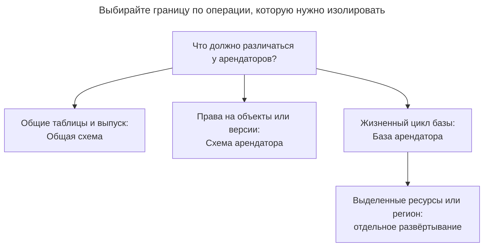
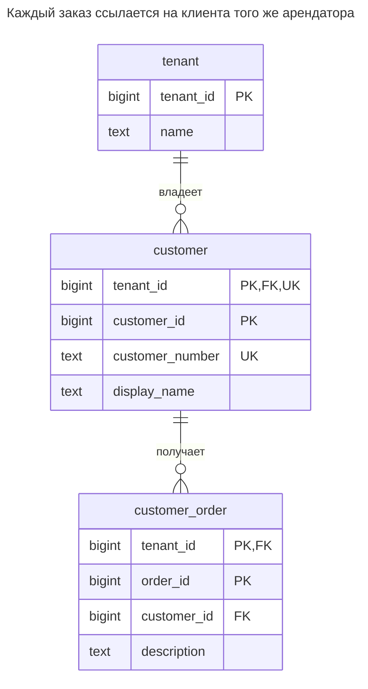
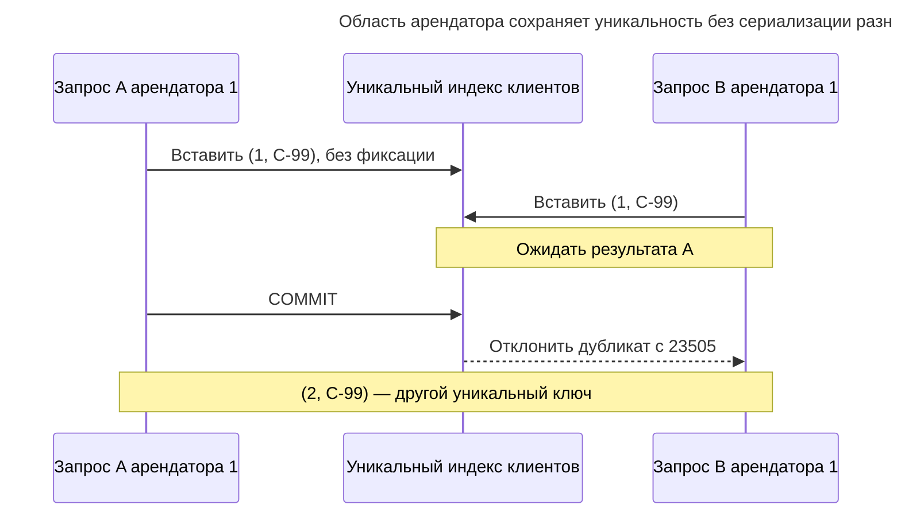
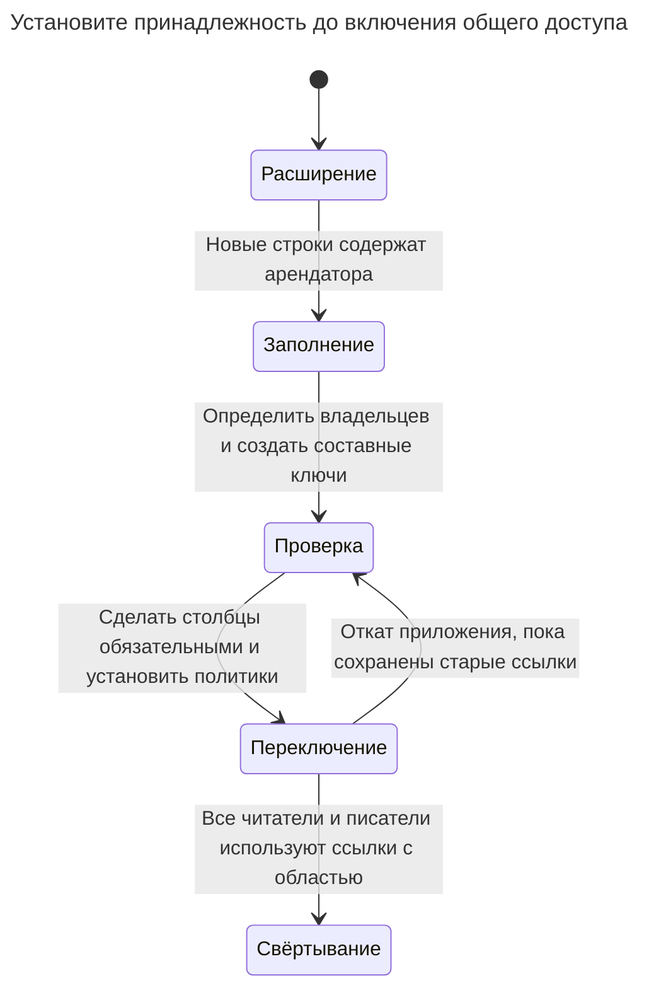

# Общая схема

## Назначение

Общая схема хранит данные всех арендаторов в одних таблицах, различая их по столбцу `tenant_id` в каждой строке. Обычно это самая дешёвая в эксплуатации модель: одна схема для миграций и один пул соединений, но изоляция зависит от соблюдения границ арендатора на каждом пути доступа. Глава показывает, как включить `tenant_id` в ключи и внешние ключи, чтобы строки разных арендаторов не могли ссылаться друг на друга, как защита строк PostgreSQL обеспечивает фильтрацию в базе и что делать с арендатором, переросшим остальных. [Сравнение моделей аренды Azure](https://learn.microsoft.com/en-us/azure/azure-sql/database/saas-tenancy-app-design-patterns) отмечает низкую стоимость общей базы в расчёте на небольшого арендатора.

## Также известен как

Shared tables; pooled tenancy. AWS называет общее хранилище [моделью pool](https://docs.aws.amazon.com/whitepapers/latest/saas-architecture-fundamentals/data-partitioning.html) и разделяет размещение данных и изоляцию доступа. Citus называет распределённую форму [шардированием по строкам](https://docs.citusdata.com/en/stable/get_started/concepts.html); шардирование — вариант размещения, а не обязательное условие паттерна.

## Проблема

Вы продаёте одно приложение управления заказами многим компаниям. Номер клиента `C-10` допустим в каждой компании, а заказ должен ссылаться на клиента своей компании. Глобально уникальный ID заказа не выражает это правило принадлежности. Внешний ключ только по `customer_id` может пропустить заказ с клиентом другой компании.

Добавление `WHERE tenant_id = ...` на основном экране клиентов оставляет импорты, фоновые задания, отчёты и служебные точки доступа отдельными задачами. Нужны и инвариант связей, и граница доступа. Ни один из них не заменяет аутентификацию, определяющую, от имени какого арендатора разрешён запрос.

## Решение

Добавьте `tenant_id` во все таблицы арендатора, включая таблицы связей и рабочих заданий. Определите идентичность строк и бизнес-уникальность в этой области и передавайте область через каждый внешний ключ на данные арендатора. В примере `(tenant_id, customer_id)` идентифицирует клиента, а `(tenant_id, customer_number)` — его бизнес-номер. PostgreSQL поддерживает такие [многостолбцовые ограничения уникальности и внешние ключи](https://www.postgresql.org/docs/18/ddl-constraints.html).

Примените защиту строк (RLS) к каждой таблице арендатора. Используйте `USING` для выбора существующих строк и `WITH CHECK` для проверки вставленных или изменённых строк согласно [контракту `CREATE POLICY`](https://www.postgresql.org/docs/18/sql-createpolicy.html) PostgreSQL. Пример получает аутентифицированную область из локальной настройки транзакции, которую устанавливает доверенный код приложения. Предикаты арендатора остаются и в запросах приложения: они поясняют намерение и делают границы соединений явными.

Считайте соединение, которому разрешено самостоятельно устанавливать контекст арендатора, доверенным промежуточным слоем. Эта реализация защищает от забытого предиката строки, но не мешает произвольному SQL под той же ролью выбрать другого арендатора. Если арендаторам нужен прямой доступ через SQL, выдавайте им независимо ограниченные учётные данные или выбирайте одну из более строгих границ маршрутизации ниже.

## Альтернативы и выбор

| Соседний паттерн или механизм | Связь | Определяющее требование |
| --- | --- | --- |
| [Схема арендатора](schema-per-tenant.md) | Замена | Нужны отдельные права на объекты или поэтапные версии схемы в одной базе |
| [База арендатора](database-per-tenant.md) | Замена; дополнение в гибридном развёртывании | Нужен экспорт базы целиком для арендатора или выделенное размещение отдельных арендаторов |
| Защита строк | Вариант реализации | Общим таблицам нужен фильтр строк, обеспечиваемый базой для ограниченной роли приложения |
| [Секционирование таблицы](table-partitioning.md) | Дополнение | Физическое обслуживание таблиц или отсечение секций требует ключа секционирования; изоляция доступа остаётся отдельной задачей |

Полная таблица — в [Атласе решений](decision-atlas.md). Избегайте [Клонированных таблиц](cloned-tables.md) как подмены явной модели аренды соглашением об именовании.



Крупный арендатор может покинуть общий пул без изменения модели для остальных. Отдельная база на том же сервере всё равно требует дополнительного решения о развёртывании, если нужна изоляция ресурсов.

## Структура



Метки `UK` клиента вместе обозначают `(tenant_id, customer_number)`, а не два отдельных уникальных столбца. Внешний ключ заказа включает и `tenant_id`, и `customer_id`; копирование номера или ID клиента другого арендатора не позволит пересечь границу принадлежности.

## Таблицы и инварианты

- **`ss.tenant`** регистрирует арендаторов. Это управляющие данные, недоступные рабочей роли в этом практикуме.
- **`ss.customer`** имеет составной первичный ключ и уникальность номера клиента в пределах арендатора. У двух арендаторов может быть клиент `10` с номером `C-10`.
- **`ss.customer_order`** требует соответствующего клиента того же арендатора. Индекс `(tenant_id, customer_id)` поддерживает этот путь доступа; PostgreSQL [не индексирует ссылающиеся столбцы автоматически](https://www.postgresql.org/docs/18/ddl-constraints.html#DDL-CONSTRAINTS-FK).
- **Политика доступа** применяется и к клиентам, и к заказам. Отсутствующий контекст не показывает строк и не разрешает вставку. Не выдавайте рабочей роли владение таблицами, `BYPASSRLS` или операции над всей таблицей, такие как `TRUNCATE`; PostgreSQL описывает эти [исключения RLS](https://www.postgresql.org/docs/18/ddl-rowsecurity.html).

## Когда применять

- Арендаторы используют одну схему и могут одновременно получать каждый выпуск.
- Вы хотите создавать арендатора как данные, не создавая новый набор объектов базы.
- Большинство операций приложения относится к одному аутентифицированному арендатору, и вы можете установить эту область до доступа к данным.
- Позже можно изолировать необычно дорогих арендаторов через маршрутизацию, не обещая каждому выделенные ресурсы сейчас.

## Последствия и компромиссы

- ➕ Одно определение таблицы, индекса и миграции обслуживает всех арендаторов пула.
- ➕ Уникальность в пределах арендатора остаётся ограничением базы, а не предварительной проверкой приложения.
- ➖ Идентификатор арендатора расширяет ключи и должен передаваться потомкам, соединениям, кешам и полезной нагрузке заданий.
- ➖ Медленная миграция или дорогая нагрузка расходует общий эксплуатационный бюджет пула. RLS ограничивает строки, а не потребление ресурсов; AWS рассматривает [«шумных соседей» отдельно от разделения данных](https://docs.aws.amazon.com/whitepapers/latest/saas-architecture-fundamentals/data-partitioning.html).
- ➖ Восстановление одного арендатора требует найти весь граф его строк и согласовать его с общими справочниками. Объекта размером с арендатора, который можно восстановить целиком, нет.

## Реализация

[Полный скрипт для PostgreSQL 18.6](../assets/shared-schema/shared-schema.sql) создаёт двух арендаторов, проверяет поведение без контекста и подтверждает два ожидаемых отказа. Запускайте его от администратора практикума в новой базе; для рабочих операций он переключается на непривилегированную роль. Основной DDL:

```sql
CREATE ROLE ss_app NOLOGIN NOSUPERUSER NOBYPASSRLS;
CREATE SCHEMA ss;
CREATE TABLE ss.tenant (
    tenant_id bigint PRIMARY KEY,
    name text NOT NULL
);
CREATE TABLE ss.customer (
    tenant_id bigint NOT NULL REFERENCES ss.tenant (tenant_id),
    customer_id bigint NOT NULL,
    customer_number text NOT NULL,
    display_name text NOT NULL,
    PRIMARY KEY (tenant_id, customer_id),
    UNIQUE (tenant_id, customer_number)
);
CREATE TABLE ss.customer_order (
    tenant_id bigint NOT NULL,
    order_id bigint NOT NULL,
    customer_id bigint NOT NULL,
    description text NOT NULL,
    PRIMARY KEY (tenant_id, order_id),
    CONSTRAINT order_customer_fk FOREIGN KEY (tenant_id, customer_id)
        REFERENCES ss.customer (tenant_id, customer_id)
);
CREATE INDEX order_customer_idx ON ss.customer_order (tenant_id, customer_id);
```

В примере ID заданы явно, чтобы были видны границы арендатора; генератор выбирайте отдельно, как объясняется в [Суррогатном ключе](surrogate-key.md). Администратор создаёт клиентов `(1, 10)`, `(2, 10)` и `(2, 20)`, затем устанавливает одинаковую политику на обе таблицы арендатора:

```sql
ALTER TABLE ss.customer ENABLE ROW LEVEL SECURITY;
ALTER TABLE ss.customer FORCE ROW LEVEL SECURITY;
CREATE POLICY tenant_scope ON ss.customer TO ss_app
    USING (tenant_id = nullif(current_setting('app.tenant_id', true), '')::bigint)
    WITH CHECK (tenant_id = nullif(current_setting('app.tenant_id', true), '')::bigint);
ALTER TABLE ss.customer_order ENABLE ROW LEVEL SECURITY;
ALTER TABLE ss.customer_order FORCE ROW LEVEL SECURITY;
CREATE POLICY tenant_scope ON ss.customer_order TO ss_app
    USING (tenant_id = nullif(current_setting('app.tenant_id', true), '')::bigint)
    WITH CHECK (tenant_id = nullif(current_setting('app.tenant_id', true), '')::bigint);
GRANT USAGE ON SCHEMA ss TO ss_app;
GRANT SELECT, INSERT, UPDATE, DELETE ON ss.customer, ss.customer_order TO ss_app;
```

`app.tenant_id` — соглашение приложения в этом примере, а не встроенная переменная арендатора PostgreSQL. PostgreSQL принимает [составные имена пользовательских параметров из двух частей](https://www.postgresql.org/docs/18/runtime-config-custom.html); [`current_setting(..., true)`](https://www.postgresql.org/docs/18/functions-admin.html#FUNCTIONS-ADMIN-SET) возвращает `NULL`, если параметра нет. `nullif` также обрабатывает пустое значение после сброса. Практикум проверяет это выражение, а не приписывает соглашение документации RLS.

При входе запроса аутентифицируйте арендатора, начните транзакцию, установите область и выполняйте всю работу на этом полученном из пула соединении:

```sql
SET ROLE ss_app;
BEGIN;
SET LOCAL app.tenant_id = '1';
INSERT INTO ss.customer_order VALUES (1, 100, 10, 'First order');
SELECT tenant_id, customer_id, customer_number FROM ss.customer;
UPDATE ss.customer SET display_name = 'Acme renamed'
WHERE tenant_id = 1 AND customer_id = 10;
SELECT o.order_id, c.display_name
FROM ss.customer_order AS o
JOIN ss.customer AS c USING (tenant_id, customer_id);
COMMIT;
```

Запрос клиентов возвращает только `(1, 10, C-10)`, хотя в нём нет предиката арендатора; соединение возвращает `(100, Acme renamed)`. [`SET LOCAL`](https://www.postgresql.org/docs/18/sql-set.html) действует до конца транзакции, поэтому следующий запрос должен снова установить контекст. Производственные соединения должны аутентифицироваться ограниченными логинами, наследующими `ss_app`; доступный только администратору `SET ROLE` в практикуме — удобство тестирования.

В транзакции арендатора 1 эти две недопустимые операции завершаются ошибками по разным причинам:

```sql
INSERT INTO ss.customer_order VALUES (1, 101, 20, 'Wrong tenant');
INSERT INTO ss.customer_order VALUES (2, 102, 10, 'Forged scope');
```

Выполняйте их независимо или через блоки обработки исключений скрипта. PostgreSQL 18.6 отклоняет первую с SQLSTATE `23503`: `ERROR: insert or update on table "customer_order" violates foreign key constraint "order_customer_fk"`. Клиент `(2, 20)` существует, а `(1, 20)` — нет. Вторая возвращает SQLSTATE `42501`: `ERROR: new row violates row-level security policy for table "customer_order"`. Первая проверка защищает связи, вторая — разрешённую область записи.

## Поддержка в движках

- **PostgreSQL 18:** приведённые политики и составные ограничения независимо проверяют доступ и связи. `FORCE` распространяется на обычных владельцев, но суперпользователи и роли с `BYPASSRLS` по-прежнему обходят политики; исключите их из обработки запросов. [Проверки ссылочной целостности обходят RLS](https://www.postgresql.org/docs/18/ddl-rowsecurity.html), поэтому невидимость родителя не заменяет правило внешнего ключа.
- **MySQL 8.4:** вариант реализации — ограниченное обновляемое представление с [`WITH CHECK OPTION`](https://dev.mysql.com/doc/refman/8.4/en/create-view.html), отклоняющее записи вне его предиката. Запретите прямой доступ к базовой таблице и отдельно спроектируйте доверенный контекст; это не прямой перенос DDL политик PostgreSQL.
- **SQL Server 2025 (17.x):** [политики безопасности](https://learn.microsoft.com/en-us/sql/relational-databases/security/row-level-security?view=sql-server-ver17) используют встроенные табличные функции-предикаты. Для видимости используйте фильтрующие предикаты, для недопустимых записей — блокирующие; один фильтр не запрещает вставлять невидимые строки.
- **Oracle AI Database 26ai:** [Virtual Private Database](https://docs.oracle.com/en/database/oracle/oracle-database/26/dbseg/oracle-virtual-private-database.html) добавляет динамически создаваемые предикаты защищённым объектам. Для новых проектов, которым нужен контроль доступа к строкам и столбцам, Oracle рекомендует Real Application Security; оцените этот вариант реализации, а не копируйте синтаксис политик PostgreSQL.
- **SQLite 3:** [отсутствие `GRANT` и `REVOKE`](https://www.sqlite.org/omitted.html) означает, что внешней границей доступа служат права на файл базы. Держите область арендатора в доверенном коде приложения или разделяйте файлы; проверки на основе ролей из этого практикума не переносятся.

## Сбои и конкурентность



[Проверка уникального индекса](https://www.postgresql.org/docs/18/index-unique-checks.html) PostgreSQL ждёт незавершённую конфликтующую транзакцию и проверяет её результат. Если A откатится, B сможет продолжить. Для простого создания клиента не нужна блокировка всего арендатора; доверьте разрешение конфликта ограничению с его областью.

Более опасный сбой — повторно используемое соединение с состоянием сеанса предыдущего арендатора. Начинайте и завершайте область при каждом запросе, включая задания и повторы; сбрасывайте неудачные транзакции перед возвратом соединений. Отсутствующий контекст должен запрещать доступ, а не выбирать арендатора по умолчанию. Проверяйте все поддерживаемые рабочие роли: тест суперпользователя может пройти в обход нужной границы.

После неопределённой фиксации повторяйте с тем же арендатором и идентичностью операции; [Публичный идентификатор](public-identifier.md) по-прежнему требует авторизации арендатора. Никогда не считайте ID, найденный вне разрешённой области, доказательством владения строкой.

## Миграция

Начните с существующих таблиц одной компании. Добавьте допускающие `NULL` столбцы арендатора, назначьте каждую старую строку известному арендатору и включайте аутентифицированную область в новые записи. Заполняйте потомков через связь с родителем; не угадывайте принадлежность по случайно совпавшим ID. Сохраняйте старые ссылки, пока создаёте составную уникальность и новые внешние ключи. PostgreSQL позволяет добавлять внешние ключи как [`NOT VALID` и проверять позже](https://www.postgresql.org/docs/18/sql-altertable.html); планируйте окна блокировок DDL вместо обещания преобразования без блокировок.



Переключайте ограниченные рабочие роли только после проверки чтения и отклонения записи хотя бы для двух арендаторов. Удаляйте старые внешние ключи без области и столбцы только после перевода всех писателей; период совместимости описан в [Расширении и свёртывании](expand-contract.md). При откате кода приложения сохраняйте ограничения принадлежности.

Для выделения переросшего пул арендатора создайте целевую схему или базу, скопируйте полный граф его строк, перенесите последующие изменения и ненадолго запретите записи в источнике перед переключением доверенного маршрута арендатора. Проверьте количества и ссылки до открытия записи в целевой базе. После её начала откат требует обратной синхронизации либо новой паузы записи и копирования; простое восстановление старого маршрута потеряет эти изменения. Общим справочникам нужна явная политика копирования или владения.

## Антипаттерны и частые ошибки

- Объявлять `FOREIGN KEY (customer_id)` и считать, что отдельный `tenant_id` делает связь безопасной; более общая проблема целостности разобрана в [Отсутствующих внешних ключах](missing-foreign-keys.md).
- Включать RLS у родителя, забывая потомков, экспорты или новые таблицы.
- Позволять запросу напрямую задавать доверенную область либо выполнять произвольный SQL под ролью, способной менять настройку контекста.
- Тестировать от владельца или суперпользователя и принимать результат за проверку рабочей политики.
- Создавать `orders_tenant_42` ради обхода проблемы общей таблицы; [Клонированные таблицы](cloned-tables.md) превращают создание арендаторов в повторяющийся DDL, не обеспечивая полноценной модели доступа.

## Известные применения

- [Пример мультитенантной рекламы Citus](https://docs.citusdata.com/en/stable/use_cases/multi_tenant.html) добавляет `company_id` в дочерние таблицы и составные ключи до распределения данных арендаторов. Раздел о крупных арендаторах описывает перенос на выделенные узлы; это возможности расширения, а не встроенное шардирование PostgreSQL.
- [Мультитенантная модель базы Microsoft](https://learn.microsoft.com/en-us/azure/azure-sql/database/saas-tenancy-app-design-patterns) хранит арендаторов вместе со столбцами их идентификаторов и сравнивает этот подход с отдельными базами и гибридными моделями.

## Связанные паттерны

- [Схема арендатора](schema-per-tenant.md) переносит область в пространства имён объектов и права.
- [База арендатора](database-per-tenant.md) переносит маршрутизацию и жизненный цикл на границу базы.
- [Суррогатный ключ](surrogate-key.md) выбирает выдачу ID строк отдельно от принадлежности.
- [Публичный идентификатор](public-identifier.md) определяет внешние ID, не заменяя авторизацию.
- [Секционирование таблицы](table-partitioning.md) меняет физическую организацию внутри общей модели.
- [Расширение и свёртывание](expand-contract.md) разбивает миграцию принадлежности на этапы.
- [Клонированные таблицы](cloned-tables.md) объясняют цену неуправляемых копий таблиц.
- [Отсутствующие внешние ключи](missing-foreign-keys.md) объясняют, почему проверки приложения не заменяют ограничения связей.
