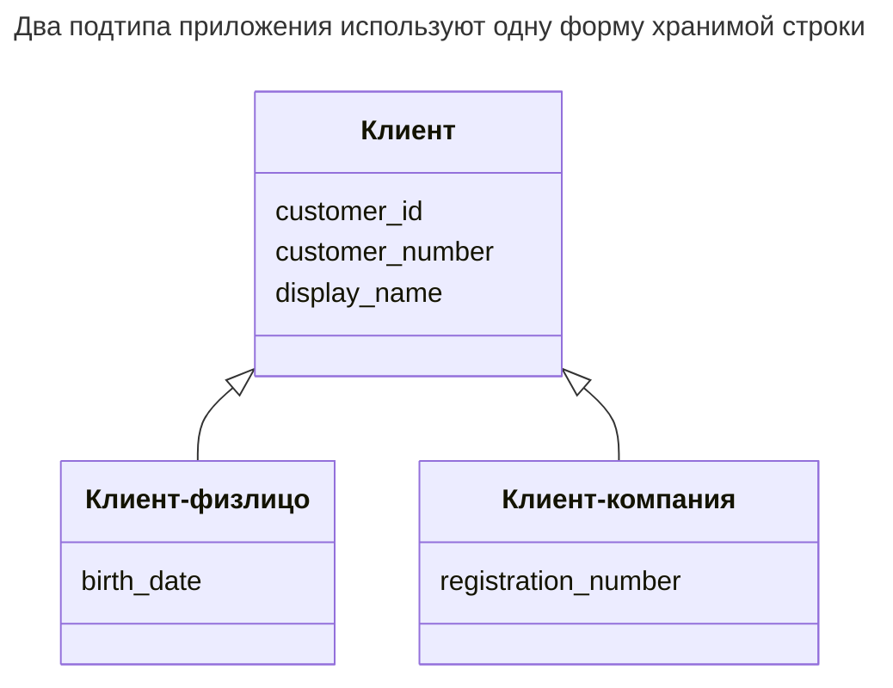
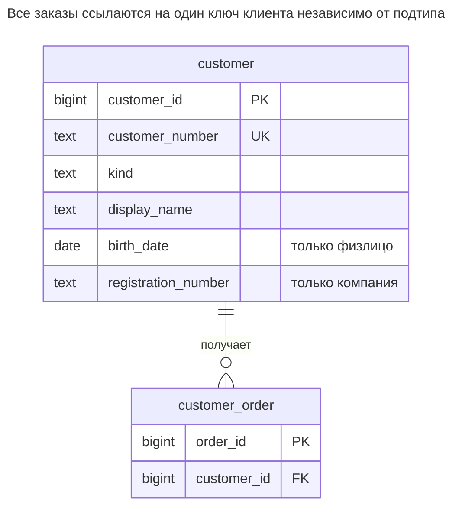
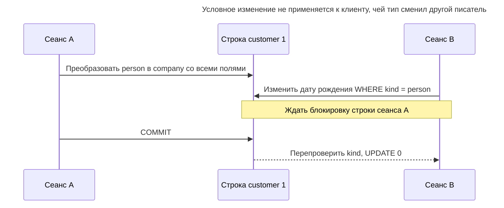
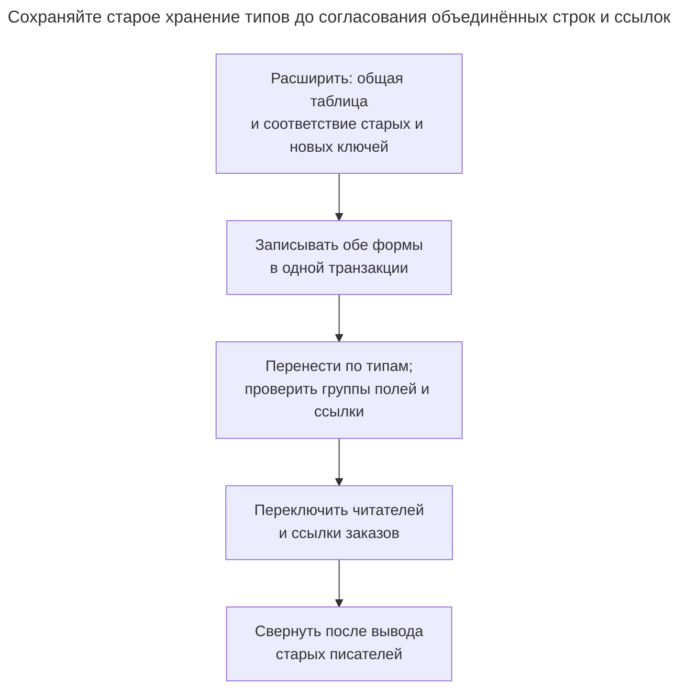

# Единая таблица

## Назначение

Единая таблица хранит все подтипы сущности — например, клиентов-физлиц и клиентов-компании — в одной таблице со столбцом типа и объединением столбцов всех подтипов. Запросам по всем подтипам не нужны соединения, а добавление подтипа редко требует новой таблицы. Глава показывает, как ограничения `CHECK` требуют заполнения или отсутствия специфичных столбцов по типу — правило, иначе оставляемое приложению, — и когда растущее число допускающих `NULL` столбцов указывает на более подходящее отображение наследования.

## Также известен как

Single Table Inheritance Фаулера; стратегия Hibernate `SINGLE_TABLE`. Паттерн получил имя в [Single Table Inheritance Фаулера](https://martinfowler.com/eaaCatalog/singleTableInheritance.html); [руководство Hibernate](https://docs.hibernate.org/orm/6.6/userguide/html_single/Hibernate_User_Guide.html#entity-inheritance-single-table) показывает отображение различителя.

## Проблема

Система заказов обслуживает людей и компании. У обоих есть клиентский номер и отображаемое имя; только у человека — дата рождения, только у компании — регистрационный номер. Вы часто выводите всех клиентов и хотите одну обычную ссылку на клиента в каждом заказе.

Две полные таблицы дублируют общие столбцы и оставляют заказу выбор целей. Общая таблица без ограничений формы создаёт другую проблему: компания может иметь дату рождения человека без собственного регистрационного номера. Тогда метка типа сообщает меньше, чем вы ожидаете.

## Решение

Храните полного клиента одной строкой. Сделайте общие поля обязательными, задайте `kind` закрытый словарь и выразите разрешённые сочетания полей подтипов одной именованной проверкой. Пример намеренно требует и присутствия нужных полей, и отсутствия неверных. Смена типа означает замену его группы полей в том же операторе.



Это типы приложения, а не три таблицы. Их объединённые поля становятся одной строкой `customer` ниже; различитель выбирает допустимые поля подтипа.

## Альтернативы и выбор

| Соседний паттерн | Связь | Определяющее требование |
| --- | --- | --- |
| [Таблицы классов](class-table-inheritance.md) | Замена | Группы полей подтипов велики, требуют собственных ссылок или меняются независимо |
| [Таблицы конкретных классов](concrete-table-inheritance.md) | Замена | Вы преимущественно читаете один конкретный тип и не нуждаетесь в общей цели ссылок |
| [Столбец JSON](json-column.md) | Дополнение или замена переменной группы полей | Форма атрибутов открыта; вы принимаете явную проверку путей вместо фиксированных столбцов подтипов |
| [Типизированные свойства](typed-properties.md) | Замена для определяемых во время работы атрибутов | Администраторы определяют поля после развёртывания; известные классы — неверная граница |
| [Объект роли](role-object.md) | Замена для пересекающихся классификаций | Клиент может одновременно иметь несколько ролей вместо ровно одного подтипа |

Полная таблица — в [Атласе решений](decision-atlas.md). Несколько столбцов с `NULL` сами по себе не оправдывают смену отображения; считайте группы полей, чтения и правила записи, которые действительно нужно сопровождать.

## Структура



Каждый заказ называет одного клиента. Нет таблиц человека или компании для соединения, а проверка строки связывает `kind` с допускающими `NULL` полями подтипов. Ключ не меняется при допустимом преобразовании подтипа.

## Таблицы и инварианты

- **`customer`** имеет первичный ключ для ссылок и отдельный уникальный клиентский номер на оба подтипа. `kind` обязателен и ограничен `person` или `company`.
- **`customer_shape`** требует ровно группу полей, выбранную `kind`. Явные условия `IS NULL` / `IS NOT NULL` избегают неопределённого результата: PostgreSQL [принимает проверку с результатом `NULL`](https://www.postgresql.org/docs/18/ddl-constraints.html#DDL-CONSTRAINTS-CHECK-CONSTRAINTS).
- **`customer_order`** требует существующего клиента и запрещает удаление клиента с заказами. Внешний ключ проверяет существование, а не конкретный подтип; если заказ разрешён лишь компаниям, нужна другая схема ссылок.

## Когда применять

- Набор подтипов известен, и каждый добавляет управляемое число полей.
- Вы часто ищете, сортируете или адресно ссылаетесь на всё семейство клиентов.
- У клиента один исключающий остальные тип, а допустимую строку можно описать локальными условиями.

## Последствия и компромиссы

- ➕ Одна вставка создаёт целого клиента, одна ссылка охватывает семейство.
- ➕ Уникальность клиентского номера охватывает все подтипы без второго реестра.
- ➖ Нельзя безусловно объявить все столбцы подтипов `NOT NULL`; условная обязательность выражается проверками.
- ➖ Каждый новый подтип меняет общую таблицу и правило формы, затрагивая писателей существующих типов.
- ➖ Чтение полной строки включает объединение полей, не нужное ни одному отдельному подтипу. Не обещайте выигрыш объёма или пропускной способности без измерения фактических проекций и индексов.

## Реализация

[Полный скрипт](../assets/single-table-inheritance/single-table-inheritance.sql) проверяет вставку, отказ и преобразование подтипа. ID заданы явно, чтобы отделить выдачу от отображения; генераторы рассмотрены в [Суррогатном ключе](surrogate-key.md).

```sql
CREATE TABLE customer (
    customer_id bigint PRIMARY KEY,
    customer_number text NOT NULL UNIQUE,
    kind text NOT NULL CHECK (kind IN ('person', 'company')),
    display_name text NOT NULL,
    birth_date date,
    registration_number text,
    CONSTRAINT customer_shape CHECK (
        (kind = 'person' AND birth_date IS NOT NULL AND registration_number IS NULL)
        OR
        (kind = 'company' AND birth_date IS NULL AND registration_number IS NOT NULL)
    )
);
CREATE TABLE customer_order (
    order_id bigint PRIMARY KEY,
    customer_id bigint NOT NULL REFERENCES customer (customer_id)
);
CREATE INDEX customer_order_customer_idx ON customer_order (customer_id);
```

Создайте оба типа, добавьте заказы и запросите общие поля без соединения с подтипом:

```sql
INSERT INTO customer VALUES
    (1, 'C-1', 'person', 'Ada', DATE '1990-01-01', NULL),
    (2, 'C-2', 'company', 'Northwind', NULL, 'REG-2');
INSERT INTO customer_order VALUES (10, 1), (20, 2);
SELECT customer_number, kind, display_name FROM customer ORDER BY customer_id;
UPDATE customer SET display_name = 'Ada Lovelace' WHERE customer_id = 1;
```

Запрос возвращает `(C-1, person, Ada)` и `(C-2, company, Northwind)`. Изменение только различителя недопустимо:

```sql
UPDATE customer SET kind = 'company' WHERE customer_id = 1;
```

PostgreSQL 18.6 возвращает SQLSTATE `23514`: `ERROR: new row for relation "customer" violates check constraint "customer_shape"`. Полное преобразование проходит:

```sql
UPDATE customer
SET kind = 'company', birth_date = NULL, registration_number = 'REG-1'
WHERE customer_id = 1;
SELECT o.order_id, c.kind, c.registration_number
FROM customer_order AS o JOIN customer AS c USING (customer_id)
WHERE o.order_id = 10;
```

Результат — `(10, company, REG-1)`. Ссылка сохранилась; допустимость преобразования конкретного реального клиента — отдельная бизнес-политика. Не используйте преобразование для случайного слияния двух разных идентичностей.

## Поддержка в движках

- **PostgreSQL 18:** отображение реализуют обычные таблицы и проверка строки. Встроенный [`INHERITS`](https://www.postgresql.org/docs/18/ddl-inherit.html) — другой механизм; здесь он не нужен.
- **MySQL 8.4:** сохраняйте проверку [включённой](https://dev.mysql.com/doc/refman/8.4/en/create-table-check-constraints.html), не объявляйте `NOT ENFORCED`. При необходимости адаптируйте типы столбцов.
- **SQL Server 2025 (17.x):** [`CHECK`](https://learn.microsoft.com/en-us/sql/t-sql/statements/create-table-transact-sql?view=sql-server-ver17) выражает то же правило различителя. Имя отображения ORM не устанавливает правило за вас.
- **Oracle AI Database 26ai:** [пустые строки символов считаются `NULL`](https://docs.oracle.com/en/database/oracle/oracle-database/26/sqlrf/Nulls.html). Пустой регистрационный номер не удовлетворяет обязательному полю компании этого примера; явно решите допустимость пустых значений при импорте.
- **SQLite 3:** используйте [таблицы `STRICT`](https://www.sqlite.org/stricttables.html), если полагаетесь на типы хранимых скаляров, заменив `bigint` на `INTEGER`, даты — на проверяемое представление. Включайте [внешние ключи для каждого соединения](https://www.sqlite.org/foreignkeys.html#fk_enable).

## Сбои и конкурентность

Проверка строки защищает каждую обычную вставку и обновление без предварительной проверки приложения. Для процесса «прочитать — изменить — сохранить» включайте ранее прочитанный тип в условие обновления и требуйте одну затронутую строку либо используйте [Столбец версии](version-column.md). PostgreSQL [повторно проверяет условие обновления после ожидания конкурентного писателя](https://www.postgresql.org/docs/18/transaction-iso.html#XACT-READ-COMMITTED) при read committed.



Проигравшему изменению нужна перезагрузка данных, а не слепой повтор с ослабленным условием. Безусловное изменение полей подтипа вместо этого встретит проверку формы, если оставит поля несовместимыми с текущим типом.

## Миграция

Начните с перечня фактических типов и обязательных полей каждого. Исправьте строки, содержащие две несовместимые группы или ни одной. При объединении отдельных таблиц сохраните соответствие каждой старой таблицы и ключа новому ключу; одинаковые целые уже могут существовать в обеих. Осознанно обеспечьте уникальность клиентских номеров вместо произвольного отбрасывания повторов.



Переносите данные с той же блокировкой исходной строки, что и действующие двойные писатели, чтобы устаревшие строки не затёрли новые изменения. В существующей таблице PostgreSQL поддерживает [добавление проверки `NOT VALID` и отдельную валидацию](https://www.postgresql.org/docs/18/sql-altertable.html); DDL всё ещё требует окна блокировки. Сохраняйте старое представление в период [Расширения и свёртывания](expand-contract.md). Откатывайте чтение, пока сохраняется двойная запись; до закрытия окна отката не вводите подтип, который старое представление не хранит.

## Антипаттерны и частые ошибки

- Проверять лишь наличие обязательных полей, разрешая заполнение несовместимых полей подтипов.
- Пропускать `NOT NULL` у `kind`, подрывая условия обычного равенства.
- Считать поставщика и покупателя исключающими подтипами, когда компания бывает обоими; используйте [Объект роли](role-object.md).
- Переносить каждое новое поле в [Нетипизированные свойства](untyped-properties.md) лишь ради отказа от изменения проверки формы.
- Считать FK на `customer` ограничением ссылки на компанию.

## Известные применения

- Rails документирует [наследование с единой таблицей](https://guides.rubyonrails.org/association_basics.html#single-table-inheritance-sti) со столбцом `type`, выбирающим класс модели.
- [Отображение Hibernate `SINGLE_TABLE`](https://docs.hibernate.org/orm/6.6/userguide/html_single/Hibernate_User_Guide.html#entity-inheritance-single-table) явно обсуждает проверки или триггеры целостности подтипов. Проверка здесь — разработанная схема, а не DDL, генерируемый Rails.

## Связанные паттерны

- [Таблицы классов](class-table-inheritance.md) отделяют ограничения подтипов, сохраняя общую идентичность.
- [Таблицы конкретных классов](concrete-table-inheritance.md) делают каждый подтип независимо полным.
- [Столбец JSON](json-column.md) размещает переменные атрибуты рядом с фиксированными общими столбцами.
- [Типизированные свойства](typed-properties.md) дают модель метаданных определяемым во время работы атрибутам.
- [Объект роли](role-object.md) моделирует пересекающиеся и меняющиеся роли.
