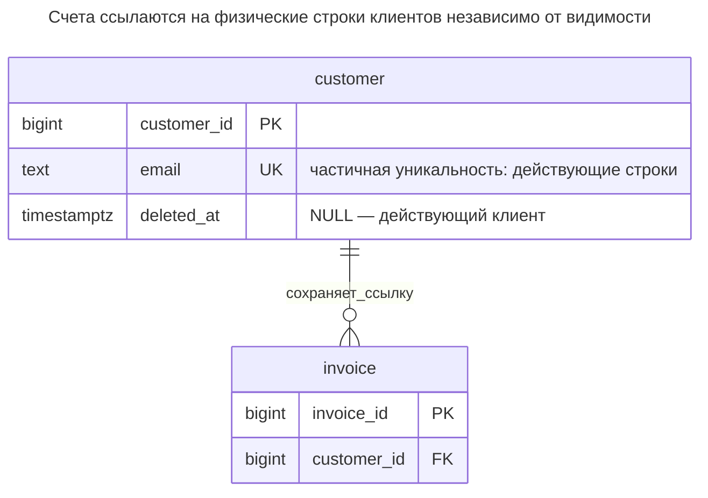
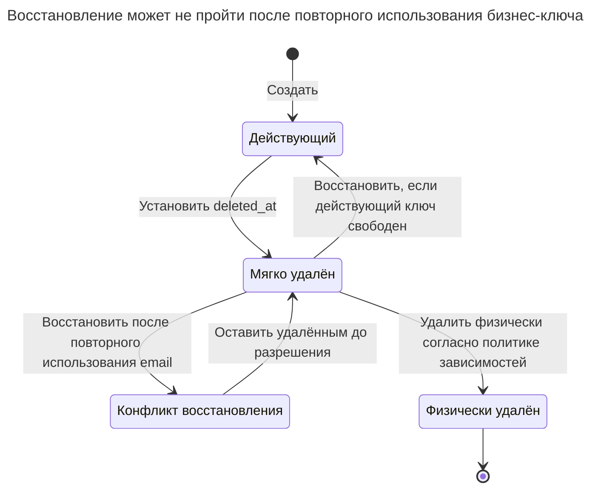
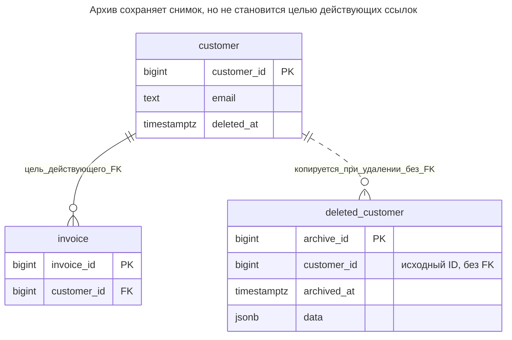
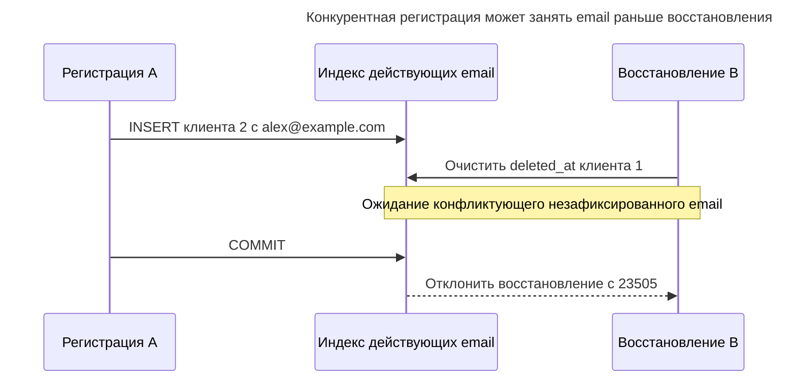
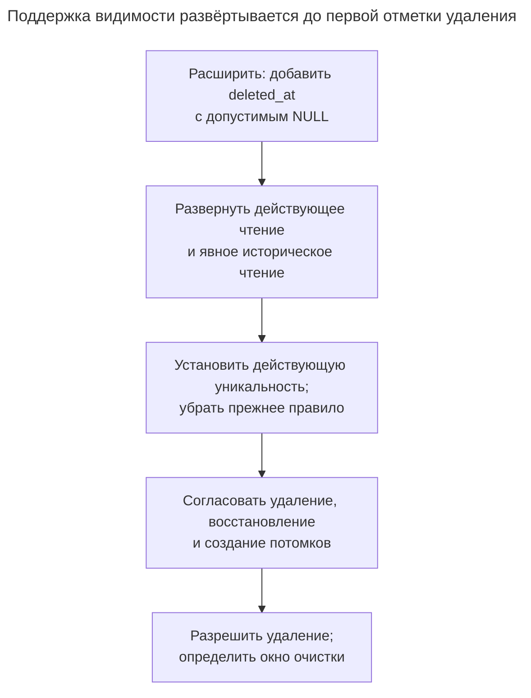

# Мягкое удаление

## Назначение

Мягкое удаление помечает строку как удалённую, обычно временной меткой `deleted_at`, вместо физического удаления, чтобы данные можно было восстановить и продолжать показывать в отчётах. Глава раскрывает цену, из-за которой подход вызывает споры: каждый запрос и каждое ограничение уникальности должны учитывать удалённые строки, внешние ключи продолжают ссылаться на строки, которые приложение считает исчезнувшими, а персональные данные остаются там, где требования конфиденциальности предписывают их удалить. Подход сравнивается с переносом удалённых строк в отдельную архивную таблицу; показано, как частичные уникальные индексы сохраняют уникальность действующих строк. См. [поведение мягкого удаления Laravel](https://laravel.com/docs/12.x/eloquent#soft-deleting) и [частичные уникальные индексы PostgreSQL](https://www.postgresql.org/docs/18/indexes-partial.html).

## Также известен как

Soft deleting в [Laravel Eloquent](https://laravel.com/docs/12.x/eloquent#soft-deleting). Название описывает политику жизненного цикла: приложение скрывает физически существующую строку. Оно не подразумевает исторических версий, стирания или полного процесса восстановления.

## Проблема

Сотруднику поддержки нужно отменить случайное удаление клиента, а счета должны по-прежнему идентифицировать этого клиента. Физическое удаление намеренно блокируется внешним ключом счёта. Замена удаления обновлением временной метки сохраняет строку-цель ссылки, но теперь «существует» и «доступен для новой работы» — разные вопросы.

Сложность появляется, когда другой клиент регистрируется с email удалённого. Если разрешить повторное использование, восстановление старой строки может конфликтовать. Если навсегда запретить его, удаление не освобождает email. Ни один исход не следует автоматически из добавления `deleted_at`; нужно выбрать контракт идентичности и восстановления.

## Решение

Сохраните исходный первичный ключ, установите `deleted_at`, чтобы скрыть клиента из действующих операций, и предоставьте представление действующих строк с `deleted_at IS NULL`. Обеспечьте уникальность email только среди действующих строк [частичным уникальным индексом](https://www.postgresql.org/docs/18/indexes-partial.html) PostgreSQL. Явно определите отчёты: исторический отчёт по счетам соединяется с сохранённым клиентом, а выбор нового клиента использует представление действующих строк.

Восстановление очищает метку только при соблюдении уникальности действующих строк и бизнес-правил. Окончательная очистка — отдельный процесс физического удаления, который разрешает зависимые строки, сохраняемые свидетельства и другие копии согласно политике хранения. Пример сохраняет счета и потому не разрешает окончательно удалить их клиента. Он также не обеспечивает правило «новым счетам нужен действующий клиент»; если это требование есть, добавьте согласованный путь записи.

## Альтернативы и выбор

| Соседний паттерн | Связь | Определяющее требование |
| --- | --- | --- |
| Физическое удаление | Замена | Ссылки и хранение допускают немедленное удаление, а восстановление на месте не нужно |
| Архив удалённых записей | Замена | Нужна копия для восстановления без хранения удалённых строк в действующих таблицах; восстановление может быть явным импортом |
| [Таблица истории](history-table.md) | Дополнение; замена для сохранения прежних значений | Нужны прежние значения, а не только последняя строка с отметкой удаления |
| [Журнал аудита](audit-log.md) | Дополнение | Нужно знать, кто удалил или восстановил строку, почему и в рамках какого запроса |
| [История статусов](status-history.md) | Замена для более широкого жизненного цикла | «Архивирован», «приостановлен» и «закрыт» — разные бизнес-состояния с допустимыми переходами |

Полное сравнение семейства — в [Атласе решений](decision-atlas.md). [Аргумент Брандура Лича против мягкого удаления](https://brandur.org/soft-deletion) подчёркивает утечки в запросах, ослабление семантики действующих ссылок и сложную очистку, предлагая архив удалённых записей. Рассматривайте это как довод проектирования, а не доказательство бесполезности восстановления. Выбирайте мягкое удаление, только если можете определить и поддерживать процесс восстановления.

## Структура



Внешний ключ нацелен на полную таблицу клиентов. Он сохраняет физическую ссылочную целостность после отметки удаления, но не сообщает, доступен ли клиент для новой продажи.

## Таблицы и инварианты

- **`customer`** сохраняет одну физическую строку на ID. Удалённые строки сохраняют ID; восстановление не должно привязывать счета к вновь выданному ID.
- **`customer_live_email_key`** допускает не более одной действующей строки с email и разрешает удалённые дубликаты. Пример трактует переданный email как уже выбранный приложением канонический ключ; нормализация email не реализуется.
- **`invoice`** требует физически существующего клиента. Внешний ключ по-прежнему блокирует физическое удаление, включая удаление после мягкого; изменение `deleted_at` его не затрагивает, поскольку целевой ключ остаётся.
- **`live_customer`** — удобное представление чтения, а не граница безопасности. Читатели базовой таблицы всё ещё могут получать удалённые данные; если видимость ограничивает доступ, отдельно определите привилегии.
- **Время удаления** — время обработки отметки. Оно не записывает автора, прежние значения или несколько циклов удаления/восстановления; используйте для этого события аудита.

## Когда применять

- Вы предлагаете определённое окно восстановления и знаете поведение зависимостей в этом окне.
- Существующие отчёты должны сохранять идентичность объекта, исключённого из действующего выбора.
- Команда может поддерживать отдельные действующие, исторические и очистительные операции, включая фоновые задания и экспорты.

## Последствия и компромиссы

- ➕ Восстановление на месте сохраняет первичный ключ и существующие ссылки.
- ➕ Старые счета могут показывать сохранённого клиента без копирования каждого атрибута в архив.
- ➖ Каждый действующий путь доступа обязан применять правило видимости, включая соединения, фоновые задания и ручной SQL.
- ➖ Уникальность — решение жизненного цикла: освобождение действующего ключа делает позднее восстановление условным.
- ➖ Отметка оставляет строку и её данные на месте. Например, [статья 17 GDPR](https://eur-lex.europa.eu/eli/reg/2016/679/art_17/oj/eng) определяет основания и исключения стирания; скрытие строки само по себе не удаляет персональные данные. Выводите политику очистки или обезличивания из применимых требований вместо трактовки метки как стирания.

## Реализация

[Полный скрипт PostgreSQL 18.6](../assets/soft-delete/soft-delete.sql) проверяет видимость, сохранённые ссылки, конфликт восстановления, архивную альтернативу и запрет физического удаления:

```sql
CREATE SCHEMA soft_example;
CREATE TABLE soft_example.customer (
    customer_id bigint PRIMARY KEY,
    email text NOT NULL,
    deleted_at timestamptz
);
CREATE UNIQUE INDEX customer_live_email_key ON soft_example.customer (email)
WHERE deleted_at IS NULL;
CREATE TABLE soft_example.invoice (
    invoice_id bigint PRIMARY KEY,
    customer_id bigint NOT NULL REFERENCES soft_example.customer (customer_id)
);
CREATE VIEW soft_example.live_customer AS
SELECT customer_id, email FROM soft_example.customer WHERE deleted_at IS NULL;
```

Безусловного ограничения уникальности email намеренно нет. Уникальный ключ `(email, deleted_at)` не обеспечил бы правило «одна действующая строка» при [обычной для PostgreSQL уникальности, различающей `NULL`](https://www.postgresql.org/docs/18/ddl-constraints.html#DDL-CONSTRAINTS-UNIQUE-CONSTRAINTS). Частичный индекс прямо задаёт действующее подмножество.

```sql
INSERT INTO soft_example.customer VALUES (1, 'alex@example.com', NULL);
INSERT INTO soft_example.invoice VALUES (10, 1);
UPDATE soft_example.customer SET deleted_at = clock_timestamp()
WHERE customer_id = 1 AND deleted_at IS NULL;
INSERT INTO soft_example.customer VALUES (2, 'alex@example.com', NULL);
SELECT customer_id FROM soft_example.live_customer;
SELECT i.invoice_id, c.customer_id, c.deleted_at IS NOT NULL AS deleted
FROM soft_example.invoice AS i
JOIN soft_example.customer AS c USING (customer_id);
```

Представление действующих клиентов возвращает клиента `2`. Запрос счёта возвращает `(10, 1, true)`: исходный клиент по-прежнему существует, но помечен удалённым. Не соединяйте исторические отчёты через действующее представление, если это стирает связь из отчёта. Напротив, выбор клиента новой продажи не должен обращаться к неограниченной базовой таблице.

Восстановление клиента `1` теперь конфликтует:

```sql
UPDATE soft_example.customer SET deleted_at = NULL WHERE customer_id = 1;
```

PostgreSQL 18.6 возвращает SQLSTATE `23505`: `ERROR: duplicate key value violates unique constraint "customer_live_email_key"`, с уточнением `DETAIL: Key (email)=(alex@example.com) already exists.` Решите, должен ли пользователь изменить email, отменить новую регистрацию, объединить идентичности отдельным процессом или отказаться от восстановления. Не разрешайте конфликт молчаливым переносом ссылок счетов.



Окончательная очистка находится за пределами обратимого жизненного цикла. Одна метка удаления не сообщает процессу восстановления, какие потомки удалены независимо, а какие скрыты как часть операции над родителем.

Если нужна копия для восстановления, но предпочтительно физическое удаление из действующей таблицы, используйте архив. Пример архивирует клиента `2`, у которого нет счетов, одним оператором через [`DELETE ... RETURNING`](https://www.postgresql.org/docs/18/sql-delete.html) и [изменяющее данные CTE](https://www.postgresql.org/docs/18/queries-with.html#QUERIES-WITH-MODIFYING):

```sql
CREATE TABLE soft_example.deleted_customer (
    archive_id bigint GENERATED ALWAYS AS IDENTITY PRIMARY KEY,
    customer_id bigint NOT NULL,
    archived_at timestamptz NOT NULL DEFAULT clock_timestamp(),
    data jsonb NOT NULL
);
WITH removed AS (
    DELETE FROM soft_example.customer WHERE customer_id = 2 RETURNING *
)
INSERT INTO soft_example.deleted_customer (customer_id, data)
SELECT customer_id, to_jsonb(removed) FROM removed;
UPDATE soft_example.customer SET deleted_at = NULL WHERE customer_id = 1;
```

Вставка в архив и удаление успешны или неуспешны вместе. Затем клиента `1` можно восстановить, поскольку email свободен. В конце скрипт проверяет, что физическое удаление клиента `1` всё ещё вызывает `23503` на `invoice_customer_id_fkey`. Архив — отдельная сохраняемая копия со своей политикой хранения и доступа; он не обходит внешние ключи и не реализует стирания.



Пунктир описывает копирование, а не ссылочное ограничение. В чистой архивной замене `deleted_at` отсутствует в действующей схеме; здесь он оставлен, потому что исполняемый пример сравнивает подходы на одних исходных таблицах. Архив не может принять внешний ключ действующего счёта лишь благодаря хранению исходного ID внутри JSON.

## Поддержка в движках

- **PostgreSQL 18:** [частичные уникальные индексы](https://www.postgresql.org/docs/18/indexes-partial.html) обеспечивают уникальность действующего подмножества. Оставляйте внешние ключи на полном первичном ключе вместо ожидания ссылки на представление или условие только для действующих строк.
- **MySQL 8.4:** используйте [индексируемый генерируемый столбец](https://dev.mysql.com/doc/refman/8.4/en/create-table-secondary-indexes.html), возвращающий email для действующих строк и `NULL` для удалённых, и сделайте его уникальным. MySQL [допускает несколько `NULL` в уникальном индексе](https://dev.mysql.com/doc/refman/8.4/en/create-table.html); при переносе сохраняйте выбранный тип email и правила равенства. Это альтернативное определение, а не синтаксис частичного индекса PostgreSQL.
- **SQL Server 2025 (17.x):** [уникальные фильтрованные индексы](https://learn.microsoft.com/en-us/sql/relational-databases/indexes/create-filtered-indexes?view=sql-server-ver17) обеспечивают уникальность подмножества `deleted_at IS NULL`. Фильтр относится к индексу, а не ограничению уникальности.
- **Oracle AI Database 26ai:** [уникальные индексы на выражениях](https://docs.oracle.com/en/database/oracle/oracle-database/26/sqlrf/CREATE-INDEX.html) поддерживают условную уникальность. Отображайте удалённые строки в `NULL` для каждого индексируемого выражения ключа; пример Oracle опирается на исключение ключей, целиком состоящих из `NULL`.
- **SQLite 3:** [уникальные частичные индексы](https://www.sqlite.org/partialindex.html) выражают то же условие действующих строк. Включайте [контроль внешних ключей для каждого соединения](https://www.sqlite.org/foreignkeys.html#fk_enable), если рассчитываете на запрет физического удаления.

## Сбои и конкурентность



Предварительная проверка свободного email не резервирует его. [Проверка уникального индекса PostgreSQL](https://www.postgresql.org/docs/18/index-unique-checks.html) ожидает незафиксированный конфликт и повторяет проверку. Верните приложению конфликт восстановления; не обходите индекс ради успеха запроса.

Если новым счетам нужен действующий клиент, создание счёта и удаление клиента должны блокировать одну строку клиента до проверки или изменения `deleted_at` внутри своих транзакций. [Строчные блокировки `FOR UPDATE`](https://www.postgresql.org/docs/18/explicit-locking.html#LOCKING-ROWS) PostgreSQL обеспечивают согласование. Один внешний ключ родителя не контролирует неключевое условие жизненного цикла. Решите, могут ли сохраняться счета, принятые до удаления; пример отвечает утвердительно. Определите эквивалентные правила для каждого потомка вместо автоматического каскада с необъяснимой семантикой восстановления.

Используйте условные операции и проверяйте число затронутых строк при повторах удаления или восстановления. Очистка уже очищенной отметки не должна создавать второе бизнес-событие «восстановлен». Метки также недостаточно для обнаружения конкурентных правок через цикл удаления/восстановления; используйте [Столбец версии](version-column.md), если устаревшего редактора нужно отклонить. Записывайте автора и причину через [Журнал аудита](audit-log.md), фиксируя их вместе с изменением жизненного цикла.

## Миграция

Добавьте допускающую `NULL` отметку, пока старый код видит те же строки. До разрешения удаления перечислите всех читателей и писателей: обычные списки, соединения, проверки уникальности, экспорты, административные экраны и задания. Разверните фильтрацию действующих строк и явный исторический доступ вместе с учитывающими зависимости операциями удаления и восстановления. Только затем разрешайте первое мягкое удаление: старый читатель не понимает новое правило видимости.



Если старая схема имеет безусловную уникальность email, сначала создайте частичный уникальный индекс, а старое ограничение удаляйте лишь после поддержки повторного использования ключей и конфликтов восстановления всеми писателями. PostgreSQL поддерживает [конкурентное создание индексов](https://www.postgresql.org/docs/18/sql-createindex.html#SQL-CREATEINDEX-CONCURRENTLY), но удалению ограничения всё ещё нужно запланированное окно блокировки DDL. При откате остановите новые удаления и повторное использование ключей, устраните дубликаты до возврата безусловной уникальности и сохраняйте фильтрацию, пока существующие удалённые строки не получат намеренно выбранную судьбу. Простое развёртывание старых читателей вновь покажет их.

Архивная миграция вместо этого меняет писателей физического удаления так, чтобы они транзакционно сохраняли возвращённую строку. Переносите зависимости по явной политике, совместимой с внешними ключами, и проверяйте восстановление как импорт, включая конфликты ключей и изменение схемы. Сохраняйте архив до окончания срока хранения; не считайте, что старый JSON автоматически является корректным текущим клиентом.

## Антипаттерны и частые ошибки

- Описывать мягкое удаление как отключение внешних ключей. Они по-прежнему защищают физические ссылки, но не дополнительное условие «действующий».
- Фильтровать обычные списки, забывая отчёты, соединения, пакетные задания или уникальность.
- Считать восстановление простой очисткой флага после повторного использования ключей или изменения зависимостей.
- Добавлять одной отметке несколько несвязанных бизнес-смыслов вместо моделирования жизненного цикла через [Историю статусов](status-history.md).
- Называть сохранённую строку, архив, таблицу истории или резервную копию стёртыми, потому что обычное приложение их скрывает.
- Считать удалённые строки ненужными тестовыми данными и позднее очищать без проверки того же графа зависимостей, который исходно блокировал физическое удаление.

## Известные применения

- [SoftDeletes Laravel 12](https://laravel.com/docs/12.x/eloquent#soft-deleting) сохраняет строку, устанавливает `deleted_at` и исключает мягко удалённые модели из обычных запросов моделей. Это область видимости фреймворка, а не правило внешнего ключа базы или защита независимого ручного SQL.
- [Альтернатива Брандура Лича с таблицей удалённых записей](https://brandur.org/soft-deletion) показывает транзакционное удаление в архив восстановления и обосновывает более простую семантику действующих запросов. Восстановление, ссылки и хранение всё равно требуют намеренно выбранной политики.

## Связанные паттерны

- [Таблица истории](history-table.md) записывает прежние значения, которых не сохраняет отметка удаления.
- [Журнал аудита](audit-log.md) устанавливает авторов удаления, восстановления и очистки.
- [История статусов](status-history.md) обслуживает более богатый жизненный цикл, чем «действующий или удалённый».
- [Столбец версии](version-column.md) отклоняет правки на основе устаревшей версии жизненного цикла.
- [Отсутствующие внешние ключи](missing-foreign-keys.md) объясняет необходимость контроля физических связей.
- [Расширение и свёртывание](expand-contract.md) подготавливает читателей до включения нового поведения записи.
