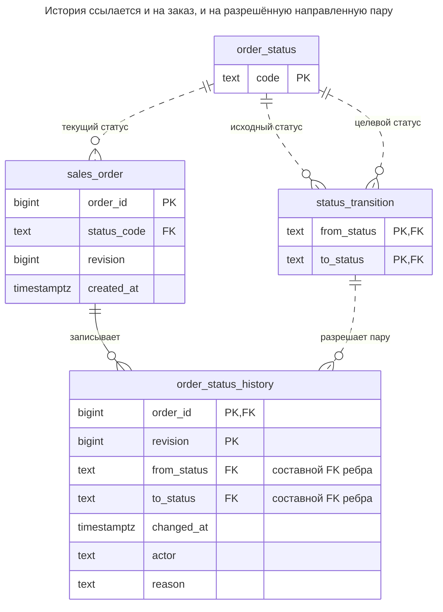
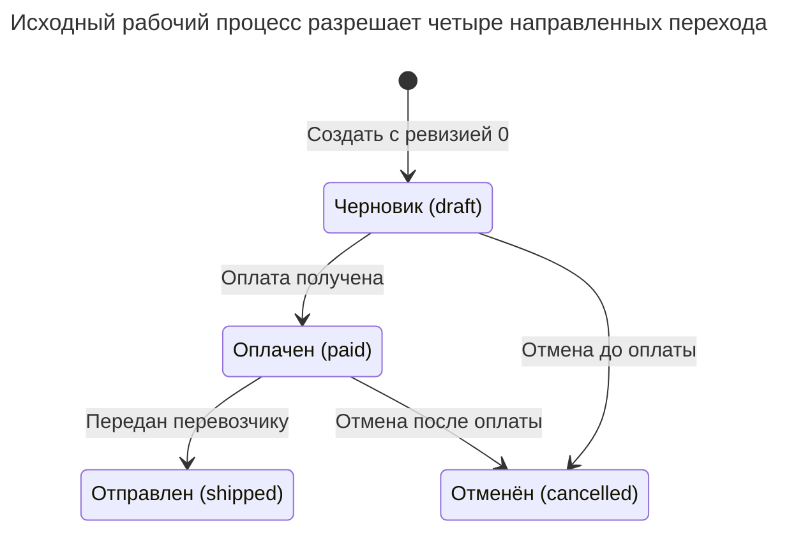
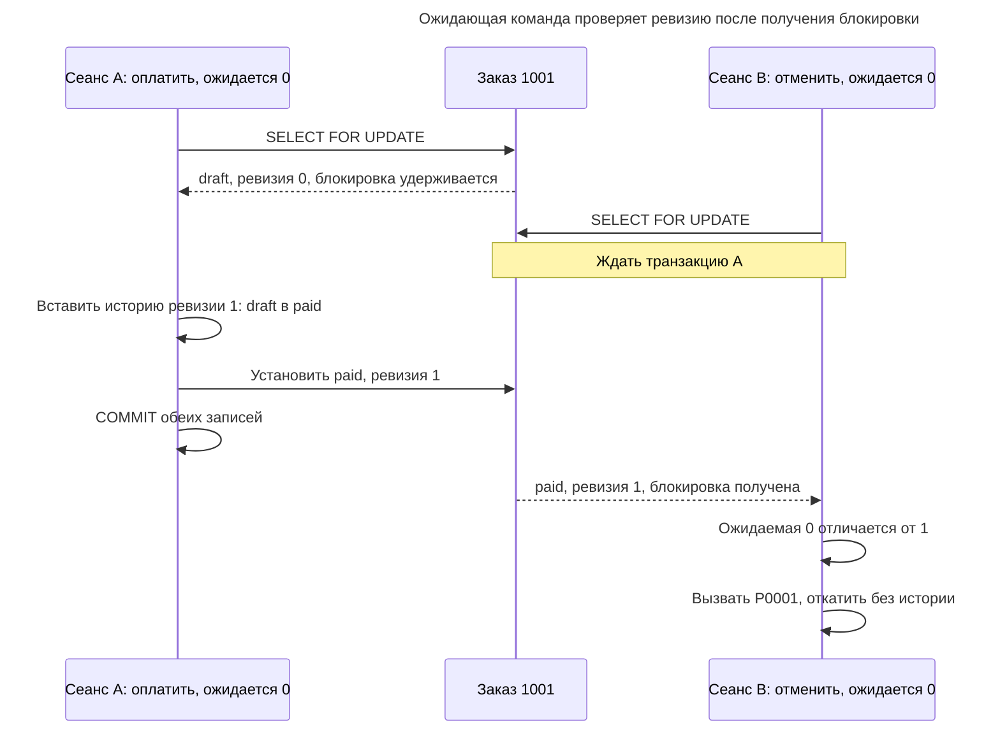
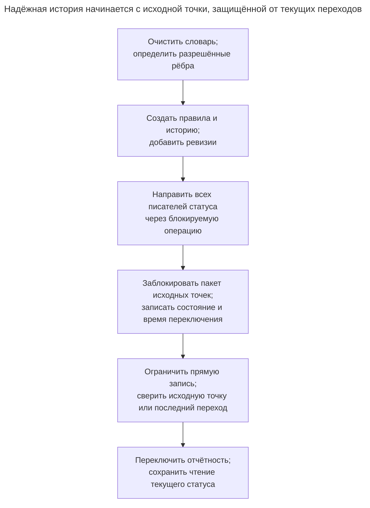

# История статусов

## Назначение

История статусов хранит текущее состояние сущности — заказа, обращения, заявки — вместе с журналом каждого перехода: из какого состояния, в какое, когда, кем и почему. Таблица допустимых переходов, на которую ссылается внешний ключ, отклоняет перемещения, запрещённые процессом, например возврат из `shipped` в `draft`. Глава показывает, как атомарно записывать текущий статус и строку истории, почему одного внешнего ключа недостаточно для проверки начала перехода из настоящего текущего состояния и какая блокировка закрывает этот пробел при конкурентных обновлениях.

## Также известен как

История переходов состояний; история рабочего процесса. Здесь эти термины обозначают типизированную запись изменений жизненного цикла. Реализация на внешних ключах и блокировках ниже — разработанная схема, а не приписывание подхода именованной технике из каталога.

## Проблема

Строка заказа показывает `shipped`, но поддержке нужно знать, когда принята оплата, кто выпустил отправку и почему предыдущий заказ отменили. Перезапись одного столбца статуса теряет эти ответы. Запись сообщения в журнал после обновления создаёт другую проблему: сбой между двумя записями оставляет текущее состояние без объяснения.

Список допустимых имён статусов тоже слабее рабочего процесса. И `draft`, и `shipped` могут быть допустимыми именами, хотя `shipped → draft` запрещён. Даже одной таблицы разрешённых пар недостаточно: два писателя могут прочитать `draft`, затем независимо записать `draft → paid` и `draft → cancelled`. Каждая пара разрешена, но обе не могут описывать следующий переход одной ревизии заказа.

## Решение

Храните текущий статус и ревизию в заказе. Храните разрешённые направленные рёбра в `status_transition` с ключом `(from_status, to_status)`. Добавляйте одну строку истории для каждого принятого перехода, включая ревизию заказа, исходное и целевое состояния, время обработки, исполнителя и причину. Составной внешний ключ истории проверяет ребро по этой таблице; он не сравнивает исходное состояние ребра со строкой заказа.

Направляйте переходы через единственный путь записи, который блокирует заказ, проверяет ревизию вызывающей стороны, получает исходное состояние из заблокированной строки, вставляет историю и обновляет текущее состояние. [Блокировки строк PostgreSQL](https://www.postgresql.org/docs/18/explicit-locking.html#LOCKING-ROWS) сериализуют писателей заказа, а [граница транзакции](https://www.postgresql.org/docs/18/tutorial-transactions.html) заставляет обе записи завершиться вместе или вместе откатиться. Получайте исполнителя из доверенного контекста аутентификации приложения; ограничение непустой строки не аутентифицирует человека.

Используйте ревизии для последовательности внутри заказа, а временные метки — для отчётов по времени обработки. Пример создаёт каждый заказ в `draft` с нулевой ревизией; время создания хранится в заказе, а история начинается с первого перехода. Создание не представляется вымышленным переходом из другого бизнес-состояния. Записывайте отдельного автора создания, если этого требует ваша подотчётность.

## Альтернативы и выбор

| Соседний паттерн или представление | Связь | Определяющее требование |
| --- | --- | --- |
| [Таблица значений](lookup-table.md) только с текущим статусом | Замена для простых требований; дополнение здесь | Нужна принадлежность словарю, но не последовательность переходов |
| [Таблица истории](history-table.md) | Замена для восстановления целых строк; дополнение для других атрибутов | Нужны прежние адреса, суммы и другие значения строки, а не только изменения жизненного цикла |
| [Журнал аудита](audit-log.md) | Дополнение; замена, если достаточно редкого расследования | Нужны действия по многим таблицам, контекст запроса или неудачные попытки |
| [Столбец версии](version-column.md) | Дополнение; вариант оптимистической реализации | Нужно отклонять устаревшие команды; условное обновление может заменить явную блокировку, если история записывается только для победившего обновления |
| Отдельный столбец времени для каждой вехи | Замена для сводки фиксированного однопроходного процесса | Нужны известные вехи и приемлема потеря повторных посещений и произвольных переходов |

Последний вариант похож на [таблицу фактов накапливаемого снимка Кимбалла](https://www.kimballgroup.com/data-warehouse-business-intelligence-resources/kimball-techniques/dimensional-modeling-techniques/accumulating-snapshot-fact-table/), обновляющую строку процесса по мере наступления вех. Это отчётное представление, а не автоматический механизм обеспечения рабочего процесса. Полное сравнение семейства — в [Атласе решений](decision-atlas.md).

## Структура



У заказа может быть ноль или больше принятых переходов. Каждое ребро может встречаться в историях многих заказов. Исходное и целевое состояния ссылаются на один словарь, но направление важно: разрешение `paid → shipped` не разрешает обратный переход. Текущее состояние хранится для прямого чтения, поэтому путь записи должен поддерживать его согласованность с историей.

## Таблицы и инварианты

- **`order_status`** определяет имена состояний. На его первичный ключ ссылаются заказы и обе стороны каждого разрешённого ребра.
- **`status_transition`** допускает каждую направленную пару один раз и запрещает переходы в себя. В этом примере набор правил сохраняется: использованные рёбра нельзя удалить, пока на них ссылается история.
- **`sales_order`** хранит один текущий статус и неотрицательную ревизию. Управляемый путь создания начинает с `draft`, ревизия ноль. Значения по умолчанию не запрещают привилегированному писателю явно вставить другое состояние.
- **`order_status_history`** идентифицирует переход парой `(order_id, revision)`, требует положительную ревизию, непустых исполнителя и причину и проверяет пару через `history_transition_fk`. Первичный ключ поддерживает упорядоченную историю заказа; отдельный ID истории не нужен.
- **Согласованность и полноту цепочки** обеспечивает ограниченный путь записи: он получает `from_status`, один раз увеличивает ревизию, вставляет строку и обновляет состояние. Ни FK пары, ни первичный ключ истории сами по себе не обеспечивают протокол. Роли приложения не получают прямых прав записи в таблицы; владение остаётся доверенной возможностью сопровождения.

## Когда применять

- Поддержке и отчётности процесса нужны последовательность принятых изменений состояния и сведения об их авторах.
- Некоторые пары допустимых имён состояний должны быть запрещены.
- Конкурентные обработчики или пользователи могут подавать конкурирующие команды для одной сущности.
- Вы можете определить управляемый путь создания и единый транзакционный путь перехода.

## Последствия и компромиссы

- ➕ Чтение текущего состояния остаётся простым, а чтение переходов сохраняет ход процесса.
- ➕ FK разрешённых пар ловит запрещённые рёбра, даже если в процедуре нет отдельной ветки для такого ребра.
- ➕ Ревизии обнаруживают устаревшие команды, в том числе после выхода из состояния и возврата в него.
- ➖ Текущее состояние хранится вместе с историей; нужно запрещать обходным писателям нарушать их согласованность.
- ➖ Блокировка заказа сериализует переходы занятой сущности; история растёт с числом переходов.
- ➖ Таблица пар не выражает любую проверку. «Отправлять лишь после упаковки всех позиций» требует дополнительных проверок и координации с писателями позиций.
- ➖ Эта история содержит только принятые переходы. Отклонённым командам и изменениям других атрибутов нужен отдельный журнал.

## Реализация

[Полный скрипт PostgreSQL 18.6](../assets/status-history/status-history.sql) проверяет принятые переходы, запрещённые пары, устаревшие ревизии и атомарный откат после искусственной ошибки обновления. Выделенная схема — доверенный контейнер таблиц и процедуры:

```sql
CREATE SCHEMA workflow_example;
REVOKE ALL ON SCHEMA workflow_example FROM PUBLIC;

CREATE TABLE workflow_example.order_status (
    code text PRIMARY KEY
);
CREATE TABLE workflow_example.status_transition (
    from_status text REFERENCES workflow_example.order_status (code),
    to_status text REFERENCES workflow_example.order_status (code),
    PRIMARY KEY (from_status, to_status),
    CHECK (from_status <> to_status)
);
CREATE TABLE workflow_example.sales_order (
    order_id bigint PRIMARY KEY,
    status_code text NOT NULL DEFAULT 'draft'
        REFERENCES workflow_example.order_status (code),
    revision bigint NOT NULL DEFAULT 0 CHECK (revision >= 0),
    created_at timestamptz NOT NULL DEFAULT clock_timestamp()
);
CREATE TABLE workflow_example.order_status_history (
    order_id bigint REFERENCES workflow_example.sales_order (order_id),
    revision bigint CHECK (revision > 0),
    from_status text NOT NULL,
    to_status text NOT NULL,
    changed_at timestamptz NOT NULL,
    actor text NOT NULL CHECK (btrim(actor) <> ''),
    reason text NOT NULL CHECK (btrim(reason) <> ''),
    PRIMARY KEY (order_id, revision),
    CONSTRAINT history_transition_fk FOREIGN KEY (from_status, to_status)
        REFERENCES workflow_example.status_transition (from_status, to_status)
);
```

Составной FK использует обязательные исходный и целевой столбцы, поэтому отсутствие значения не позволяет обойти проверку пары. Скрипт сохраняет проверку всех внешних ключей. Оставьте таблицу переходов под контролем сопровождения, не позволяя писателям заказов добавить ребро, узаконивающее их запрос.

```sql
CREATE FUNCTION workflow_example.move_order(
    p_order_id bigint, p_expected_revision bigint, p_to_status text,
    p_actor text, p_reason text
) RETURNS bigint LANGUAGE plpgsql SECURITY DEFINER
SET search_path = pg_catalog, pg_temp AS $$
DECLARE
    current_order workflow_example.sales_order%ROWTYPE;
    next_revision bigint;
BEGIN
    SELECT * INTO STRICT current_order
    FROM workflow_example.sales_order
    WHERE order_id = p_order_id FOR UPDATE;
    IF current_order.revision IS DISTINCT FROM p_expected_revision THEN
        RAISE EXCEPTION 'stale order revision: expected %, found %',
            p_expected_revision, current_order.revision USING ERRCODE = 'P0001';
    END IF;
    next_revision := current_order.revision + 1;
    INSERT INTO workflow_example.order_status_history
        (order_id, revision, from_status, to_status, changed_at, actor, reason)
    VALUES (p_order_id, next_revision, current_order.status_code,
            p_to_status, clock_timestamp(), p_actor, p_reason);
    UPDATE workflow_example.sales_order
    SET status_code = p_to_status, revision = next_revision
    WHERE order_id = p_order_id;
    RETURN next_revision;
END;
$$;
REVOKE ALL ON FUNCTION workflow_example.move_order(bigint, bigint, text, text, text)
    FROM PUBLIC;
REVOKE ALL ON ALL TABLES IN SCHEMA workflow_example FROM PUBLIC;
```

[Функция с правами владельца](https://www.postgresql.org/docs/18/sql-createfunction.html#SQL-CREATEFUNCTION-SECURITY) выполняется с его разрешениями. Ссылки на таблицы квалифицированы, путь поиска исключает доступные вызывающей стороне для записи схемы, а публичное выполнение отозвано. Разворачивайте её под доверенным владельцем, отличным от логина приложения. Выдайте приложению использование схемы, необходимые чтения и выполнение именно этой функции; не выдавайте запись в заказ, историю или правила и членство в роли владельца. Создание заказа оставьте отдельной управляемой операции, вставляющей начальное состояние. Владелец базы данных всё ещё может обойти эту границу.

[`SELECT ... INTO STRICT`](https://www.postgresql.org/docs/18/plpgsql-statements.html#PLPGSQL-STATEMENTS-SQL-ONEROW) сообщает об отсутствующем заказе вместо молчаливого бездействия. Пользовательский [`RAISE EXCEPTION`](https://www.postgresql.org/docs/18/plpgsql-errors-and-messages.html) с SQLSTATE `P0001` сообщает о несовпадении ревизии до вставки истории. Временная метка истории использует [`clock_timestamp()`](https://www.postgresql.org/docs/18/functions-datetime.html#FUNCTIONS-DATETIME-CURRENT), читающий настенные часы при выполнении, а не в начале транзакции. Это время обработки, а не момент внешнего события или фиксации транзакции.

```sql
INSERT INTO workflow_example.order_status VALUES
    ('draft'), ('paid'), ('shipped'), ('cancelled');
INSERT INTO workflow_example.status_transition VALUES
    ('draft', 'paid'), ('draft', 'cancelled'),
    ('paid', 'shipped'), ('paid', 'cancelled');
INSERT INTO workflow_example.sales_order (order_id) VALUES (1001);

SELECT workflow_example.move_order(1001, 0, 'paid', 'user:42', 'Payment captured');
SELECT workflow_example.move_order(1001, 1, 'shipped', 'user:81', 'Carrier pickup');
SELECT order_id, status_code, revision FROM workflow_example.sales_order;
SELECT revision, from_status, to_status, actor, reason
FROM workflow_example.order_status_history
WHERE order_id = 1001 ORDER BY revision;
```



Четыре бизнес-стрелки точно соответствуют исходным строкам `status_transition`; стрелка создания не является строкой истории. Обратной стрелки из `shipped` в `draft` нет, поэтому FK пары отклоняет запрос.

Оба вызова возвращают новую ревизию: сначала `1`, затем `2`. Текущее состояние — `(1001, shipped, 2)`. Две строки истории описывают `draft → paid` исполнителем `user:42` с причиной `Payment captured` и `paid → shipped` исполнителем `user:81` с причиной `Carrier pickup`. Запрещённый возврат в черновик отклоняется:

```sql
SELECT workflow_example.move_order(1001, 2, 'draft', 'user:42', 'Reopen order');
```

PostgreSQL 18.6 возвращает SQLSTATE `23503`: `ERROR: insert or update on table "order_status_history" violates foreign key constraint "history_transition_fk"`, с уточнением `DETAIL: Key (from_status, to_status)=(shipped, draft) is not present in table "status_transition".` Ни история, ни изменение текущего состояния не переживают неудачный вызов. Запрос с ревизией `1` вместо этого вызывает `P0001`: `ERROR: stale order revision: expected 1, found 2`.

Скрипт также демонстрирует предел FK под правами владельца: ручная вставка истории `draft → cancelled` проходит, хотя заказ находится в `shipped`, поскольку пара существует. Демонстрация немедленно откатывается. У обычной роли приложения не должно быть такого пути вставки.

## Поддержка в движках

- **PostgreSQL 18:** функция использует `FOR UPDATE` при Read Committed и PL/pgSQL. При более сильной изоляции [конкурентные изменения могут вместо этого вызвать ошибки сериализации](https://www.postgresql.org/docs/18/transaction-iso.html); при необходимости повторяйте всю транзакцию.
- **MySQL 8.4 / InnoDB:** используйте [`SELECT ... FOR UPDATE` внутри явной транзакции](https://dev.mysql.com/doc/refman/8.4/en/innodb-locking-reads.html). Блокирующее чтение требует отключённого autocommit, в том числе через начало транзакции. Перенесите процедуру и обработку ошибок; обычного согласованного чтения для этого протокола недостаточно.
- **SQL Server 2025 (17.x):** перенесите блокирующее чтение в явную транзакцию с [`UPDLOCK`](https://learn.microsoft.com/en-us/sql/t-sql/queries/hints-transact-sql-table?view=sql-server-ver17#updlock), удерживающим блокировки обновления до завершения транзакции. Воссоздайте атомарную обработку ошибок и права процедуры на T-SQL.
- **Oracle AI Database 26ai:** [`SELECT ... FOR UPDATE`](https://docs.oracle.com/en/database/oracle/oracle-database/26/sqlrf/SELECT.html) блокирует возвращённые строки до конца транзакции. Перенесите писателя на PL/SQL, сохранив проверку ревизии, составной FK и единую границу фиксации.
- **SQLite 3:** включайте [внешние ключи для каждого соединения](https://www.sqlite.org/foreignkeys.html#fk_enable). Используйте [`BEGIN IMMEDIATE`](https://www.sqlite.org/lang_transaction.html#deferred_immediate_and_exclusive_transactions) до чтения и изменения состояния: SQLite имеет одного одновременного писателя вместо этого протокола блокировки строк. Обрабатывайте `SQLITE_BUSY`; держите обе записи в этой транзакции.

## Сбои и конкурентность

При PostgreSQL Read Committed два вызова с ожидаемой нулевой ревизией конкурируют за одну блокировку заказа. После фиксации победителем первой ревизии ожидающее блокирующее чтение получает обновлённую строку, и его проверка ревизии завершается ошибкой. Если победитель откатится, ожидающий может продолжить с нулевой ревизии. Это следует из [поведения блокирующего чтения PostgreSQL](https://www.postgresql.org/docs/18/explicit-locking.html#LOCKING-ROWS). Блокировка и проверка ревизии служат разным целям: блокировка координирует запись, а ревизия отклоняет команду на основе прежнего представления заказа.



Оба запрошенных ребра допустимы из `draft`, но лишь первая команда использует текущую ревизию. Ожидающий завершается ошибкой до вставки истории, сохраняя одну согласованную цепочку.

Возвращайте успех лишь после фиксации транзакции вызывающей стороны. Если вставка истории не прошла, текущее состояние не меняется; если последующее обновление не прошло, предшествующая вставка тоже откатывается. Не перехватывайте ошибку с последующей фиксацией лишь одной стороны. Временная метка не является надёжным глобальным ключом порядка; ревизии задают порядок только внутри одной сущности.

После потери ответа не переосмысливайте повтор автоматически как новый переход из нового состояния. Повтор старой ревизии вызовет конфликт, но сам конфликт не говорит, победил ли предыдущий запрос этого клиента. Используйте [Запись идемпотентности](idempotency-record.md), фиксируемую вместе с переходом, когда API обязан вернуть исходный результат. В операциях с несколькими заказами соблюдайте единый порядок ID для снижения взаимоблокировок и повторяйте прерванные транзакции согласно [рекомендациям PostgreSQL по взаимоблокировкам](https://www.postgresql.org/docs/18/explicit-locking.html#LOCKING-DEADLOCKS).

Если политика переходов должна развиваться, сохраняйте исторические рёбра и версионируйте набор правил, включая версию в ссылки заказов и истории. Либо добавьте флаг доступности и проверяйте его под блокировкой в пути записи, как [Таблица значений](lookup-table.md) делает при выводе. Пример не реализует ни одного механизма изменения политики: удаление использованного ребра намеренно блокируется. Дополнительные условия по остаткам или оплате требуют блокировки этих фактов либо эквивалентного общего протокола записи; блокировка одного заказа не стабилизирует несвязанные данные.

## Миграция

Начните с текущего столбца статуса: очистите словарь и определите рёбра, доступные новым командам. Сохраните настоящие исторические переходы из надёжного существующего журнала, если он есть; не выводите исполнителей или время переходов из конечного статуса. Для заказов с неизвестным прошлым запишите отдельную исходную точку миграции с наблюдаемым состоянием и временем переключения. Она отмечает начало надёжной истории, а не вымышленный бизнес-переход `draft → current`.

Создайте таблицы истории и правил, добавьте ревизию существующим заказам и разверните новый путь записи. В период [Расширения и свёртывания](expand-contract.md) направьте каждое старое обновление статуса через ту же блокируемую операцию или адаптер совместимости. Для каждого пакета исходных точек берите общие с новым писателем блокировки заказов и отмечайте обработанные заказы, чтобы текущий переход не конкурировал с устаревшим снимком. Установите ограниченные права приложения до заявления, что каждый принятый переход записан. Планируйте окна блокировок DDL; PostgreSQL [`NOT VALID` и последующая проверка](https://www.postgresql.org/docs/18/sql-altertable.html) позволяют отделить установку FK от проверки существующих строк.

Перед переключением отчётности сверяйте текущую ревизию и статус с последним записанным переходом или исходной точкой, если переходов нет. Сохраняйте прежнее чтение при развёртывании. Для отката можно вернуть читателей к столбцу текущего статуса, продолжая поддерживать историю; возврат к неограниченной записи статусов прекращает гарантию полноты. Сохраняйте историю и отмечайте возникший разрыв, не делая вид, что его можно будет восстановить позднее.



Исходная точка использует те же блокировки заказов, что и текущие переходы, не позволяя устаревшему снимку заменить новое состояние. Она отмечает начало надёжной истории без изобретения прежних переходов.

## Антипаттерны и частые ошибки

- Считать, что FK разрешённой пары доказывает совпадение исходного состояния с текущей строкой. Контрпример под правами владельца показывает недостающую проверку.
- Добавлять историю во второй транзакции или разрешать прямые обновления статуса в обход процедуры.
- Выбирать «последний» переход только по времени. Используйте ревизию заказа и явно определяйте смысл временной метки.
- Считать повтор имени статуса доказательством отсутствия изменений с момента чтения. Ревизия обнаруживает и промежуточные посещения.
- Править старую строку истории для исправления бизнес-действия. Записывайте разрешённый компенсирующий переход с причиной; привилегированные исправления данных оставляйте явными и отдельно подотчётными.
- Разрешать вызывающей стороне произвольного исполнителя или считать, что запись принятых переходов включает неудачные попытки.
- Считать таблицу переходов авторизацией. Ребро может быть глобально допустимо, хотя этот вызывающий не вправе его использовать; выполняйте аутентификацию и авторизацию до вызова пути записи.

## Известные применения

- [Руководство разработчика Apache OFBiz](https://nightlies.apache.org/ofbiz/stable/ofbiz/html5/developer-manual.html) показывает запрос `BudgetStatus` по бюджету и дате и поиск `StatusValidChange` по текущему `statusId` и запрошенному `statusIdTo`. Это пример хранимой истории и данных переходов, а не доказательство использования показанных здесь FK пары, блокировок и прав.
- [Накапливаемый снимок Кимбалла](https://www.kimballgroup.com/data-warehouse-business-intelligence-resources/kimball-techniques/dimensional-modeling-techniques/accumulating-snapshot-fact-table/) обобщает процесс датами вех. Отчётную проекцию можно вывести из принятых переходов, сохранив операционную последовательность отдельно.
- [Audit Log Фаулера](https://martinfowler.com/eaaDev/AuditLog.html) записывает значимые изменения и отмечает сложность повторяющихся исторических запросов. Типизированная таблица переходов сужает эту общую идею до необходимых главе запросов жизненного цикла.

## Связанные паттерны

- [Таблица значений](lookup-table.md) определяет контролируемый словарь и различает принадлежность и доступность.
- [Таблица истории](history-table.md) сохраняет целые версии строк, когда записи перехода недостаточно.
- [Журнал аудита](audit-log.md) фиксирует более широкий круг действий и контекст запроса.
- [Столбец версии](version-column.md) обеспечивает проверку устаревшей команды или альтернативу оптимистической записи.
- [Запись идемпотентности](idempotency-record.md) разрешает повторы после неопределённых фиксаций.
- [Расширение и свёртывание](expand-contract.md) задаёт структуру внедрения вместо неконтролируемой записи статусов.
