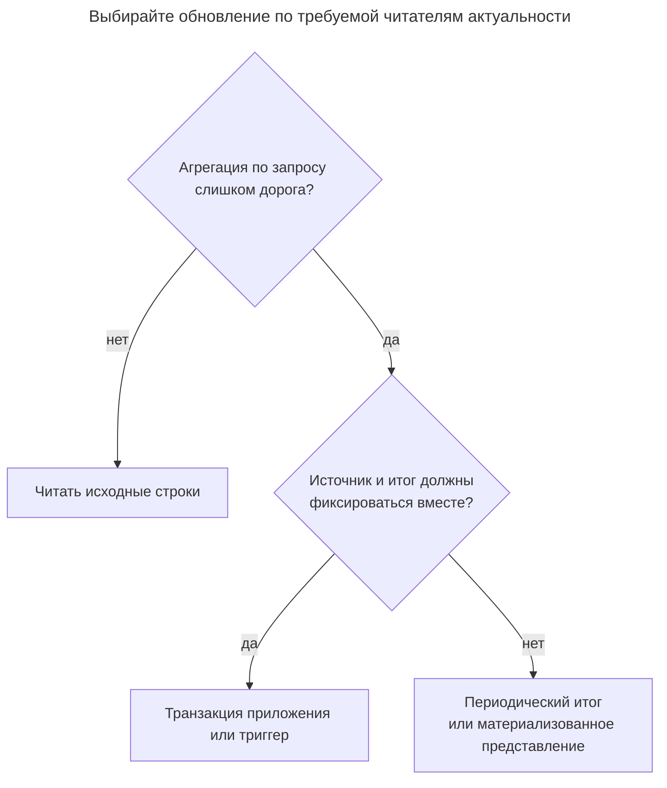
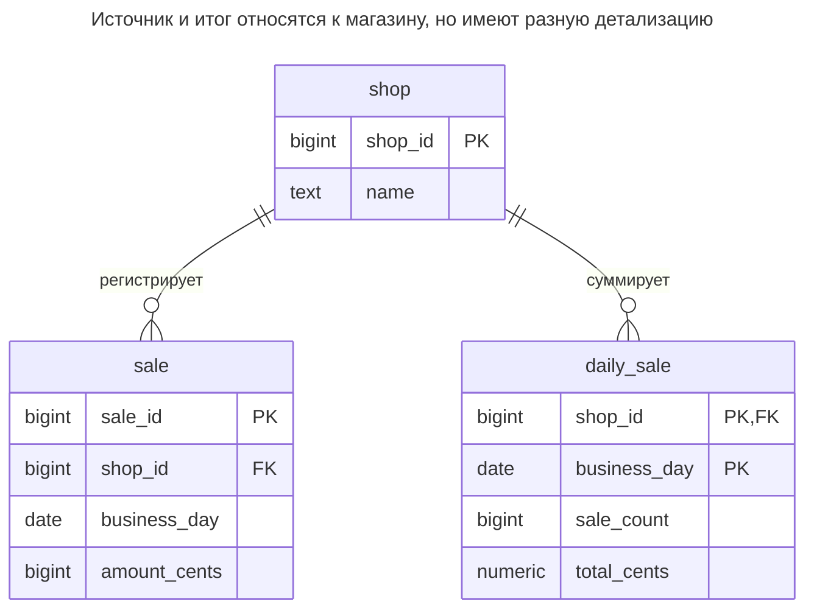
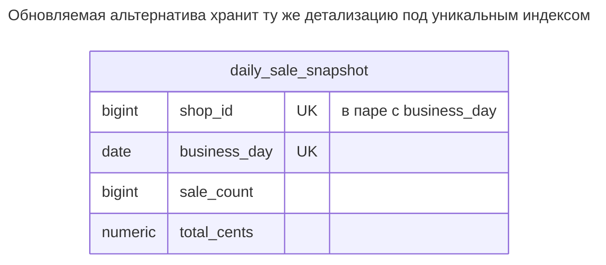
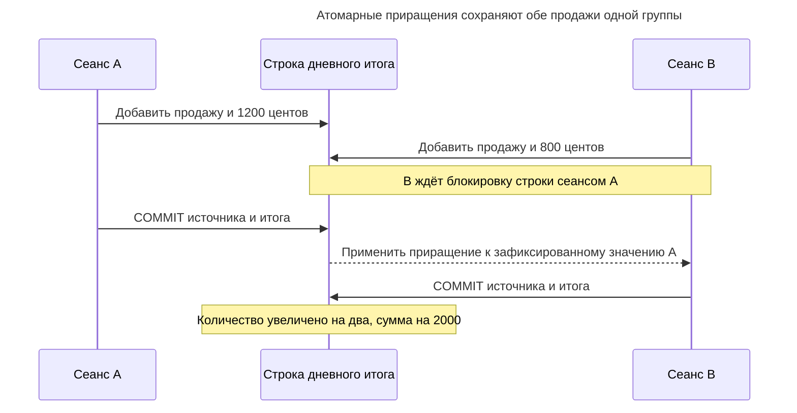
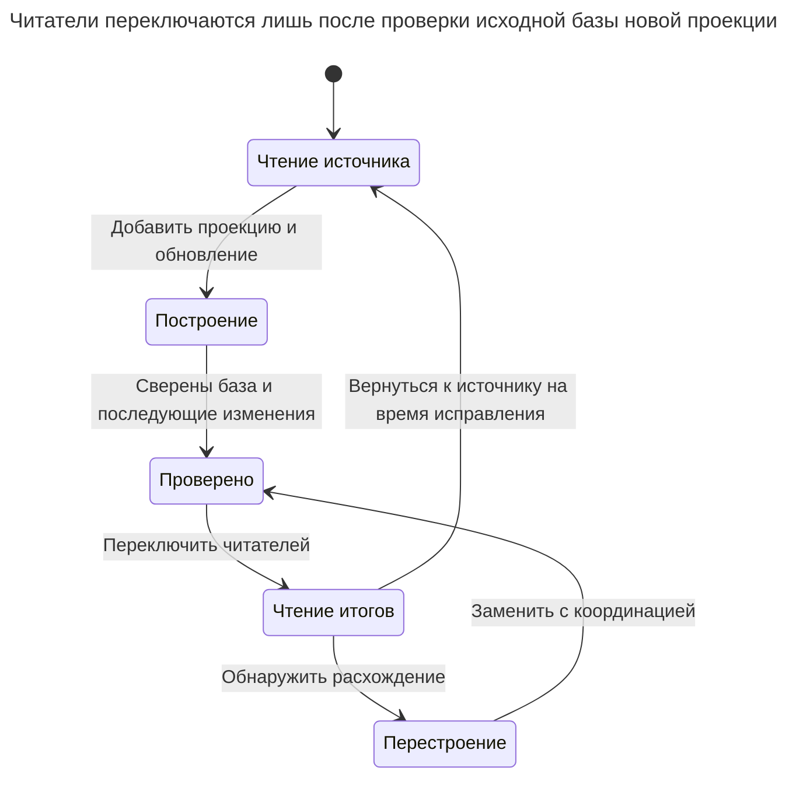

# Таблица итогов

## Назначение

Таблица итогов хранит заранее вычисленные агрегаты — дневные продажи, число комментариев, остатки счетов, — чтобы частые чтения больше не сканировали исходные строки. Глава сравнивает синхронизацию обновлениями в одной транзакции, триггерами, периодическим пересчётом и материализованными представлениями; простейшая форма — кеш счётчика в родительской строке. Показаны корректные конкурентные приращения и перестроение итогов из источника при расхождении.

## Также известен как

Rollup table; aggregate table. Кеш счётчика — форма с одним счётчиком на родителя: Rails описывает [`counter_cache`](https://guides.rubyonrails.org/association_basics.html#counter-cache) у ассоциации. [Материализованное представление](https://www.postgresql.org/docs/18/rules-materializedviews.html) — вариант реализации, хранящий результат запроса вместе с определяющим запросом.

## Проблема

Панель показателей многократно суммирует продажи по магазину и бизнес-дню. Индекс помогает найти продажи дня, но панель всё равно запрашивает одну и ту же свёртку этих строк. По мере накопления продаж вычисление каждого ответа дорожает, хотя ответ остаётся небольшой строкой.

Копирование вчерашнего итога в таблицу переносит проблему в обслуживание. Исправление, отмена, импорт или повтор могут исказить итог. Прежде чем хранить его, определите, нужен ли панели итог на момент читающей транзакции или опубликованный отчётный снимок. У кешированного остатка, по которому разрешается снятие средств, и вчерашнего графика продаж разные требования к актуальности.

## Решение

Оставьте отдельные строки `sale` источником истины и храните одну строку `daily_sale` на `(shop_id, business_day)`. Поддерживайте и количество, и сумму; среднее выводите из них, не усредняя дневные средние. Определяйте бизнес-день до вставки, включая политику часового пояса за пределами примера, и не складывайте суммы разных валют. Практикум закрепляет за каждым магазином одну отчётную валюту и хранит целые центы.

Выберите одного ответственного за обновление. Пример использует оператор приложения, меняющий источник и итог совместно. [Модифицирующие CTE](https://www.postgresql.org/docs/18/queries-with.html#QUERIES-WITH-MODIFYING) PostgreSQL передают изменённые строки через `RETURNING`; внешний оператор применяет лишь их дельты. Арифметика и запрос сверки входят в контракт записи схемы.

| Обновление | Контракт актуальности | Ваша работа |
| --- | --- | --- |
| Транзакция приложения | Источник и итог фиксируются вместе | Все писатели, включая импорты и исправления, соблюдают протокол |
| Триггер | Изменения источника вызывают обновление в базе | Покрыть вставки, изменения, удаления и переносы групп; оценить массовую запись и блокировки |
| Периодическое перестроение | Опубликованный снимок с указанной границей времени | Планировать, публиковать и отслеживать обновления; читатели принимают задержку |
| Материализованное представление PostgreSQL | Содержимое последнего обновления | Хранить группирующий запрос и выполнять `REFRESH`; прямое обновление строк недоступно |

PostgreSQL описывает [выполнение триггеров в вызывающей транзакции](https://www.postgresql.org/docs/18/trigger-definition.html). Его [пример материализованного представления](https://www.postgresql.org/docs/18/rules-materializedviews.html) вместо этого суммирует счета для панели и обновляется по расписанию. Ни одна реализация не доказывает пригодность выбранной актуальности для авторизации или проверки средств.

## Альтернативы и выбор

| Соседний паттерн или механизм | Связь | Определяющее требование |
| --- | --- | --- |
| Агрегация источника по запросу | Замена | Чтения редки или индексированный срез уже достаточно дёшев |
| Счётчик родительской строки | Вариант реализации | Нужен один счётчик на родителя без дополнительного измерения группировки |
| Материализованное представление | Вариант реализации | Допустима задержка обновления; база должна хранить определяющий запрос |
| [Секционирование таблицы](table-partitioning.md) | Дополнение | Нужно управление хранением источника и диапазонными сканированиями; секционирование не вычисляет итоги |
| [Двойная запись](double-entry-ledger.md) | Дополнение | Остаткам нужны достоверные сбалансированные движения; итог не заменяет целостность проводок |
| [Транзакционный outbox](transactional-outbox.md) и [Запись идемпотентности](idempotency-record.md) | Вариант асинхронного обновления | Отдельная проекция потребляет надёжно сохранённые события и устраняет повторные эффекты |

Полное сравнение — в [Атласе решений](decision-atlas.md). Начните с измеренной стоимости запроса и требования актуальности, затем выбирайте, где оплачивать агрегацию.



Итог оправдывается повторной работой, которой можно избежать. Второе решение определяет перенос этой работы в каждую запись или в последующее обновление.

## Структура



Внешнего ключа от итога к конкретной продаже нет. Ключ обозначает группу, а связь со всеми составляющими продажами — вычисление, не ссылочная целостность. Магазину без продаж строка итога не обязательна.

## Таблицы и инварианты

- **`shop`** идентифицирует владельца отчётности. Пример предполагает одну валюту на магазин; межмагазинная конвертация не входит в итог.
- **`sale`** имеет стабильный первичный ключ и неотрицательную сумму. Ключ предотвращает повторную вставку одного исходного ID. При показанном исправлении приложение не меняет магазин и бизнес-день.
- **`daily_sale`** содержит строку на группу, неотрицательные количество и итог. Локальные проверки ловят невозможные значения, но не произвольное расхождение: правдоподобный неверный итог их проходит.
- **Равенство источнику** — инвариант обновления, а не декларативное ограничение. PostgreSQL [не поддерживает межстрочные и межтабличные утверждения в `CHECK`](https://www.postgresql.org/docs/18/ddl-constraints.html#DDL-CONSTRAINTS-CHECK-CONSTRAINTS). Ограничивайте прямую запись итогов и сверяйтесь с источником.
- **Пустые группы** могут оставаться как `(0, 0)` после удаления последней продажи. Чтение и сверка считают отсутствие группы и сохранённую нулевую строку эквивалентными.

## Когда применять

- Многие чтения повторяют одну группировку, а стоимость агрегации источника измерена.
- Вы можете назвать источник истины, детализацию группировки и контракт актуальности.
- Можно покрыть каждое изменение источника и выполнить перестроение при сбое обновления.

## Последствия и компромиссы

- ➕ Панель получает одну сохранённую строку дня вместо свёртки всех его продаж.
- ➕ Сохранённые исходные строки позволяют объяснить и пересчитать ответ.
- ➖ Синхронное обновление делает популярные группы горячими точками записи; отдельная таблица итогов не убирает конкуренцию за её строку.
- ➖ Количества и суммы имеют простые дельты. Удаление текущего минимума или максимума может потребовать поиска замены в источнике.
- ➖ Каждое новое измерение меняет детализацию и цену обновления. Итог по магазину и дню не отвечает на вопросы по товару и дню без нового запроса к источнику или проекции.
- ➖ Удаление исходных секций может уничтожить основу для перестроения старых итогов. До применения политики хранения решите, становятся ли эти итоги самостоятельными сохраняемыми отчётными фактами.

## Реализация

[Полный скрипт PostgreSQL 18.6](../assets/summary-table/summary-table.sql) проверяет вставки, исправления, удаление, отказ дубликата, сверку и обновление материализованного представления. Таблицы явно фиксируют детализацию:

```sql
CREATE TABLE shop (
    shop_id bigint PRIMARY KEY,
    name text NOT NULL
);
CREATE TABLE sale (
    sale_id bigint PRIMARY KEY,
    shop_id bigint NOT NULL REFERENCES shop (shop_id),
    business_day date NOT NULL,
    amount_cents bigint NOT NULL CHECK (amount_cents >= 0)
);
CREATE INDEX sale_group_idx ON sale (shop_id, business_day);
CREATE TABLE daily_sale (
    shop_id bigint REFERENCES shop (shop_id),
    business_day date,
    sale_count bigint NOT NULL CHECK (sale_count >= 0),
    total_cents numeric NOT NULL CHECK (total_cents >= 0),
    PRIMARY KEY (shop_id, business_day)
);
INSERT INTO shop VALUES (1, 'Harbor');
```

Сначала вставляйте исходные строки, затем агрегируйте возвращённые значения в одну дельту на группу. [`ON CONFLICT DO UPDATE`](https://www.postgresql.org/docs/18/sql-insert.html#SQL-ON-CONFLICT) PostgreSQL обеспечивает атомарный исход «вставка или обновление»; приращение использует заблокированное хранимое значение, а не итог, ранее прочитанный клиентом:

```sql
WITH added AS (
    INSERT INTO sale VALUES
        (101, 1, DATE '2026-11-01', 1200),
        (102, 1, DATE '2026-11-01', 800)
    RETURNING shop_id, business_day, amount_cents
)
INSERT INTO daily_sale AS d
SELECT shop_id, business_day, count(*), sum(amount_cents)
FROM added GROUP BY shop_id, business_day
ON CONFLICT (shop_id, business_day) DO UPDATE
SET sale_count = d.sale_count + EXCLUDED.sale_count,
    total_cents = d.total_cents + EXCLUDED.total_cents;
SELECT * FROM daily_sale;
```

Результат — `(1, 2026-11-01, 2, 2000)`. Предварительная группировка пакета также исключает несколько обновлений одной конфликтующей строки в одном операторе, что запрещают [правила `INSERT`](https://www.postgresql.org/docs/18/sql-insert.html#SQL-ON-CONFLICT) PostgreSQL.

Для исправления суммы используйте разницу старого и нового исходных значений, не всю новую сумму. [`UPDATE ... RETURNING`](https://www.postgresql.org/docs/18/sql-update.html) PostgreSQL 18 позволяет получить обе версии:

```sql
WITH changed AS (
    UPDATE sale SET amount_cents = 1500 WHERE sale_id = 101
    RETURNING WITH (OLD AS o, NEW AS n)
        n.shop_id, n.business_day, n.amount_cents - o.amount_cents AS delta
)
UPDATE daily_sale AS d SET total_cents = d.total_cents + c.delta
FROM changed AS c
WHERE (d.shop_id, d.business_day) = (c.shop_id, c.business_day)
RETURNING d.*;
```

Это возвращает `(1, 2026-11-01, 2, 2300)`. Для существующей продажи требуйте ровно одно обновление итога; если строка отсутствует, откатите транзакцию и выполните сверку до повтора. В эксплуатации оберните оператор и проверку числа строк одной транзакцией или контролируемой процедурой. Перенос продажи в другой магазин/день требует вычитания из старой группы и добавления в новую; операция, меняющая лишь сумму, намеренно этого не делает.

Отмена удаляет исходную строку и вычитает вклад, только если удаление вернуло её:

```sql
WITH removed AS (
    DELETE FROM sale WHERE sale_id = 102
    RETURNING shop_id, business_day, amount_cents
)
UPDATE daily_sale AS d
SET sale_count = d.sale_count - 1,
    total_cents = d.total_cents - r.amount_cents
FROM removed AS r
WHERE (d.shop_id, d.business_day) = (r.shop_id, r.business_day)
RETURNING d.*;
```

Результат — `(1, 2026-11-01, 1, 1500)`. Повторное удаление ничего не меняет. При фактическом удалении исходной строки действует то же требование числа затронутых строк. Повторная вставка источника отклоняется до фиксации какого-либо приращения:

```sql
INSERT INTO sale VALUES (101, 1, DATE '2026-11-01', 1500);
```

PostgreSQL 18.6 возвращает SQLSTATE `23505`: `ERROR: duplicate key value violates unique constraint "sale_pkey"`, с уточнением `DETAIL: Key (sale_id)=(101) already exists.` Исходный ключ полезен для обнаружения повторов, только если повторы используют его снова. Сравнение содержимого запроса после неопределённой фиксации описано в [Записи идемпотентности](idempotency-record.md).

Для обновления по расписанию используйте отдельную проекцию, не смешивая пересчёты с текущими приращениями:

```sql
CREATE MATERIALIZED VIEW daily_sale_snapshot AS
SELECT shop_id, business_day, count(*) AS sale_count,
       sum(amount_cents) AS total_cents
FROM sale GROUP BY shop_id, business_day;
CREATE UNIQUE INDEX daily_sale_snapshot_key
    ON daily_sale_snapshot (shop_id, business_day);
REFRESH MATERIALIZED VIEW CONCURRENTLY daily_sale_snapshot;
```

[`CONCURRENTLY`](https://www.postgresql.org/docs/18/sql-refreshmaterializedview.html) допускает конкурентное чтение, требует уже заполненного представления и уникального индекса по обычным столбцам, покрывающего все строки, и позволяет лишь одно обновление этого представления за раз. Содержимое заменяется результатом определяющего запроса; это не автоматическое инкрементальное обновление.



Отдельная проекция имеет ту же детализацию по магазину и дню. Пример объявляет уникальный индекс, но не внешний ключ на `shop`; при каждом обновлении содержимое берётся из исходного запроса.

## Поддержка в движках

- **PostgreSQL 18:** выбирайте обычную поддерживаемую таблицу или обновляемое материализованное представление выше. Обычное представление хранит запрос, материализованное — [его результат](https://www.postgresql.org/docs/18/rules-materializedviews.html).
- **MySQL 8.4 / InnoDB:** переносите реализацию обычной таблицы с [`INSERT ... ON DUPLICATE KEY UPDATE`](https://dev.mysql.com/doc/refman/8.4/en/insert-on-duplicate.html), реагирующим на конфликты первичного или уникального ключа. Сохраняйте источник и итог в одной транзакции и адаптируйте синтаксис CTE PostgreSQL.
- **SQL Server 2025 (17.x):** [индексированные представления](https://learn.microsoft.com/en-us/sql/relational-databases/views/create-indexed-views?view=sql-server-ver17) — поддерживаемый движком вариант с ограничениями, включая привязку к схеме и `COUNT_BIG(*)` для группирующих представлений. Их обслуживание увеличивает работу записи базовых таблиц; это не обновления PostgreSQL по расписанию.
- **Oracle Database 19c:** [обновление материализованных представлений](https://docs.oracle.com/en/database/oracle/oracle-database/19/dwhsg/refreshing-materialized-views.html) различает `ON COMMIT` и `ON DEMAND`, а также быстрое и полное обновление. Проверьте применимость до выбора контракта актуальности и цены.
- **SQLite 3:** [обычное представление](https://www.sqlite.org/lang_createview.html) именует `SELECT`; для хранимой проекции нужна явно поддерживаемая таблица. Из-за [единственного одновременного писателя](https://www.sqlite.org/lang_transaction.html) длинные транзакции перестроения затрагивают запись всей базы.

## Сбои и конкурентность

Используйте Read Committed для локальных операторов дельт. [Документация изоляции PostgreSQL](https://www.postgresql.org/docs/18/transaction-iso.html#XACT-READ-COMMITTED) объясняет использование обновлённой версии строки ожидающим обновлением. Два приращения сериализуются на строке итога, не заменяя заранее прочитанные значения друг друга:



Откат совместно отменяет изменение источника и дельту. Потерянный после фиксации ответ всё ещё требует идентичности повтора; новый исходный ID посчитает ещё одну продажу.

При записи нескольких групп по возможности захватывайте блокировки итогов в едином порядке ключей и после взаимоблокировки повторяйте всю транзакцию. [Рекомендации PostgreSQL по взаимоблокировкам](https://www.postgresql.org/docs/18/explicit-locking.html#LOCKING-DEADLOCKS) советуют согласованный порядок. Никогда не повторяйте только приращение после отката исходной вставки. При асинхронном обновлении сохраняйте обработанный ID события и дельту в одной транзакции потребителя; [паттерны outbox и устранения повторов](transactional-outbox.md) объясняют, почему одна доставка не предотвращает повторные эффекты.

Сверяйте одним снимком запроса, чтобы конкурентная зафиксированная запись не появилась лишь с одной стороны сравнения:

```sql
WITH expected AS (
    SELECT shop_id, business_day, count(*) AS sale_count,
           sum(amount_cents) AS total_cents
    FROM sale GROUP BY shop_id, business_day
)
SELECT shop_id, business_day
FROM expected AS e FULL JOIN daily_sale AS d USING (shop_id, business_day)
WHERE coalesce(e.sale_count, 0) <> coalesce(d.sale_count, 0)
   OR coalesce(e.total_cents, 0) <> coalesce(d.total_cents, 0);
```

Практикум не возвращает строк. Для безопасного исправления небольшой системы приостановите писателей источника [табличной блокировкой `SHARE`](https://www.postgresql.org/docs/18/sql-lock.html), перестройте под исключительной блокировкой писателей итогов и зафиксируйте замену целиком:

```sql
BEGIN;
LOCK TABLE sale IN SHARE MODE;
LOCK TABLE daily_sale IN EXCLUSIVE MODE;
DELETE FROM daily_sale;
INSERT INTO daily_sale
SELECT shop_id, business_day, count(*), sum(amount_cents)
FROM sale GROUP BY shop_id, business_day;
COMMIT;
```

Это намеренно блокирует исходную запись на время сканирования; обычные читатели итогов продолжают читать зафиксированный снимок. Так исключается опасная последовательность «просканировать, затем перезаписать итог, уже увеличенный текущими писателями». Для крупных перестроений без остановки введите координацию по магазину, которую каждый писатель использует до изменения источника, либо стройте из согласованного снимка и надёжного потока изменений. Фоновое сканирование само по себе не делает перестроение непрерывным.

## Миграция

Создайте итог без изменения читателей. Установите обновление для всех писателей, получите согласованную исходную базу, выполните сверку и лишь затем переключайте чтение. Простая исходная база создаётся перестроением с блокировками выше в ходе измеренной паузы записи. Для непрерывной подготовки нужна описанная граница снимка и изменений. Начало с нуля и учёт лишь новых записей пропускает старые данные.



Сохраняйте чтение источника в ходе развёртывания. Откат возможен возвратом чтения к источнику на время исправления проекции; не удаляйте исходные факты ради исправления неверного итога. Счётчик родителя заполните до начала использования. Rails явно описывает [неактивное чтение кеша счётчиков при заполнении](https://guides.rubyonrails.org/association_basics.html#counter-cache).

## Антипаттерны и частые ошибки

- Обновлять источник и итог разными фиксациями или увеличивать счётчик через чтение и замену на стороне клиента.
- Покрывать вставку, забыв удаления, исправления, импорты или переносы между группами.
- Применять одну дельту одновременно триггером и приложением.
- Считать неотрицательный итог доказательством равенства источнику.
- Усреднять средние без весов или суммировать разные валюты.
- Перестраивать из старого снимка, пока текущие дельты обновляют перезаписываемую таблицу.

## Известные применения

- [Пример материализованного итога продаж PostgreSQL](https://www.postgresql.org/docs/18/rules-materializedviews.html) группирует счета по продавцу и дате для чтения панели.
- [`counter_cache` Rails](https://guides.rubyonrails.org/association_basics.html#counter-cache) хранит число связанных записей у владельца и описывает проблемы заполнения и исправления.
- [Паттерн Materialized View Microsoft](https://learn.microsoft.com/en-us/azure/architecture/patterns/materialized-view) рассматривает хранимую проекцию чтения как восстанавливаемые данные, производные от источника. Схема магазина этой главы — учебный проект, а не опубликованная схема поставщика.

## Связанные паттерны

- [Двойная запись](double-entry-ledger.md) предоставляет достоверные движения для проекции остатка.
- [Секционирование таблицы](table-partitioning.md) управляет хранением источника независимо от агрегации.
- [Запись идемпотентности](idempotency-record.md) не даёт повторённым командам или событиям применить ещё одну дельту.
- [Транзакционный outbox](transactional-outbox.md) предоставляет надёжный асинхронный вход проекции.
- [Расширение и свёртывание](expand-contract.md) разбивает развёртывание проекции и возврат на этапы.
