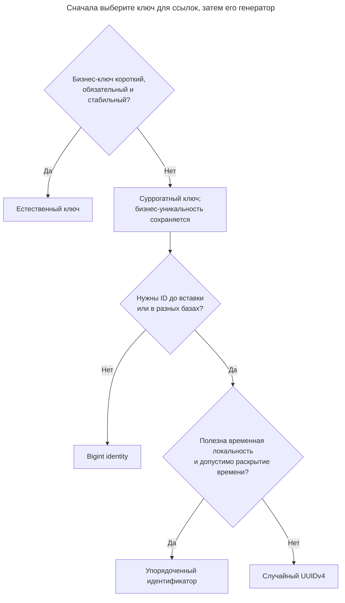
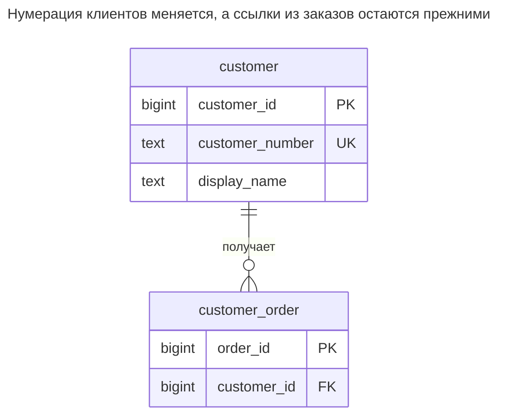
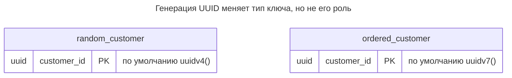
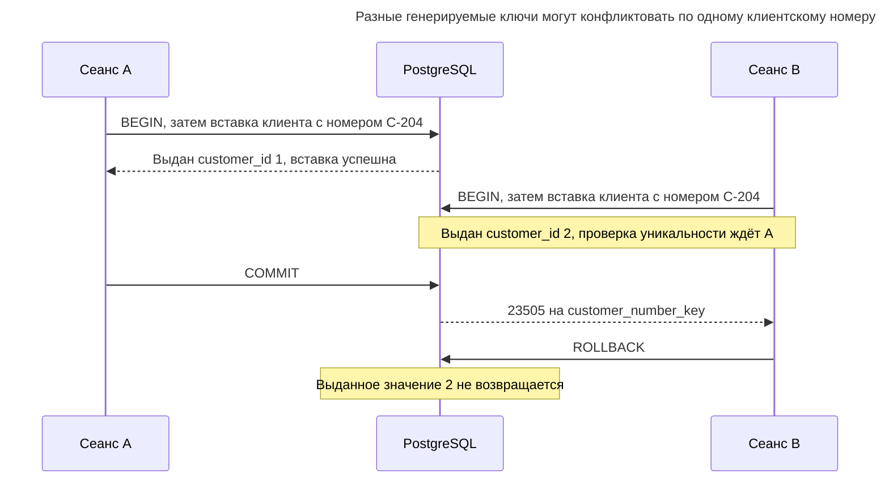
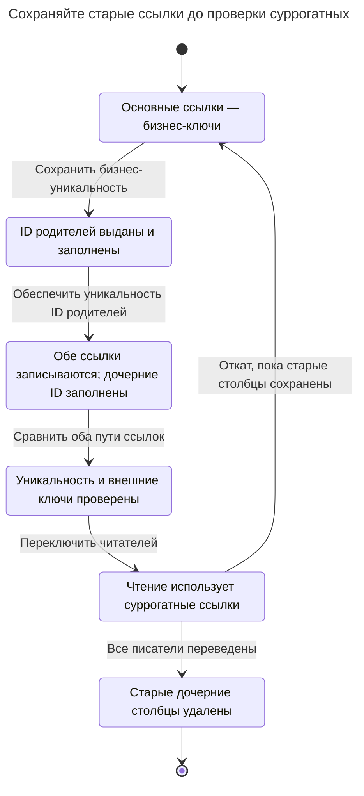

# Суррогатный ключ

## Назначение

Суррогатный ключ — значение, созданное исключительно для идентификации строки: оно не несёт бизнес-смысла, остаётся неизменным и служит целью внешних ключей. Выбирая между identity-столбцом типа `bigint`, случайным UUIDv4 и упорядоченным по времени UUIDv7/ULID, учитывайте размер индекса, локальность вставок, объединение баз данных и необходимость получать идентификаторы до вставки. Суррогат не заменяет ограничение уникальности бизнес-атрибутов: без него можно сохранить одного клиента дважды. [Терминология ключей Эмблера](https://agiledata.org/essays/keys.html) явно разделяет бизнес-идентичность и ключ без предметного смысла.

## Также известен как

Искусственный ключ; ключ, назначаемый системой. [Identity Field](https://martinfowler.com/eaaCatalog/identityField.html) Фаулера — связанный паттерн отображения: ключ базы данных сохраняют в объекте, чтобы связать объект с его строкой. Он не предписывает конкретный генератор ключей.

## Проблема

Вы идентифицируете клиентов по клиентскому номеру, но слияние компаний может изменить систему нумерации. Если заказы ссылаются на этот номер, перенумерация клиента затронет и его заказы. Отсутствие номера при регистрации создаёт другую проблему: клиента нужно сохранить до того, как бизнес назначит ему идентификатор. Это причины отделить идентичность строки от нумерации клиентов.

Само по себе добавление целого числа не решает ни повторную регистрацию, ни неоднозначное сопоставление при импорте. Два разных числа могут обозначать две строки с одним клиентским номером. Прежде чем выбирать ключ хранения, определите, какие бизнес-атрибуты действительно различают клиентов.

## Решение

Назначьте `customer` генерируемый первичный ключ `customer_id` и ссылайтесь на него из `customer_order`. В этом примере сохраните `customer_number` как отдельное обязательное уникальное значение. Номер можно изменить, не меняя идентификатор. [Identity-столбцы](https://www.postgresql.org/docs/18/ddl-identity-columns.html) PostgreSQL генерируют значения из неявной последовательности; сами по себе они не гарантируют уникальность, поэтому первичный ключ нужно объявить явно.

Выбирайте генератор отдельно от решения использовать суррогат:

| Генератор | Когда выбирать | Приемлемая цена |
| --- | --- | --- |
| `bigint` identity | Идентификаторы выдаёт одна база данных, и их можно получить при вставке | Независимые базы могут выдать одинаковые числа; при объединении потребуется таблица соответствий |
| UUIDv4 | Писателям нужны идентификаторы до вставки без центрального распределителя | Более широкие ключи; случайные позиции вставки в индекс |
| UUIDv7 / ULID | Нужны распределённая генерация и временная локальность | Более широкие ключи и раскрытие времени генерации; см. [Упорядоченный идентификатор](time-ordered-identifier.md) |

В PostgreSQL [`bigint`](https://www.postgresql.org/docs/18/datatype-numeric.html) занимает восемь байт, а значение [`uuid`](https://www.postgresql.org/docs/18/datatype-uuid.html) — 128 бит. Это сравнение объёма самих ключей, а не обещание, что индекс UUID будет ровно вдвое больше. [Рекомендации RFC для баз данных](https://www.rfc-editor.org/rfc/rfc9562.html#section-6.13) объясняют преимущество упорядоченных по времени UUID перед случайными с точки зрения локальности. Прежде чем обещать выигрыш в пропускной способности, измерьте полную рабочую нагрузку.

## Альтернативы и выбор

| Соседний паттерн | Связь | Определяющее требование |
| --- | --- | --- |
| [Естественный ключ](natural-key.md) | Замена первичного ключа; дополнение в виде ограничения уникальности | Короткий обязательный бизнес-ключ достаточно стабилен для ссылок |
| [Упорядоченный идентификатор](time-ordered-identifier.md) | Вариант реализации | Генерация до вставки с сохранением приблизительного временного порядка |
| [Публичный идентификатор](public-identifier.md) | Дополнение | Клиентам нужен отдельный контракт идентификации |

Полное сравнение семейства приведено в [Атласе решений](decision-atlas.md). Избегайте [Обязательных суррогатов](mandatory-surrogates.md): для связи, которую определяют два существующих ключа, может быть достаточно составного первичного ключа.



Первая развилка определяет контракт ссылок, следующие — способ выдачи генерируемого ключа. Бизнес-уникальность необходима при любом генераторе.

## Структура



Заказ хранит генерируемый ключ. Строка клиента содержит и стабильную цель ссылок, и изменяемый номер. Уникальность номера — независимый инвариант.

## Таблицы и инварианты

- **`customer`** содержит одну строку на клиентский номер. Первичный ключ различает строки; `NOT NULL` вместе с `customer_number_key` запрещает отсутствующие и повторяющиеся номера.
- **`customer_order`** связывает каждый заказ с одним клиентом. Обязательный внешний ключ отклоняет ссылки на отсутствующих клиентов; индекс дочерней таблицы помогает искать по клиенту. PostgreSQL [не создаёт индекс на ссылающихся столбцах автоматически](https://www.postgresql.org/docs/18/ddl-constraints.html#DDL-CONSTRAINTS-FK).
- **Стабильность ключа** — инвариант политики записи: обычные операции приложения никогда не меняют `customer_id`. `GENERATED ALWAYS` ограничивает явную вставку, но не любое возможное изменение ключа; см. [правила identity-столбцов](https://www.postgresql.org/docs/18/ddl-identity-columns.html).

## Когда применять

- Бизнес-идентификаторы назначаются поздно или исправляются после появления зависимых строк.
- Многие таблицы ссылаются на сущность с широким или чувствительным бизнес-ключом.
- Нужна независимая генерация идентификаторов, и для неё выбран генератор UUID.

## Последствия и компромиссы

- ➕ Изменение бизнес-номера клиента не меняет ссылки из заказов.
- ➕ Незавершённая регистрация может получить идентичность строки до завершения бизнес-процесса; если это требуется, скорректируйте обязательность номера в примере.
- ➖ Необходимо поддерживать и индекс первичного ключа, и уникальный индекс бизнес-ключа.
- ➖ Внутренний идентификатор клиента в заказе не сообщает оператору клиентский номер без дополнительного поиска.
- ➖ Разные генерируемые идентификаторы не доказывают, что это разные реальные клиенты. Бизнес-ограничение обнаруживает лишь те дубликаты, которые оно определяет.

## Реализация

[Полный скрипт](../assets/surrogate-key/surrogate-key.sql) включает варианты с UUID и проверяет ожидаемую ошибку дублирования. Основные таблицы:

```sql
CREATE TABLE customer (
    customer_id bigint GENERATED ALWAYS AS IDENTITY PRIMARY KEY,
    customer_number text NOT NULL,
    display_name text NOT NULL,
    CONSTRAINT customer_number_key UNIQUE (customer_number)
);
CREATE TABLE customer_order (
    order_id bigint GENERATED ALWAYS AS IDENTITY PRIMARY KEY,
    customer_id bigint NOT NULL REFERENCES customer (customer_id)
);
CREATE INDEX customer_order_customer_idx ON customer_order (customer_id);
```

Вставьте клиента, получите его идентификатор через [`RETURNING`](https://www.postgresql.org/docs/18/sql-insert.html#SQL-INSERT-RETURNING) и используйте его для последующих ссылок. Здесь поиск позволяет выполнить пример без клиентских переменных:

```sql
INSERT INTO customer (customer_number, display_name)
VALUES ('C-104', 'Northwind') RETURNING customer_id;
INSERT INTO customer_order (customer_id)
SELECT customer_id FROM customer WHERE customer_number = 'C-104';
UPDATE customer SET customer_number = 'C-204'
WHERE customer_number = 'C-104';
SELECT o.order_id, c.customer_id, c.customer_number
FROM customer_order AS o JOIN customer AS c USING (customer_id);
```

В пустой базе примера результат будет `(1, 1, C-204)`. Вторая регистрация с этим номером завершится ошибкой, хотя получила бы другой суррогат:

```sql
INSERT INTO customer (customer_number, display_name)
VALUES ('C-204', 'Duplicate');
```

PostgreSQL 18.6 возвращает SQLSTATE `23505`: `ERROR: duplicate key value violates unique constraint "customer_number_key"`, с уточнением `DETAIL: Key (customer_number)=(C-204) already exists.`

Для независимой реализации на UUID измените объявление ключа и все ссылающиеся столбцы на `uuid`. PostgreSQL 18 предоставляет оба [генератора](https://www.postgresql.org/docs/18/functions-uuid.html):

```sql
CREATE TABLE random_customer (
    customer_id uuid PRIMARY KEY DEFAULT uuidv4()
);
CREATE TABLE ordered_customer (
    customer_id uuid PRIMARY KEY DEFAULT uuidv7()
);
```

При генерации в приложении передавайте явный UUID вместо значения по умолчанию. Не меняйте идентификатор существующей строки при каждом повторе запроса.



Это независимые альтернативные таблицы, каждая с первичным ключом UUID. При реальном преобразовании нужно также привести каждый ссылающийся столбец к соответствующему типу.

## Поддержка в движках

- **PostgreSQL 18:** используйте приведённые определения identity и UUID. Identity — механизм выдачи значений вместе с ограничением, а не сервис бизнес-нумерации.
- **MySQL 8.4 / InnoDB:** [записи вторичных индексов содержат первичный ключ](https://dev.mysql.com/doc/refman/8.4/en/innodb-index-types.html). Поэтому широкий суррогат влияет и на вторичные индексы; ширина ключа важна не только для столбцов внешних ключей.
- **SQL Server 2025 (17.x):** [`IDENTITY`](https://learn.microsoft.com/en-us/sql/t-sql/statements/create-table-transact-sql-identity-property?view=sql-server-ver17) тоже требует первичного ключа или ограничения уникальности и может оставлять пропуски после сбоев.
- **Oracle AI Database 26ai:** [identity-столбцам](https://docs.oracle.com/en/database/oracle/oracle-database/26/sqlrf/CREATE-TABLE.html) нужен числовой тип; замените `bigint` подходящим определением `NUMBER`.
- **SQLite 3:** [`INTEGER PRIMARY KEY`](https://www.sqlite.org/lang_createtable.html#rowid) — псевдоним rowid; при пропуске значения он получает автоматически выбранное целое число. У `BIGINT PRIMARY KEY` такого поведения нет.

## Сбои и конкурентность

Используйте генератор и ограничения при обычном уровне изоляции транзакций; не вводите блокировку таблицы только для вычисления следующего идентификатора. PostgreSQL [`nextval`](https://www.postgresql.org/docs/18/functions-sequence.html) атомарно выдаёт разные значения разным сеансам, и выданные значения не возвращаются при откате. Пропуски ожидаемы. Никогда не используйте `MAX(customer_id) + 1` и не перенумеровывайте строки, чтобы закрыть пробелы.

Две конкурентные регистрации могут обе пройти предварительную проверку в приложении. [Проверка конфликтов уникального индекса](https://www.postgresql.org/docs/18/index-unique-checks.html) PostgreSQL ждёт незавершённую конфликтующую запись и повторно проверяет её результат. Обрабатывайте конфликт бизнес-ключа явно. После неопределённого результата фиксации найдите исходный запрос по бизнес-ключу или [Записи идемпотентности](idempotency-record.md); генерация нового суррогата — не стратегия повторения.



Генератор предотвращает совпадение идентификаторов, а ограничение бизнес-ключа — повторную регистрацию. Неудачная регистрация может оставить пропуск в последовательности.

## Миграция

Сохраните уникальность существующего бизнес-ключа. Добавьте допускающий `NULL` суррогатный столбец без генерируемого значения по умолчанию для всей таблицы, настройте выдачу значений новым строкам и заполните существующие строки ограниченными пакетами. Создайте уникальный индекс [конкурентно](https://www.postgresql.org/docs/18/sql-createindex.html#SQL-CREATEINDEX-CONCURRENTLY). Добавьте суррогатные столбцы дочерним таблицам, записывайте обе ссылки и заполните новые через старый ключ. Добавьте внешние ключи как [`NOT VALID`, затем проверьте их](https://www.postgresql.org/docs/18/sql-altertable.html). Запланируйте короткие окна блокировок DDL и повторные попытки их захвата; преобразование не обходится без блокировок.

Переключайте чтение после проверки согласованности старых и новых ссылок. Не удаляйте старые дочерние столбцы, пока не обновлены все писатели. Для отката до удаления верните чтение и запись к сохранённым бизнес-ссылкам. При объединении баз с целочисленными суррогатами создайте явное соответствие старых и новых ID и примените его ко всем дочерним таблицам; копирование чисел без преобразования может указать на другого клиента.



Сохранённые бизнес-ссылки обеспечивают путь отката в период совместной работы. Их удаление закрывает этот прямой путь возврата.

## Антипаттерны и частые ошибки

- Удаление бизнес-уникальности после добавления суррогата: показанный дубликат становится допустимым.
- Использование ID как номера счёта или числа строк: пропуски последовательности делают такую трактовку неверной.
- Добавление ID в чистую связь без уникальности пары; см. [Обязательные суррогаты](mandatory-surrogates.md).
- Случайная публикация ключа хранения с последующим обнаружением зависимости клиентов от его формата; решение о [публичной идентичности](public-identifier.md) принимайте явно.

## Известные применения

- [Пример identity-столбца](https://www.postgresql.org/docs/18/ddl-identity-columns.html) PostgreSQL назначает людям генерируемые номера.
- [Identity Field](https://martinfowler.com/eaaCatalog/identityField.html) Фаулера показывает отображение, сохраняющее в памяти ключ строки; подход работает и с естественными, и с суррогатными ключами.

## Связанные паттерны

- [Естественный ключ](natural-key.md) определяет бизнес-уникальность, сохраняемую рядом с суррогатом.
- [Упорядоченный идентификатор](time-ordered-identifier.md) рассматривает упорядоченные генераторы суррогатных ключей.
- [Публичный идентификатор](public-identifier.md) отделяет внешние ссылки от внутренних соединений.
- [Обязательные суррогаты](mandatory-surrogates.md) объясняет, когда дополнительный ключ ничего не даёт.
