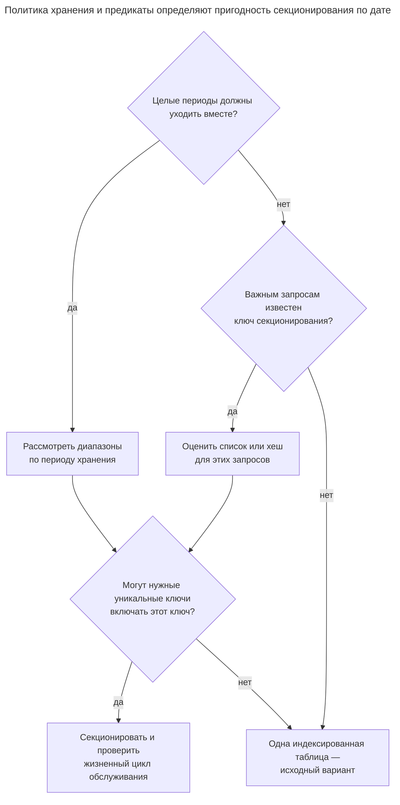
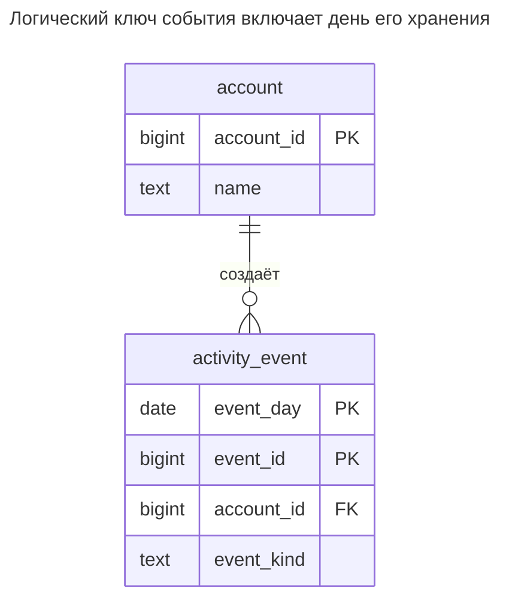
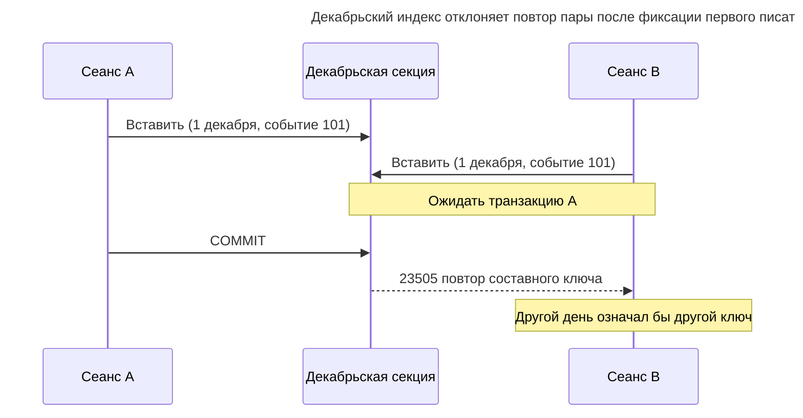
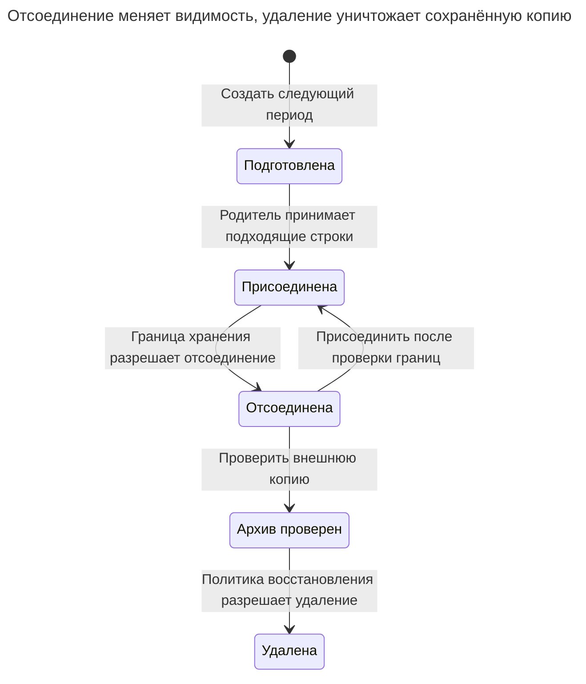

# Секционирование таблицы

## Назначение

Секционирование делит большую таблицу на секции по диапазону, списку или хешу ключа, а запросы по-прежнему видят единую таблицу. Старые данные можно отсоединять или удалять целой секцией вместо долгого `DELETE`, а запросы с фильтром по ключу читают лишь нужные секции. Глава показывает декларативное секционирование PostgreSQL, выбор ключа, ограничения первичных и уникальных ключей и накладные расходы роста числа секций.

## Также известен как

Declarative partitioning; горизонтальное разделение в одной базе. [Терминология секционирования PostgreSQL](https://www.postgresql.org/docs/18/ddl-partitioning.html) описывает одну логическую таблицу с физическими частями. Глава отделяет это от шардирования между базами и от [Разделения таблицы](table-split.md), разделяющего столбцы.

## Проблема

Приложение хранит события фиксированное число месяцев. Большинство запросов читает недавний диапазон дат, но очистка многократно удаляет старые строки по отдельности. Вы хотите совместить единицу хранения и удаления, сохранив для приложения одно отношение.

Ключ, выбранный только ради равномерного распределения строк, может помешать цели. Хеширование ID события распределяет строки месяца по всем секциям, не давая отсоединить месяц. И наоборот, месячные секции мало помогают поиску, которому известен лишь ID. Начните с нужных предикатов и операции хранения, затем проверьте совместимость предпочтительного ключа с требованиями уникальности.

## Решение

Определите `activity_event` как секционированного родителя с хранимым `event_day` и непересекающимися месячными диапазонами. Вставляйте и запрашивайте через родителя. Заранее создавайте будущие секции, отслеживайте покрытый горизонт и отсоединяйте истёкшие только после решения о судьбе опоздавших событий и исторических читателей.

PostgreSQL [маршрутизирует строки по границе секции](https://www.postgresql.org/docs/18/sql-createtable.html), используя диапазоны с включённой нижней и исключённой верхней границей. Первичный ключ родителя включает столбцы секционирования. Здесь событие идентифицируется `(event_day, event_id)`; глобальная уникальность одного `event_id` намеренно не объявлена. Если внешнему ключу нужен только ID, сохраните сущность в несекционированной таблице идентичности или выберите другой проект, не ослабляя контракт молча.

| Стратегия | Обслуживаемое требование | Что оценить |
| --- | --- | --- |
| Диапазон по дню события | Удаление или архивация целых периодов; фильтрация по ним | Поздние данные, будущее покрытие и обслуживание границ |
| Список ограниченных категорий | Изоляция явно перечисленных групп | Перекос и рост набора категорий |
| Хеш стабильного ключа | Разделение доступа по ключу на фиксированный набор частей | Удаление по времени всё ещё затрагивает каждую часть |

Это [три декларативные стратегии](https://www.postgresql.org/docs/18/ddl-partitioning.html#DDL-PARTITIONING-DECLARATIVE) PostgreSQL. Ни одна не гарантирует пропускную способность; измеряйте планирование, выполнение и обслуживание с предполагаемым числом секций.

## Альтернативы и выбор

| Соседний паттерн или механизм | Связь | Определяющее требование |
| --- | --- | --- |
| Одна обычная таблица с подходящими индексами | Замена | Запросы и очистка уже укладываются в бюджет; сохраняются простые глобальные ключи |
| [Таблица итогов](summary-table.md) | Дополнение; замена повторных агрегирующих сканирований | Читателям нужны готовые итоги, а не просто меньше проверяемых физических частей |
| [Разделение таблицы](table-split.md) | Дополнение или замена при широких строках | Проблему создают холодные или отдельно защищённые столбцы, а не старые строки |
| [Расширение и свёртывание](expand-contract.md) | Дополнение | Существующая таблица переходит к секциям при совместной работе клиентов |
| Шардирование между базами | Замена для иной границы ёмкости | Одна база не выдерживает нужную нагрузку; встроенные секции сами не добавляют серверов |

Полное сравнение — в [Атласе решений](decision-atlas.md). Избегайте [Клонированных таблиц](cloned-tables.md): приложение не должно собирать новый список имён таблиц при начале месяца. Встроенные секции сохраняют контракт одного отношения.



Проверка уникальных ключей предшествует DDL. Структура, упрощающая очистку, может не подходить контракту ссылок вашей сущности.

## Структура



Много событий принадлежат одной учётной записи. Внешний ключ — обычная ссылочная целостность; месяц события — физическая маршрутизация, не отдельная бизнес-сущность. Ноябрьская и декабрьская части имеют те же столбцы и составной ключ, что родитель.

## Таблицы и инварианты

- **`account`** — несекционированная таблица идентичности. Событие не может ссылаться на отсутствующую учётную запись.
- **`activity_event`** — логическое отношение приложения с первичным ключом `(event_day, event_id)`. Он запрещает дубликаты пары, включая конкурентные записи в одной секции, но разрешает тот же ID в другой день.
- **`activity_event_2026_11` / `activity_event_2026_12`** принимают только объявленные диапазоны. Границы не пересекаются; непокрытая дата не маршрутизируется. Правила следуют из [объявления секций PostgreSQL](https://www.postgresql.org/docs/18/sql-createtable.html).
- **День хранения** в примере назначается бизнесом. Вычисляйте его единообразно до вставки; клиенты не должны по-разному определять границу дня.
- **Входящие ссылки** должны содержать полный ключ события, если ссылаются на этот первичный ключ. Здесь потомков событий нет, чтобы пример отсоединения не зависел от хранения дочерних данных.

## Когда применять

- У крупной исходной таблицы предсказуемая единица хранения или архивации.
- Важные запросы ограничивают выбранный ключ секционирования.
- Вы можете регулярно создавать, отсоединять, восстанавливать секции и обрабатывать поздние события.
- Получившаяся составная уникальность и форма ссылок приемлемы.

## Последствия и компромиссы

- ➕ Обслуживание периода не требует удаления каждого старого события. PostgreSQL [описывает отсоединение и удаление секций как способ избежать vacuum после массового удаления](https://www.postgresql.org/docs/18/ddl-partitioning.html#DDL-PARTITIONING-OVERVIEW).
- ➕ Запросы исключают ненужные периоды, если предикаты поддерживают отсечение секций.
- ➖ Больше частей — больше индексов, метаданных и работы планировщика. [Рекомендации PostgreSQL](https://www.postgresql.org/docs/18/ddl-partitioning.html#DDL-PARTITIONING-DECLARATIVE-BEST-PRACTICES) предостерегают от предположения, что больше секций лучше.
- ➖ Поиск только по ID может проверять много секций. Индекс ID в каждой не создаёт единого правила глобальной уникальности.
- ➖ PostgreSQL может [перенести обновлённую строку в другую секцию](https://www.postgresql.org/docs/18/sql-update.html); неизменяемый `event_day` упрощает контракт ключа и хранения в примере.
- ➖ Операции секций всё ещё требуют блокировок. «Операция с метаданными» не обещает непрерывную обработку запросов.

## Реализация

[Полный скрипт PostgreSQL 18.6](../assets/table-partitioning/table-partitioning.sql) проверяет маршрутизацию, границы, составную уникальность, отсечение, конкурентное отсоединение и повторное присоединение. Начните с двух месяцев:

```sql
CREATE TABLE account (
    account_id bigint PRIMARY KEY,
    name text NOT NULL
);
CREATE TABLE activity_event (
    event_day date NOT NULL,
    event_id bigint NOT NULL,
    account_id bigint NOT NULL REFERENCES account (account_id),
    event_kind text NOT NULL,
    PRIMARY KEY (event_day, event_id)
) PARTITION BY RANGE (event_day);
CREATE TABLE activity_event_2026_11 PARTITION OF activity_event
    FOR VALUES FROM ('2026-11-01') TO ('2026-12-01');
CREATE TABLE activity_event_2026_12 PARTITION OF activity_event
    FOR VALUES FROM ('2026-12-01') TO ('2027-01-01');
CREATE INDEX activity_event_account_day_idx
    ON activity_event (account_id, event_day);
INSERT INTO account VALUES (1, 'Harbor');
INSERT INTO activity_event VALUES
    ('2026-11-30', 101, 1, 'login'),
    ('2026-12-01', 101, 1, 'login');
SELECT tableoid::regclass AS physical_table, event_day, event_id
FROM activity_event ORDER BY event_day;
```

Строки находятся соответственно в `activity_event_2026_11` и `activity_event_2026_12`. Одинаковый ID допустим благодаря разным датам. PostgreSQL показывает физическое отношение через [`tableoid`](https://www.postgresql.org/docs/18/ddl-system-columns.html). Индекс родителя создаёт соответствующие индексы секций по [правилам секционированных индексов](https://www.postgresql.org/docs/18/sql-createindex.html).

Читайте по полуоткрытому интервалу дат и проверяйте фактический план:

```sql
EXPLAIN (COSTS OFF)
SELECT event_id, event_kind FROM activity_event
WHERE account_id = 1
  AND event_day >= DATE '2026-12-01'
  AND event_day < DATE '2027-01-01';
UPDATE activity_event SET event_kind = 'session_started'
WHERE event_day = DATE '2026-12-01' AND event_id = 101;
```

Проверенный план содержит лишь `activity_event_2026_12`; конкретный метод сканирования зависит от стоимости. Отсечение использует границы секций, [а не наличие индекса](https://www.postgresql.org/docs/18/ddl-partitioning.html#DDL-PARTITION-PRUNING). Задавайте предикаты на хранимом ключе, не предполагая, что произвольное выражение над ним обеспечит отсечение.

У этой вставки нет назначения:

```sql
INSERT INTO activity_event VALUES ('2027-01-01', 102, 1, 'login');
```

PostgreSQL 18.6 возвращает SQLSTATE `23514`: `ERROR: no partition of relation "activity_event" found for row`, с уточнением `DETAIL: Partition key of the failing row contains (event_day) = (2027-01-01).` Повтор декабрьской пары «день и ID» даёт `23505` для `activity_event_2026_12_pkey`. Попытка `UNIQUE (event_id)` у родителя даёт `0A000`: `ERROR: unique constraint on partitioned table must include all partitioning columns`. Скрипт проверяет все три случая.

Создайте январь до первого принятого события. Для очистки отсоедините ноябрь, сохранив отдельную таблицу:

```sql
CREATE TABLE activity_event_2027_01 PARTITION OF activity_event
    FOR VALUES FROM ('2027-01-01') TO ('2027-02-01');
ALTER TABLE activity_event
    DETACH PARTITION activity_event_2026_11 CONCURRENTLY;
SELECT count(*) FROM activity_event;
SELECT count(*) FROM activity_event_2026_11;
```

Оба количества равны `1`: чтение родителя исключает ноябрь, а отсоединённая таблица сохраняет свою строку. Конкурентное отсоединение запускается вне блока транзакции. [Контракт `DETACH`](https://www.postgresql.org/docs/18/sql-altertable.html#SQL-ALTERTABLE-DETACH-PARTITION) PostgreSQL использует менее строгую блокировку родителя, запрещает этот режим при секции по умолчанию и предоставляет `FINALIZE` при прерывании между этапами. До отсоединения решите, как писатели отклоняют или перенаправляют вновь приходящие ноябрьские данные.

Для репетиции обратимой архивации присоедините таблицу заново:

```sql
ALTER TABLE activity_event ATTACH PARTITION activity_event_2026_11
    FOR VALUES FROM ('2026-11-01') TO ('2026-12-01');
```

Удаляйте отсоединённую таблицу только после выполнения требований архивации и восстановления. Если другие таблицы ссылаются на сохраняемые ключи событий, до удаления нужно разрешить зависимости и политику их хранения; практикум намеренно не содержит входящих внешних ключей на события.

## Поддержка в движках

- **PostgreSQL 18:** первичные и уникальные ограничения родителя требуют всех столбцов секционирования и не могут обеспечивать эту гарантию при ключах секционирования на выражениях. Изучите [декларативные ограничения](https://www.postgresql.org/docs/18/ddl-partitioning.html#DDL-PARTITIONING-DECLARATIVE-LIMITATIONS) до выбора ключа.
- **MySQL 8.4 / InnoDB:** [каждый уникальный ключ должен включать столбцы секционирования](https://dev.mysql.com/doc/refman/8.4/en/partitioning-limitations-partitioning-keys-unique-keys.html), а [секционированные таблицы InnoDB не могут иметь внешние ключи или быть их целью](https://dev.mysql.com/doc/refman/8.4/en/partitioning-limitations-storage-engines.html). Внешний ключ учётной записи мешает прямому переносу примера.
- **SQL Server 2025 (17.x):** использует [функцию и схему секционирования](https://learn.microsoft.com/en-us/sql/relational-databases/partitions/partitioned-tables-and-indexes?view=sql-server-ver17). Секционированный уникальный индекс должен включать столбец секционирования; невыровненный индекс может сохранять уникальность другого ключа при ином обслуживании. Не распространяйте ограничение PostgreSQL на все уникальные индексы SQL Server.
- **Oracle Database 19c:** [интервальное секционирование](https://docs.oracle.com/en/database/oracle/oracle-database/19/vldbg/partition-concepts.html) автоматически создаёт будущие интервальные секции. Секционирование по ссылке может выводить разбиение потомка из внешнего ключа родителя; это дополнительные варианты проекта, а не синтаксические аналоги практикума.
- **SQLite 3:** [грамматика `CREATE TABLE`](https://www.sqlite.org/lang_createtable.html) не содержит встроенного `PARTITION BY`. Сохраните обычную индексированную таблицу либо примите, что ручное разделение таблиц требует маршрутизации приложения и отдельного проекта целостности.

## Сбои и конкурентность

Граница секций не делает безопасными две вставки одинакового составного ключа. [Проверка уникальных индексов PostgreSQL](https://www.postgresql.org/docs/18/index-unique-checks.html) ждёт конфликтующего незафиксированного писателя, затем проверяет результат:



Для этой гарантии достаточно Read Committed. Она ничего не говорит об уникальности одного ID или устранении повторных запросов; при повторах сохраняйте полную идентичность.

Заранее создавайте секции и сигнализируйте о последней покрытой дате. Секция по умолчанию ловит данные вне диапазона, но тогда неожиданные строки накапливаются вместо показанной ошибки. [Правила присоединения PostgreSQL](https://www.postgresql.org/docs/18/sql-altertable.html#SQL-ALTERTABLE-ATTACH-PARTITION) могут требовать сканирования секции по умолчанию, чтобы доказать отсутствие строк нового диапазона. Считайте её обслуживаемым путём исключений, а не автоматическим управлением ёмкостью.

Конкурентное отсоединение ожидает соответствующие транзакции, а не игнорирует их. Перед очисткой отслеживайте старые транзакции, задавайте ограниченный [`lock_timeout`](https://www.postgresql.org/docs/18/runtime-config-client.html#GUC-LOCK-TIMEOUT) для захвата DDL и проверяйте состояние присоединения перед повтором прерванной операции. Клиентский тайм-аут не доказывает, что сервер не завершил ни одного этапа.



Отсоединённые данные остаются доступны по имени отдельной таблицы. Это даёт окно восстановления до разрушительного удаления, но не сохраняет старый результат родителя для исторических запросов.

## Миграция

PostgreSQL [не позволяет прямо превратить обычную таблицу в секционированного родителя](https://www.postgresql.org/docs/18/ddl-partitioning.html#DDL-PARTITIONING-DECLARATIVE). Создайте нового родителя и будущие части, разверните совместимых писателей и заполняйте ограниченные периоды по протоколу [Расширения и свёртывания](expand-contract.md). Захватывайте конкурентные вставки, исправления и удаления: одноразовое копирование теряет изменения во время сканирования. Сверьте ключи и содержимое до переключения читателей.

Существующие таблицы размером с период присоединяйте вместо копирования, если форма, индексы и ограничения отвечают [требованиям `ATTACH PARTITION`](https://www.postgresql.org/docs/18/sql-altertable.html#SQL-ALTERTABLE-ATTACH-PARTITION) PostgreSQL. Действующий подходящий `CHECK` позволяет избежать проверочного сканирования кандидата. Добавьте и проверьте его до окна блокировки присоединения. PostgreSQL не поддерживает [`CREATE INDEX CONCURRENTLY` непосредственно на секционированном родителе](https://www.postgresql.org/docs/18/sql-createindex.html); при преобразовании крупной работающей иерархии создавайте индексы секций конкурентно и присоединяйте их.

Синхронизируйте старое хранилище до конца окна отката. До его вывода убедитесь, что входящие внешние ключи указывают новый полный ключ и ни один запрос не зависит от старой глобальной уникальности ID. В небольшом практикуме откат отсоединения — повторное присоединение; оно возможно лишь при сохранённых строках и совместимом свободном диапазоне.

## Антипаттерны и частые ошибки

- Секционировать лишь из-за большого на вид числа строк без проверки нагрузки и операции обслуживания.
- Выбирать дату, продолжая запросы и ссылки только по ID, словно глобальный ключ сохранился.
- Создавать секцию на клиента без ограничения количества и измерения цены планирования.
- Забывать следующий месяц или позволять секции по умолчанию бесконтрольно расти.
- Считать быстрое отсоединение разрешением игнорировать поздние данные, исторических читателей или зависимые строки.
- Поддерживать [Клонированные таблицы](cloned-tables.md) в SQL приложения, когда требование покрывает единое секционированное отношение.

## Известные применения

- [Пример измерений PostgreSQL](https://www.postgresql.org/docs/18/ddl-partitioning.html) использует месячные диапазоны с отсоединением или удалением старых периодов. Эта глава применяет механизм к событиям приложения.
- [Документация секционированных таблиц Microsoft](https://learn.microsoft.com/en-us/sql/relational-databases/partitions/partitioned-tables-and-indexes?view=sql-server-ver17) описывает хранение периодами, обслуживание индексов и переключение на архивную таблицу.
- [Концепции секционирования Oracle](https://docs.oracle.com/en/database/oracle/oracle-database/19/vldbg/partition-concepts.html) включают интервальное секционирование и секционирование по ссылке. Это расширяет выбор физического жизненного цикла, не доказывая выигрыш производительности вашей схемы.

## Связанные паттерны

- [Таблица итогов](summary-table.md) сокращает повторную агрегацию сохраняемых событий.
- [Клонированные таблицы](cloned-tables.md) описывают цену раскрытия физических срезов запросам приложения.
- [Расширение и свёртывание](expand-contract.md) разбивает переход с обычного хранения на этапы.
- [Разделение таблицы](table-split.md) разделяет столбцы, а не диапазоны дат.
