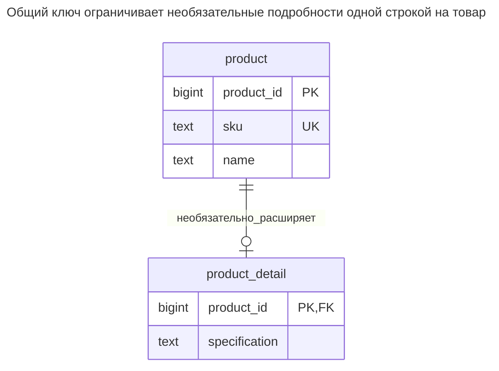
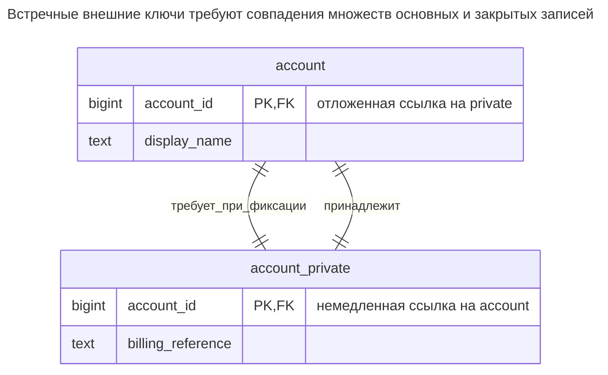
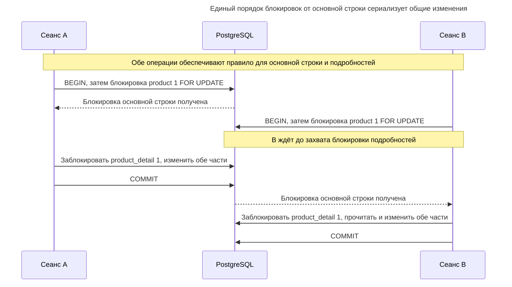
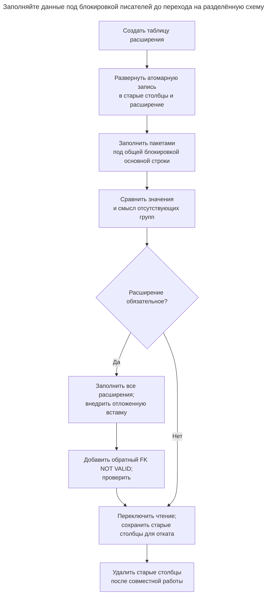

# Разделение таблицы

## Назначение

Разделение таблицы переносит часть столбцов сущности во вторую таблицу с тем же первичным ключом, образуя связь «один к одному». Причины различны: необязательные данные, имеющиеся лишь у части строк, большие или редко читаемые столбцы, раздувающие основную таблицу, либо столбцы с другими правилами доступа или частотой изменений. Глава разделяет эти мотивы, показывает, как ключи и ограничения обеспечивают «не более одного», а при необходимости «ровно одно», и когда дополнительное соединение обходится дороже получаемой экономии.

## Также известен как

Split Table в [каталоге рефакторингов Эмблера и Садаладжа](https://databaserefactoring.com/); вертикальное секционирование в [рекомендациях Microsoft](https://learn.microsoft.com/en-us/azure/well-architected/design-guides/partition-data). Здесь части остаются внутри одной базы данных и границы транзакции; разделение не подразумевает распределения по сервисам.

## Проблема

Списку товаров нужны артикул SKU и короткое название. Редактору нужна длинная спецификация, причём она есть лишь у некоторых товаров. Если обе операции работают с одной широкой строкой, возникает соблазн немедленно её разделить. Сначала определите настоящую причину: необязательность, управление доступом, объём чтения и конкурентные обновления требуют разных доказательств.

Необязательная спецификация требует ясного различия между «записи подробностей нет» и «запись подробностей с пустой спецификацией». Чувствительной спецификации нужны права доступа. Часто обновляемому счётчику остатков нужна отдельная цель обновления лишь тогда, когда разделение снижает конкуренцию в вашей нагрузке. Само по себе добавление таблицы не устанавливает ни одной из этих политик.

## Решение

Оставьте идентичность и общие атрибуты в `product`. Необязательную спецификацию поместите в `product_detail`, чей первичный ключ одновременно служит внешним ключом на `product`. Товар без подробностей создать можно, но две записи подробностей для него или подробности без товара — нельзя. Используйте левое соединение, когда результат должен включать товары без подробностей.

Для обязательного расширения добавьте и обратный внешний ключ: ключ родителя должен ссылаться на ключ подробностей. Отложите эту обратную проверку до конца транзакции, чтобы вставить родителя раньше подробностей. Для явного показа различия ниже используется отдельная пара таблиц учётной записи. [Правила откладываемых ограничений PostgreSQL](https://www.postgresql.org/docs/18/sql-createtable.html) допускают такой временный разрыв при вставке, но не позволяют зафиксировать отсутствие расширения.

## Альтернативы и выбор

| Соседний паттерн | Связь | Определяющее требование |
| --- | --- | --- |
| Обычные столбцы в исходной таблице | Замена | Атрибуты обычно читаются и меняются вместе; соединение не создаёт полезной границы |
| [Столбец JSON](json-column.md) | Замена для гибкой формы подробностей; дополнение внутри таблицы подробностей | Структура меняется, а не просто необязательна или редко используется |
| [Таблицы классов](class-table-inheritance.md) | Дополнение с похожей формой ключей | Расширение представляет подтип с собственными правилами, а не ещё одну часть каждого товара |
| [Локализованные значения](localized-values.md) | Замена для переводимых атрибутов подробностей | Одной сущности нужны строки для нескольких языков, а не не более одного расширения |

Полное сравнение — в [Атласе решений](decision-atlas.md). Хранение столбцов вместе с выборкой только нужных — исходный вариант, который следует измерить до физического разделения.

## Структура



Подробности используют ту же идентичность, что и владелец. Второй генерируемый ID или избыточный уникальный индекс не нужен. Внешний ключ направлен от подробностей к основной записи; само это направление не требует подробностей у каждой основной строки.

## Таблицы и инварианты

- **`product`** содержит обязательный уникальный SKU и название. Товар существует независимо от необязательных подробностей.
- **`product_detail`** содержит не более одной строки на товар благодаря первичному ключу и не имеет осиротевших строк благодаря внешнему ключу. Удаление товара каскадно удаляет его подробности.
- **`account` / `account_private`**, обязательный вариант, имеют одинаковые множества ключей на границах транзакций, потому что каждая сторона ссылается на другую. Ключ закрытой строки уникален, поэтому каждой учётной записи соответствует ровно одно расширение.
- **Управлению доступом** нужны реальные разрешения. PostgreSQL поддерживает [права на таблицы и столбцы](https://www.postgresql.org/docs/18/sql-grant.html), поэтому разделение — вариант администрирования, а не необходимое условие защиты столбцов. Пример не создаёт роли приложения.

## Когда применять

- У необязательной группы есть осмысленный общий жизненный цикл, а её поля должны быть обязательными, когда группа существует.
- Вы измерили выигрыш от чтения более компактной основной записи или обновления отдельных строк.
- Граница таблицы упрощает управление правами для отдельно администрируемых атрибутов.

## Последствия и компромиссы

- ➕ Поля подробностей можно сделать обязательными, не требуя самих подробностей.
- ➕ Основные запросы обращаются только к основной таблице; обновления подробностей имеют собственную строку-цель.
- ➖ Чтение полной сущности требует соединений и осознанной обработки отсутствия подробностей.
- ➖ Обязательные расширения вводят протокол создания и удаления между таблицами.
- ➖ У каждого расширения собственная строка и индекс первичного ключа; для небольших групп разделение может увеличить объём хранения.

Не предполагайте, что длинное значение `text` заставляет каждое чтение основной записи получать все его байты. [Хранилище TOAST PostgreSQL](https://www.postgresql.org/docs/18/storage-toast.html) уже сжимает большие значения или выносит их за пределы строки и обычно сохраняет неизменённые вынесенные значения при обновлениях. Сравните измерения выборок нужных столбцов и обновлений с неразделённой схемой; выделение большого текста не улучшает ввод-вывод автоматически.

## Реализация

[Полный скрипт](../assets/table-split/table-split.sql) охватывает необязательное и обязательное расширения:

```sql
CREATE TABLE product (
    product_id bigint PRIMARY KEY,
    sku text NOT NULL UNIQUE,
    name text NOT NULL
);
CREATE TABLE product_detail (
    product_id bigint PRIMARY KEY REFERENCES product (product_id)
        ON DELETE CASCADE,
    specification text NOT NULL
);
INSERT INTO product VALUES (1, 'CHAIR', 'Chair'), (2, 'DESK', 'Desk');
INSERT INTO product_detail VALUES (1, 'Oak frame');
SELECT p.sku, d.specification FROM product AS p
LEFT JOIN product_detail AS d USING (product_id)
ORDER BY p.product_id;
UPDATE product_detail SET specification = 'Ash frame' WHERE product_id = 1;
```

Запрос возвращает `(CHAIR, Oak frame)` и `(DESK, NULL)`. Внутреннее соединение исключило бы стол. Вторая запись подробностей для стула недопустима:

```sql
INSERT INTO product_detail VALUES (1, 'Another specification');
```

PostgreSQL 18.6 возвращает SQLSTATE `23505`: `ERROR: duplicate key value violates unique constraint "product_detail_pkey"`, с уточнением `DETAIL: Key (product_id)=(1) already exists.` Для ровно одного расширения добавьте обратную ссылку, а не предполагайте, что внешний ключ потомка уже это гарантирует:

```sql
CREATE TABLE account (
    account_id bigint PRIMARY KEY,
    display_name text NOT NULL
);
CREATE TABLE account_private (
    account_id bigint PRIMARY KEY REFERENCES account (account_id)
        ON DELETE CASCADE,
    billing_reference text NOT NULL
);
ALTER TABLE account ADD CONSTRAINT account_requires_private
    FOREIGN KEY (account_id) REFERENCES account_private (account_id)
    DEFERRABLE INITIALLY DEFERRED;
BEGIN;
INSERT INTO account VALUES (10, 'Northwind');
INSERT INTO account_private VALUES (10, 'B-10');
COMMIT;
```



Оба направления обязательны на границах транзакции. Откладывается только обратная ссылка из `account`, позволяя внутри транзакции сначала вставить родителя.

Обе строки теперь существуют. Вставка одной учётной записи без расширения завершается ошибкой при фиксации:

```sql
BEGIN;
INSERT INTO account VALUES (11, 'Incomplete');
COMMIT;
```

Ошибка имеет SQLSTATE `23503`: `ERROR: insert or update on table "account" violates foreign key constraint "account_requires_private"`, с уточнением `DETAIL: Key (account_id)=(11) is not present in table "account_private".` Неудачная транзакция не оставляет учётной записи `11`. Удаление учётной записи `10` каскадно удаляет её закрытую строку; удаление только закрытой строки не может оставить учётную запись без обязательного расширения. Скрипт проверяет оба случая.

```mermaid
---
title: Временное отсутствие расширения не может пережить фиксацию
---
stateDiagram-v2
  direction TB
  state "Обеих строк учётной записи нет" as Empty
  state "Родитель вставлен; обратная проверка отложена" as Parent
  state "Обе строки вставлены в транзакции" as Pair
  state "Согласованная пара зафиксирована" as Stored
  state "Фиксация отклонена; транзакция отменена" as Failed
  [*] --> Empty
  Empty --> Parent: BEGIN; вставить account
  Parent --> Pair: Вставить account_private
  Parent --> Failed: COMMIT без закрытой строки
  Pair --> Stored: COMMIT проверяет обратную ссылку
  Failed --> Empty
  class Parent warn
  class Pair,Stored accent
  class Empty,Failed muted
```



Успешные вставки не завершают операцию, пока отложенная проверка не пройдена при фиксации. Если закрытой строки нет, откат удаляет и только что вставленного родителя.

## Поддержка в движках

- **PostgreSQL 18:** используйте обычную пару «первичный ключ / внешний ключ» для необязательных подробностей и отложенную обратную ссылку для обязательного варианта.
- **MySQL 8.4 / InnoDB:** [проверки внешних ключей немедленные](https://dev.mysql.com/doc/refman/8.4/en/ansi-diff-foreign-keys.html). Обязательную циклическую вставку нельзя перенести без изменений. Храните обязательные поля вместе или используйте управляемую процедуру создания с более слабой гарантией схемы.
- **SQL Server 2025 (17.x):** [синтаксис ограничений `CREATE TABLE`](https://learn.microsoft.com/en-us/sql/t-sql/statements/create-table-transact-sql?view=sql-server-ver17) не содержит `DEFERRABLE`. Необязательное разделение переносится просто; при переносе обязательного варианта не обещайте такую же отложенную циклическую гарантию.
- **Oracle AI Database 26ai:** поддерживает [откладываемые ограничения](https://docs.oracle.com/en/database/oracle/oracle-database/26/sqlrf/constraint.html). Адаптируйте типы и проверьте циклический жизненный цикл с обоими включёнными ограничениями.
- **SQLite 3:** поддерживает [отложенные внешние ключи](https://www.sqlite.org/foreignkeys.html#fk_deferred); включайте их проверку для каждого соединения. Адаптируйте DDL к возможностям создания таблиц SQLite вместо копирования последующего шага PostgreSQL `ADD CONSTRAINT`.

## Сбои и конкурентность

Создавайте или меняйте обе части в одной транзакции, если они составляют одно бизнес-изменение. Отложенная целостность проверяется при фиксации, поэтому не подтверждайте успех вызывающей стороне лишь на основании успешных вставок. PostgreSQL документирует [момент проверки ограничений](https://www.postgresql.org/docs/18/sql-set-constraints.html); неудачная фиксация означает неудачную операцию.

Разделение позволяет независимым группам полей использовать разные блокировки строк, но этот выигрыш исчезает, если каждая операция сначала блокирует основную строку. Если правило охватывает обе части, задайте для всех участвующих писателей единый порядок: сначала основная строка, затем подробности. [Правила блокировок строк и взаимоблокировок PostgreSQL](https://www.postgresql.org/docs/18/explicit-locking.html) объясняют, почему разный порядок может привести к взаимоблокировке. [Столбец версии](version-column.md) в основной записи защищает изменения подробностей лишь тогда, когда каждое такое изменение проверяет и увеличивает эту версию в той же транзакции.



Захват основной блокировки первым не позволяет второму писателю удерживать подробности в ожидании основной строки. Протокол сериализует эти совместные изменения, поэтому само разделение не обеспечивает их конкурентное редактирование.

## Миграция

Сначала создайте таблицу расширения. Разверните писателей, атомарно обновляющих старые столбцы и новую строку. Переносите данные ограниченными пакетами, блокируя каждую исходную строку по тому же протоколу, что и действующие писатели; иначе старая копия затрёт более новые подробности. До переключения чтения сравните значения и различите отсутствующие группы и группы с полями `NULL`.

Для обязательных расширений заполните и проверьте каждую строку до добавления обратного внешнего ключа; PostgreSQL позволяет [добавить его как `NOT VALID` и проверить отдельно](https://www.postgresql.org/docs/18/sql-altertable.html). Примените правила отложенной вставки ко всем писателям до включения цикла. DDL всё равно требует запланированного окна блокировки. Сохраняйте старые столбцы в период совместной работы при [Расширении и свёртывании](expand-contract.md), чтобы чтение можно было вернуть. Если новая модель допускает отсутствие строк подробностей, до удаления чего-либо определите, как откат представляет это отсутствие в старых столбцах.



Перенос данных и действующие писатели используют один протокол блокировки, чтобы не восстановить устаревшие подробности. Обязательный вариант добавляет проверку полноты и обратную ссылку до окончательного переключения чтения.

## Антипаттерны и частые ошибки

- Называть внешний ключ потомка гарантией «ровно одно»: он обеспечивает существование родителя, а не потомка.
- Выносить каждый необязательный скаляр в таблицу, даже когда у полей нет общего жизненного цикла или способа доступа.
- Использовать внутреннее соединение и незаметно терять товары без необязательных подробностей.
- Считать имя таблицы вроде `private` авторизацией без проверки прав.
- Путать расширение с подтипом; если требуется принадлежность типу, используйте [Таблицы классов](class-table-inheritance.md).

## Известные применения

- [Пример вертикального секционирования Microsoft](https://learn.microsoft.com/en-us/azure/well-architected/design-guides/partition-data#vertical-partitioning) отделяет сведения о товаре от остатков и данных последнего заказа по характеру доступа и изменений.
- Каталог Эмблера и Садаладжа содержит [Split Table](https://databaserefactoring.com/). Необязательная и обязательная схемы здесь — разработанные примеры, а не SQL, воспроизведённый из каталога.

## Связанные паттерны

- [Таблицы классов](class-table-inheritance.md) используют общие ключи для идентичности подтипов.
- [Столбец JSON](json-column.md) решает задачу переменной структуры независимо от размещения строк.
- [Локализованные значения](localized-values.md) расширяют сущность одной строкой на язык.
- [Столбец версии](version-column.md) может координировать изменения между частями.
- [Расширение и свёртывание](expand-contract.md) задаёт подход к поэтапной миграции.
