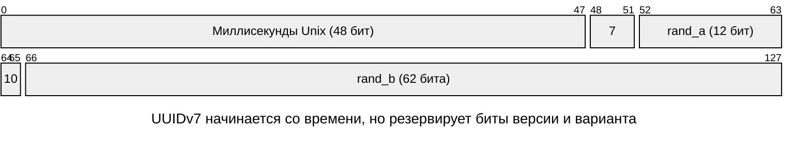
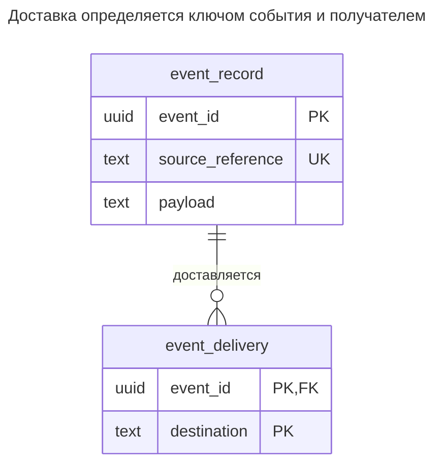
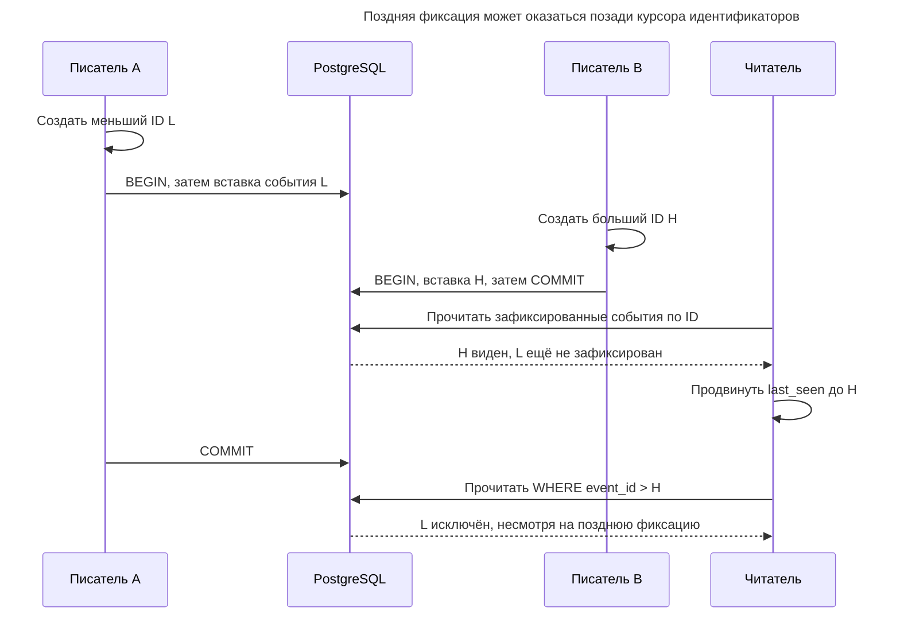
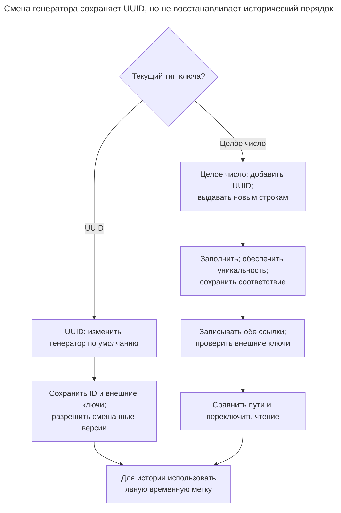

# Упорядоченный идентификатор

## Назначение

Упорядоченный по времени идентификатор рассчитан на глобальную уникальность и помещает время генерации в старшие биты: UUIDv7, ULID или значение в стиле Snowflake. Он позволяет сосредоточить новые записи B-дерева ближе к недавнему краю индекса, как последовательные целые числа, сохраняя возможность генерации в приложении на многих узлах. UUIDv7 и ULID не требуют центрального распределителя; Snowflake требует настроенных идентификаторов машин. Сравнивайте форматы, их порядок внутри миллисекунды и между машинами, а также время, которое раскрывается любому обладателю ID. Первичные определения — [RFC 9562 §5.7](https://www.rfc-editor.org/rfc/rfc9562.html#section-5.7), [спецификация ULID](https://github.com/ulid/spec) и [README Snowflake](https://github.com/twitter-archive/snowflake/tree/snowflake-2010).

## Также известен как

Time-sortable ID. UUIDv7 — формат RFC; ULID расшифровывается как Universally Unique Lexicographically Sortable Identifier. [README Snowflake](https://github.com/twitter-archive/snowflake/tree/snowflake-2010) Twitter называет приблизительную упорядоченность «k-sorted». Эти названия обозначают разные форматы, а не взаимозаменяемые кодировки.

## Проблема

Вы хотите создать событие и зависимые записи до отправки в хранилище. Центральный распределитель целых чисел добавляет зависимость на этом пути. Случайные UUID обходятся без него, но разбрасывают новые ключи по индексу; [RFC 9562 §6.13](https://www.rfc-editor.org/rfc/rfc9562.html#section-6.13) называет локальность в базе данных одной из причин появления упорядоченных по времени UUID.

Вы также хотите просматривать недавние события по ID. Это полезный порядок ключей, но он не показывает, какие транзакции зафиксированы и не пришлёт ли отключённый писатель более старый ID позднее. Разделяйте требования к идентичности, просмотру и надёжной доставке изменений.

## Решение

Генерируйте суррогат с временной меткой в старших битах и сохраняйте ограничение первичного ключа. В PostgreSQL 18 начните со встроенного `uuid` и `DEFAULT uuidv7()`; приложение также может передавать собственный UUIDv7. Сохраняйте отдельную ссылку на источник для обнаружения повторных запросов. Используйте явную бизнес-метку времени, если нужно время события, а не показание часов генератора.

| Формат | Структура и порядок | Цена выбора |
| --- | --- | --- |
| [UUIDv7](https://www.rfc-editor.org/rfc/rfc9562.html#section-5.7) | 128 бит: 48 бит миллисекунд Unix, версия/вариант, ещё 74 бита; необязательные доли времени и счётчики могут заменять часть случайности | Выберите генератор с документированным поведением внутри миллисекунды и при переводе часов назад |
| [ULID](https://github.com/ulid/spec#specification) | 48 бит миллисекунд Unix и 80 случайных бит; каноническая строка из 26 символов Crockford Base32 | Обычный порядок в одной миллисекунде не определён; монотонная фабрика увеличивает суффикс в пределах собственного состояния |
| [Исходный Snowflake](https://github.com/twitter-archive/snowflake/tree/snowflake-2010) | 41 бит миллисекунд от собственной эпохи, 10 бит настроенного ID машины, 12 бит последовательности; помещается в знаковое 64-битное число | Назначайте ID машин без пересечений; обрабатывайте исчерпание последовательности и движение часов назад |

При случайном суффиксе UUIDv7 идентификаторы одной миллисекунды не сохраняют порядок генерации; [необязательные механизмы монотонности RFC](https://www.rfc-editor.org/rfc/rfc9562.html#section-6.2) зависят от выбранного генератора. Состояние монотонной фабрики ULID тоже локально. Ни один из этих подходов не задаёт общего порядка суффиксов между машинами. Для канонического текста ULID используйте порядок ASCII, как требует спецификация. Не помещайте строку ULID в столбец UUID и не называйте её произвольное двоичное представление «UUIDv7».



Поле версии равно `0111`, вариант — `10`; остальные 74 бита разделены между `rand_a` и `rand_b`. Генератор может использовать часть этих битов для долей времени или счётчиков, поэтому одна структура формата не обещает порядка внутри миллисекунды.

## Альтернативы и выбор

| Соседний паттерн | Связь | Определяющее требование |
| --- | --- | --- |
| [Суррогатный ключ](surrogate-key.md) | Основное решение; целое число и UUIDv4 — альтернативные реализации | Целое число для централизованной выдачи или UUIDv4, когда нежелательно раскрытие времени |
| [Естественный ключ](natural-key.md) | Замена первичного ключа либо дополнение в виде бизнес-уникальности | Обязательный бизнес-идентификатор уже обеспечивает подходящую идентичность |
| [Публичный идентификатор](public-identifier.md) | Дополнение | Упорядоченный ID остаётся внутренним, наружу выдаётся независимый случайный идентификатор |

Полная таблица приведена в [Атласе решений](decision-atlas.md). Выбор UUIDv7 не отвечает на вопрос, нужен ли таблице суррогат вообще; см. [Обязательные суррогаты](mandatory-surrogates.md).

## Структура



Оба пути генерации заполняют один столбец ключа. Строки доставки ссылаются на событие независимо от того, где выдан его ID. Повторный импорт определяется ссылкой на источник, а не одним генерируемым идентификатором.

## Таблицы и инварианты

- **`event_record`** содержит уникальный `event_id` без `NULL` и отдельный обязательный уникальный `source_reference`. Дополнительно `event_id_v7` отклоняет идентификаторы других версий.
- **`event_delivery`** допускает одну запись на пару «событие и получатель» и требует существования события.
- **Временной порядок** — свойство генератора, а не межстрочное ограничение. Схема не может доказать достоверность переданной метки времени или то, что больший ID зафиксирован позже.

## Когда применять

- Нужны идентификаторы до вставки или в независимо записывающих базах данных.
- Измерения показывают, что нагрузка выигрывает от сосредоточения недавних ключей в меньшей области индекса.
- Приблизительный временной порядок полезен, а раскрытие времени генерации допустимо либо наружу выдаётся отдельный идентификатор.

## Последствия и компромиссы

- ➕ Ссылки можно создать до вставки родителя.
- ➕ Недавно сгенерированные ключи занимают близкий диапазон вместо случайных позиций по всему индексу.
- ➖ UUIDv7 и ULID сохраняют размер 128 бит; упорядоченность не означает компактность.
- ➖ Старшая временная метка раскрывает время генерации, которое не обязательно совпадает со временем бизнес-события.
- ➖ Сосредоточенная область вставок может сосредоточить и конкуренцию. Измеряйте с вашим числом писателей; локальность не гарантирует пропускную способность.

## Реализация

[Полный скрипт для PostgreSQL 18.6](../assets/time-ordered-identifier/time-ordered-identifier.sql) проверяет как серверные значения по умолчанию, так и явно переданные ID:

```sql
CREATE TABLE event_record (
    event_id uuid PRIMARY KEY DEFAULT uuidv7(),
    source_reference text NOT NULL UNIQUE,
    payload text NOT NULL,
    CONSTRAINT event_id_v7 CHECK ((uuid_extract_version(event_id) = 7) IS TRUE)
);
CREATE TABLE event_delivery (
    event_id uuid NOT NULL REFERENCES event_record (event_id),
    destination text NOT NULL,
    PRIMARY KEY (event_id, destination)
);
```

[Функции UUID PostgreSQL](https://www.postgresql.org/docs/18/functions-uuid.html) генерируют v7 с использованием миллисекунд, долей миллисекунды и случайности. Они также извлекают версию и время; извлечение версии возвращает `NULL` для других вариантов UUID. Проверке нужен `IS TRUE`, потому что [`CHECK` PostgreSQL принимает `NULL`](https://www.postgresql.org/docs/18/ddl-constraints.html#DDL-CONSTRAINTS-CHECK-CONSTRAINTS). Значение, созданное приложением, вставляется тем же путём; фиксированный ID делает пример воспроизводимым:

```sql
INSERT INTO event_record (source_reference, payload)
VALUES ('import:104', 'created') RETURNING event_id;
INSERT INTO event_record (event_id, source_reference, payload)
VALUES ('019535d9-3df7-79fb-b466-fa907fa17f9e', 'import:105', 'created');
INSERT INTO event_delivery
VALUES ('019535d9-3df7-79fb-b466-fa907fa17f9e', 'billing');
UPDATE event_record SET payload = 'validated'
WHERE source_reference = 'import:105';
SELECT source_reference, payload FROM event_record
WHERE event_id = '019535d9-3df7-79fb-b466-fa907fa17f9e';
SELECT uuid_extract_version(event_id) AS version,
       uuid_extract_timestamp(event_id) AT TIME ZONE 'UTC' AS generated_at
FROM event_record WHERE source_reference = 'import:105';
SELECT source_reference FROM event_record ORDER BY event_id;
```

Поиск возвращает `(import:105, validated)`. Извлечение возвращает версию `7` и время UTC `2025-02-24 02:46:24.503`. Последний запрос сортирует ключи, но не реализует надёжный поток зафиксированных изменений. Повтор ключа с другой ссылкой на источник завершится ошибкой:

```sql
INSERT INTO event_record (event_id, source_reference, payload)
VALUES ('019535d9-3df7-79fb-b466-fa907fa17f9e', 'import:106', 'duplicate');
```

PostgreSQL 18.6 возвращает SQLSTATE `23505`: `ERROR: duplicate key value violates unique constraint "event_record_pkey"`, с уточнением `DETAIL: Key (event_id)=(019535d9-3df7-79fb-b466-fa907fa17f9e) already exists.` Глобальная уникальность — цель проектирования; первичный ключ остаётся локальной границей её обеспечения.

## Поддержка в движках

- **PostgreSQL 18:** [`uuidv7()`](https://www.postgresql.org/docs/18/functions-uuid.html) встроен. Храните UUID во встроенном типе [`uuid`](https://www.postgresql.org/docs/18/datatype-uuid.html), а не строкой из 36 символов.
- **MySQL 8.4:** [`UUID()` генерирует v1](https://dev.mysql.com/doc/refman/8.4/en/miscellaneous-functions.html#function_uuid), а не v7. Для созданного приложением v7 сохраняйте канонический порядок байтов в двоичном хранилище; [флаг перестановки `UUID_TO_BIN`](https://dev.mysql.com/doc/refman/8.4/en/miscellaneous-functions.html#function_uuid-to-bin) оптимизирует v1, поэтому оставьте его выключенным.
- **SQL Server 2025 (17.x):** [порядок `uniqueidentifier` не совпадает со сравнением исходных битовых последовательностей](https://learn.microsoft.com/en-us/sql/t-sql/data-types/uniqueidentifier-transact-sql?view=sql-server-ver17). Не предполагайте, что временной порядок UUIDv7 переносится без изменений. [`NEWSEQUENTIALID()`](https://learn.microsoft.com/en-us/sql/t-sql/functions/newsequentialid-transact-sql?view=sql-server-ver17) использует последовательные GUID Windows, доступен только как значение столбца по умолчанию и после перезапуска Windows может начать с меньшего диапазона.
- **Oracle AI Database 26ai:** [`SYS_GUID()`](https://docs.oracle.com/en/database/oracle/oracle-database/26/sqlrf/SYS_GUID.html) возвращает 16 байт, на большинстве платформ включающих сведения об узле и процессе; это не документированный генератор UUIDv7. Для этого паттерна передавайте v7 из приложения и храните байты в `RAW(16)`.
- **SQLite 3:** генерируйте идентификаторы в приложении и храните в двоичном или каноническом текстовом виде; [классы хранения](https://www.sqlite.org/datatype3.html) SQLite включают `BLOB` и `TEXT`, а не встроенный тип UUID. Используйте порядок байтов/ASCII, соответствующий представлению.

## Сбои и конкурентность

Не меняйте ID при повторах доставки и сохраняйте уникальность источника на случай, если повторный запрос случайно сгенерирует новый ID. Первичные и уникальные ограничения разрешают конкурентные дубликаты; для хранения упорядоченного ID не требуется более сильная изоляция. [Проверки уникальных индексов PostgreSQL](https://www.postgresql.org/docs/18/index-unique-checks.html) разрешают конфликты с конкурентными незафиксированными строками.

Рассогласование часов и независимая генерация суффиксов не дают общего порядка генерации; ни порядок генерации, ни порядок ID не определяют порядок фиксации. Старый клиент может прислать ID ниже текущего курсора читателя. Для надёжного получения используйте [Транзакционный outbox](transactional-outbox.md) или другой явный протокол доставки вместо опроса только по `id > last_seen`.



Обе вставки имеют допустимые уникальные ID, но курсор навсегда пропускает L, если движется только вверх. Надёжной доставке нужен протокол, независимый от времени генерации.

Для Snowflake установите исключительное владение ID машин и правила перезапуска до приёма нагрузки. [Исходная реализация](https://github.com/twitter-archive/snowflake/tree/snowflake-2010) отказывается генерировать после перевода часов назад, пока время не превысит последнее использованное значение, и защищается от переполнения последовательности внутри миллисекунды. Определите, как выбранная реализация сообщает об этих ситуациях; не переключайтесь молча на генератор с потенциально пересекающимися значениями.

## Миграция

Для существующего ключа UUID можно изменить только генератор по умолчанию, сохранив все ID и внешние ключи. Не добавляйте проверку «только v7» из примера, пока остаются строки v4. Смешанные версии сохраняют идентичность, но не делают старые случайные ключи упорядоченными по времени; исторические запросы сортируйте по явной временной метке. PostgreSQL поддерживает изменение значений по умолчанию через [`ALTER TABLE`](https://www.postgresql.org/docs/18/sql-altertable.html).

Для целочисленного ключа добавьте отдельный столбец UUID, генерируйте значения для новых строк и заполните старые, не выдавая новые ID за носители исходного времени создания. Обеспечьте уникальность, записывайте обе формы ссылок потомков и проверьте внешние ключи до переключения чтения; см. [Расширение и свёртывание](expand-contract.md). Сохраните старое соответствие до отказа от отката. Вернуть прежнее значение по умолчанию легко; отозвать уже опубликованные ID — отдельное изменение контракта.



Смена значения UUID по умолчанию не трогает исторические ключи, а переход с целого числа требует миграции ссылок. Ни один путь не восстанавливает исходное время создания из новых ID.

## Антипаттерны и частые ошибки

- Обещать строгий глобальный порядок, в том числе внутри миллисекунды. [RFC 9562 §6.2](https://www.rfc-editor.org/rfc/rfc9562.html#section-6.2) описывает необязательные механизмы монотонности генератора; номер версии сам по себе их не гарантирует.
- Использовать встроенную временную метку как аудируемое время события или доказательство фиксации.
- Публиковать упорядоченный ID, когда время генерации должно оставаться закрытым; используйте [Публичный идентификатор](public-identifier.md).
- Считать улучшенный генератор основанием для [Обязательных суррогатов](mandatory-surrogates.md) в каждой таблице.

## Известные применения

- PostgreSQL 18 реализует [генерацию UUIDv7 и извлечение времени](https://www.postgresql.org/docs/18/functions-uuid.html).
- [README Snowflake](https://github.com/twitter-archive/snowflake/tree/snowflake-2010) Twitter объясняет потребность в компактных приблизительно упорядоченных ID между центрами обработки данных. Это исходный проект 2010 года, а не описание нынешней промышленной архитектуры Twitter.

## Связанные паттерны

- [Суррогатный ключ](surrogate-key.md) помогает решить, полезна ли генерируемая идентичность.
- [Естественный ключ](natural-key.md) сохраняет бизнес-уникальность, которую не обеспечивают генерируемые ID.
- [Публичный идентификатор](public-identifier.md) отделяет наблюдаемую идентичность от ключей хранения, содержащих время.
- [Транзакционный outbox](transactional-outbox.md) обеспечивает надёжную публикацию независимо от порядка ID.
- [Обязательные суррогаты](mandatory-surrogates.md) предостерегает от выбора генератора до выбора ключа.
