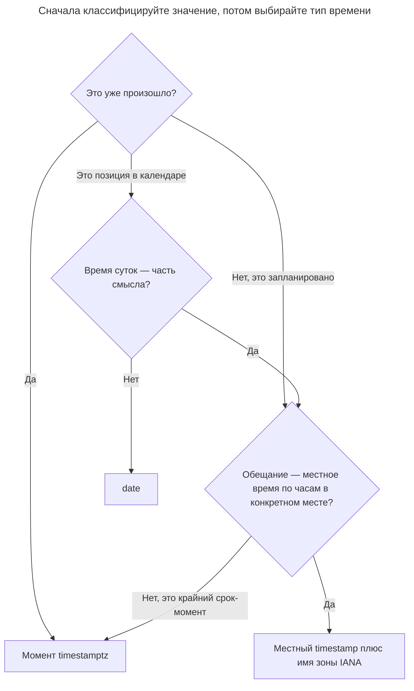
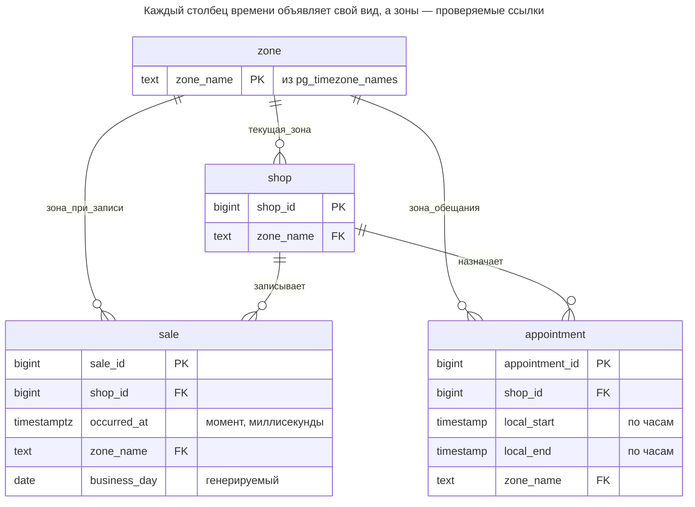
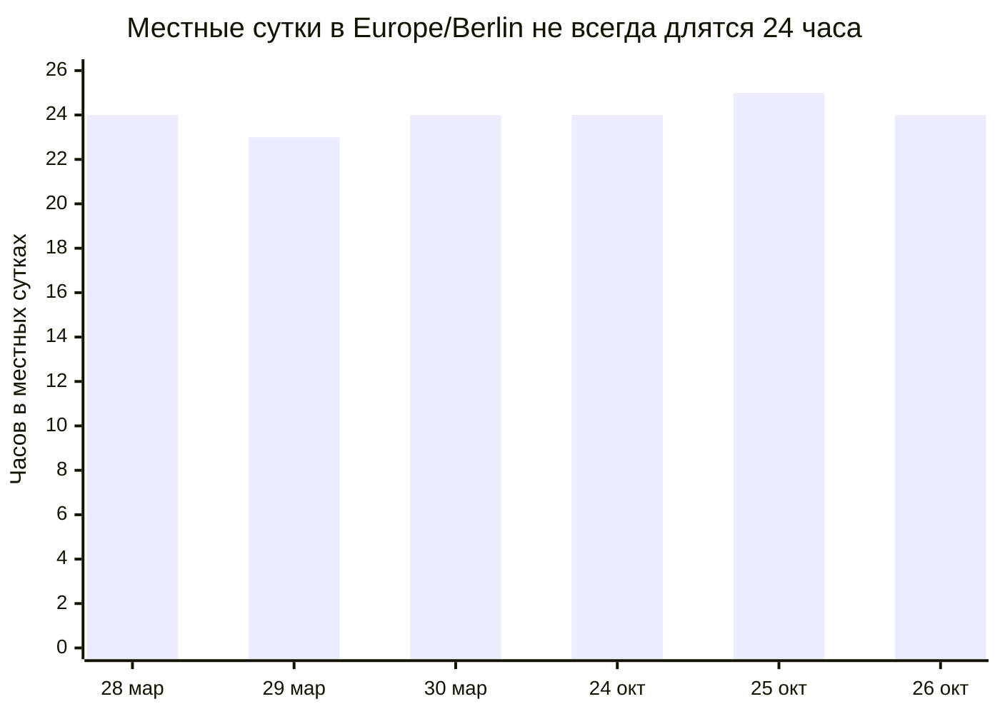
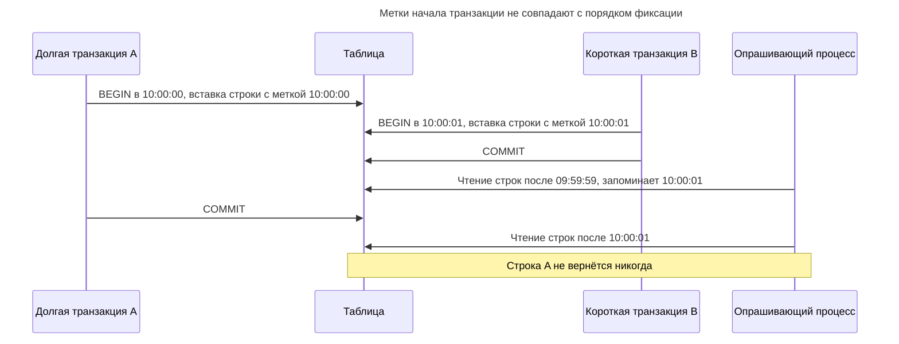
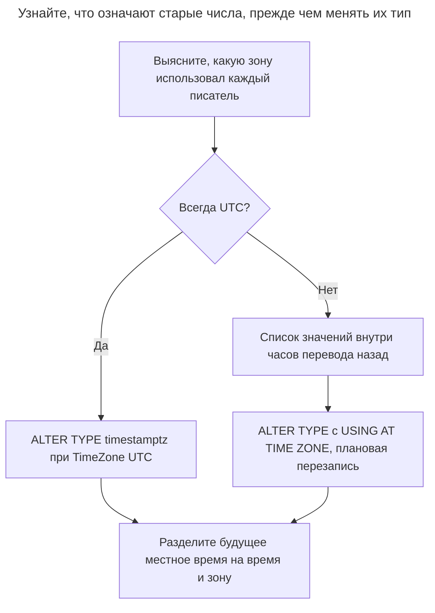

# Момент времени

## Назначение

Момент времени — это сохранённая точка или календарная позиция, тип которой говорит, что она означает: момент, когда что-то произошло, гражданскую дату или время по часам, которое наступит в определённом месте. Глава показывает, как выбирать между `timestamptz`, `date` и местным временем с именем зоны IANA, как сделать точность частью типа столбца, как превратить момент в бизнес-день, не предполагая, что в сутках 24 часа, и какие часы на самом деле читает `now()`. Остальные главы книги о времени опираются на эти решения. См. [типы даты и времени PostgreSQL](https://www.postgresql.org/docs/18/datatype-datetime.html) и [базу часовых поясов IANA](https://www.iana.org/time-zones).

## Также известен как

[Time Point](https://martinfowler.com/eaaDev/TimePoint.html) в дополнительных корпоративных паттернах Фаулера: точность и часовой пояс там — свойства самого значения, а не кода, который его читает. В JavaScript [Temporal API](https://tc39.es/proposal-temporal/docs/) называет те же различия `Instant`, `PlainDate`, `PlainDateTime` и `ZonedDateTime`.

## Проблема

Магазин в Токио записывает продажу в 23:30 UTC 1 марта. Дневной отчёт группирует по `occurred_at::date` в сеансе с часовым поясом UTC и относит продажу к 1 марта, хотя касса магазина уже закрыла 1 марта и продажа принадлежит 2 марта. Клиент из Берлина записывается на консультацию на 09:00 1 апреля следующего года, и приложение при сохранении переводит время в UTC. Если до этой даты изменятся правила перевода часов — правительства меняют правила летнего времени, и база tz следует за ними, — сохранённый момент перестанет означать 09:00 в Берлине, а в строке не останется того, о чём просил клиент.

Обратная ошибка встречается так же часто. Столбец `timestamp without time zone`, заполненный «локальным временем сервера», хранит числа, смещение которых живёт в настройке развёртывания. Переезд сервера или один иначе настроенный сервер приложения незаметно смешивают смещения. Час перевода стрелок назад случается дважды, поэтому часть сохранённых значений нельзя однозначно вернуть к моменту. Клиент на JavaScript присылает миллисекунды, база хранит микросекунды, и поиск на равенство по метке, которую клиент вернул обратно, ничего не находит.

## Решение

Классифицируйте каждый столбец времени до выбора его типа:

- **Момент** — что-то произошло или было записано: `timestamptz`. PostgreSQL хранит абсолютный момент и показывает его в часовом поясе сеанса `TimeZone`; введённое смещение не сохраняется.
- **Гражданская дата** — день рождения, срок оплаты, бизнес-день: `date`. Это не полночь где-либо. Если вы выводите её из момента, делайте это в объявленной зоне и сохраняйте использованную зону.
- **Будущее время по часам** — запись на приём, часы работы, запланированная публикация: местный `timestamp` плюс имя зоны IANA, например `Europe/Berlin`, а не фиксированное смещение. Вычисляйте момент, когда он нужен, по правилам зоны, действующим в этот момент.
- **Прошедшая длительность** — `interval` или целое число в объявленных единицах, а не разность двух местных времён.

Сделайте точность частью типа (`timestamptz(3)`, если клиенты передают миллисекунды), держите диапазоны полуоткрытыми и называйте часы, которые записывает каждый столбец: начало транзакции (`now()`), момент вызова (`clock_timestamp()`) или время события, переданное вызывающей стороной.

## Альтернативы и выбор

| Вариант | Отношение | Решающее требование |
| --- | --- | --- |
| Момент `timestamptz` | Вариант по умолчанию для событий | Значение фиксирует, когда что-то произошло, где бы это ни случилось |
| `date` | Замена момента | Значение — позиция в календаре без времени суток |
| Местный `timestamp` плюс имя зоны | Замена момента в будущем | Обещание — время по часам в определённом месте; смена правил должна сдвинуть момент, а не местное время |
| Момент плюс зафиксированная зона | Дополнение | Нужно показать или сгруппировать по местному времени, действовавшему при записи события |
| Целое число эпохи | Вариант реализации | Единицу задаёт внешний протокол; назовите её в имени столбца и преобразуйте в одном месте |
| [Период действия](effective-dating.md) | Дополнение | Значение действует в бизнес-периоде, границы которого — моменты времени |

Полное сравнение — в [Атласе решений](decision-atlas.md).



Крайний срок вроде «аукцион закрывается в 18:00 UTC» — это момент, хотя он и в будущем. Местное обещание вроде «клиника открывается в 09:00» — нет: только правила зоны в этот день превращают его в момент.

## Структура



Продажа хранит зону, действовавшую при её записи, — [зафиксированное значение](captured-value.md), поэтому последующий переезд магазина в другую зону не переписывает историю. Запись на приём хранит только местные поля и зону; её моменты вычисляются в представлении.

## Таблицы и инварианты

- **`zone`** перечисляет имена зон, которые принимает база часовых поясов этого сервера, скопированные из [`pg_timezone_names`](https://www.postgresql.org/docs/18/view-pg-timezone-names.html). Ссылки на неё отклоняют опечатки при записи. Это снимок одной сборки tzdata: обновляйте его после обновления сервера и будьте готовы, что в некоторых сборках нет устаревших псевдонимов. Образ PostgreSQL 18.7 на основе Debian, на котором проверялся практикум, отклоняет `Europe/Kiev` и принимает только `Europe/Kyiv`.
- **`shop`** владеет своей текущей зоной, которая может измениться при переезде магазина.
- **`sale`** хранит момент с точностью до миллисекунд и зону, действовавшую при записи. `business_day` — хранимый генерируемый столбец, поэтому он не может с ними разойтись. PostgreSQL принимает это выражение, потому что `timezone(text, timestamptz)` объявлена неизменяемой.
- **`appointment`** хранит обещанные местные начало и конец вместе с именем зоны. Представление `appointment_instant` вычисляет моменты при каждом чтении, поэтому обновление tzdata меняет их, не затрагивая строки.

## Когда применять

- Для каждого нового столбца времени: классификация — одно решение на столбец, и отменять его дорого.
- Когда отчёты группируют по дню, неделе или месяцу для людей в нескольких зонах или в одной зоне с летним временем.
- Когда вы планируете будущие события по местному времени или обмениваетесь метками времени с клиентами, у которых другая точность.

## Последствия и компромиссы

- ➕ Моменты корректно сравниваются и упорядочиваются независимо от зоны сервера, сеанса или клиента.
- ➕ Будущее местное время переживает смену правил летнего времени, потому что моменты выводятся, а не замораживаются.
- ➕ Расхождения точности решаются один раз, на границе столбца, а не в каждом сравнении.
- ➖ У будущего местного времени нет момента, пока вы его не вычислите. Напоминаниям и индексам вида «начинается в ближайший час» нужен вычисленный столбец, который вы пересчитываете после обновлений tzdata.
- ➖ Несуществующее или повторяющееся местное время разрешается правилом молча, а не отклоняется. Приложение должно спросить пользователя, когда разница важна.
- ➖ Список зон зависит от сборки tzdata на сервере и меняется при обновлениях.

## Реализация

[Полный скрипт для PostgreSQL 18.7](../assets/time-point/time-point.sql) проверяет бизнес-день, независимость хранения от сеанса, округление точности, длину суток, разрешение пропущенного и повторного часа, календарную арифметику, моменты записей на приём, отклонение неизвестной зоны и записи в генерируемый столбец, часы и смену типа без перезаписи таблицы:

```sql
CREATE SCHEMA time_example;
CREATE TABLE time_example.zone (zone_name text PRIMARY KEY);
INSERT INTO time_example.zone (zone_name) SELECT name FROM pg_timezone_names;
CREATE TABLE time_example.shop (
    shop_id bigint PRIMARY KEY,
    zone_name text NOT NULL REFERENCES time_example.zone (zone_name)
);
CREATE TABLE time_example.sale (
    sale_id bigint PRIMARY KEY,
    shop_id bigint NOT NULL REFERENCES time_example.shop (shop_id),
    occurred_at timestamptz(3) NOT NULL,
    zone_name text NOT NULL REFERENCES time_example.zone (zone_name),
    business_day date GENERATED ALWAYS AS
        ((occurred_at AT TIME ZONE zone_name)::date) STORED
);
CREATE TABLE time_example.appointment (
    appointment_id bigint PRIMARY KEY,
    shop_id bigint NOT NULL REFERENCES time_example.shop (shop_id),
    local_start timestamp(0) NOT NULL,
    local_end timestamp(0) NOT NULL,
    zone_name text NOT NULL REFERENCES time_example.zone (zone_name),
    CHECK (local_end > local_start)
);
CREATE VIEW time_example.appointment_instant AS
SELECT appointment_id,
       local_start AT TIME ZONE zone_name AS starts_at,
       local_end AT TIME ZONE zone_name AS ends_at
FROM time_example.appointment;
```

Запишите продажу в Токио с текущей зоной магазина:

```sql
INSERT INTO time_example.shop VALUES (1, 'Asia/Tokyo'), (2, 'Europe/Berlin');
INSERT INTO time_example.sale (sale_id, shop_id, occurred_at, zone_name)
SELECT 10, shop_id, TIMESTAMPTZ '2026-03-01 23:30:00+00', zone_name
FROM time_example.shop WHERE shop_id = 1;
SELECT business_day FROM time_example.sale WHERE sale_id = 10;
```

Запрос возвращает `2026-03-02`. После `SET TIME ZONE 'America/New_York'` тот же `occurred_at` отображается как `2026-03-01 18:30:00-05`: изменилось только представление. [Оператор `AT TIME ZONE`](https://www.postgresql.org/docs/18/functions-datetime.html#FUNCTIONS-DATETIME-ZONECONVERT) превращает момент в местные поля именованной зоны, а местные поля — в момент. Ввод `2026-03-29 10:00:00.1235+00` сохраняется как `.124`, потому что столбец объявляет три знака дробной части.

Бизнес-день в зоне — полуоткрытый диапазон моментов от местной полуночи до следующей местной полуночи:

```sql
SELECT count(*) FROM time_example.sale
WHERE occurred_at >= DATE '2026-03-29'::timestamp AT TIME ZONE 'Europe/Berlin'
  AND occurred_at <  DATE '2026-03-30'::timestamp AT TIME ZONE 'Europe/Berlin';
```

Этот диапазон длится 23 часа. Скрипт проверяет, что 25 октября в Берлине длится 25 часов и что прибавление `interval '1 day'` к `timestamptz` в берлинском сеансе сохраняет 12:00 по местному времени через переход, а прибавление `interval '24 hours'` даёт 13:00.



Короткий и длинный столбцы — переходы на летнее и зимнее время в 2026 году. Отчёт, который делит дневную сумму на 24 или строит сутки через `+ interval '24 hours'`, в таких зонах ошибается дважды в год.

Местное время, попавшее в переход, разрешается, а не отклоняется. [Правило PostgreSQL](https://www.postgresql.org/docs/18/datetime-invalid-input.html) даёт несуществующему времени смещение, действовавшее непосредственно до перехода, а неоднозначному — смещение, действующее сразу после него:

```sql
SELECT TIMESTAMP '2026-03-29 02:30' AT TIME ZONE 'Europe/Berlin',
       TIMESTAMP '2026-10-25 02:30' AT TIME ZONE 'Europe/Berlin';
```

Оба выражения возвращают `01:30:00+00`: первое — это 03:30 летнего времени, которое пользователь не вводил, второе — более позднее из двух 02:30. Спрашивайте пользователя, когда запись попадает в любой из этих часов.

Запись на приём хранит обещание и выводит момент:

```sql
INSERT INTO time_example.appointment VALUES
    (20, 2, TIMESTAMP '2027-04-01 09:00', TIMESTAMP '2027-04-01 09:30', 'Europe/Berlin');
SELECT starts_at FROM time_example.appointment_instant WHERE appointment_id = 20;
```

По текущим правилам запрос возвращает `2027-04-01 07:00:00+00`. Опечатку в имени зоны отклоняет ссылка:

```sql
INSERT INTO time_example.appointment VALUES
    (21, 2, TIMESTAMP '2027-04-01 10:00', TIMESTAMP '2027-04-01 10:30', 'Europe/Berlinn');
```

PostgreSQL 18.7 выдаёт SQLSTATE `23503`: `ERROR: insert or update on table "appointment" violates foreign key constraint "appointment_zone_name_fkey"` с `DETAIL: Key (zone_name)=(Europe/Berlinn) is not present in table "zone".` Без ссылки опечатка обнаружилась бы только тогда, когда запрос вычислил бы `AT TIME ZONE` и упал с `22023`. Прямая запись в `business_day` выдаёт `428C9`: `ERROR: column "business_day" can only be updated to DEFAULT`.

## Поддержка в движках

- **PostgreSQL 18:** `timestamptz` хранит момент в UTC с микросекундным разрешением и без зоны; [имена часовых поясов](https://www.postgresql.org/docs/18/datatype-datetime.html#DATATYPE-TIMEZONES) берутся из базы tz, с которой собран сервер, и это может быть копия операционной системы. [`now()` и `transaction_timestamp()`](https://www.postgresql.org/docs/18/functions-datetime.html#FUNCTIONS-DATETIME-CURRENT) возвращают начало транзакции, `statement_timestamp()` — начало оператора, а `clock_timestamp()` — момент вызова.
- **MySQL 8.4:** [`TIMESTAMP`](https://dev.mysql.com/doc/refman/8.4/en/datetime.html) при сохранении переводит значение из зоны сеанса в UTC и обратно при чтении и ограничен 1970–2038 годами; `DATETIME` хранит поля без зоны. Именованные зоны работают только после загрузки [таблиц часовых поясов](https://dev.mysql.com/doc/refman/8.4/en/time-zone-support.html). Храните имя зоны в отдельном столбце, как здесь.
- **SQL Server 2025 (17.x):** [`datetimeoffset`](https://learn.microsoft.com/en-us/sql/t-sql/data-types/datetimeoffset-transact-sql?view=sql-server-ver17) хранит смещение, а не имя зоны, поэтому не может последовать за сменой правил. [`AT TIME ZONE`](https://learn.microsoft.com/en-us/sql/t-sql/queries/at-time-zone-transact-sql?view=sql-server-ver17) использует имена зон Windows, например `Central European Standard Time`; если клиенты присылают имена IANA, сопоставляйте их явно.
- **Oracle AI Database 26ai:** [`TIMESTAMP WITH TIME ZONE`](https://docs.oracle.com/en/database/oracle/oracle-database/26/sqlrf/Data-Types.html) может хранить вместе со значением имя региона, а `TIMESTAMP WITH LOCAL TIME ZONE` приводит значение к зоне базы данных. `DATE` включает время суток, поэтому гражданской дате нужно правило усечения.
- **SQLite 3:** типа даты нет. Храните текст ISO 8601 в UTC или число эпохи Unix; [функции даты](https://www.sqlite.org/lang_datefunc.html) знают только UTC и локальную зону процесса, поэтому преобразование по именованным зонам — забота приложения.

## Сбои и конкурентность

`now()` фиксируется в начале транзакции. Долгая транзакция, которая фиксируется поздно, записывает строки, выглядящие старше строк, зафиксированных раньше короткими транзакциями. Читатель, который опрашивает `WHERE updated_at > :last_seen`, поэтому их пропускает:



`clock_timestamp()` этого не исправляет: фиксация в любом случае происходит после простановки метки. Передавайте изменения потребителям через механизм, упорядоченный по фиксации: [транзакционный outbox](transactional-outbox.md) с захватом строк блокировками, [таблицу очереди](queue-table.md) или логическое декодирование. Запас по времени с дедупликацией по ID лишь сужает окно.

Метки, созданные на серверах приложения, несут расхождение их часов. Для упорядочивания событий внутри одной базы используйте часы базы. Для событий, о которых сообщают устройства, храните присланный `occurred_at` и `received_at` базы рядом и решайте, какой из них использует каждый отчёт.

Обновление tzdata меняет моменты, выведенные из будущего местного времени. Если вы кешируете вычисленный `starts_at` для напоминаний или индексов, пересчитывайте его из `local_start` и `zone_name` после каждого обновления сервера и считайте кеш производными данными, а не обещанием.

## Миграция

Если столбцы `timestamp` хранят UTC, меняйте тип в сеансе с зоной UTC. Тогда PostgreSQL 18.7 сохраняет файл таблицы — скрипт сравнивает `pg_relation_filenode` до и после, — хотя `ALTER TABLE` всё равно ненадолго берёт [блокировку `ACCESS EXCLUSIVE`](https://www.postgresql.org/docs/18/sql-altertable.html). В сеансе с любой другой зоной та же команда перезаписывает таблицу.

Если столбцы `timestamp` хранят время местной зоны, преобразуйте их через `USING recorded_at AT TIME ZONE 'Europe/Berlin'`; это перезаписывает таблицу. Значения внутри часа перевода стрелок назад неоднозначны: составьте их список до изменения и решайте по другим признакам, например по порядку последовательности, а не принимайте правило по умолчанию.



Будущие события, сохранённые как моменты UTC, можно вернуть к местному времени, только если известна зона, в которой каждое было записано, и tzdata, актуальная на момент записи. Восстановите местное время по этим данным, сохраните его рядом с зоной и переключите читателей на производное представление через [расширение и свёртывание](expand-contract.md).

## Антипаттерны и частые ошибки

- Приведение момента через `::date`, которое использует зону сеанса, а не зону бизнеса.
- `BETWEEN '... 00:00' AND '... 23:59:59'`, который теряет доли секунды и 25-й час. Используйте полуоткрытые диапазоны.
- Хранение фиксированного смещения вроде `+01:00` для будущего местного времени.
- Построение суток через `interval '24 hours'` или предположение, что в каждых сутках 24 часа.
- Метка `now()` на всех строках долгого пакета, которые потом читаются как отдельные моменты событий.
- Сравнение на равенство меток, возвращённых клиентом, когда клиент хранит меньше знаков дробной части, чем столбец.
- Сокращения вроде `CST`, которые в разных регионах означают разные смещения; храните имена IANA.

## Известные применения

- Джон Скит в статье [«Storing UTC is not a silver bullet»](https://codeblog.jonskeet.uk/2019/03/27/storing-utc-is-not-a-silver-bullet/) прослеживает конференцию, назначенную на 09:00 в Амстердаме, через смену правил tz и по этой причине хранит местное время вместе с идентификатором зоны.
- [RFC 9557](https://www.rfc-editor.org/rfc/rfc9557.html) расширяет метки времени RFC 3339 именем зоны в квадратных скобках, например `2022-07-08T00:14:07+01:00[Europe/Paris]`, чтобы API мог передать и момент, и зону, придающую ему местный смысл.
- JavaScript [Temporal API](https://tc39.es/proposal-temporal/docs/) разделяет `Instant`, `PlainDate`, `PlainDateTime` и `ZonedDateTime` — ту же классификацию, что и столбцы этой главы.

## Связанные паттерны

- [Период действия](effective-dating.md) строит бизнес-периоды из дат или моментов.
- [Таблица истории](history-table.md) и [битемпоральная таблица](bitemporal-table.md) выбирают, какие часы записывают версию.
- [Таблица итогов](summary-table.md) агрегирует по бизнес-дню, а для этого нужна политика зон из этой главы.
- [Таблица значений](lookup-table.md) объясняет справочник, который здесь используется для имён зон.
- [Транзакционный outbox](transactional-outbox.md) доставляет изменения в порядке фиксации, а не по меткам времени.
