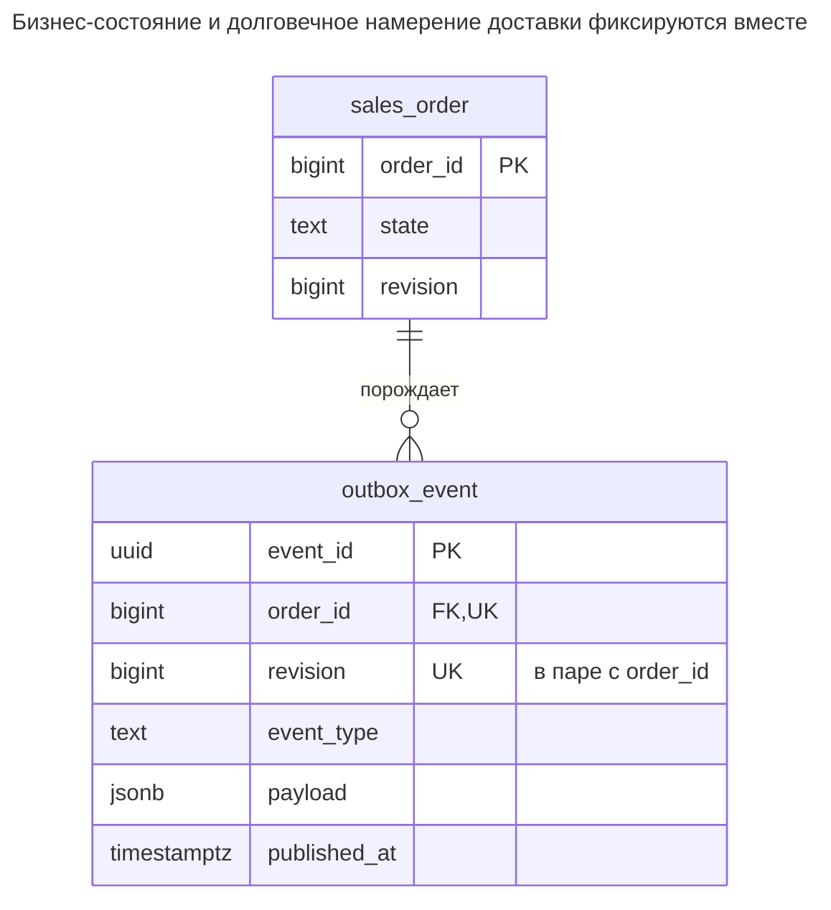
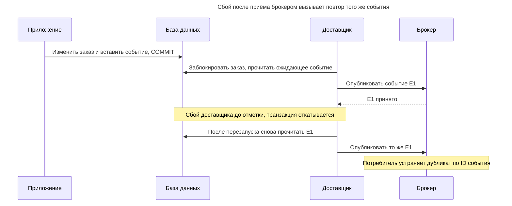
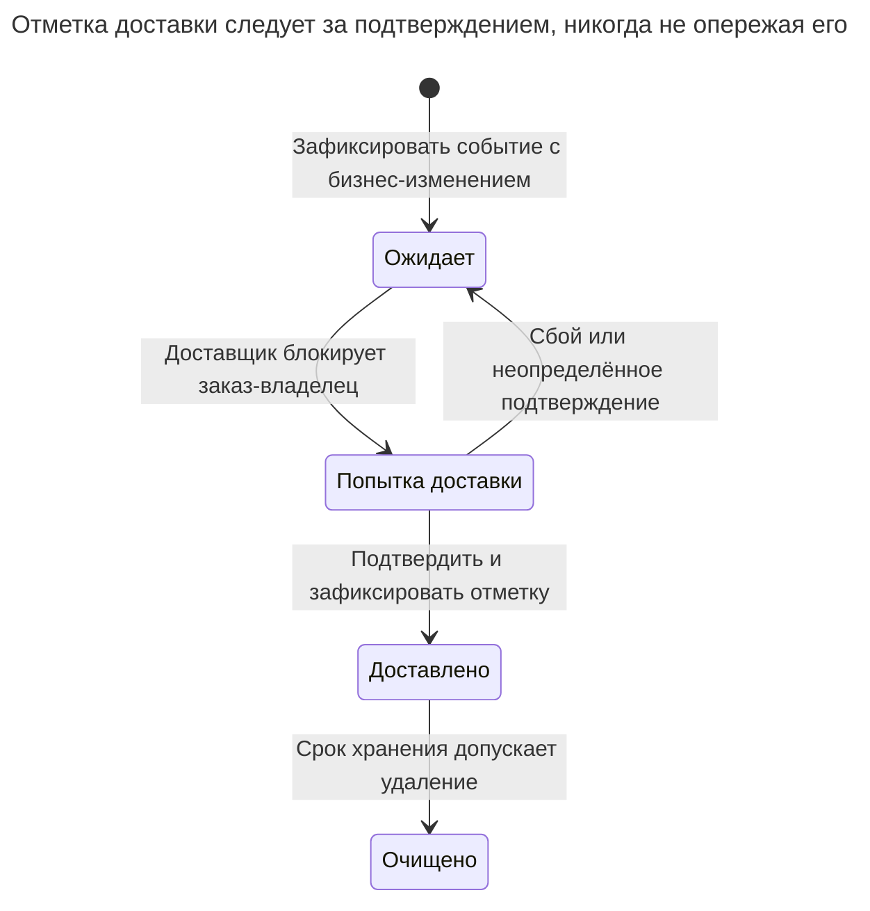
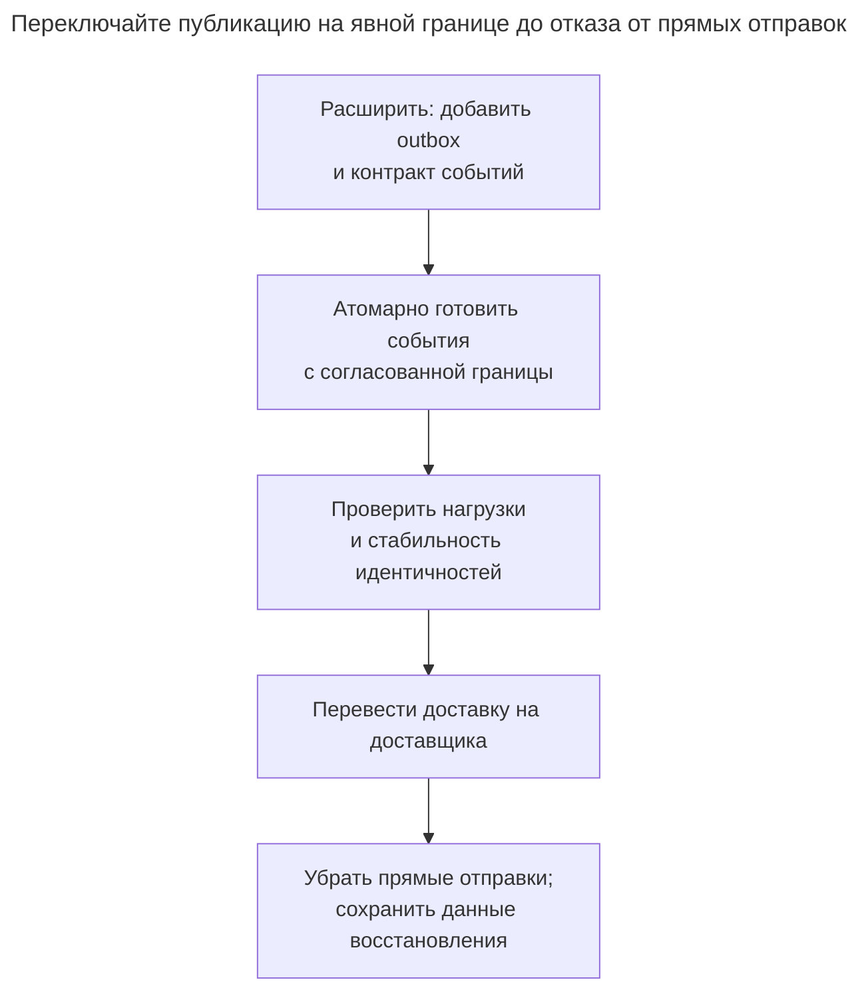

# Транзакционный outbox

## Назначение

Транзакционный outbox решает проблему двойной записи: когда сервис меняет данные и должен опубликовать событие, он записывает событие в таблицу исходящих сообщений в той же транзакции, что изменение. Отдельный доставщик — опрашивающий процесс или захват изменений вроде Debezium — читает outbox и доставляет события брокеру сообщений. Глава показывает таблицу, гарантии порядка и доставки, необходимость терпимости потребителей к дубликатам и очистку доставленных строк.

## Также известен как

События приложения в каталоге [Transactional Outbox](https://microservices.io/patterns/data/transactional-outbox.html) Ричардсона. [Polling Publisher](https://microservices.io/patterns/data/polling-publisher.html) и [Transaction Log Tailing](https://microservices.io/patterns/data/transaction-log-tailing.html) — варианты реализации доставщика, а не разные бизнес-схемы.

## Проблема

Вы отмечаете заказ оплаченным, затем отправляете `OrderPaid` брокеру. При сбое после фиксации, но до отправки, заказ остаётся оплаченным без события. Отправка первой переворачивает сбой: брокер может объявить оплату, чья транзакция базы затем откатится.

Повторяющий HTTP-клиент добавляет неоднозначность, но одно устранение дубликатов запросов не закрывает пробел между базой и брокером. Нужен долговечный локальный факт о сообщении, которое ещё нужно доставить, без независимой фиксации между ним и бизнес-изменением.

## Решение

Вставляйте неизменяемый снимок события в `outbox_event` в той же транзакции базы, которая меняет `sales_order`. Доставщик читает зафиксированные события, публикует и записывает подтверждённую доставку. Неудачная бизнес-транзакция не оставляет ни изменения, ни события; зафиксированная оставляет работу доставки, переживающую перезапуск процесса. Эту локальную атомарность даёт [транзакционная модель PostgreSQL](https://www.postgresql.org/docs/18/tutorial-transactions.html).

Отделяйте идентичность события от заказа. Сохраняйте стабильный `event_id` при каждой попытке публикации, ключ заказа для маршрутизации и явную ревизию заказа для порядка. Потребители устраняют дубликаты по ID события через [Запись идемпотентности](idempotency-record.md). [Паттерн outbox Ричардсона](https://microservices.io/patterns/data/transactional-outbox.html) явно включает повторную публикацию после сбоя доставщика; доставка автоматически не становится однократной.

## Альтернативы и выбор

| Соседний паттерн или механизм | Связь | Определяющее требование |
| --- | --- | --- |
| [Таблица очереди](queue-table.md) | Замена для полностью локальной работы; вариант опрашивающей доставки | Обработчик выполняет задание прямо без публикации интеграционного события |
| [Запись идемпотентности](idempotency-record.md) | Дополнение | Устраняет повторы входящих команд и эффектов потребителей, но не доставляет сообщения |
| [Столбец версии](version-column.md) | Дополнение | Отклоняет устаревшие команды и даёт явную ревизию агрегата |
| Опрашивающий издатель | Вариант реализации | Нужен обычный SQL-доставщик, и вы готовы обслуживать опрос, повторы и хранение |
| Чтение журнала транзакций | Вариант реализации | Вы уже обслуживаете CDC и можете сохранять позиции коннектора и требования повторного воспроизведения |
| Согласованная распределённая транзакция | Замена с другой связанностью | Оба ресурса и эксплуатационная модель поддерживают единый протокол распределённой фиксации |

Полное сравнение — в [Атласе решений](decision-atlas.md). Вызов после фиксации без долговечного хранения доставки всё ещё оставляет окно сбоя. Регистрация произвольных табличных изменений через CDC сама по себе также не задаёт стабильную нагрузку бизнес-события.

## Структура



Заказ порождает много событий, в примере — одно на ревизию. Внешний ключ намеренно типизирован на заказы. Для нескольких независимых типов агрегатов выбирайте отдельные типизированные outbox или явный альтернативный проект ссылок вместо притворства, что `(type, id)` — внешний ключ; см. [Отсутствующие внешние ключи](missing-foreign-keys.md).

## Таблицы и инварианты

- **`sales_order`** — источник истины текущего бизнес-состояния. Ревизия увеличивается под блокировкой заказа при каждом порождающем событие изменении.
- **`outbox_event`** имеет стабильный первичный ключ события и уникальную пару `(order_id, revision)`. Нагрузка и тип описывают зафиксированное изменение, а не позднюю реконструкцию сегодняшнего заказа.
- **Атомарное создание** — инвариант пути записи: ограничения не заставляют каждое обновление заказа порождать событие. Централизуйте нужные изменения или используйте намеренно спроектированный путь записи базы.
- **Состояние доставки** отделено от содержимого события. Задавайте `published_at` только после нужного долговечного подтверждения брокера. Оно означает запись приёма доставщиком, а не завершение всех потребителей.
- **Порядок** задан для заказа. Пример сериализует доставщиков на заказе и выбирает его самую раннюю неопубликованную ревизию; глобального порядка разных заказов нет.

## Когда применять

- Локальная бизнес-фиксация должна в итоге вызвать интеграционное событие или удалённую команду.
- Допустима асинхронная доставка, и можно показывать или отслеживать её задержку.
- Потребители терпимы к дубликатам, а порядок сущности имеет определённую реализацию.

## Последствия и компромиссы

- ➕ Недоступность брокера не стирает зафиксированное намерение доставки; события надёжно накапливаются.
- ➕ Откат бизнеса не оставляет независимо зафиксированное подготовленное событие.
- ➖ У доставки есть задержка и очередь, требующие пределов ёмкости, мониторинга и восстановления.
- ➖ Подтверждение и отметка — разные фиксации разных систем, поэтому дубликаты отправки возможны.
- ➖ Контракты событий и хранение входят в эволюцию схемы. Удаление старого события может уничтожить единственную копию для запоздалого доставщика или воспроизведения.

## Реализация

[Полный скрипт PostgreSQL 18.6](../assets/transactional-outbox/transactional-outbox.sql) проверяет атомарное создание и откат, уникальность по заказу и отметку доставки. Он имитирует успешное подтверждение брокера и не запускает брокер. [`uuidv4()`](https://www.postgresql.org/docs/18/functions-uuid.html) генерирует ID событий; первый ID ниже фиксирован для воспроизводимости:

```sql
CREATE TABLE sales_order (
    order_id bigint PRIMARY KEY,
    state text NOT NULL CHECK (state IN ('pending', 'paid', 'cancelled')),
    revision bigint NOT NULL DEFAULT 0 CHECK (revision >= 0)
);
CREATE TABLE outbox_event (
    event_id uuid PRIMARY KEY DEFAULT uuidv4(),
    order_id bigint NOT NULL REFERENCES sales_order (order_id),
    revision bigint NOT NULL CHECK (revision > 0),
    event_type text NOT NULL,
    payload jsonb NOT NULL,
    published_at timestamptz,
    CONSTRAINT outbox_order_revision_key UNIQUE (order_id, revision)
);
CREATE INDEX outbox_pending_idx ON outbox_event (order_id, revision)
WHERE published_at IS NULL;
INSERT INTO sales_order VALUES (1, 'pending', 0);
BEGIN;
WITH changed AS (
    UPDATE sales_order SET state = 'paid', revision = revision + 1
    WHERE order_id = 1 AND state = 'pending' AND revision = 0
    RETURNING order_id, revision, state
)
INSERT INTO outbox_event (event_id, order_id, revision, event_type, payload)
SELECT '00000000-0000-4000-8000-000000000001', order_id, revision, 'OrderPaid',
       jsonb_build_object('schema_version', 1, 'order_id', order_id,
                          'revision', revision, 'state', state)
FROM changed
RETURNING event_id, revision;
COMMIT;
```

Возвращаются фиксированный ID события и ревизия `1`. [CTE с изменением данных](https://www.postgresql.org/docs/18/queries-with.html#QUERIES-WITH-MODIFYING) вставляет событие только для изменённой строки. До сообщения о принятии команды требуйте одно возвращённое событие; ноль строк означает невыполненное предусловие. Если вставка неудачна, обновление заказа не может зафиксироваться отдельно.

Следующая попытка дублирует ревизию под другим ID события:

```sql
-- Expected SQLSTATE 23505.
INSERT INTO outbox_event (event_id, order_id, revision, event_type, payload)
VALUES ('00000000-0000-4000-8000-000000000002', 1, 1, 'OrderPaid', '{}');
```

PostgreSQL 18.6 возвращает SQLSTATE `23505`: `ERROR: duplicate key value violates unique constraint "outbox_order_revision_key"`. Уникальность запрещает повтор ревизии, но не доказывает отсутствия пропущенных событий или корректности выбранной производителем нагрузки.

В опрашивающей реализации блокируйте заказ с ожидающими событиями, затем читайте его первое ожидающее событие. Подготовленный заказ здесь — `1`; доставщик передаёт фактически возвращённый ID во второй запрос:

```sql
BEGIN;
SELECT o.order_id FROM sales_order AS o
WHERE EXISTS (
    SELECT 1 FROM outbox_event AS e
    WHERE e.order_id = o.order_id AND e.published_at IS NULL
)
ORDER BY o.order_id LIMIT 1
FOR UPDATE OF o SKIP LOCKED;
SELECT event_id, event_type, payload FROM outbox_event
WHERE order_id = 1 AND published_at IS NULL
ORDER BY revision LIMIT 1 FOR UPDATE;
-- Publish this exact event; wait for the broker acknowledgement.
-- The SQL-only lab assumes that acknowledgement succeeds here.
UPDATE outbox_event SET published_at = clock_timestamp()
WHERE event_id = '00000000-0000-4000-8000-000000000001'
  AND published_at IS NULL
RETURNING event_id;
COMMIT;
```

Удерживайте блокировку заказа до подтверждения и отметки; протокол обязателен для каждого опрашивающего доставщика. Если заказ или событие не возвращены, завершите транзакцию и опросите позднее. При сбое публикации откатитесь и повторите то же событие. Настройте ограниченные тайм-ауты брокера: простая реализация удерживает транзакцию базы во время сетевой работы. Доставщик с арендой сокращает транзакцию, но требует протокола владения и восстановления [Таблицы очереди](queue-table.md).

Блокировка родителя не даёт второму доставщику обогнать прежнюю ревизию заказа. Она также кратко блокирует запись заказа. Публикуйте с ID заказа как стабильным ключом маршрутизации и сохраняйте порядок у брокера и потребителя; порядок SQL-ревизий не управляет произвольным дальнейшим транспортом. Не помечайте несколько строк доставленными лишь по попытке пакетной публикации.

## Поддержка в движках

- **PostgreSQL 18:** опрос использует [`FOR UPDATE SKIP LOCKED`](https://www.postgresql.org/docs/18/sql-select.html#SQL-FOR-UPDATE-SHARE) на точке сериализации заказа. Чтение журнала — альтернативный доставщик; не запускайте для того же потока несогласованный опрос параллельно.
- **MySQL 8.4 / InnoDB:** [`SKIP LOCKED`](https://dev.mysql.com/doc/refman/8.4/en/innodb-locking-reads.html) поддерживает похожее получение доставки. Оно небезопасно для репликации операторов; намеренно выбирайте конфигурацию репликации.
- **SQL Server 2025 (17.x):** перенос опроса может использовать [`READPAST` с протоколом блокировки обновления](https://learn.microsoft.com/en-us/sql/t-sql/queries/hints-transact-sql-table?view=sql-server-ver17); учитывайте ограничения изоляции. Это не текстовая замена CTE и блокировочного синтаксиса PostgreSQL.
- **Oracle AI Database 26ai:** [`FOR UPDATE SKIP LOCKED`](https://docs.oracle.com/en/database/oracle/oracle-database/26/sqlrf/SELECT.html) поддерживает выбор конкурирующих доставщиков. При переносе сохраняйте сериализацию заказа и правила подтверждения.
- **SQLite 3:** [ограничение одним писателем](https://www.sqlite.org/lang_transaction.html) делает транзакцию записи, удерживаемую во время ввода-вывода брокера, особенно ограничительной. Предпочтите короткий протокол получения или одного подходящего нагрузке доставщика.

## Сбои и конкурентность



Долговечная единица — «изменение заказа плюс намерение события», а не «изменение базы плюс публикация брокера». ID события должен переживать повтор; новый ID каждой отправки разрушает устранение дубликатов потребителем.

Используйте Read Committed для локального условного обновления и опросных транзакций. [Блокировки строк PostgreSQL](https://www.postgresql.org/docs/18/explicit-locking.html#LOCKING-ROWS) действуют до конца транзакции, поэтому конкурентный доставщик пропускает заблокированный заказ. `SKIP LOCKED` улучшает прогресс независимых заказов, но не даёт строгой справедливости. Следите за возрастом самого старого ожидающего события, а не только числом публикаций в секунду.



`Attempting` здесь — состояние транзакции и процесса, а не сохранённый столбец статуса. Неопределённое подтверждение идёт по ветке повтора, даже если брокер фактически принял первую отправку.

Для CDC настройте отображение таблицы коннектора и сохраняйте позицию восстановления. [Outbox Event Router Debezium](https://debezium.io/documentation/reference/stable/transformations/outbox-event-router.html) по умолчанию использует `id`, `aggregatetype`, `aggregateid`, `type`, `payload`; `aggregateid` становится ключом сообщения, ID события доступен для устранения дубликатов. Типизированной опросной схеме главы нужна настройка или адаптация, это не готовая совместимость. Маршрутизатор ожидает вставленные события и отфильтровывает удаления; документированные ограничения обновлений — ещё одна причина не сочетать его стандартный контракт таблицы с обновлениями отметки доставки этого опроса.

## Миграция

Создайте outbox до переключения производителей. Установите границу публикации и политику стабильной идентичности событий. Фиксируйте все новые изменения на границе, проверьте подготовленные события, затем запустите доставку. Исторические строки не доказывают доставку исходных событий; если потребителю нужна отправная точка, публикуйте явные события снимка/заполнения под отдельным контрактом.



Избегайте пробела и двух независимых производителей при передаче. Если прямая публикация пересекается, используйте одинаковые ID событий и потребителей с устранением дубликатов. При откате прекращайте новое создание outbox только после организации эквивалентной долговечной доставки; доставьте уже принятые ожидающие строки. См. [Расширение и свёртывание](expand-contract.md).

При очистке опросного outbox удаляйте ограниченными пакетами только подтверждённые строки старше обещанного окна восстановления/диагностики. Индекс ожидающих сужает выборку, но удалённым и обновлённым строкам всё ещё нужно [регулярное обслуживание vacuum PostgreSQL](https://www.postgresql.org/docs/18/routine-vacuuming.html). Очистка CDC вместо этого учитывает восстановимость и воспроизведение коннектора; опросный `published_at` не является его позицией. Не удаляйте ожидающие события ради облегчения аварии без явного отказа от доставки.

## Антипаттерны и частые ошибки

- Публиковать после фиксации без долговечной записи или до неё, предполагая отзыв сообщения откатом.
- Восстанавливать старую нагрузку события из последнего состояния заказа.
- Обещать глобальный порядок или порядок заказа лишь потому, что ID или метки времени сортируются.
- Отмечать доставку до подтверждения или обещать однократную доставку из-за уникальной вставки outbox.
- Запускать несколько доставщиков, забирающих отдельные события без согласования ревизий одного заказа.

## Известные применения

- [Опрашивающий издатель](https://microservices.io/patterns/data/polling-publisher.html) и [доставщик чтения журнала](https://microservices.io/patterns/data/transaction-log-tailing.html) Ричардсона описывают оба механизма доставки и указывают реализации Eventuate Tram.
- [Outbox Event Router Debezium](https://debezium.io/documentation/reference/stable/transformations/outbox-event-router.html) отображает вставленные outbox-записи в маршрутизированные события; ID события, ключ маршрутизации и нагрузка — разные поля.
- [Подготовленные фоновые задания Лича](https://brandur.org/idempotency-keys) используют тот же принцип подготовки в локальной транзакции для позднее поставленной в очередь работы.

## Связанные паттерны

- [Запись идемпотентности](idempotency-record.md) устраняет повторы запросов и эффектов потребителей.
- [Таблица очереди](queue-table.md) даёт получение, повторы и восстановление аренды асинхронной работы.
- [Столбец версии](version-column.md) предоставляет ревизию агрегата принятых изменений.
- [Отсутствующие внешние ключи](missing-foreign-keys.md) ставят под сомнение непроверенные ссылки агрегатов.
- [Расширение и свёртывание](expand-contract.md) поэтапно меняет создание событий и контракты потребителей.
