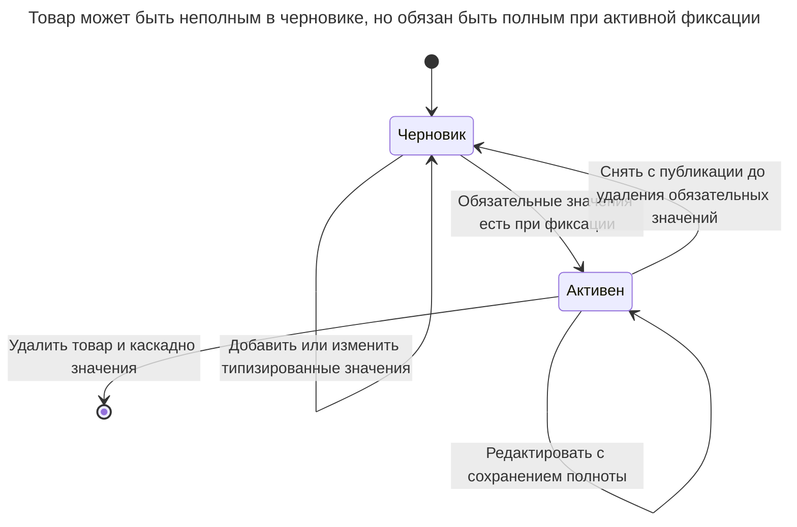
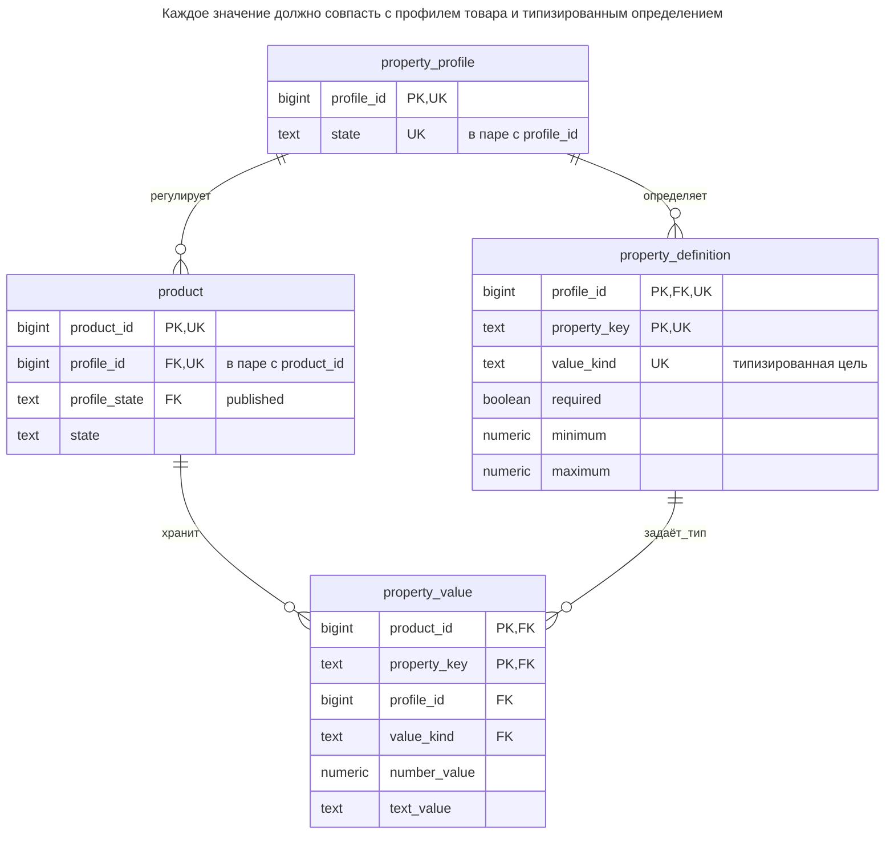
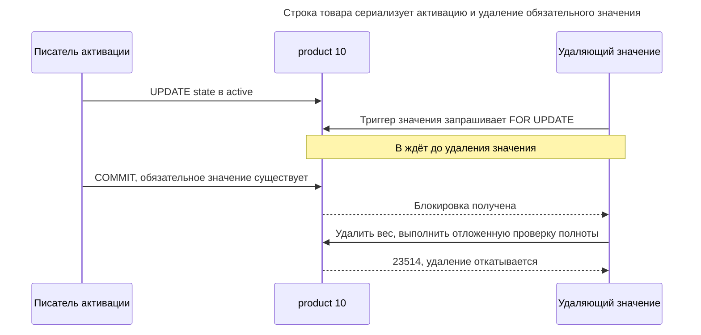
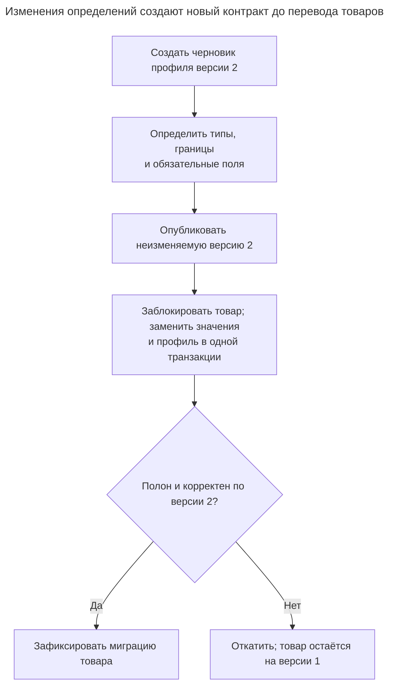

# Типизированные свойства

## Назначение

Типизированные свойства позволяют пользователям или администраторам определять новые атрибуты без изменения схемы: таблица определений хранит имена, типы данных и ограничения, а таблица значений ссылается и на сущность, и на определение. Это спроектированная форма «сущность — атрибут — значение»: значения хранятся в столбцах нужных типов, обязательность и диапазоны проверяются, определения развиваются. Глава показывает построение модели, запросы сущностей одновременно по нескольким свойствам и ситуации, где столбец JSON дешевле решает ту же задачу.

## Также известен как

Typed dynamic properties; определённые динамические свойства с типами значений. [Dealing with Properties Фаулера](https://martinfowler.com/apsupp/properties.pdf) различает свойства со строковыми именами, определённые свойства, типизированные свойства и правила, определяющие допустимые свойства типов объектов. Схема ниже — разработанная реализация идей, а не SQL, воспроизведённый из статьи.

## Проблема

Администраторы каталога определяют атрибуты после развёртывания. Профилю доставки нужен `weight_kg` с числовым диапазоном; `color` — необязательный текст. Товары должны редактироваться незавершёнными, но активный товар обязан иметь все обязательные значения. Следующий профиль может сузить диапазон веса без молчаливого изменения контракта товаров старого профиля.

Таблица `(product_id, name, text_value)` упрощает добавление поля, но не связывает имя с объявленным типом или обязательностью. `NOT NULL` у `text_value` запрещает null внутри существующей строки, но не требует существования отсутствующей строки веса. Это разные ограничения с разными механизмами обеспечения.

## Решение

Моделируйте версию профиля, определения её свойств, товары с этим профилем и типизированные значения. Публикуйте полный профиль до его использования товарами, затем замораживайте определения. Развивайте определения созданием и публикацией следующего профиля вместо изменения смысла существующих значений на месте.

Первичным ключом обеспечьте одно значение на товар и свойство. Составными FK сопоставляйте и профиль товара, и объявленный тип определения. Проверкой строки выбирайте нужный столбец значения, триггером проверяйте границы из метаданных, отложенными триггерами ограничений — существование обязательных значений. [Проверки PostgreSQL не могут безопасно обеспечивать правила по строкам других таблиц](https://www.postgresql.org/docs/18/ddl-constraints.html#DDL-CONSTRAINTS-CHECK-CONSTRAINTS); скрытый в функции `CHECK` поиск метаданных не решает изменения определений и конкурентную запись.



Правило обязательности действует в активном состоянии жизненного цикла. Транзакция может временно удалить и заменить обязательное значение, но не может зафиксировать активный товар без него.

## Альтернативы и выбор

| Соседний паттерн | Связь | Определяющее требование |
| --- | --- | --- |
| Обычные типизированные столбцы | Замена стабильных полей; дополнение идентичности товара | Имена полей известны разработчикам и заслуживают прямых ограничений и простых запросов |
| [Столбец JSON](json-column.md) | Замена | Обычно вы читаете и редактируете один документ без полного процесса определений свойств |
| [Единая таблица](single-table-inheritance.md) / [Таблицы классов](class-table-inheritance.md) | Замена | Вариативность следует известному семейству подтипов, а не полям администраторов |
| [Наблюдение](observation.md) | Замена для другого жизненного цикла факта | Измерение имеет собственные время, метод или происхождение вместо одного текущего значения |
| [Величина](quantity.md) | Дополнение | Числовым свойствам нужны явные единицы и совместимые сравнения |
| [Нетипизированные свойства](untyped-properties.md) | Заменяемый антипаттерн | Имена и значения — неограниченные строки без контракта определения |

Полная таблица — в [Атласе решений](decision-atlas.md). Типизированные свойства оправдывают сложность лишь тогда, когда определения свойств — часть создаваемого продукта. Это не общий способ избежать миграций обычных столбцов.

## Структура



Повторённые профиль и тип — проверяемые компоненты ссылок, а не независимые редактируемые факты. Метки `UK` обозначают компоненты составных уникальных целей DDL. Ребро от товара к значениям допускает отсутствие; отложенное правило жизненного цикла задаёт обязательность активных товаров.

## Таблицы и инварианты

- **`property_profile`** представляет одну версию определений. Опубликованный профиль нельзя вернуть в черновик, а изменения определений блокируют его строку до проверки публикации.
- **`property_definition`** идентифицирует поле парой `(profile_id, property_key)`. Пример поддерживает ограниченные числа и текст, а не произвольные выражения типов, реляционные ссылки или многозначные поля.
- **`product`** ссылается лишь на опубликованные профили через `(profile_id, profile_state)`. Черновики могут быть неполными, активные товары — нет.
- **`property_value`** имеет одно типизированное значение без `NULL` на пару «товар/свойство». Составные FK обеспечивают принадлежность профилю и объявленный вид значения; `property_value_shape` выбирает ровно один столбец значения.
- **Межстрочная проверка** явная: триггер значения проверяет числовые границы, отложенные триггеры товара/значений — каждое обязательное определение. Изменения значений сначала блокируют товар, сериализуясь с активацией при read committed.

## Когда применять

- Конечные пользователи или администраторы действительно создают поля во время работы.
- Нужны управляемые имена, типы, диапазоны и обязательность, а не непрозрачный набор настроек.
- Товарам нужны разные версионируемые контракты полей, а переходы между контрактами — видимые бизнес-операции.
- Поиск по нескольким свойствам оправдывает типизированные индексы и более сложные запросы.

## Последствия и компромиссы

- ➕ Новым определениям поддерживаемого семейства типов нужны изменения данных, а не столбцы.
- ➕ Числовые условия используют числа, а объявленное число нельзя заменить произвольным текстом.
- ➕ Опубликованные профили сохраняют трактовку существующих товаров при развитии определений.
- ➖ Чтение товара восстанавливает множество строк значений; каждое поисковое поле добавляет условие или соединение.
- ➖ Обязательности, изменениям метаданных и публикации нужны жизненный цикл и протокол конкурентности.
- ➖ Новый примитивный тип, ссылка на сущность или повторяющиеся значения всё ещё меняют схему и логику проверки.
- ➖ Индексы смешанных свойств требуют анализа нагрузки. Не считайте их эквивалентом обычного составного индекса фиксированных столбцов товара.

## Реализация

[Полный скрипт](../assets/typed-properties/typed-properties.sql) проверен на PostgreSQL 18.6. Он включает все защиты, индексы, ожидаемые ошибки и миграцию профиля. Таблицы определяют правила ссылок и формы значения:

```sql
CREATE TABLE property_profile (
    profile_id bigint PRIMARY KEY,
    state text NOT NULL DEFAULT 'draft' CHECK (state IN ('draft', 'published')),
    UNIQUE (profile_id, state)
);
CREATE TABLE property_definition (
    profile_id bigint NOT NULL REFERENCES property_profile (profile_id),
    property_key text NOT NULL,
    value_kind text NOT NULL CHECK (value_kind IN ('number', 'text')),
    required boolean NOT NULL DEFAULT false,
    minimum numeric,
    maximum numeric,
    PRIMARY KEY (profile_id, property_key),
    UNIQUE (profile_id, property_key, value_kind),
    CHECK (
        (value_kind = 'number' AND minimum IS NOT NULL AND maximum IS NOT NULL
            AND minimum <= maximum AND minimum > '-Infinity'::numeric
            AND maximum < 'Infinity'::numeric)
        OR (value_kind = 'text' AND minimum IS NULL AND maximum IS NULL)
    )
);
CREATE TABLE product (
    product_id bigint PRIMARY KEY,
    profile_id bigint NOT NULL,
    profile_state text NOT NULL DEFAULT 'published' CHECK (profile_state = 'published'),
    state text NOT NULL DEFAULT 'draft' CHECK (state IN ('draft', 'active')),
    UNIQUE (product_id, profile_id),
    FOREIGN KEY (profile_id, profile_state) REFERENCES property_profile (profile_id, state)
);
CREATE TABLE property_value (
    product_id bigint NOT NULL,
    profile_id bigint NOT NULL,
    property_key text NOT NULL,
    value_kind text NOT NULL,
    number_value numeric,
    text_value text,
    PRIMARY KEY (product_id, property_key),
    FOREIGN KEY (product_id, profile_id) REFERENCES product (product_id, profile_id)
        ON DELETE CASCADE,
    FOREIGN KEY (profile_id, property_key, value_kind)
        REFERENCES property_definition (profile_id, property_key, value_kind),
    CONSTRAINT property_value_shape CHECK (
        (value_kind = 'number' AND number_value IS NOT NULL AND text_value IS NULL)
        OR (value_kind = 'text' AND number_value IS NULL AND text_value IS NOT NULL)
    )
);
CREATE INDEX property_value_number_idx
    ON property_value (profile_id, property_key, number_value, product_id)
    WHERE value_kind = 'number';
CREATE INDEX property_value_text_idx
    ON property_value (profile_id, property_key, text_value, product_id)
    WHERE value_kind = 'text';
```

Числовые определения требуют конечных нижней и верхней границ; реальному продукту может понадобиться более богатый словарь типов. Единицы в примере явно закодированы в `weight_kg`. Если пользователи выбирают единицы, моделируйте их, а не сравнивайте килограммы и фунты как голые числа; см. [Величина](quantity.md).

Публикация должна замораживать метаданные, читаемые проверками диапазонов. Эти защиты блокируют профиль до редактирования определений и запрещают изменения опубликованных определений. Блокировки строк удерживаются до конца транзакции по [правилам блокировок PostgreSQL](https://www.postgresql.org/docs/18/explicit-locking.html#LOCKING-ROWS):

```sql
CREATE FUNCTION guard_published_profile() RETURNS trigger LANGUAGE plpgsql AS $$
BEGIN
    IF OLD.state = 'published' THEN
        RAISE EXCEPTION USING ERRCODE = '23514', MESSAGE = 'published profile is immutable';
    END IF;
    RETURN NEW;
END $$;
CREATE TRIGGER profile_immutable BEFORE UPDATE ON property_profile
    FOR EACH ROW EXECUTE FUNCTION guard_published_profile();

CREATE FUNCTION guard_definition() RETURNS trigger LANGUAGE plpgsql AS $$
DECLARE
    target_profile bigint;
    profile_status text;
BEGIN
    IF TG_OP = 'UPDATE' AND NEW.profile_id <> OLD.profile_id THEN
        RAISE EXCEPTION 'create a new definition instead of moving it';
    END IF;
    target_profile := CASE WHEN TG_OP = 'DELETE' THEN OLD.profile_id ELSE NEW.profile_id END;
    SELECT state INTO profile_status FROM property_profile
    WHERE profile_id = target_profile FOR UPDATE;
    IF profile_status = 'published' THEN
        RAISE EXCEPTION USING ERRCODE = '23514', MESSAGE = 'published definitions are immutable';
    END IF;
    IF TG_OP = 'DELETE' THEN RETURN OLD; END IF;
    RETURN NEW;
END $$;
CREATE TRIGGER definition_guard BEFORE INSERT OR UPDATE OR DELETE ON property_definition
    FOR EACH ROW EXECUTE FUNCTION guard_definition();
```

Запись значения блокирует товар и проверяет объявленный диапазон. И активация, и удаление обязательной строки должны назначать проверку полноты. [Триггеры ограничений PostgreSQL](https://www.postgresql.org/docs/18/sql-createtrigger.html) поддерживают такой отложенный момент:

```sql
CREATE FUNCTION guard_property_value() RETURNS trigger LANGUAGE plpgsql AS $$
DECLARE
    target_product bigint;
    definition property_definition%ROWTYPE;
BEGIN
    IF TG_OP = 'UPDATE' AND NEW.product_id <> OLD.product_id THEN
        RAISE EXCEPTION 'delete and insert instead of moving a value';
    END IF;
    target_product := CASE WHEN TG_OP = 'DELETE' THEN OLD.product_id ELSE NEW.product_id END;
    PERFORM 1 FROM product WHERE product_id = target_product FOR UPDATE;
    IF TG_OP = 'DELETE' THEN RETURN OLD; END IF;
    SELECT * INTO definition FROM property_definition
    WHERE profile_id = NEW.profile_id AND property_key = NEW.property_key;
    IF NEW.value_kind = 'number' AND NOT
        (NEW.number_value BETWEEN definition.minimum AND definition.maximum) THEN
        RAISE EXCEPTION USING ERRCODE = '23514', MESSAGE = 'property value outside allowed range';
    END IF;
    RETURN NEW;
END $$;
CREATE TRIGGER value_guard BEFORE INSERT OR UPDATE OR DELETE ON property_value
    FOR EACH ROW EXECUTE FUNCTION guard_property_value();

CREATE FUNCTION check_required_properties() RETURNS trigger LANGUAGE plpgsql AS $$
DECLARE
    target_product bigint;
BEGIN
    target_product := CASE WHEN TG_OP = 'DELETE' THEN OLD.product_id ELSE NEW.product_id END;
    IF EXISTS (
        SELECT 1 FROM product AS p
        JOIN property_definition AS d ON d.profile_id = p.profile_id
        WHERE p.product_id = target_product AND p.state = 'active' AND d.required
          AND NOT EXISTS (
              SELECT 1 FROM property_value AS v
              WHERE v.product_id = p.product_id AND v.property_key = d.property_key
          )
    ) THEN
        RAISE EXCEPTION USING ERRCODE = '23514', MESSAGE = 'active product lacks required property';
    END IF;
    RETURN NULL;
END $$;
CREATE CONSTRAINT TRIGGER product_complete AFTER INSERT OR UPDATE ON product
    DEFERRABLE INITIALLY DEFERRED FOR EACH ROW EXECUTE FUNCTION check_required_properties();
CREATE CONSTRAINT TRIGGER value_complete AFTER INSERT OR UPDATE OR DELETE ON property_value
    DEFERRABLE INITIALLY DEFERRED FOR EACH ROW EXECUTE FUNCTION check_required_properties();
```

Используйте таблицы через роль приложения, которая не может заменять функции, отключать триггеры или очищать метаданные через `TRUNCATE`. Считайте ID стабильными и используйте одну транзакцию на редактирование товара. Скрипт работает при read committed; операция значений нескольких товаров должна получать их блокировки в одном порядке для снижения взаимоблокировок.

Опубликуйте профиль, создайте товар-черновик и активируйте со значениями в одной транзакции:

```sql
BEGIN;
INSERT INTO property_profile (profile_id) VALUES (1);
INSERT INTO property_definition VALUES
    (1, 'weight_kg', 'number', true, 0.01, 1000),
    (1, 'color', 'text', false, NULL, NULL);
UPDATE property_profile SET state = 'published' WHERE profile_id = 1;
INSERT INTO product (product_id, profile_id) VALUES (10, 1);
INSERT INTO property_value VALUES
    (10, 1, 'weight_kg', 'number', 2.5, NULL),
    (10, 1, 'color', 'text', NULL, 'red');
UPDATE product SET state = 'active' WHERE product_id = 10;
COMMIT;
SELECT p.product_id FROM product AS p
JOIN property_value AS w ON w.product_id = p.product_id
    AND w.profile_id = p.profile_id AND w.property_key = 'weight_kg'
JOIN property_value AS c ON c.product_id = p.product_id
    AND c.profile_id = p.profile_id AND c.property_key = 'color'
WHERE p.profile_id = 1 AND p.state = 'active'
  AND w.value_kind = 'number' AND w.number_value < 5
  AND c.value_kind = 'text' AND c.text_value = 'red';
UPDATE property_value SET number_value = 3 WHERE product_id = 10 AND property_key = 'weight_kg';
```

Поиск по двум свойствам возвращает `10`. Недопустимое изменение диапазона отклоняется немедленно:

```sql
UPDATE property_value SET number_value = 2000
WHERE product_id = 10 AND property_key = 'weight_kg';
```

Триггер вызывает SQLSTATE `23514`: `ERROR: property value outside allowed range`. Удаление обязательной строки отклоняется в конце транзакции:

```sql
BEGIN;
DELETE FROM property_value WHERE product_id = 10 AND property_key = 'weight_kg';
COMMIT;
```

Ошибка — SQLSTATE `23514`: `ERROR: active product lacks required property`. Неудачная фиксация сохраняет исходную строку. Вставка активного товара без значений нарушает то же правило. Полный скрипт также проверяет, что текстовое значение `weight_kg` нарушает составной FK типа с SQLSTATE `23503`, а редактирование опубликованного определения вызывает `published definitions are immutable`.

## Поддержка в движках

- **PostgreSQL 18:** схему реализуют обычные составные ключи, защиты PL/pgSQL и отложенные триггеры ограничений. Одна проверка с чтением метаданных не является равноценной заменой.
- **MySQL 8.4 / InnoDB:** [`CHECK` запрещает подзапросы и хранимые функции](https://dev.mysql.com/doc/refman/8.4/en/create-table-check-constraints.html), а [проверки внешних ключей немедленны](https://dev.mysql.com/doc/refman/8.4/en/create-table-foreign-keys.html). Осознанно переносите проверку жизненного цикла; одна процедура сохранения приложения не защищает обходящую её запись.
- **SQL Server 2025 (17.x):** DML-[триггеры обрабатывают множества строк](https://learn.microsoft.com/en-us/sql/relational-databases/triggers/create-dml-triggers-to-handle-multiple-rows-of-data?view=sql-server-ver17). Буквальный перенос построчной PL/pgSQL-функции пропустил бы многострочные операции. [Синтаксис `CREATE TABLE`](https://learn.microsoft.com/en-us/sql/t-sql/statements/create-table-transact-sql?view=sql-server-ver17) также не даёт отложенного триггера ограничений в стиле PostgreSQL.
- **Oracle AI Database 26ai:** поддерживает [откладываемые ограничения](https://docs.oracle.com/en/database/oracle/oracle-database/26/sqlrf/constraint.html), но это не переносит напрямую тела PL/pgSQL и пользовательскую отложенную проверку полноты. Спроектируйте и проверьте границу валидации реализации Oracle.
- **SQLite 3:** [таблицы `STRICT`](https://www.sqlite.org/stricttables.html) ограничивают типы скаляров, но не принимают объявление PostgreSQL `numeric`. Осознанно выберите числовое представление; [триггеры SQLite](https://www.sqlite.org/lang_createtrigger.html) построчные и не предоставляют такую отложенную возможность.

## Сбои и конкурентность

При read committed блокируйте товар до изменения значений. `value_guard` делает это даже при удалениях; изменение состояния уже блокирует строку товара. Если активация побеждает, последующее удаление обязательного значения видит активный товар и отклоняется при фиксации. Если удаление побеждает, последующая активация обнаруживает отсутствие и отклоняется. PostgreSQL [перепроверяет строки после ожидающей блокировки или обновления](https://www.postgresql.org/docs/18/transaction-iso.html#XACT-READ-COMMITTED); проверки намеренно выполняются после родительской блокировки и повторно при отложенной валидации.



У публикации отдельная точка сериализации: изменение определения блокирует профиль, а публикация обновляет тот же профиль. Затем опубликованные определения не меняются под проверкой диапазона. Повтор после неопределённой фиксации означает перечитать состояние товара и значения; не считайте успешную вставку доказательством прохождения отложенных проверок. Взаимоблокировки и ошибки сериализации требуют повтора всей транзакции, а не лишь последнего оператора значения.

## Миграция

Из [Нетипизированных свойств](untyped-properties.md) сначала согласуйте имена, дубликаты значений, единицы и неверный числовой текст. Создайте профиль-черновик из принятых определений и определите обязательные поля. Опубликуйте, перенесите товары в черновом состоянии и сохраните отклонённые исходные значения для исправления вместо молчаливого преобразования. Проверьте каждый товар до активации.



Запускаемый скрипт показывает переход: удаление старых строк значений, изменение профиля товара и вставка преобразованных значений одной транзакцией. Отложенная проверка допускает временный пробел. Более строгий диапазон или новое обязательное поле должны соблюдаться до фиксации. Сохраняйте старый профиль и представление в период [Расширения и свёртывания](expand-contract.md); откат к старому профилю возможен лишь при сохранении соответствия значений. Новый примитивный вид значения требует изменения схемы, хотя новые определения существующих видов — нет.

## Антипаттерны и частые ошибки

- Делать строки значений обязательными по `NULL` и считать, что из этого следует существование обязательных строк.
- Менять опубликованное определение, придавая существующим значениям новый смысл без миграции.
- Проверять полноту лишь при активации, разрешая последующее удаление обязательных значений.
- Проверять диапазоны в приложении, когда импорт пишет прямо в таблицу значений.
- Пропускать компоненты профиля/типа в FK и допускать значения другого контракта.
- Использовать динамические свойства для небольшого стабильного набора полей разработчиков, яснее выражаемого обычными столбцами.

## Известные применения

- [Typed Dynamic Property Фаулера](https://martinfowler.com/apsupp/properties.pdf) на странице 9 прикрепляет объявленный тип значения к определению свойства; статья также различает правила допустимых свойств разных видов объектов. Протокол публикации и полноты здесь — разработка этой главы, а не гарантия фреймворка поставщика.

## Связанные паттерны

- [Столбец JSON](json-column.md) предлагает более простую границу документа, если управление определениями не нужно.
- [Нетипизированные свойства](untyped-properties.md) описывают исправляемую модель неограниченных строковых значений.
- [Наблюдение](observation.md) даёт независимо записываемым измерениям собственный жизненный цикл.
- [Величина](quantity.md) определяет числовые значения с явными единицами.
- [Таблицы классов](class-table-inheritance.md) обрабатывают известные формы подтипов без метаданных полей времени выполнения.
