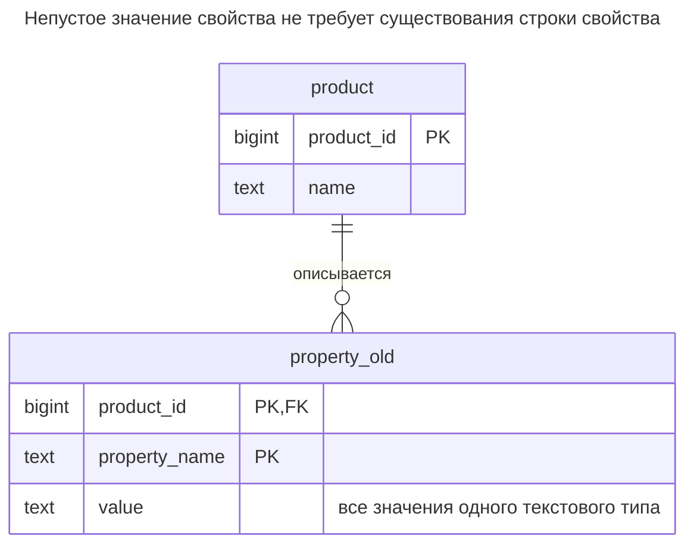
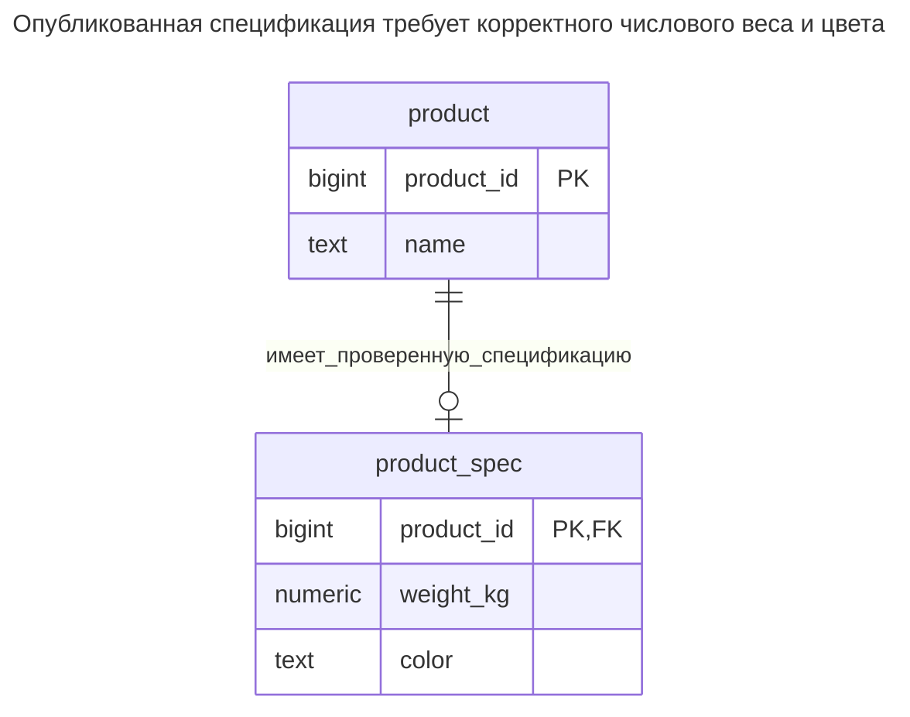
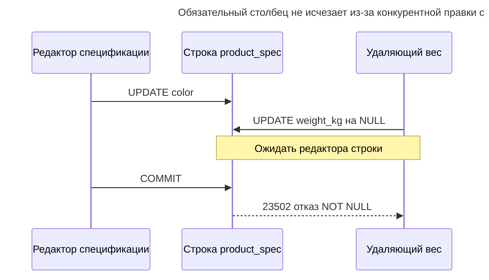
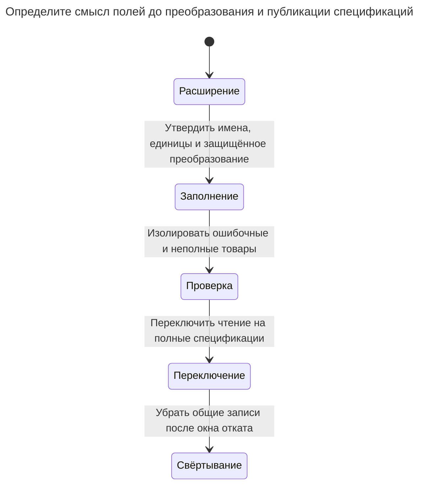

# Нетипизированные свойства

Нетипизированные свойства хранят произвольные атрибуты строками из сущности, имени атрибута и значения в текстовом столбце — наивная форма «сущность — атрибут — значение». Без дополнительных проверок общий текстовый столбец не проверяет типы и ссылки отдельных атрибутов, обязательные атрибуты отсутствуют, а запросы нескольких атрибутов требуют восстановления через соединения или агрегацию. Глава показывает сбои и миграцию к столбцам, столбцу JSON или типизированным свойствам. Билл Карвин называет это Entity-Attribute-Value.

## Также известен как

Entity-Attribute-Value в [оглавлении SQL Antipatterns Билла Карвина](https://pragprog.com/titles/bksap1/sql-antipatterns-volume-1/). Вредный случай здесь — неограниченная модель строковых значений, а не любая структура строк атрибутов. [Dealing with Properties Фаулера](https://martinfowler.com/apsupp/properties.pdf) различает гибкие, определённые и типизированные динамические свойства; это разные уровни контракта.

## Контекст

Сегодня у товаров есть вес и цвет, а позже ожидаются другие атрибуты. Вместо столбцов товара вы создаёте строки `(product_id, property_name, value)`. Один общий редактор сохраняет любое имя и строку без миграции.

## Проблема

Вы используете один текстовый тип для полей с разным смыслом и правилами. Уникальность пары товара и имени не требует строки веса, не делает значение числом и не связывает свойство поставщика с существующим поставщиком. `heavy` и `2` одинаково удовлетворяют контракту столбца. Числовое сравнение становится текстовым порядком или приведением типа, которое падает на существующих данных.

Эти правила можно реализовать. Добавьте метаданные, типизированное хранение и проверку жизненного цикла — но это уже спроектированная система [Типизированных свойств](typed-properties.md). Назвать общую строковую таблицу гибкой и пропустить проверки — значит перенести схему в недокументированное соглашение писателей.

## Почему так делают

Пользователям действительно может требоваться определять поля во время работы приложения. Возможно, нужно сохранять неизвестные свойства источника до выяснения смысла. Оба требования законны. Ошибка — давать стабильным существенным полям приложения тот же слабый контракт лишь ради отказа от DDL сегодня.

Для непрозрачного импорта сохраняйте сырые значения и имена источника как свидетельства, а проверенные данные публикуйте отдельно. Для динамических определений явно закладывайте жизненный цикл определений, индексирование, обязательность и преобразования, не ожидая этого от текстовой таблицы.

## Последствия

- ➖ Похожий на число текст сравнивается как текст до явного преобразования.
- ➖ Обязательное поле может отсутствовать строкой вопреки `value NOT NULL`.
- ➖ Опечатки имени создают видимость нового атрибута вместо ошибки.
- ➖ Чтение нескольких полей требует соединений, агрегации или другого восстановления.
- ➖ Изменение определения переосмысливает сохранённые значения, если контракт не версионируется.

## Признаки

- Частый запрос по-разному приводит один `value` для каждого имени свойства.
- Каждое сохранение товара содержит отдельный цикл проверки обязательных свойств.
- Импорт одного ошибочного значения ломает приведение в последующем отчёте.
- Словарь данных существует лишь в условиях приложения над строками.

## Как лучше

Перенесите стабильные обязательные поля в обычные типизированные столбцы. Идентичность владельца оставьте реляционной, а гибкую форму выбирайте лишь для действительно переменного остатка. В примере спецификация товара фиксирована: вес обязателен, конечен и положителен; цвет обязателен. Единица явно задана килограммами; выбираемые единицы — отдельное требование [Величины](quantity.md).

### Альтернативы и выбор

| Соседний паттерн | Связь | Определяющее требование |
| --- | --- | --- |
| Обычные типизированные столбцы | Замена | Разработчики управляют стабильными полями и нуждаются в прямых предикатах и ограничениях |
| [Типизированные свойства](typed-properties.md) | Замена | Пользователи определяют поля, типы и обязательность как управляемые данные |
| [Столбец JSON](json-column.md) | Замена целого документа; дополнение фиксированных столбцов | Необязательные свойства обычно читаются и редактируются вместе |
| [Таблицы классов](class-table-inheritance.md) | Замена известных полей подтипов | Конечному семейству типов нужны разные группы обязательных столбцов |

[Типы JSON PostgreSQL](https://www.postgresql.org/docs/18/datatype-json.html#JSON-DOC-DESIGN) поддерживают гибридную модель, но корректный JSON не обеспечивает бизнес-обязательность и ссылочную целостность. Превращение каждой старой строки в строку JSON сохраняет проблему типов. Полная таблица — в [Атласе решений](decision-atlas.md).

## Пример

### Структура

**Было:** у имён и значений нет схемы отдельных свойств.



Настоящий внешний ключ владельца полезен. Он ничего не говорит о наличии веса товара или о том, является ли вес числом.

```sql
CREATE TABLE product (product_id bigint PRIMARY KEY, name text NOT NULL);
CREATE TABLE property_old (
    product_id bigint NOT NULL REFERENCES product (product_id),
    property_name text NOT NULL,
    value text COLLATE "C" NOT NULL,
    PRIMARY KEY (product_id, property_name)
);
INSERT INTO product VALUES (1, 'Crate'), (2, 'Box'), (3, 'Bag'), (4, 'Envelope');
INSERT INTO property_old VALUES
    (1, 'weight_kg', '100'), (1, 'color', 'red'),
    (2, 'weight_kg', '2'), (2, 'color', 'red'),
    (3, 'weight_kg', 'heavy'), (3, 'color', 'blue'), (4, 'color', 'green');
SELECT product_id FROM property_old
WHERE property_name = 'weight_kg' AND value < '20' ORDER BY product_id;
```

Текстовый предикат возвращает товары `1, 2`: `100` предшествует `20` при выбранной [побайтовой сортировке `C`](https://www.postgresql.org/docs/18/collation.html). У товара `3` неверное числовое описание, у `4` веса нет совсем. Оба допустимы в старой схеме.

**Стало:** публикуем полные спецификации с типизированными полями.



Пока исходные данные в карантине, товар может оставаться без опубликованной спецификации. Каждая строка спецификации полна; проект не утверждает, что она уже есть у каждого товара.

```sql
CREATE TABLE product_spec (
    product_id bigint PRIMARY KEY REFERENCES product (product_id),
    weight_kg numeric NOT NULL,
    color text NOT NULL,
    CONSTRAINT product_spec_weight CHECK (weight_kg > 0 AND weight_kg < 'Infinity'::numeric)
);
CREATE INDEX product_spec_weight_color_idx ON product_spec (weight_kg, color);
CREATE TABLE property_reject (
    product_id bigint PRIMARY KEY REFERENCES product (product_id),
    reason text NOT NULL
);
BEGIN;
LOCK TABLE product, property_old IN SHARE ROW EXCLUSIVE MODE;
CREATE TEMP TABLE parsed_spec ON COMMIT DROP AS
SELECT p.product_id, c.value AS color,
       CASE WHEN pg_input_is_valid(w.value, 'numeric') THEN w.value::numeric END AS weight_kg
FROM product AS p
LEFT JOIN property_old AS w ON w.product_id = p.product_id AND w.property_name = 'weight_kg'
LEFT JOIN property_old AS c ON c.product_id = p.product_id AND c.property_name = 'color';
INSERT INTO product_spec
SELECT product_id, weight_kg, color FROM parsed_spec
WHERE color IS NOT NULL AND weight_kg > 0 AND weight_kg < 'Infinity'::numeric;
INSERT INTO property_reject
SELECT product_id, 'missing or invalid required field' FROM parsed_spec AS p
WHERE NOT EXISTS (SELECT 1 FROM product_spec AS s WHERE s.product_id = p.product_id);
COMMIT;
SELECT product_id FROM product_spec WHERE weight_kg < 20 AND color = 'red';
SELECT * FROM property_reject ORDER BY product_id;
```

Поиск по числу и цвету возвращает лишь товар `2`. Товары `3` и `4` попадают в `property_reject`; исходные строки остаются в `property_old`. [`pg_input_is_valid` PostgreSQL](https://www.postgresql.org/docs/18/functions-info.html#FUNCTIONS-INFO-VALIDITY) проверяет ввод до защищённого числового приведения. Затем фильтр конечного положительного числа отклоняет значения вне контракта поля. Это не универсальный механизм определений.

```sql
INSERT INTO product_spec VALUES (3, 'heavy', 'blue');
```

PostgreSQL 18.6 возвращает SQLSTATE `22P02`: `ERROR: invalid input syntax for type numeric: "heavy"`. Обязательность проверяется независимо:

```sql
INSERT INTO product_spec (product_id, color) VALUES (4, 'green');
```

Это даёт SQLSTATE `23502`: `ERROR: null value in column "weight_kg" of relation "product_spec" violates not-null constraint`. [Полный скрипт](../assets/untyped-properties/untyped-properties.sql) проверяет оба отказа и количество карантинных записей.

### Поддержка в движках

- **PostgreSQL 18:** защита проверкой допустимости ввода специфична для движка. Сохраняйте и аудит преобразования, и настоящие ограничения типизированной цели.
- **SQL Server:** [`TRY_CONVERT`](https://learn.microsoft.com/en-us/sql/t-sql/functions/try-convert-transact-sql?view=sql-server-ver17) возвращает `NULL` при неудаче поддерживаемого преобразования. Явно допустимые `NULL` всё равно требуют отдельного решения об обязательности.
- **SQLite:** обычные таблицы используют [сродство типов](https://www.sqlite.org/datatype3.html), поэтому похожее объявление числового столбца не даёт той же гарантии. [Таблицы `STRICT`](https://www.sqlite.org/stricttables.html) ограничивают поддерживаемые типы; выберите масштабированные целые или иное явное представление числа, не копируя `numeric` в расчёте на одинаковую проверку.

### Сбои и конкурентность

Обязательные строки значений создают межстрочную гонку: активация видит вес, пока другая транзакция удаляет его. Исправление фиксированными столбцами размещает вес и публикацию спецификации в одной строке. Замена типизированными свойствами должна координировать активацию и правки значений, как показывает соответствующая глава.



[Блокировки строк PostgreSQL](https://www.postgresql.org/docs/18/explicit-locking.html#LOCKING-ROWS) сериализуют обновления; правило столбца отклоняет полученный `NULL`. Это не защищает от удаления целой необязательной строки спецификации. Если все опубликованные товары обязаны сохранять её, добавьте явную границу жизненного цикла и полноты, не предполагая, что общий ключ требует потомка.

### Миграция

Учтите имена, повторные имена, единицы и отсутствующие обязательные значения. До разбора утвердите определение каждого переносимого поля. Сохраняйте исходный текст и решения преобразования, различайте ошибочные или отсутствующие значения и настоящий ноль. Не заменяйте неудачный числовой ввод нулём, если это не документированный смысл.



Практикум копирует при паузе записи. Работающее заполнение должно блокировать товар до чтения или изменения любой формы, а текущие писатели — соблюдать ту же блокировку. Сравните восстановленные исходные значения с типизированным результатом и не допускайте активацию до полноты обязательных данных. Новой системе типизированных свойств также нужны версионные определения и проверки при последующем удалении обязательных значений. См. [Расширение и свёртывание](expand-contract.md).

## Связанные паттерны и антипаттерны

- [Типизированные свойства](typed-properties.md) превращают расширяемость во время работы в явный управляемый контракт.
- [Столбец JSON](json-column.md) хранит целый документ рядом с ограниченным реляционным ядром.
- [Таблицы классов](class-table-inheritance.md) обрабатывают известные поля подтипов без произвольных имён свойств.
- [Величина](quantity.md) связывает числовые значения с единицами.
