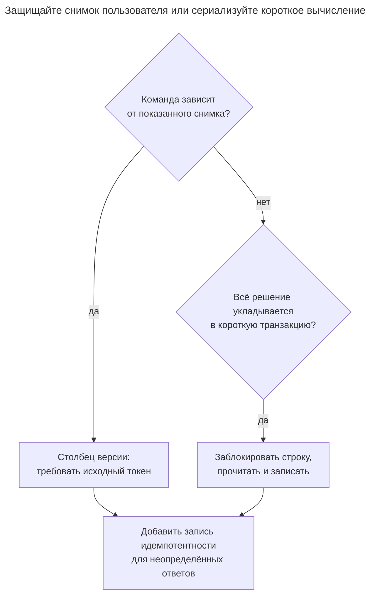
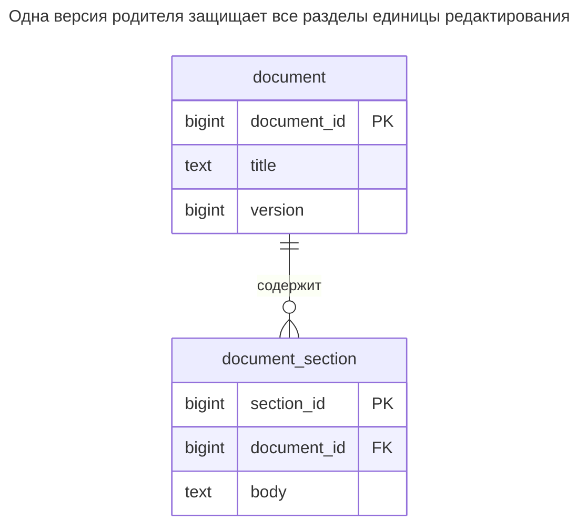
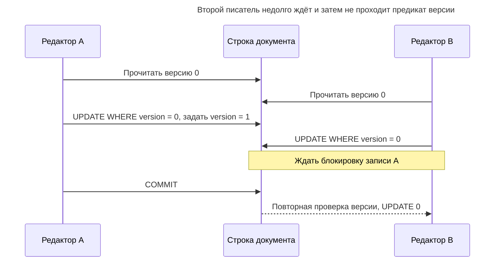
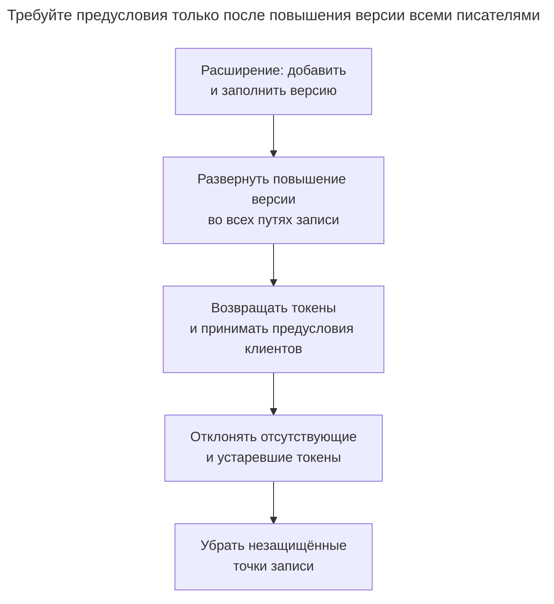

# Столбец версии

## Назначение

Столбец версии реализует оптимистическую блокировку: каждая строка содержит счётчик или временную метку, и обновление успешно, только если версия осталась той, которую прочитал клиент. Два человека, редактирующие запись, больше не перезаписывают друг друга молча — второй получает конфликт и может перечитать данные. Глава показывает оператор обновления и обнаружение нуля затронутых строк, реализацию в ORM, встроенные версии строк вроде `rowversion` SQL Server и `xmin` PostgreSQL, а также случаи, когда лучше пессимистическая блокировка.

## Также известен как

[Optimistic Offline Lock](https://martinfowler.com/eaaCatalog/optimisticOfflineLock.html); токен оптимистической конкурентности. Offline означает, что пользовательское редактирование охватывает несколько транзакций базы, а не что база недоступна.

## Проблема

Два редактора загружают один заголовок документа. Один меняет его на «Launch checklist», другой, всё ещё видящий оригинал, сохраняет «Release checklist». Безусловное обновление принимает оба изменения и теряет работу первого. Открытая на время редактирования транзакция превратила бы время реакции человека в длительность блокировки.

Проверка версии в приложении с последующим безусловным обновлением оставляет гонку между проверкой и записью. Сравнение должно быть внутри оператора, меняющего строку. Также нужно отличать устаревшее изменение от повтора запроса, чей прежний ответ потерялся.

## Решение

Добавьте обязательную целочисленную `version`, изначально нулевую. Возвращайте её с документом и требуйте то же значение при сохранении. Обновляйте по первичному ключу **и ожидаемой версии**, повышая версию тем же оператором. Одна возвращённая строка означает успех; отсутствие строки — несовпадение предусловия вызывающей стороны. Перечитайте данные или предложите слияние вместо автоматической перезаписи.

Осознанно выбирайте область защиты. Здесь `document` владеет несколькими разделами, поэтому его версия защищает всю единицу редактирования. Каждая вставка, правка и удаление раздела должны сначала выиграть обновление версии родителя в той же транзакции. Версия только заголовка не защитит дочерние строки. Читайте версию родителя и его разделы из одного согласованного снимка, например одним запросом, чтобы показанный документ соответствовал токену.

## Альтернативы и выбор

| Соседний паттерн или механизм | Связь | Определяющее требование |
| --- | --- | --- |
| Короткая транзакция с блокировкой строки | Замена протокола конфликтов | Можно прочитать, решить и записать сразу, без ожидания человека или сети |
| [Резервирование](reservation.md) | Дополнение | Пользователь должен удерживать дефицитный ресурс на время решения; обнаружение устаревшей правки его не резервирует |
| [Запись идемпотентности](idempotency-record.md) | Дополнение | Повтор должен восстановить результат уже принятой команды |
| [История статусов](status-history.md) | Дополнение | Нужны принятые переходы процесса вместе с отклонением устаревших команд |
| [Упорядоченная коллекция](ordered-collection.md) | Дополнение | Токен охватывает коллекцию, а позиции описывают её текущий порядок |
| Токен, генерируемый движком | Вариант реализации | Его время жизни и семантика обновления отвечают внешнему контракту редактирования |

Полное сравнение — в [Атласе решений](decision-atlas.md). Для увеличения счётчика без зависимости от ранее показанного состояния может хватить атомарного увеличения; требование токена способно создавать ненужные для этой операции конфликты.



Версия отвечает, актуально ли исходное состояние. Ключ запроса отвечает, была ли команда уже успешной; у значений разное время жизни.

## Структура



Разделы ссылаются на стабильную идентичность документа, а не его меняющуюся версию. Версия — предусловие записи, а не ещё один первичный ключ или история прежнего содержимого.

## Таблицы и инварианты

- **`document`** имеет первичный ключ и неотрицательную версию без `NULL`. `document_version_nonnegative` отклоняет неверные сохранённые счётчики.
- **`document_section`** имеет одного владельца, обеспеченного внешним ключом. Версия родителя повышается при каждом принятом изменении этой единицы редактирования.
- **Защищённая запись** отклоняет устаревшие правки. CHECK не заставит произвольного писателя передать ожидаемую версию; направляйте все записи через одну границу приложения или ограниченную процедуру базы.
- **Стабильность токена** требует не использовать ID документов повторно и не сбрасывать версии существующей идентичности. Иначе старый токен может совпасть с другим воплощением.

## Когда применять

- Формы, административные инструменты или API редактируют снимок между отдельными запросами.
- Конфликты нужно сообщать вызывающей стороне, а не молча разрешать последней записью.
- Большинство изменений затрагивает разные документы, а повтор или слияние редких конфликтов приемлемы.

## Последствия и компромиссы

- ➕ Во время размышлений пользователя блокировка базы не удерживается.
- ➕ Один токен может охватывать несколько связанных таблиц, если все писатели повышают версию родителя.
- ➖ Общий токен агрегата отклоняет и одновременные изменения несвязанных разделов; узкие токены допускают больше конкурентности, но защищают меньший инвариант.
- ➖ Запись по-прежнему берёт обычные блокировки базы. «Оптимистическая» не означает выполнение без блокировок.
- ➖ Ответ на конфликт требует продуктового решения: перечитать, слить или явно перезаписать с новой наблюдаемой версией. Слепая автоматическая повторная отправка уничтожает политику устаревших правок.

## Реализация

[Полный скрипт](../assets/version-column/version-column.sql) проверяет успешное обновление, устаревшее обновление, защищённую правку раздела и отклонение ограничением в PostgreSQL 18.6:

```sql
CREATE TABLE document (
    document_id bigint PRIMARY KEY,
    title text NOT NULL,
    version bigint NOT NULL DEFAULT 0,
    CONSTRAINT document_version_nonnegative CHECK (version >= 0)
);
CREATE TABLE document_section (
    section_id bigint PRIMARY KEY,
    document_id bigint NOT NULL REFERENCES document (document_id),
    body text NOT NULL
);
CREATE INDEX document_section_owner_idx ON document_section (document_id);
INSERT INTO document VALUES (1, 'Checklist', 0);
INSERT INTO document_section VALUES (10, 1, 'Review draft');
SELECT document_id, title, version FROM document WHERE document_id = 1;
UPDATE document SET title = 'Launch checklist', version = version + 1
WHERE document_id = 1 AND version = 0
RETURNING version;
UPDATE document SET title = 'Release checklist', version = version + 1
WHERE document_id = 1 AND version = 0
RETURNING version;
```

Первое обновление возвращает `1`; второе не возвращает строк и сообщает `UPDATE 0`, без ошибки SQL. [Правила обновления Read Committed PostgreSQL](https://www.postgresql.org/docs/18/transaction-iso.html#XACT-READ-COMMITTED) повторно проверяют предикат после фиксации конкурентного обновления. Отсутствующий или недоступный документ тоже может дать ноль строк; различайте случаи по политике видимости API. Не называйте каждый нулевой результат ошибкой сериализации.

Для правки раздела начните с повышения версии родителя. Требуйте ровно одно обновление родителя и раздела; иначе откатывайте транзакцию. В этом заполненном примере оба успешны:

```sql
BEGIN;
UPDATE document SET version = version + 1
WHERE document_id = 1 AND version = 1
RETURNING version;
UPDATE document_section SET body = 'Review final draft'
WHERE document_id = 1 AND section_id = 10;
COMMIT;
```

Новый токен — `2`. В приложении не выполняйте дочернее обновление, если родительское не вернуло строку, и откатывайтесь, если потомок не найден. Удаление тоже защищайте ожидаемой версией. Следующее значение счётчика недопустимо независимо от записывающего приложения:

```sql
-- Expected SQLSTATE 23514.
UPDATE document SET version = -1 WHERE document_id = 1;
```

PostgreSQL 18.6 возвращает `ERROR: new row for relation "document" violates check constraint "document_version_nonnegative"` (SQLSTATE `23514`). Это показывает проверку области сохранённых значений; обычный результат устаревшего редактора остаётся `UPDATE 0`.

## Поддержка в движках

- **PostgreSQL 18:** для долговечного контракта приложения предпочтителен явный счётчик. [`xmin`](https://www.postgresql.org/docs/18/ddl-system-columns.html) обозначает транзакцию вставки версии строки; ID транзакций 32-битные и циклически повторяются. Это не постоянный уникальный номер ревизии.
- **MySQL 8.4:** используйте явный счётчик. [Автоматически обновляемая временная метка](https://dev.mysql.com/doc/refman/8.4/en/timestamp-initialization.html) не меняется, если другим столбцам присваивают прежние значения; не предполагайте семантику токена SQL Server.
- **SQL Server 2025 (17.x):** [`rowversion`](https://learn.microsoft.com/en-us/sql/t-sql/data-types/rowversion-transact-sql?view=sql-server-ver17) — автоматически генерируемый восьмибайтовый счётчик базы, а не дата. Обновления повышают его даже при неизменных значениях. Сравнивайте прежний двоичный токен и получайте новый; не увеличивайте вручную и не используйте как стабильный ключ.
- **Oracle AI Database 26ai:** [`ORA_ROWSCN`](https://docs.oracle.com/en/database/oracle/oracle-database/26/sqlrf/ORA_ROWSCN-Pseudocolumn.html) по умолчанию отслеживает зависимости на уровне блока и не является точным SCN фиксации даже с зависимостями строк. Используйте явную числовую версию для простого контракта счётчика на сущность из этой главы.
- **SQLite 3:** сохраняйте условное обновление счётчика. [Модель одного писателя](https://www.sqlite.org/lang_transaction.html) сериализует транзакции записи, но не обнаруживает устаревшую форму без ожидаемой версии приложения.

## Сбои и конкурентность



При Read Committed сравнения одной строки достаточно для правила устаревшей записи. При Repeatable Read или Serializable конкурентная запись вместо этого может потребовать повтора всей транзакции по [правилам изоляции PostgreSQL](https://www.postgresql.org/docs/18/transaction-iso.html). Сохраните исходное предусловие пользователя при повторе; не подставляйте свежий токен, перезаписывая конкурента.

Токен документа не обеспечивает правило над независимыми документами вроде «назначен хотя бы один рецензент», если все существенные записи не координируются на общем корне. После потери ответа отказ старого токена не доказывает успех вашей команды: версию могла повысить другая. Устраняйте неоднозначность [Записью идемпотентности](idempotency-record.md).

## Миграция

Добавьте и заполните столбец версии, затем разверните писателей, повышающих её при каждом изменении. Временно сохраните чтение для старых клиентов, но установите момент, после которого запись без ожидаемого токена отклоняется. Пока не участвуют все писатели, новые клиенты не могут доверять токену: старый писатель меняет содержимое без повышения версии.



Сохраните совместимого с откатом писателя, который продолжает повышать версии, даже если интерфейс перестаёт их требовать. Сброс счётчиков или возврат незащищённого писателя при активных клиентах с токенами нарушает контракт. Используйте [Расширение и свёртывание](expand-contract.md) для поэтапного изменения API и схемы по отдельности.

## Антипаттерны и частые ошибки

- Прочитать версию, сравнить в памяти, затем обновить только по ID.
- Загрузить последнюю версию прямо перед сохранением устаревшей формы: это заменяет свидетельство состояния, которое действительно редактировал пользователь.
- Позволить массовому импорту или записи дочерних таблиц обходить повышение версии.
- Считать временную метку гарантированно различным счётчиком без определения правил генерации и точности.
- Путать токен конфликта с сохранённой историей или ключом дедупликации запроса.

## Известные применения

- [Оптимистическая блокировка Rails](https://api.rubyonrails.org/classes/ActiveRecord/Locking/Optimistic.html) использует `lock_version`, вызывает `ActiveRecord::StaleObjectError` при устаревшем сохранении или удалении и рекомендует переносить версию между запросами в скрытом поле формы.
- [Руководство Hibernate по оптимистической блокировке](https://docs.hibernate.org/orm/6.6/userguide/html_single/#locking-optimistic) описывает числовые и временные свойства версии и `@Version`. Отображение ORM не оправдывает несогласованные прямые записи SQL.

## Связанные паттерны

- [Резервирование](reservation.md) задаёт жизненный цикл истекающей заявки на ресурс.
- [История статусов](status-history.md) сохраняет принятые переходы вместе с защитой по ревизии.
- [Упорядоченная коллекция](ordered-collection.md) может использовать один токен родителя для показанного порядка.
- [Запись идемпотентности](idempotency-record.md) восстанавливает результат команды после потери ответа.
- [Расширение и свёртывание](expand-contract.md) координирует старых писателей и новые предусловия.
