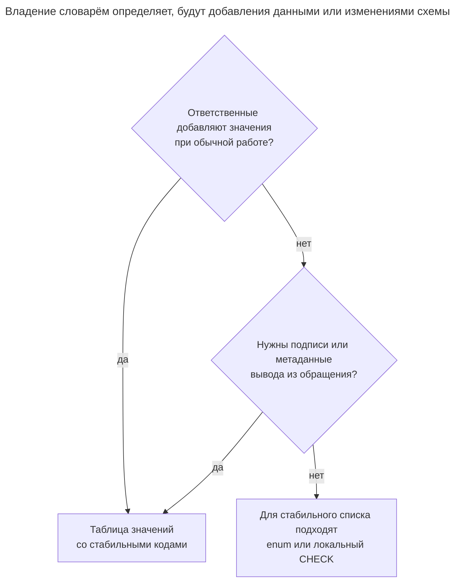
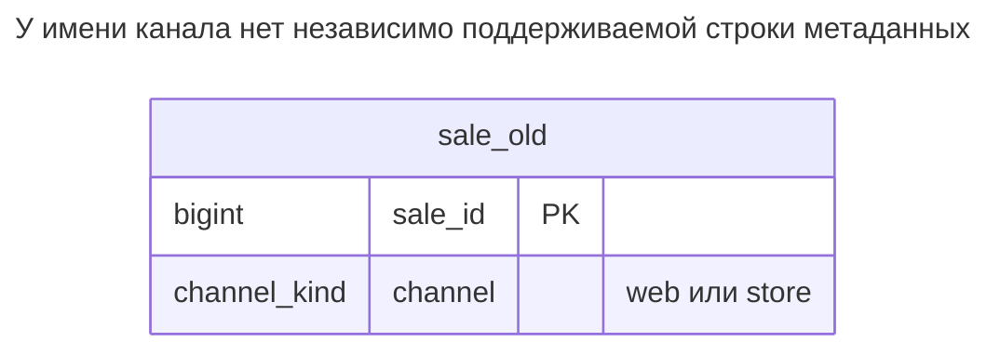
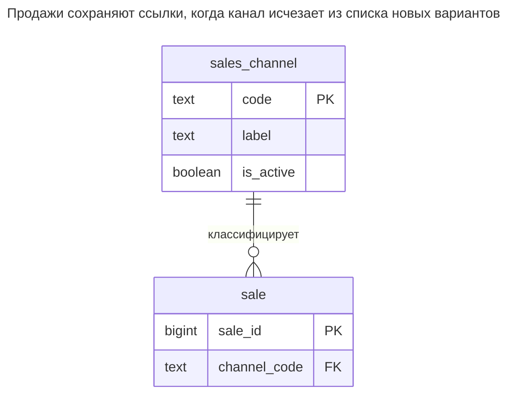
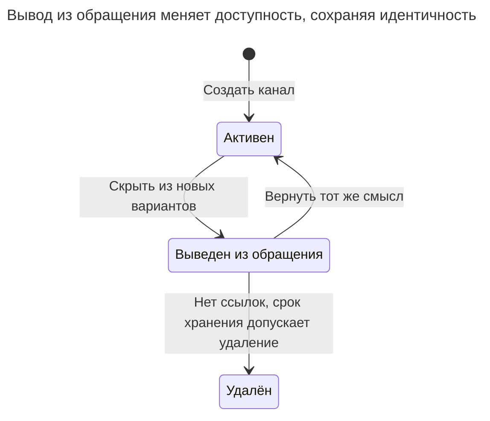
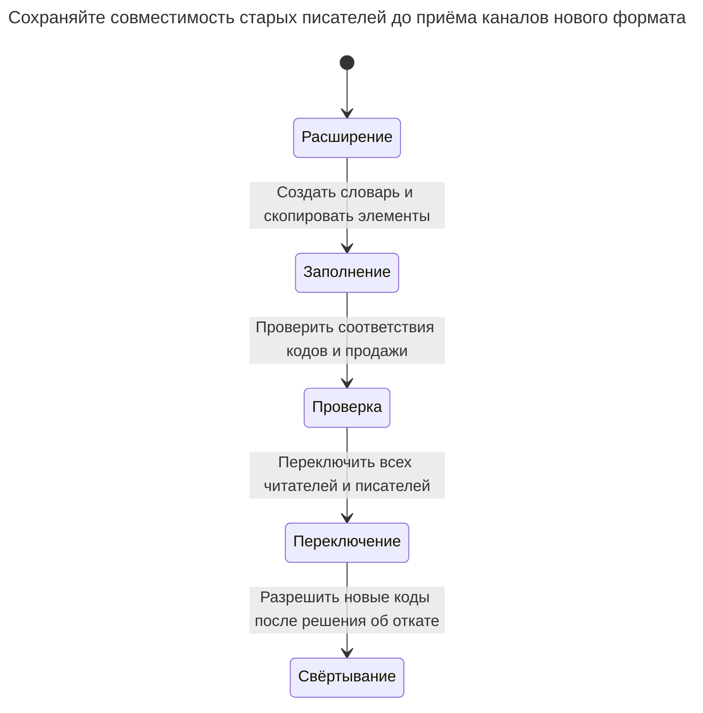

# Изменчивые перечисления

Изменчивые перечисления помещают список, который меняется вместе с бизнес-данными — категории товаров, регионы, каналы продаж, — в тип enum или ограничение CHECK. Тогда каждому новому значению нужна миграция схемы, удаление значения enum PostgreSQL требует пересоздания типа, а для списка допустимых значений приложение должно изучать схему или дублировать её список в коде. Глава показывает, когда такие списки принадлежат таблице значений, а когда стабильный enum всё ещё лучше. Билл Карвин называет это 31 Flavors.

## Также известен как

31 Flavors в [оглавлении SQL Antipatterns Билла Карвина](https://pragprog.com/titles/bksap1/sql-antipatterns-volume-1/). Здесь вредное условие сужено до поддерживаемых бизнесом словарей, жизненный цикл которых не укладывается в выпуски схемы.

## Контекст

Отдел продаж открывает и закрывает каналы, меняет подписи и выбирает, какие показывать в формах новых заказов. Сначала есть лишь `web` и `store`, поэтому встроенного enum или локального списка `CHECK ... IN (...)` кажется достаточно. Позднее список становится операционными данными, которыми управляют люди, не развёртывающие изменения схемы.

## Проблема

Каждое бизнес-добавление кодируется как DDL, а строки для подписи, доступности и других метаданных нет. [Типы enum](https://www.postgresql.org/docs/18/datatype-enum.html) PostgreSQL имеют порядок объявления и отдельную идентичность типа; существующие элементы нельзя удалить или переставить без пересоздания типа. Это конкретное несоответствие каналам, выводимым из обращения с сохранением смысла старых продаж.

Список CHECK можно заменить, удалив элемент после согласования сохранённых строк, поэтому не называйте удаление невозможным во всех случаях. Оба представления доступны через метаданные схемы. Цена в том, что приложение, поддерживающее варианты выбора, должно понимать представление схемы или синхронизировать с ним второй список.

## Почему так делают

Короткий список схемы сразу даёт проверку без дополнительной таблицы. Небольшой словарь под управлением разработчиков вполне может меняться только с выпусками, особенно если каждому новому значению всё равно нужно новое поведение приложения. Стабильные enum остаются полезными. Антипаттерн начинается, когда добавление категории должно быть обычной бизнес-операцией, но всё ещё требует миграции типа.

## Последствия

- ➖ Бизнес-сопровождение наследует требования к разрешениям DDL, расписанию и совместимости.
- ➖ Скрывать выведенный вариант и сохранять старые ссылки неудобно без метаданных каждого значения.
- ➖ Порядок объявления enum можно ошибочно принять за редактируемый порядок отображения.
- ➖ Принятие нового элемента базой не означает, что старый код приложения его понимает.
- ➖ Повторное использование старого кода с другим смыслом переосмысляет прежние записи при любом представлении.

## Признаки

- Заявка на новый регион или канал требует от разработчика изменения enum.
- Подписи и флаги активности живут в отдельном словаре приложения с написанием enum в качестве ключа.
- Удаление означает удаление кода из типа, хотя исторические строки всё ещё его используют.
- Формирование выпадающих списков читает определения каталога базы при обычных запросах.

## Как лучше

Выделите словарю собственную [Таблицу значений](lookup-table.md) со стабильным ключом и изменяемыми атрибутами представления. Ссылайтесь на ключ из продаж. Выводите запись из обращения без удаления; различайте существование и доступность для нового назначения. Пример обеспечивает целостность принадлежности и запрос вариантов. Присвоение только активных значений требует дополнительного синхронизированного правила записи из главы о таблице значений.

### Альтернативы и выбор

| Выбор | Связь | Когда выбирать |
| --- | --- | --- |
| [Таблица значений](lookup-table.md) | Замена | Значениям нужны подписи, вывод из обращения или обычное бизнес-сопровождение |
| Enum PostgreSQL | Вариант реализации стабильного словаря | Тип под управлением разработчиков имеет небольшой набор элементов, меняющийся с выпусками |
| Локальный список CHECK | Вариант реализации | Небольшое стабильное правило принадлежит одному столбцу и не требует метаданных |
| Таблица значений с защищённым присвоением | Дополнение | Старые значения должны читаться, но отклонять новые назначения |

Полное сравнение — в [Атласе решений](decision-atlas.md). Таблица меняет сопровождение вариантов выбора, а не развёртывание кода, который ветвится по ним.



Постоянно фиксированное техническое различие может остаться в DDL. Одна потребность в метаданных может оправдать строки, даже если добавления редки.

## Пример

### Структура

**Было:** допустимые каналы находятся внутри определения типа.



Пользовательский тип ограничивает сохранённое написание. Он не даёт каждому каналу подпись или состояние вывода из обращения.

```sql
CREATE TYPE channel_kind AS ENUM ('web', 'store');
CREATE TABLE sale_old (sale_id bigint PRIMARY KEY, channel channel_kind NOT NULL);
INSERT INTO sale_old VALUES (1, 'web'), (2, 'store');
```

Новый согласованный канал отклоняется:

```sql
INSERT INTO sale_old VALUES (3, 'partner');
```

PostgreSQL 18.6 возвращает SQLSTATE `22P02`: `ERROR: invalid input value for enum channel_kind: "partner"`. [`ALTER TYPE ... ADD VALUE`](https://www.postgresql.org/docs/18/sql-altertype.html) расширяет тип, но добавленное внутри транзакции значение нельзя использовать до её фиксации.

**Стало:** каналы — данные, на которые можно ссылаться.



Каждой продаже нужен один существующий канал. FK проверяет код, а не `is_active`.

```sql
CREATE TABLE sales_channel (
    code text PRIMARY KEY,
    label text NOT NULL,
    is_active boolean NOT NULL DEFAULT true
);
CREATE TABLE sale (
    sale_id bigint PRIMARY KEY,
    channel_code text NOT NULL,
    CONSTRAINT sale_channel_fk FOREIGN KEY (channel_code) REFERENCES sales_channel (code)
);
CREATE INDEX sale_channel_idx ON sale (channel_code);
BEGIN;
LOCK TABLE sale_old IN SHARE ROW EXCLUSIVE MODE;
INSERT INTO sales_channel (code, label)
SELECT DISTINCT channel::text, initcap(channel::text) FROM sale_old;
INSERT INTO sale SELECT sale_id, channel::text FROM sale_old;
COMMIT;
BEGIN;
INSERT INTO sales_channel (code, label) VALUES ('partner', 'Partner sales');
INSERT INTO sale VALUES (3, 'partner');
COMMIT;
UPDATE sales_channel SET is_active = false WHERE code = 'store';
SELECT code, label FROM sales_channel WHERE is_active ORDER BY code;
SELECT s.sale_id, c.label, c.is_active FROM sale AS s
JOIN sales_channel AS c ON c.code = s.channel_code ORDER BY s.sale_id;
```

Варианты выбора — `partner, web`. Чтение продаж сохраняет продажу `2` с подписью `Store` и `is_active = false`; ни одна продажа не исчезает из соединения. Новый канал и его первая продажа вставляются в одной транзакции. [Полный скрипт](../assets/volatile-enums/volatile-enums.sql) проверяет ошибку enum, миграцию и следующие две ошибки принадлежности.

```sql
INSERT INTO sale VALUES (4, 'unknown');
```

Это возвращает SQLSTATE `23503`: `ERROR: insert or update on table "sale" violates foreign key constraint "sale_channel_fk"`.

```sql
DELETE FROM sales_channel WHERE code = 'store';
```

Удаление используемого `store` возвращает SQLSTATE `23503`: `ERROR: update or delete on table "sales_channel" violates foreign key constraint "sale_channel_fk" on table "sale"`. Намерением было снять флаг активности.

### Поддержка в движках

- **PostgreSQL 18:** осознанно используйте [правила порядка и развития enum](https://www.postgresql.org/docs/18/datatype-enum.html). Независимо меняющийся порядок отображения принадлежит данным.
- **MySQL 8.4:** [`ENUM` объявляется на столбце, сортируется по позиции элемента и имеет особый элемент неверного значения](https://dev.mysql.com/doc/refman/8.4/en/enum.html). Строгий режим отклоняет неверный ввод; нестрогая запись или подавление ошибок могут давать результаты, отличные от ошибки PostgreSQL выше.
- **SQL Server:** [тип-псевдоним](https://learn.microsoft.com/en-us/sql/t-sql/statements/create-type-transact-sql?view=sql-server-ver17) — не перечислимый тип PostgreSQL. Для принадлежности значений выбирайте CHECK или таблицу с FK.
- **Oracle:** [домены SQL](https://docs.oracle.com/en/database/oracle/oracle-database/26/sqlrf/create-domain.html) централизуют правила значений. Повторно используемая проверка всё равно не создаёт редактируемую строку на канал.
- **SQLite:** [выражения CHECK](https://www.sqlite.org/lang_createtable.html#check_constraints) ограничивают фиксированные текстовые значения; таблице с FK нужно [включение проверки в каждом соединении](https://www.sqlite.org/foreignkeys.html#fk_enable).

### Сбои и конкурентность

Закешированная форма может отправить код после вывода из обращения. FK примера всё ещё принимает существующий неактивный код, потому что доступность вне его ключа. Если это должно завершаться ошибкой, блокируйте и проверяйте доступность при присвоении, а вывод из обращения включите в тот же протокол; реализацию даёт [Таблица значений](lookup-table.md). Один запрос вариантов не обеспечивает правило.



Существующие ссылки переживают вывод из обращения. Реактивация кода уместна лишь для прежнего смысла; новому смыслу нужна новая идентичность.

### Миграция

Составьте список сохранённых элементов и создайте строку на каждый, включая неактивные. Пример получает начальный словарь из использованных элементов; промышленная миграция должна добавить и допустимые неиспользованные элементы из утверждённого словаря. Добавьте текстовый столбец ссылки или теневую таблицу, синхронизируйте запись и заполните по явному соответствию кодов. Проверьте принадлежность до переключения чтения.



Новый код, который не представляет старый enum, закрывает путь отката к старому коду. Отложите его приём до ухода старых писателей или до запуска определите отображение совместимости. Сохраняйте исходные данные до конца сверки и не обещайте отсутствие блокировок при замене типа или изменении CHECK; см. [правила ALTER TABLE PostgreSQL](https://www.postgresql.org/docs/18/sql-altertable.html) и [Расширение и свёртывание](expand-contract.md).

## Связанные паттерны и антипаттерны

- [Таблица значений](lookup-table.md) сравнивает enum, CHECK, домен и справочные данные.
- [Отсутствующие внешние ключи](missing-foreign-keys.md) объясняет, почему выпадающий список не заменяет контроль принадлежности.
- [Расширение и свёртывание](expand-contract.md) поэтапно меняет совместимость схемы и приложения.
