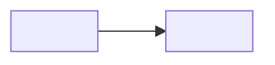

# <Pattern name>

## Intent

<What the pattern solves, in one paragraph.>

## Also known as

<Synonyms and the names the sources use (Fowler, Karwin, vendor docs). Remove the section if none.>

## Problem

<The situation and forces that lead to the pattern. Why the naive schema fails.>

## Solution

<The idea at the level of principle: which tables, keys and constraints carry it.>

## Alternatives and selection

<A compact decision panel: the sibling patterns that solve the same problem, and which requirement tips the choice. Say whether each sibling is a replacement, a complement, or an implementation option. Link the matching table in the Decision Atlas.>

## Structure

<Name the tables, their keys and cardinalities, and the relationship the reader should notice.>



<Walk through the diagram: what each table holds and how they reference each other.>

## Tables and invariants

- **<table>** <holds what; its key; the invariant it guarantees and the constraint that enforces it>.

## When to use

- <Condition under which the pattern fits.>

## Consequences and trade-offs

- ➕ <Benefit.>
- ➖ <Cost / risk.>

## Implementation

<Representative DDL, then the typical operations: insert, read, change. Show one invalid operation the schema rejects and the error it raises. Keep essential SQL inline; the full runnable script lives in `../assets/<slug>/`.>

```sql
-- <DDL>
```

## Engine support

<PostgreSQL is the reference engine. Note where other engines differ: native support, emulation, an extension, or a weaker guarantee. Name the engine version.>

## Failure and concurrency

<What happens under concurrent writes, retries and partial failures; which isolation level or lock the pattern needs; what breaks when it is missing.>

## Migration

<How to reach the pattern from the usual starting schema without downtime, and how to back out.>

## Anti-patterns and common mistakes

- <A typical mistake and what it leads to.>

## Known uses

- <Where it shows up: engines, frameworks, public schemas.>

## Related patterns

- [<Name>](<slug>.md) <explains or complements the chosen approach>.
