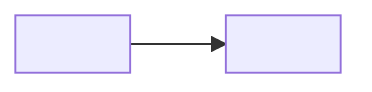

# <Nombre del patrón>

## Propósito

<Qué resuelve el patrón, en un párrafo.>

## También conocido como

<Sinónimos y los nombres que usan las fuentes (Fowler, Karwin, documentación de los motores). Elimina la sección si no hay.>

## Problema

<La situación y las fuerzas que llevan al patrón. Por qué falla el esquema ingenuo.>

## Solución

<La idea a nivel de principio: qué tablas, claves y restricciones la sostienen.>

## Alternativas y elección

<Un panel de decisión breve: los patrones hermanos que resuelven el mismo problema y el requisito que inclina la elección. Indica si cada uno es un reemplazo, un complemento o una opción de implementación. Enlaza la tabla correspondiente del Atlas de decisiones.>

## Estructura

<Nombra las tablas, sus claves y cardinalidades, y la relación en la que el lector debe fijarse.>



<Explica qué guarda cada tabla y cómo se referencian entre sí.>

## Tablas e invariantes

- **<tabla>** <qué guarda; su clave; qué invariante garantiza y con qué restricción>.

## Cuándo aplicarlo

- <Condición en la que el patrón encaja.>

## Consecuencias y compromisos

- ➕ <Beneficio.>
- ➖ <Coste / riesgo.>

## Implementación

<DDL representativo y después las operaciones típicas: insertar, leer, modificar. Muestra una operación inválida que el esquema rechaza y el error que produce. El SQL esencial va en el texto; el script ejecutable completo, en _../assets/\<slug\>/_.>

```sql
-- <DDL>
```

## Soporte en los motores

<El motor de referencia es PostgreSQL. Indica en qué difieren otros motores: soporte nativo, emulación, una extensión o una garantía más débil. Indica la versión del motor.>

## Fallos y concurrencia

<Qué ocurre con escrituras concurrentes, reintentos y fallos parciales; qué nivel de aislamiento o bloqueo necesita el patrón; qué se rompe sin él.>

## Migración

<Cómo llegar al patrón desde el esquema de partida habitual sin tiempo de inactividad y cómo revertirlo.>

## Antipatrones y errores comunes

- <Un error típico y a qué conduce.>

## Usos conocidos

- <Dónde aparece: motores, frameworks, esquemas públicos.>

## Patrones relacionados

- [<Nombre>](<slug>.md) <explica o complementa el enfoque elegido>.
