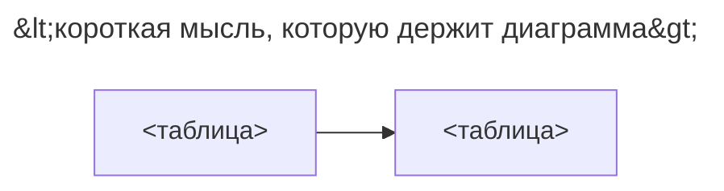

# <Название паттерна>

## Назначение

<Что решает паттерн, одним абзацем.>

## Также известен как

<Синонимы и названия из источников (Фаулер, Карвин, документация движков). Убрать раздел, если нет.>

## Проблема

<Ситуация и силы, которые приводят к паттерну. Почему наивная схема не работает.>

## Решение

<Идея паттерна на уровне принципа: какие таблицы, ключи и ограничения её несут.>

## Альтернативы и выбор

<Короткая панель выбора: соседние паттерны, которые решают ту же задачу, и требование, от которого зависит выбор. Укажите, заменяет ли соседний паттерн этот, дополняет его или служит вариантом реализации. Дайте ссылку на таблицу в «Атласе решений».>

## Структура

<Назовите таблицы, их ключи и кардинальности и связь, на которую читателю нужно обратить внимание.>



<Объясните, что хранит каждая таблица и как они ссылаются друг на друга.>

## Таблицы и инварианты

- **<таблица>** <что хранит; её ключ; какой инвариант гарантирует и каким ограничением>.

## Когда применять

- <Условие, при котором паттерн уместен.>

## Последствия и компромиссы

- ➕ <Выгода.>
- ➖ <Цена / риск.>

## Реализация

<Показательный DDL, затем типовые операции: вставка, чтение, изменение. Покажите одну недопустимую операцию, которую схема отклоняет, и ошибку, которую она вызывает. Главный SQL — прямо в тексте; полный запускаемый скрипт — в _../assets/\<slug\>/_.>

```sql
-- <DDL>
```

## Поддержка в движках

<Эталонный движок — PostgreSQL. Отметьте, чем отличаются другие движки: встроенная поддержка, эмуляция, расширение или более слабая гарантия. Укажите версию движка.>

## Сбои и конкурентность

<Что происходит при конкурентной записи, повторах и частичных сбоях; какой уровень изоляции или блокировка нужны паттерну; что ломается без них.>

## Миграция

<Как прийти к паттерну от типичной исходной схемы без простоя и как откатиться.>

## Антипаттерны и частые ошибки

- <Типичная ошибка и во что она выливается.>

## Известные применения

- <Где встречается: движки, фреймворки, публичные схемы.>

## Связанные паттерны

- [<Название>](<slug>.md) <объясняет или дополняет выбранный подход>.
